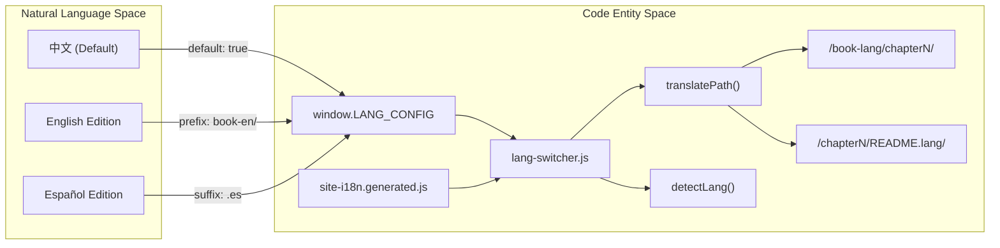

<!-- source: DeepWiki mcp.deepwiki.com · repo bojieli/ai-agent-book · page 1.3 Online Documentation Site and Localization · fetched 2026-10-26 -->

# Online Documentation Site and Localization

<details>
<summary>Relevant source files</summary>

The following files were used as context for generating this wiki page:

- [.github/workflows/deploy-pages.yml](.github/workflows/deploy-pages.yml)
- [.github/workflows/i18n-check.yml](.github/workflows/i18n-check.yml)
- [.github/workflows/star-history.yml](.github/workflows/star-history.yml)
- [assets/star-history-dark.png](assets/star-history-dark.png)
- [assets/star-history-light.png](assets/star-history-light.png)
- [docs/STATIC_SITE_I18N.md](docs/STATIC_SITE_I18N.md)
- [extras/auto-translate.css](extras/auto-translate.css)
- [extras/auto-translate.js](extras/auto-translate.js)
- [extras/book-theme.css](extras/book-theme.css)
- [extras/lang-switcher.css](extras/lang-switcher.css)
- [extras/lang-switcher.js](extras/lang-switcher.js)
- [extras/nav-collapse.js](extras/nav-collapse.js)
- [extras/search-index-router.js](extras/search-index-router.js)
- [extras/site-nav-i18n.json](extras/site-nav-i18n.json)
- [index.ko.md](index.ko.md)
- [index.md](index.md)
- [mkdocs.yml](mkdocs.yml)
- [overrides/main.html](overrides/main.html)
- [overrides/partials/header.html](overrides/partials/header.html)
- [requirements-docs.txt](requirements-docs.txt)
- [scripts/build_site.sh](scripts/build_site.sh)
- [scripts/check_i18n_consistency.py](scripts/check_i18n_consistency.py)
- [scripts/clean_site_files.py](scripts/clean_site_files.py)
- [scripts/gen_star_history.py](scripts/gen_star_history.py)
- [scripts/git_revision_dates.py](scripts/git_revision_dates.py)
- [scripts/mkdocs_pandoc_strip.py](scripts/mkdocs_pandoc_strip.py)
- [scripts/site_edit_urls.py](scripts/site_edit_urls.py)
- [scripts/site_i18n.py](scripts/site_i18n.py)
- [scripts/site_source_paths.py](scripts/site_source_paths.py)
- [scripts/split_search_index.py](scripts/split_search_index.py)
- [scripts/star-history-data.json](scripts/star-history-data.json)
- [tests/js/auto-translate.test.js](tests/js/auto-translate.test.js)
- [tests/test_core_clean_site_links.py](tests/test_core_clean_site_links.py)
- [tests/test_gen_star_history_iso_formats.py](tests/test_gen_star_history_iso_formats.py)
- [tests/test_git_revision_dates.py](tests/test_git_revision_dates.py)
- [tests/test_mkdocs_pandoc_strip.py](tests/test_mkdocs_pandoc_strip.py)
- [tests/test_mkdocs_pandoc_strip_null.py](tests/test_mkdocs_pandoc_strip_null.py)
- [tests/test_site_edit_urls.py](tests/test_site_edit_urls.py)
- [tests/test_site_i18n.py](tests/test_site_i18n.py)
- [tests/test_split_search_index.py](tests/test_split_search_index.py)

</details>


The AI Agent Engineering Book online documentation site is a static site built using **MkDocs Material**. It serves as the primary reading interface for the book's 10 chapters and 94 companion experiments across 13 supported languages. The system utilizes a hybrid localization strategy, combining build-time assembly with client-side URL rewriting and navigation translation.

## Site Build Pipeline

The build process is managed by `scripts/build_site.sh`, which assembles a staging directory `_web/` from the repository root before invoking `mkdocs build`.

### Data Flow and Assembly
The pipeline performs several critical transformations to adapt the repository's "monorepo" structure into a web-friendly format:

1.  **Staging Preparation**: The `_web/` directory is created to isolate site content from code and LaTeX sources [scripts/build_site.sh:9-12]().
2.  **Chapter Promotion**: For the default Chinese edition, chapter files (e.g., `chapter1.md`) are moved into subdirectories as `index.md` (e.g., `chapter1/index.md`). This allows the `navigation.indexes` feature in `mkdocs.yml` to make chapter titles clickable in the sidebar [scripts/build_site.sh:34-51]().
3.  **Link Rewriting**: Relative links in experiment `README.md` files are adjusted to ensure they resolve correctly within the MkDocs directory structure. For example, GitHub-style `.md` suffixes are stripped, and links in translated experiment indexes are prefixed with `../` to point back to the language-agnostic experiment folders [scripts/build_site.sh:93-132]().
4.  **Asset Filtering**: `scripts/clean_site_files.py` is invoked to remove large datasets (e.g., legal document sets in Chapter 3) and `node_modules` that are not required for the reading site [scripts/build_site.sh:75-91]().

### Build Pipeline Diagram
The following diagram illustrates the transformation from the source repository to the deployed GitHub Pages site.

**Static Site Assembly Flow**
```mermaid
graph TD
    subgraph "Source Space"
        [index.md] --> BSH["scripts/build_site.sh"]
        [book/*.md] --> BSH
        [chapter*/*.md] --> BSH
        [extras/*] --> BSH
    end

    subgraph "Staging Space (_web/)"
        BSH --> W_IDX["_web/index.md"]
        BSH --> W_CH["_web/book/chapterN/index.md"]
        BSH --> W_EXP["_web/chapterN/README.md"]
        BSH --> W_EXT["_web/extras/"]
    end

    subgraph "Build Engine"
        W_IDX --> MKD["mkdocs build"]
        W_CH --> MKD
        W_EXP --> MKD
        W_EXT --> MKD
        MYML["mkdocs.yml"] --> MKD
        GRD["scripts/git_revision_dates.py"] -.-> MKD
        SI18N["scripts/site_i18n.py"] -.-> MKD
    end

    MKD --> SITE["site/ (HTML/JS/CSS)"]
    SITE --> GHA["deploy-pages.yml"]
```
Sources: [scripts/build_site.sh:1-134](), [mkdocs.yml:8-23](), [.github/workflows/deploy-pages.yml:16-40]()

## Localization Strategy

The site supports 13 language editions including `zh`, `en`, `es`, `id`, `ru`, `ta`, `vi`, `ja`, `ar`, `tr`, `ko`, `hu`, and `he` [scripts/build_site.sh:29](). It uses a **hybrid localization** approach to handle the mix of translated prose and language-agnostic code experiments.

### Client-Side Language Switcher
The `extras/lang-switcher.js` script handles language transitions without requiring a full page reload for every configuration change.

*   **Language Configuration**: The configuration is injected into the global `window.LANG_CONFIG` by the header template [overrides/partials/header.html:108]().
*   **Path Translation**: The `translatePath` function in `lang-switcher.js` maps the current URL to its equivalent in the target language [extras/lang-switcher.js:94-161](). It handles three primary cases:
    1.  **Site Home**: Maps `/` to `/index.<code>/` if a translated homepage exists [extras/lang-switcher.js:104-107]().
    2.  **Chapter Prose**: Rewrites `/book/chapter1/` to `/book-en/chapter1/` based on prefix/suffix rules [extras/lang-switcher.js:121-125]().
    3.  **Experiment Indexes**: Maps `/chapter1/` to `/chapter1/README.<readmeSuffix>/` [extras/lang-switcher.js:151-161]().
*   **Search Index Splitting**: To prevent the search index from becoming bloated, `scripts/split_search_index.py` splits the `search_index.json` into one file per book edition [mkdocs.yml:27-30]().

### Theme Overrides and UX
The site uses a custom CSS file `extras/book-theme.css` to "de-materialize" the theme, adopting a flatter aesthetic inspired by `icyfenix.cn` [extras/book-theme.css:1-14](). 

*   **Navigation Collapser**: The left sidebar (book structure) can be toggled via a button in the header [overrides/partials/header.html:33-42](). The state is persisted in `localStorage` to prevent UI flickering during navigation [overrides/partials/header.html:22-28]().
*   **CJK Search**: The search plugin is configured with `ja` and `ko` tokenizers to improve Chinese, Japanese, and Korean search quality [mkdocs.yml:98-103]().

**Localization Entity Mapping**

Sources: [extras/lang-switcher.js:31-74](), [extras/lang-switcher.js:94-161](), [mkdocs.yml:149-163](), [overrides/partials/header.html:84-109]()

## Automation and CI/CD

### GitHub Actions Deployment
The site is automatically deployed via `.github/workflows/deploy-pages.yml` on every push to the `main` branch.
1.  **Build Job**: Installs dependencies from `requirements-docs.txt` and runs `scripts/build_site.sh` before `mkdocs build` [deploy-pages.yml:32-36]().
2.  **Deploy Job**: Publishes the `site/` artifact to GitHub Pages [deploy-pages.yml:53-55]().

### Git Revision Mapping
Because the build process moves files into a staging directory (`_web/`), standard Git timestamp plugins would fail. The `scripts/git_revision_dates.py` hook maps staged files back to their original tracked paths in the repository using `source_path_for_page` so that MkDocs can accurately display the "Last Updated" date for each page [mkdocs.yml:14-17](), [scripts/site_source_paths.py:15-31]().

### Star History Automation
The repository includes a `star-history.yml` workflow that runs daily to generate updated star growth charts [star-history.yml:4-6]().
*   **Function**: Calls `scripts/gen_star_history.py` to fetch star timestamps via the GitHub GraphQL API [star-history.yml:32-36](), [scripts/gen_star_history.py:4-6]().
*   **Incremental Updates**: Star counts are stored in `scripts/star-history-data.json` as per-hour counts to allow incremental fetching [scripts/gen_star_history.py:52-55](), [scripts/star-history-data.json:1-15]().
*   **Output**: Generates `assets/star-history-light.png` and `assets/star-history-dark.png` [assets/star-history-light.png:1-8](), [assets/star-history-dark.png:1-14]().

Sources: [.github/workflows/deploy-pages.yml:1-54](), [.github/workflows/star-history.yml:1-46](), [mkdocs.yml:14-23](), [scripts/build_site.sh:1-134](), [scripts/gen_star_history.py:1-184]()

---

