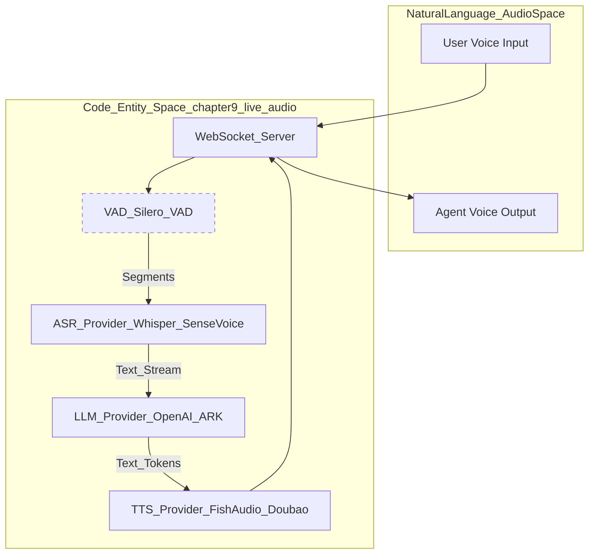
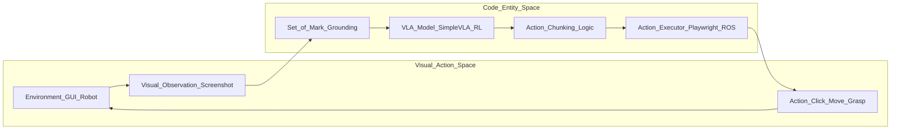

<!-- source: DeepWiki mcp.deepwiki.com · repo bojieli/ai-agent-book · page 10 Multimodal and Real-Time Interaction (Chapter 9) · fetched 2026-10-26 -->

# Multimodal and Real-Time Interaction (Chapter 9)

Relevant source files

The following files were used as context for generating this wiki page:

- [book-ar/chapter6.ar.md](book-ar/chapter6.ar.md)
- [book-ar/chapter9.ar.md](book-ar/chapter9.ar.md)
- [book-en/chapter6.md](book-en/chapter6.md)
- [book-en/chapter9.md](book-en/chapter9.md)
- [book-es/chapter6.es.md](book-es/chapter6.es.md)
- [book-es/chapter9.es.md](book-es/chapter9.es.md)
- [book-hu/chapter6.md](book-hu/chapter6.md)
- [book-hu/chapter9.md](book-hu/chapter9.md)
- [book-id/chapter6.md](book-id/chapter6.md)
- [book-id/chapter9.md](book-id/chapter9.md)
- [book-ja/chapter6.ja.md](book-ja/chapter6.ja.md)
- [book-ja/chapter9.ja.md](book-ja/chapter9.ja.md)
- [book-ko/chapter6.ko.md](book-ko/chapter6.ko.md)
- [book-ko/chapter9.ko.md](book-ko/chapter9.ko.md)
- [book-ru/chapter6.md](book-ru/chapter6.md)
- [book-ru/chapter9.md](book-ru/chapter9.md)
- [book-ta/chapter6.ta.md](book-ta/chapter6.ta.md)
- [book-ta/chapter9.ta.md](book-ta/chapter9.ta.md)
- [book-tr/chapter6.tr.md](book-tr/chapter6.tr.md)
- [book-tr/chapter9.tr.md](book-tr/chapter9.tr.md)
- [book-vi/chapter6.vi.md](book-vi/chapter6.vi.md)
- [book-vi/chapter9.vi.md](book-vi/chapter9.vi.md)
- [book-zhtw/chapter6.zhtw.md](book-zhtw/chapter6.zhtw.md)
- [book-zhtw/chapter9.zhtw.md](book-zhtw/chapter9.zhtw.md)

This page provides an overview of multimodal Agent architectures, focusing on the transition from static text processing to real-time interaction with the physical and digital world. It covers the evolution of voice interaction pipelines, GUI automation (Computer Use), and robotic Vision-Language-Action (VLA) control.

While static multimodal perception (e.g., analyzing a single image or PDF) is treated as a standard tool call in earlier chapters, Chapter 9 addresses scenarios where input is continuous and latency is critical. The core thesis is that when the underlying model is fixed, the primary engineering lever for improving performance is expanding the **observation space** and **action space** across two axes: **Modality** (form) and **Timing** (rhythm) [book-en/chapter6.md:1-14]().

## Two Axes of Expansion: Modality and Timing

Traditional agents operate on a turn-based premise where the world stands still while the agent thinks [book-en/chapter6.md:5-7](). Multimodal and real-time agents break this by expanding into:

*   **Modality:** Moving beyond text to hear sound, see screens, and sense physical torque; and acting by speaking, clicking, or driving robotic joints [book-en/chapter6.md:12-13]().
*   **Timing:** Moving from "pulling" observations to having the world "push" them (continuous streams). Actions may span multiple turns, be interrupted, or be preempted by urgent events [book-en/chapter6.md:14-15]().

### Interaction Scale and Scenarios

| Scale | Scenario | Observation Change | Action Change |
| :--- | :--- | :--- | :--- |
| **Seconds — Days** | Async & Event-Driven | World wakes Agent (mail, timers) | Actions span turns; finish via event |
| **10ms — 1s** | Voice | Listen while speaking | Think while speaking; interruptible |
| **Sub-second** | Computer Use | Screen changes between frames | Re-confirm reality against plan |
| **Milliseconds** | Robotics | Continuous sensor feedback | Action chunking; preemptible |

**Sources:** [book-en/chapter6.md:25-31]()

## Voice Interaction: VAD-ASR-LLM-TTS Pipeline

Voice interaction has evolved through three primary paradigms to minimize latency and preserve paralinguistic information such as prosody and emotion [book-en/chapter6.md:29]().

*   **Cascaded (Modular):** A serial pipeline of Voice Activity Detection (VAD), Automatic Speech Recognition (ASR), Large Language Model (LLM), and Text-to-Speech (TTS). This suffers from high cumulative latency [book-en/chapter6.md:41-47]().
*   **Full-Duplex (Interactive):** Models that listen and speak simultaneously, making real-time decisions on whether to interrupt or respond without relying on traditional silence thresholds [book-en/chapter6.md:29]().

### Voice Interaction Architecture

The following diagram illustrates the flow from raw audio input to synthesized response, mapping high-level concepts to implementation components.

**Sources:** [book-en/chapter6.md:29](), [book-en/chapter6.md:49-51]()

For details on streaming optimizations and full-duplex models, see **[Voice Interaction: VAD-ASR-LLM-TTS Pipeline](#10.1)**.

## Computer Use and Robotic VLA Control

This section covers how Agents interact with graphical user interfaces (GUIs) and physical hardware. The core challenge is mapping high-level goals to precise coordinates and actions [book-en/chapter6.md:30-31]().

*   **Computer Use:** Agents navigate operating systems using techniques like **Set-of-Mark (SoM)** visual grounding and **Accessibility Trees**. The environment is dynamic; the screen may change between the agent's observation and its action [book-en/chapter6.md:30]().
*   **Robotic VLA:** Vision-Language-Action models translate visual observations directly into motor commands. Because sensors flow back without pause, actions are often "chunked"—planned in short segments that can be preempted if the environment changes (e.g., a cup being knocked over) [book-en/chapter6.md:24-31]().

### VLA Control Loop

This diagram bridges the physical/visual environment with the code-level action execution.

**Sources:** [book-en/chapter6.md:9-31](), [book-en/chapter9.md:13-15]()

## Event-Driven Asynchrony

To support real-time interaction, the architecture must move from synchronous "polling" to an event-driven model [book-en/chapter6.md:49](). OpenClaw implements this via:
*   **Hooks:** Responding to lifecycle events like session creation [book-en/chapter6.md:57]().
*   **Cron & Heartbeat:** Time-driven triggers for proactive tasks [book-en/chapter6.md:58-59]().
*   **External Channels:** Real-time push for events like incoming calls or API callbacks [book-en/chapter6.zhtw.md:85]().

For details on GUI automation and VLA training, see **[Computer Use and Robotic VLA Control](#10.2)**.

## Related Code Experiments
*   **OpenClaw Event Loop:** Implementation of hooks, cron, and heartbeat mechanisms [book-en/chapter6.md:53-60]().
*   **Dynamic Form Generation:** Intent clarification via generated HTML forms to reduce multi-turn latency [chapter5/dynamic-form/demo.py:1-13]().
*   **PineClaw Channel:** Real-time event channel between Gateway and external telephony APIs [book-en/chapter6.zhtw.md:73-75]().
*   **Monitor Shell:** Tracking background task progress without blocking the main agent loop [book-en/chapter6.zhtw.md:83]().

**Sources:** [book-en/chapter6.md:1-60](), [book-en/chapter6.zhtw.md:61-85](), [chapter5/dynamic-form/demo.py:1-31]()

---

