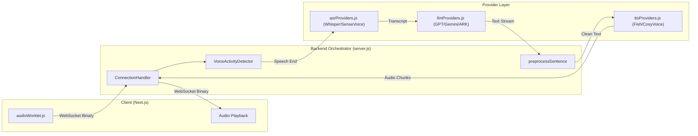
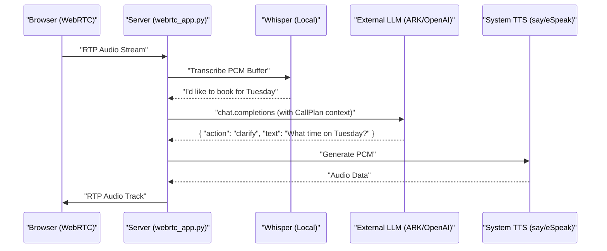

<!-- source: DeepWiki mcp.deepwiki.com · repo bojieli/ai-agent-book · page 10.1 Voice Interaction: VAD-ASR-LLM-TTS Pipeline · fetched 2026-10-26 -->

# Voice Interaction: VAD-ASR-LLM-TTS Pipeline

Relevant source files

The following files were used as context for generating this wiki page:

- [book-ar/chapter6.ar.md](book-ar/chapter6.ar.md)
- [book-ar/chapter9.ar.md](book-ar/chapter9.ar.md)
- [book-en/chapter6.md](book-en/chapter6.md)
- [book-en/chapter9.md](book-en/chapter9.md)
- [book-es/chapter6.es.md](book-es/chapter6.es.md)
- [book-es/chapter9.es.md](book-es/chapter9.es.md)
- [book-hu/chapter6.md](book-hu/chapter6.md)
- [book-hu/chapter9.md](book-hu/chapter9.md)
- [book-id/chapter6.md](book-id/chapter6.md)
- [book-id/chapter9.md](book-id/chapter9.md)
- [book-ja/chapter6.ja.md](book-ja/chapter6.ja.md)
- [book-ja/chapter9.ja.md](book-ja/chapter9.ja.md)
- [book-ko/chapter6.ko.md](book-ko/chapter6.ko.md)
- [book-ko/chapter9.ko.md](book-ko/chapter9.ko.md)
- [book-ru/chapter6.md](book-ru/chapter6.md)
- [book-ru/chapter9.md](book-ru/chapter9.md)
- [book-ta/chapter6.ta.md](book-ta/chapter6.ta.md)
- [book-ta/chapter9.ta.md](book-ta/chapter9.ta.md)
- [book-tr/chapter6.tr.md](book-tr/chapter6.tr.md)
- [book-tr/chapter9.tr.md](book-tr/chapter9.tr.md)
- [book-vi/chapter6.vi.md](book-vi/chapter6.vi.md)
- [book-vi/chapter9.vi.md](book-vi/chapter9.vi.md)
- [book-zhtw/chapter6.zhtw.md](book-zhtw/chapter6.zhtw.md)
- [book-zhtw/chapter9.zhtw.md](book-zhtw/chapter9.zhtw.md)

This page documents the engineering of real-time voice interaction systems for AI Agents. It covers the evolution from traditional cascaded pipelines to end-to-end Omni models and Full-Duplex architectures, with a specific focus on latency reduction, streaming optimizations, and the implementation found in `chapter9/live-audio/`, `chapter9/streaming-speech/`, and `chapter9/phone-agent/`.

## 1. The Cascaded Pipeline (VAD-ASR-LLM-TTS)

The cascaded architecture is the industry standard for modular voice systems. It decomposes voice interaction into four distinct functional blocks, allowing for pluggable providers.

### 1.1 Data Flow and Component Roles

1.  **VAD (Voice Activity Detection):** Monitors the audio stream to distinguish between speech and background noise. The `VoiceActivityDetector` in `chapter9/live-audio/` uses Silero VAD to detect end-of-speech triggers [chapter9/live-audio/backend/server.js:62-62](), [chapter9/live-audio/README.md:7-8]().
2.  **ASR (Automatic Speech Recognition):** Transcribes audio into text. The `SpeechToTextService` manages providers like OpenAI Whisper and SenseVoice [chapter9/live-audio/backend/server.js:63-63](), [chapter9/live-audio/README.md:21-23]().
3.  **LLM (Large Language Model):** Processes text to generate a response. `LLMProviderFactory` creates instances for GPT-4o, Gemini, or ARK Doubao [chapter9/live-audio/backend/server.js:83-87](), [chapter9/live-audio/README.md:25-29]().
4.  **TTS (Text-to-Speech):** Synthesizes audio. Implementation includes `Fish Audio S1` for controllable markers and `CosyVoice2` [chapter9/controllable-tts/README.md:1-3](), [chapter9/live-audio/README.md:31-32]().

### 1.2 Latency Analysis: Waterfall vs. Streaming

In a naive **Serial Pipeline**, cumulative latency reaches 0.9–2.0 seconds. The `chapter9/live-audio/` implementation utilizes **Full-Link Streaming** to reduce this:
*   **Audio Capture:** The frontend uses `audioWorklet.js` to stream microphone data via WebSockets [chapter9/live-audio/README.md:39-41]().
*   **Sentence Preprocessing:** The `preprocessSentence` function cleans markdown, emojis, and normalizes numbers to speed up TTS synthesis [chapter9/live-audio/backend/utils/textProcessor.js:180-189]().
*   **Concurrent Synthesis:** The backend queues TTS requests to ensure audio playback is ready as soon as the first sentence is processed [chapter9/live-audio/backend/server.js:38-41]().

### Pipeline Architecture Diagram

This diagram maps the conceptual pipeline to the implementation entities in the `live-audio` experiment.

Sources: [chapter9/live-audio/README.md:38-53](), [chapter9/live-audio/backend/server.js:26-78]()

---

## 2. Advanced Paradigms: Omni and Full-Duplex

### 2.1 Paradigm Comparison

| Paradigm | Implementation Example | Input Type | Latency |
| :--- | :--- | :--- | :--- |
| **Cascaded** | `live-audio` | Audio Buffer | High (0.8s+) |
| **Omni (Turn-based)** | `MiniCPM-o 4.5` | Raw WAV (Latent) | Medium (0.5s+) |
| **Streaming Omni** | `Qwen2-Audio` | Growing Prefix | Low-Medium |

### 2.2 End-to-End Omni Models (Experiment 9-4)
`chapter9/end-to-end-speech/` compares two paths using `MiniCPM-o 4.5`:
*   **End-to-End Path:** WAV enters the audio encoder directly, preserving paralinguistic information like speed [chapter9/end-to-end-speech/README.md:5-6]().
*   **Self-Cascade Path:** The model transcribes the audio to text first, then reasons based only on the text [chapter9/end-to-end-speech/README.md:14-20]().
*   **Result:** End-to-end models capture emotion and speed better, while self-cascade is more robust for semantic tasks like math [chapter9/end-to-end-speech/README.md:73-75]().

### 2.3 Growing Prefix Perception (Experiment 9-3)
`chapter9/streaming-speech/` implements `Qwen2-Audio` using a **growing prefix** strategy. Every new chunk `[0:t]` is re-encoded to output transcripts and acoustic events like `<|silence|>` or `<|noise|>` [chapter9/streaming-speech/README.md:1-3](), [chapter9/streaming-speech/demo.py:127-130]().

---

## 3. Specialized Implementations

### 3.1 WebRTC Phone Agent (Experiment 9-2)
The `chapter9/phone-agent/` experiment implements a full-duplex-like experience via WebRTC. It bypasses PSTN by using `aiortc` to handle browser audio streams [chapter9/phone-agent/README.md:1-3]().
*   **CallPlan:** Defines the `goal`, `context`, and `instructions` for the call [chapter9/phone-agent/agent.py:28-39]().
*   **ReAct Planning:** The agent uses an external LLM to identify missing information (e.g., confirmation codes) before initiating the call [chapter9/phone-agent/README.md:21-23]().

### 3.2 Controllable TTS (Experiment 9-5)
`chapter9/controllable-tts/` uses **Fish Audio S1** for zero-shot voice cloning. It supports 24 reference audio combinations (4 emotions × 3 speeds × 2 styles) [chapter9/controllable-tts/README.md:3-10]().
*   **Control Markers:** Uses tags like `[THINKING]` to trigger 1.2s pauses and uncertainty sounds, or `[LAUGH]` for native S1 chuckling [chapter9/controllable-tts/README.md:53-55]().

### 3.3 Audio Logic Flow: User to Phone Agent

Sources: [chapter9/phone-agent/README.md:8-12](), [chapter9/phone-agent/agent.py:126-155]()

---

## 4. Engineering Summary Table

| Feature | Code Entity | File Reference |
| :--- | :--- | :--- |
| **VAD Service** | `VoiceActivityDetector` | [chapter9/live-audio/backend/utils/vad.js:1-20]() |
| **ASR Logic** | `SpeechToTextService` | [chapter9/live-audio/backend/utils/speechToText.js:1-30]() |
| **Omni Client** | `MiniCPMOClient` | [chapter9/end-to-end-speech/speech_model.py:53-70]() |
| **Audio Metadata** | `audio_metadata()` | [chapter9/end-to-end-speech/speech_model.py:37-50]() |
| **Streaming Recognizer**| `Qwen2AudioRecognizer`| [chapter9/streaming-speech/demo.py:122-122]() |
| **Call Plan** | `CallPlan` | [chapter9/phone-agent/agent.py:28-39]() |

Sources: [chapter9/live-audio/README.md](), [chapter9/end-to-end-speech/README.md](), [chapter9/phone-agent/README.md](), [chapter9/controllable-tts/README.md]()

---

