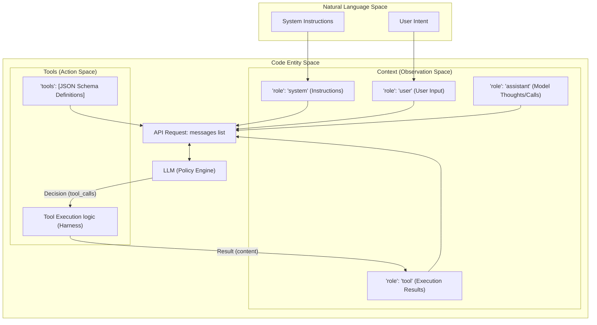
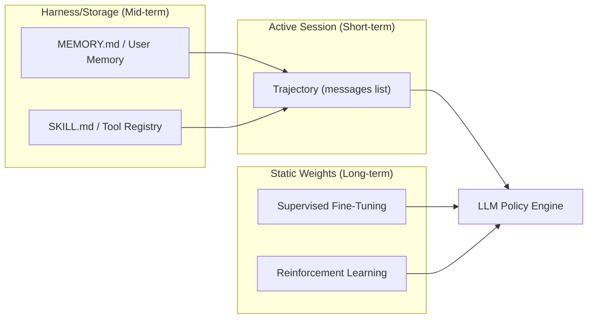

<!-- source: DeepWiki mcp.deepwiki.com · repo bojieli/ai-agent-book · page 2 Core Agent Architecture (Chapter 1) · fetched 2026-10-26 -->

# Core Agent Architecture (Chapter 1)

Relevant source files

The following files were used as context for generating this wiki page:

- [book-ar/chapter1.ar.md](book-ar/chapter1.ar.md)
- [book-en/chapter1.md](book-en/chapter1.md)
- [book-es/chapter1.es.md](book-es/chapter1.es.md)
- [book-hu/chapter1.md](book-hu/chapter1.md)
- [book-id/chapter1.md](book-id/chapter1.md)
- [book-ja/chapter1.ja.md](book-ja/chapter1.ja.md)
- [book-ko/chapter1.ko.md](book-ko/chapter1.ko.md)
- [book-ru/chapter1.md](book-ru/chapter1.md)
- [book-ta/chapter1.ta.md](book-ta/chapter1.ta.md)
- [book-tr/chapter1.tr.md](book-tr/chapter1.tr.md)
- [book-vi/chapter1.vi.md](book-vi/chapter1.vi.md)
- [book-zhtw/chapter1.zhtw.md](book-zhtw/chapter1.zhtw.md)
- [book/chapter1.md](book/chapter1.md)
- [book/chapter10.md](book/chapter10.md)
- [book/chapter2.md](book/chapter2.md)
- [book/chapter3.md](book/chapter3.md)
- [book/chapter4.md](book/chapter4.md)
- [book/chapter5.md](book/chapter5.md)
- [book/chapter6.md](book/chapter6.md)
- [book/chapter7.md](book/chapter7.md)
- [book/chapter8.md](book/chapter8.md)
- [book/chapter9.md](book/chapter9.md)
- [book/reference-answers.md](book/reference-answers.md)

This page provides a high-level overview of the foundational architecture of AI Agents as introduced in Chapter 1. It establishes the "Agent = LLM + Context + Tools" formula and introduces the core execution patterns and engineering philosophies used throughout the repository.

## The Agent Formula: Brain, Eyes, and Hands

The functional essence of a modern AI Agent is defined by the synergy of three core components. This repository treats the **Agent** as the combination of a decision-making model and the engineering harness that surrounds it, distinct from the **Environment** it interacts with [book/chapter1.md:11-13]().

| Component | Role | RL Concept | Description |
| :--- | :--- | :--- | :--- |
| **LLM** | **The Brain** | **Policy** | The reasoning engine responsible for intent parsing, planning, and judgment [book/chapter1.md:15](). |
| **Context** | **The Eyes** | **Observation & History** | The working set of information including environment data, user memory, and task progress [book/chapter1.md:16](). |
| **Tools** | **The Hands** | **Action Interfaces** | The set of interfaces (APIs, code execution) allowing the agent to perceive or change the world [book/chapter1.md:17](). |

### Mapping Natural Language to Code Entities

The following diagram bridges the conceptual "Brain, Eyes, Hands" formula to specific data structures used in modern LLM APIs, specifically the `messages` list and `tools` registry.

**Diagram: Architectural Mapping**

Sources: [book/chapter1.md:23-35](), [book/chapter2.md:45-56]()

---

## The ReAct Loop and Tool Calling

The operational heart of an agent is the **ReAct (Reason + Act)** loop. Instead of a single-turn response, the agent enters a cycle where the next action depends on the cumulative context $c_t$, which includes all prior observations and actions [book/chapter2.md:31-35]().

The tool calling protocol typically follows four stages:
1.  **Declaration**: Developers define tool metadata (name, description, parameters) in the `tools` field [book/chapter2.md:119-147]().
2.  **Decision**: The LLM analyzes the context and emits a `tool_calls` payload instead of a final answer [book/chapter2.md:151-155]().
3.  **Execution**: The Agent framework (the Harness) executes the function and captures the output [book/chapter1.md:81]().
4.  **Response**: The result is sent back to the model with the `tool` role, and the cycle repeats until a final answer is generated [book/chapter2.md:52-53]().

For a deep dive into the four-step protocol and failure modes like tool JSON errors or looping, see **[The ReAct Loop and Tool Calling](#2.1)**.

Sources: [book/chapter1.md:79-81](), [book/chapter2.md:33-35](), [book/chapter2.md:95-101]()

---

## Harness Engineering and Safety

As models become more autonomous, the engineering focus shifts from simple "Prompt Engineering" to **"Harness Engineering."** The Harness is the runtime and governance layer that manages the Model/Environment boundary [book/chapter1.md:25]().

The Harness formula: **Model + Context + Tools + Constrain + Verify + Correct**.

Key engineering pillars include:
*   **Observation/Action Space Expansion**: Improving performance by adding task-relevant data to context or new tools to the action space [book/chapter1.md:41]().
*   **Sandboxing**: Executing high-risk tools (like code execution) in isolated environments with resource limits [book/chapter1.md:103]().
*   **Human-in-the-Loop (HITL)**: Escalating high-risk actions (e.g., payments, deployments) for manual confirmation [book/chapter1.md:107]().
*   **Verification**: Using automated assertions (e.g., `env_assertions`) to judge the success of an agent's trajectory [book/chapter7.md:73-80]().

For details on ACI design, circuit breakers, and safety layers, see **[Harness Engineering and Safety](#2.2)**.

Sources: [book/chapter1.md:25-27](), [book/chapter1.md:103-107](), [book/chapter7.md:17-19]()

---

## Evolution of Learning

Agents in this repository utilize three distinct learning timescales:

1.  **Post-training (RL/SFT)**: Hard-coding foundational capabilities like tool-use and reasoning into model weights [book/chapter8.md:9-12]().
2.  **In-Context Learning (ICL)**: Short-term adaptation using the current conversation history [book/chapter2.md:35]().
3.  **Experience Learning**: Capturing trajectories and reflecting on them to create persistent "Skills" or "User Memory" [book/chapter3.md:31-39]().

**Diagram: Learning Timescales in Code**

Sources: [book/chapter3.md:78-82](), [book/chapter5.md:78-80](), [book/chapter8.md:26-38]()

---

## Chapter 1 Code Experiments

The concepts in this chapter are supported by hands-on experiments located in the `chapter1/` directory. These projects demonstrate the foundational Agent loop and the transition from prompt-based instructions to tool-based actions.

*   **Context Management**: Demonstrating how the `messages` structure and system roles influence model behavior.
*   **Web-Search Agent**: A practical implementation of a multi-turn search-and-summarize loop.
*   **RL vs. ICL**: A comparison of learning from experience (Reinforcement Learning) versus learning from the prompt (In-Context Learning).
*   **Search-Codegen**: Demonstrating the "元能力" (meta-capability) of agents generating their own tools.

For a guide to entrypoints, configuration, and validation artifacts for these projects, see **[Chapter 1 Code Experiments](#2.3)**.

Sources: [book/chapter1.md:7-9](), [book/chapter5.md:7-9]()

---

