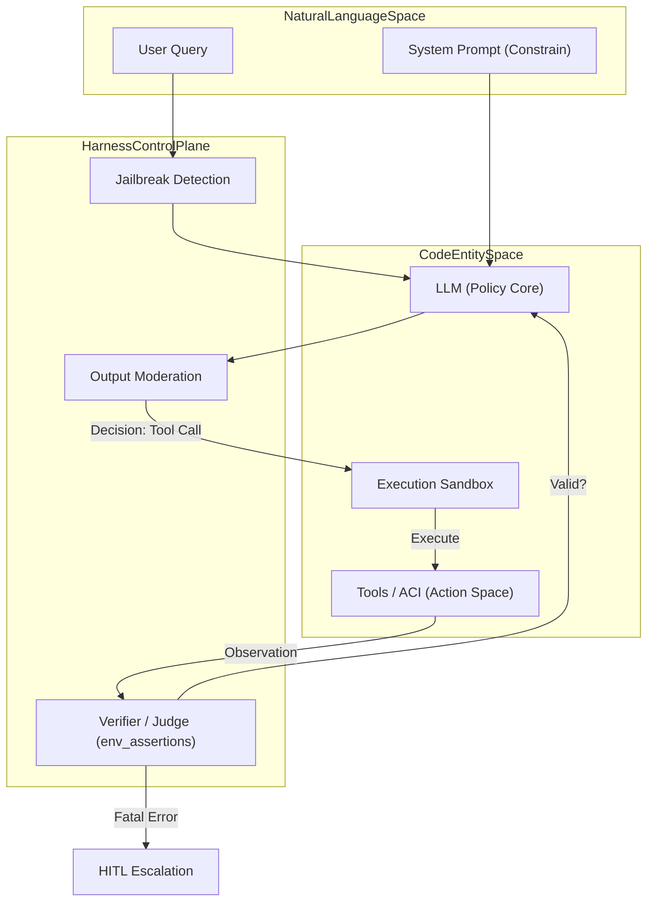
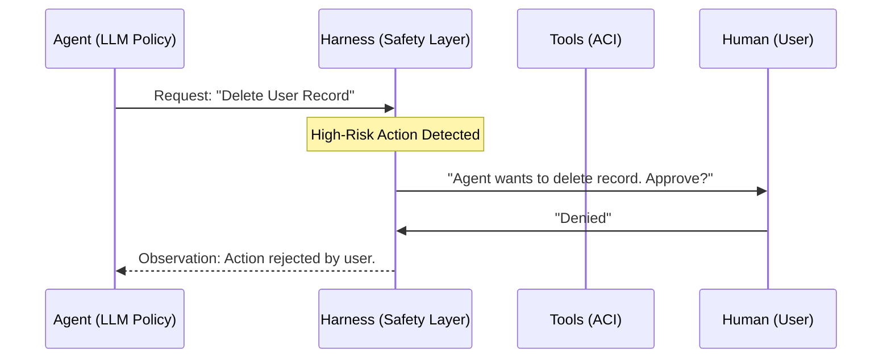
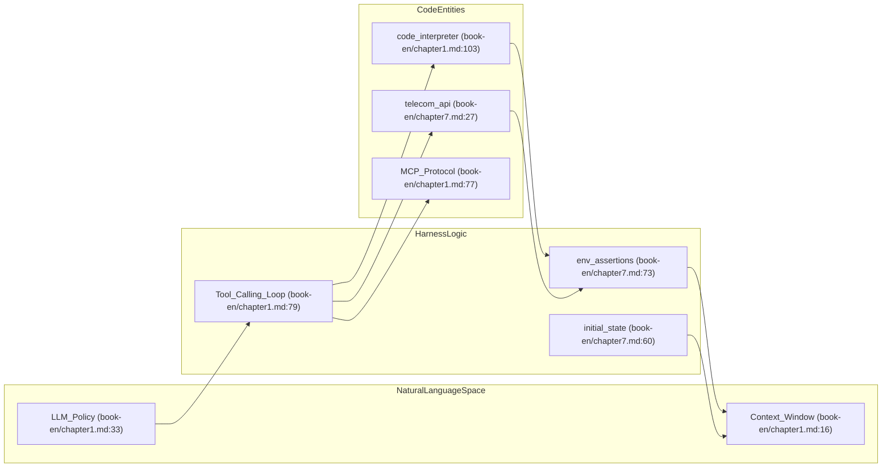

<!-- source: DeepWiki mcp.deepwiki.com · repo bojieli/ai-agent-book · page 2.2 Harness Engineering and Safety · fetched 2026-10-26 -->

# Harness Engineering and Safety

Relevant source files

The following files were used as context for generating this wiki page:

- [book-ar/chapter1.ar.md](book-ar/chapter1.ar.md)
- [book-ar/chapter7.ar.md](book-ar/chapter7.ar.md)
- [book-en/chapter1.md](book-en/chapter1.md)
- [book-en/chapter7.md](book-en/chapter7.md)
- [book-es/chapter1.es.md](book-es/chapter1.es.md)
- [book-es/chapter7.es.md](book-es/chapter7.es.md)
- [book-hu/chapter1.md](book-hu/chapter1.md)
- [book-hu/chapter7.md](book-hu/chapter7.md)
- [book-id/chapter1.md](book-id/chapter1.md)
- [book-id/chapter7.md](book-id/chapter7.md)
- [book-ja/chapter1.ja.md](book-ja/chapter1.ja.md)
- [book-ja/chapter7.ja.md](book-ja/chapter7.ja.md)
- [book-ko/chapter1.ko.md](book-ko/chapter1.ko.md)
- [book-ko/chapter7.ko.md](book-ko/chapter7.ko.md)
- [book-ru/chapter1.md](book-ru/chapter1.md)
- [book-ru/chapter7.md](book-ru/chapter7.md)
- [book-ta/chapter1.ta.md](book-ta/chapter1.ta.md)
- [book-ta/chapter7.ta.md](book-ta/chapter7.ta.md)
- [book-tr/chapter1.tr.md](book-tr/chapter1.tr.md)
- [book-tr/chapter7.tr.md](book-tr/chapter7.tr.md)
- [book-vi/chapter1.vi.md](book-vi/chapter1.vi.md)
- [book-vi/chapter7.vi.md](book-vi/chapter7.vi.md)
- [book-zhtw/chapter1.zhtw.md](book-zhtw/chapter1.zhtw.md)
- [book-zhtw/chapter7.zhtw.md](book-zhtw/chapter7.zhtw.md)

Harness Engineering represents the transition from "prompting" to "engineering" in AI Agent development. While the Large Language Model (LLM) serves as the stochastic reasoning core, the **Harness** acts as the deterministic infrastructure that guides, constrains, and secures the Agent's behavior. This page details the Harness formula, the multi-layer safety guardrails required for production deployment, and the design philosophy of the Agent-Computer Interface (ACI).

## The Harness Formula

The effectiveness of a modern Agent is governed by the Harness formula, which extends the basic `Agent = LLM + Context + Tools` definition into a robust engineering framework:

**Agent = Model + Context + Tools + Constrain + Verify + Correct** [[book-en/chapter1.md:25-27]()]

In this paradigm, the "Harness" refers to the engineering outer shell that wraps the model to ensure reliable task execution [[book-en/chapter1.md:25-27]()]:
1.  **Constrain**: Defining the boundaries of operation via system prompts, ACI design, and permission sets [[book-en/chapter1.md:107-108]()].
2.  **Verify**: Independent evaluation of the model's output or tool execution results [[book-en/chapter1.md:25-27]()].
3.  **Correct**: Mechanisms to loop back and fix errors, such as self-repair or Human-in-the-Loop (HITL) escalation [[book-en/chapter1.md:25-27]()].

### Data Flow in the Harness Lifecycle

The following diagram illustrates how the Harness wraps the core ReAct loop to ensure safety and reliability, bridging the gap between natural language intent and code execution.

**Harness-Wrapped Execution Loop**

Sources: [[book-en/chapter1.md:21-27](), [book-en/chapter7.md:67-82]()]

---

## Multi-Layer Safety Guardrails

Safety in Agent systems is implemented as a defense-in-depth strategy across three primary layers: input, execution, and output.

### 1. Input-Side: Jailbreak and Intent Detection
Before the LLM processes a request, the Harness must detect adversarial prompts (e.g., prompt injection, jailbreaking). This is often implemented using a dedicated classifier to ensure the query stays within the defined **Observation Space** [[book-en/chapter1.md:37-41]()].

### 2. Execution-Side: Sandboxing and ACI
Agents should never execute code or system commands directly on the host OS. 
*   **Sandboxing**: All execution tools must run within isolated environments. For example, Python code interpreters must be restricted in execution time, CPU, memory, and output size [[book-en/chapter1.md:103-105]()].
*   **ACI (Agent-Computer Interface)**: Unlike a GUI designed for humans, an ACI is optimized for LLM consumption. It defines which observations the Agent can read and which actions it can issue [[book-en/chapter1.md:31-35]()].

### 3. Output-Side: Moderation and Circuit Breakers
The Harness monitors the Agent's generated content and behavior for anomalies:
*   **Moderation**: Filtering harmful content using predefined rubrics.
*   **Circuit Breakers**: Monitoring for "infinite loops" or excessive resource consumption. If a tool fails repeatedly, the Harness prevents the Agent from entering a "deadlock" state [[book-en/chapter1.md:107-108]()].

| Guardrail Layer | Mechanism | Purpose |
| :--- | :--- | :--- |
| **Input** | Intent Classifier | Detects jailbreaks and out-of-scope requests. |
| **Execution** | Sandbox | Prevents unauthorized file system or network access [[book-en/chapter1.md:103-105]()]. |
| **Execution** | ACI Constraints | Limits tool parameters to safe ranges [[book-en/chapter1.md:107-108]()]. |
| **Output** | Verifier LLM | Checks if the answer satisfies safety rubrics (Verify) [[book-en/chapter1.md:25-27]()]. |
| **System** | Circuit Breaker | Stops execution if max turns or error limits are exceeded. |

Sources: [[book-en/chapter1.md:31-35](), [book-en/chapter1.md:103-108]()]

---

## Human-in-the-Loop (HITL) and Escalation

The Harness is responsible for identifying "uncertainty" and escalating to a human operator. Escalation triggers include:
1.  **High-Value Actions**: Transactions, deleting data, or production deployments require explicit confirmation [[book-en/chapter1.md:107-108]()].
2.  **Ambiguity**: When the user's initial statement is vague (e.g., "I can't get online"), the Agent must ask for clarification rather than guessing [[book-en/chapter7.md:87-89]()].
3.  **Verification Failure**: When the `env_assertions` (e.g., checking if internet speed is "excellent") fail despite the Agent's attempts [[book-en/chapter7.md:67-82]()].

**HITL Escalation Data Flow**

Sources: [[book-en/chapter1.md:107-108](), [book-en/chapter7.md:67-82]()]

---

## ACI Design Philosophy

The **Agent-Computer Interface (ACI)** is the specific subset of the Harness that defines how the Agent interacts with software. Key principles include:

*   **Structured Output**: Forcing the model to use tools via a schema (e.g., JSON) rather than free-form text [[book-en/chapter1.md:85-99]()].
*   **Progressive Disclosure**: Only showing the Agent the parts of the system state relevant to the current task to save context window space. This is modeled via `known_info` fields in task definitions [[book-en/chapter7.md:87-89]()].
*   **Model Context Protocol (MCP)**: Utilizing standardized protocols to allow the Agent to discover and use tools across different environments [[book-en/chapter1.md:77-79]()].

### Bridging Natural Language to Code Entities

This diagram maps the conceptual Harness components to their implementation strategies in the codebase, showing how reasoning translates to tool calls.

**ACI and Harness Implementation Map**

Sources: [[book-en/chapter1.md:11-19](), [book-en/chapter1.md:77-82](), [book-en/chapter7.md:27-82]()]

---

