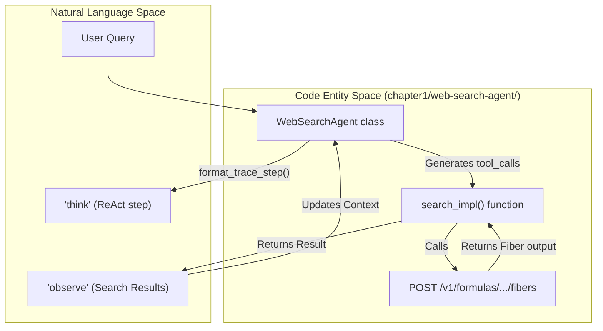
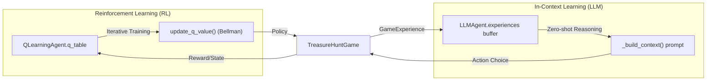
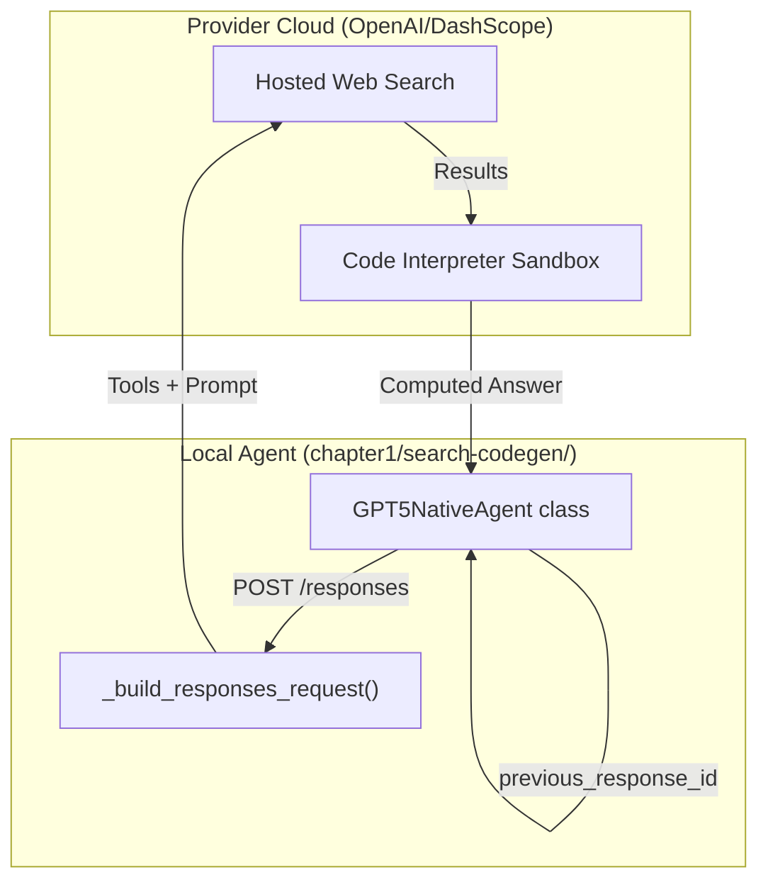

<!-- source: DeepWiki mcp.deepwiki.com · repo bojieli/ai-agent-book · page 2.3 Chapter 1 Code Experiments · fetched 2026-10-26 -->

# Chapter 1 Code Experiments

Relevant source files

The following files were used as context for generating this wiki page:

- [.github/workflows/web-search-agent-tests.yml](.github/workflows/web-search-agent-tests.yml)
- [chapter1/EXPERIMENT_LEDGER.md](chapter1/EXPERIMENT_LEDGER.md)
- [chapter1/README.en.md](chapter1/README.en.md)
- [chapter1/README.ja.md](chapter1/README.ja.md)
- [chapter1/README.md](chapter1/README.md)
- [chapter1/README.zh-TW.md](chapter1/README.zh-TW.md)
- [chapter1/context/README.md](chapter1/context/README.md)
- [chapter1/context/agent.py](chapter1/context/agent.py)
- [chapter1/context/config.py](chapter1/context/config.py)
- [chapter1/context/env.example](chapter1/context/env.example)
- [chapter1/context/main.py](chapter1/context/main.py)
- [chapter1/learning-from-experience/README.md](chapter1/learning-from-experience/README.md)
- [chapter1/learning-from-experience/demo.py](chapter1/learning-from-experience/demo.py)
- [chapter1/learning-from-experience/env.example](chapter1/learning-from-experience/env.example)
- [chapter1/learning-from-experience/experiment.py](chapter1/learning-from-experience/experiment.py)
- [chapter1/learning-from-experience/llm_agent.py](chapter1/learning-from-experience/llm_agent.py)
- [chapter1/learning-from-experience/quick_demo.py](chapter1/learning-from-experience/quick_demo.py)
- [chapter1/learning-from-experience/rl_agent.py](chapter1/learning-from-experience/rl_agent.py)
- [chapter1/search-codegen/README.md](chapter1/search-codegen/README.md)
- [chapter1/search-codegen/agent.py](chapter1/search-codegen/agent.py)
- [chapter1/search-codegen/config.py](chapter1/search-codegen/config.py)
- [chapter1/search-codegen/env.example](chapter1/search-codegen/env.example)
- [chapter1/search-codegen/example_request.py](chapter1/search-codegen/example_request.py)
- [chapter1/search-codegen/main.py](chapter1/search-codegen/main.py)
- [chapter1/search-codegen/run_experiment_1_3.py](chapter1/search-codegen/run_experiment_1_3.py)
- [chapter1/search-codegen/test_config_and_usage.py](chapter1/search-codegen/test_config_and_usage.py)
- [chapter1/search-codegen/test_responses_agent.py](chapter1/search-codegen/test_responses_agent.py)
- [chapter1/search-codegen/validation/latest.json](chapter1/search-codegen/validation/latest.json)
- [chapter1/web-search-agent/README.md](chapter1/web-search-agent/README.md)
- [chapter1/web-search-agent/agent.py](chapter1/web-search-agent/agent.py)
- [chapter1/web-search-agent/config.py](chapter1/web-search-agent/config.py)
- [chapter1/web-search-agent/env.example](chapter1/web-search-agent/env.example)
- [chapter1/web-search-agent/examples.py](chapter1/web-search-agent/examples.py)
- [chapter1/web-search-agent/pytest.ini](chapter1/web-search-agent/pytest.ini)
- [chapter1/web-search-agent/tests/conftest.py](chapter1/web-search-agent/tests/conftest.py)
- [chapter1/web-search-agent/tests/test_agent.py](chapter1/web-search-agent/tests/test_agent.py)
- [chapter1/web-search-agent/tests/test_config.py](chapter1/web-search-agent/tests/test_config.py)
- [chapter1/web-search-agent/tests/test_examples.py](chapter1/web-search-agent/tests/test_examples.py)
- [chapter1/web-search-agent/tests/test_main.py](chapter1/web-search-agent/tests/test_main.py)
- [chapter1/web-search-agent/tests/test_offline_demo.py](chapter1/web-search-agent/tests/test_offline_demo.py)
- [chapter2/README.md](chapter2/README.md)
- [chapter3/README.md](chapter3/README.md)
- [chapter4/README.md](chapter4/README.md)
- [chapter5/README.md](chapter5/README.md)
- [chapter8/README.md](chapter8/README.md)
- [chapter9/README.md](chapter9/README.md)
- [tests/test_ch1_learning_agents_empty_eval_windows.py](tests/test_ch1_learning_agents_empty_eval_windows.py)

The experiments in Chapter 1 provide a hands-on foundation for the core formula: **Agent = LLM + Context + Tools** [chapter1/README.md:3-3](). These experiments demonstrate how agents perceive the world through context, act via tools, and learn through different paradigms.

## 1. Kimi Web-Search Agent

The `web-search-agent` experiment (Experiment 1-2) demonstrates a "Model as Agent" pattern using the Kimi K3 model and Moonshot's official Formula API [chapter1/web-search-agent/README.md:3-4]().

### Implementation and Data Flow
The agent implements a ReAct (Reason-Act-Observe) loop using the `moonshot/web-search:latest` Formula [chapter1/web-search-agent/README.md:14-15](). The execution follows a specific provider-controlled sequence where the agent fetches standard `function` declarations and executes search "Fibers" [chapter1/web-search-agent/README.md:26-38]().

**Search Agent Execution Flow**

Sources: [chapter1/web-search-agent/agent.py:96-143](), [chapter1/web-search-agent/README.md:47-59]()

---

## 2. Context Management and Ablation

The `context` experiment (Experiment 1-1) explores the systematic importance of context components through a `ContextAwareAgent` and an `AblationTestSuite` [chapter1/context/agent.py:2-5]().

### Key Components
- **ContextMode**: An Enum defining five ablation states: `FULL`, `NO_HISTORY`, `NO_REASONING`, `NO_TOOL_CALLS`, and `NO_TOOL_RESULTS` [chapter1/context/agent.py:44-51]().
- **AgentTrajectory**: Tracks the execution path, including `reasoning_steps`, `tool_calls`, and raw `api_turns` [chapter1/context/agent.py:63-73]().
- **ToolRegistry**: Provides local tools like `parse_pdf`, `convert_currency`, and `calculate` to simulate an environment [chapter1/context/agent.py:75-178]().

### Ablation Study Logic
The `AblationTestSuite` runs tasks (e.g., `create_multinational_budget_task`) across different modes to measure the impact on success rates and iteration counts [chapter1/context/main.py:123-173](). In the `NO_TOOL_RESULTS` arm, the harness runs the tools but the model is shown a placeholder (e.g., `HIDDEN_RESULT_MARKER`), making the agent blind to tool execution outcomes [chapter1/context/agent.py:33-41](), [chapter1/context/main.py:176-178]().

Sources: [chapter1/context/agent.py:33-73](), [chapter1/context/main.py:87-194]()

---

## 3. RL vs LLM In-Context Learning

This experiment (Experiments 7-1 and 7-2) compares traditional tabular Q-learning with LLM in-context learning (ICL) using a `TreasureHuntGame` [chapter1/learning-from-experience/README.md:1-4]().

### Comparison Architecture
- **QLearningAgent**: Uses a `q_table` (state-action map) and the Bellman equation to learn, requiring thousands of episodes (e.g., 10,000) to discover hidden mechanics [chapter1/learning-from-experience/rl_agent.py:14-51](), [chapter1/learning-from-experience/README.md:168-174]().
- **LLMAgent**: Uses a `GameExperience` buffer and reasoning to generalize from very few examples (e.g., 20 episodes) [chapter1/learning-from-experience/llm_agent.py:61-130](), [chapter1/learning-from-experience/README.md:158-160]().

**Learning Mechanism Comparison**

Sources: [chapter1/learning-from-experience/rl_agent.py:42-51](), [chapter1/learning-from-experience/llm_agent.py:117-171](), [chapter1/learning-from-experience/README.md:154-165]()

---

## 4. Search-Codegen (Deep Research)

The `search-codegen` experiment (Experiment 1-3) demonstrates the **Responses API** pattern where an agent performs hosted web search and server-side code execution in a single loop [chapter1/search-codegen/README.md:3-9]().

### Implementation Detail
1. **Tool Specification**: The `GPT5NativeAgent` requests `web_search` and `code_interpreter` within the same `responses` request [chapter1/search-codegen/agent.py:65-76]().
2. **Intent Clarification**: A system prompt enforces a "Hard rule" to ask clarifying questions before calling tools if user preferences are ambiguous [chapter1/search-codegen/agent.py:47-63]().
3. **Continuation**: Uses `previous_response_id` in the `_build_responses_request` to maintain state across turns, allowing the agent to continue a research thread after clarification [chapter1/search-codegen/agent.py:115-117]().

**Responses API Data Flow**

Sources: [chapter1/search-codegen/agent.py:21-117](), [chapter1/search-codegen/README.md:13-50]()

---

