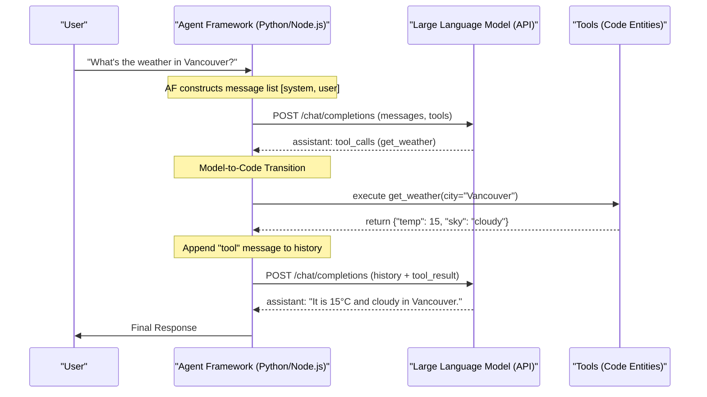
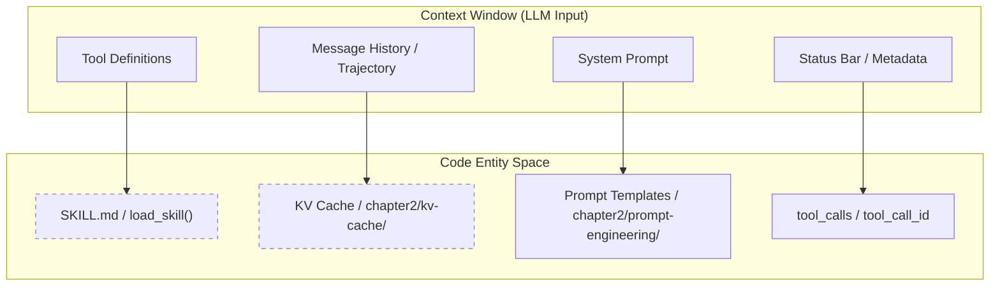

<!-- source: DeepWiki mcp.deepwiki.com · repo bojieli/ai-agent-book · page 3 Context Engineering (Chapter 2) · fetched 2026-10-26 -->

# Context Engineering (Chapter 2)

Relevant source files

The following files were used as context for generating this wiki page:

- [book-ar/chapter2.ar.md](book-ar/chapter2.ar.md)
- [book-en/chapter2.md](book-en/chapter2.md)
- [book-es/chapter2.es.md](book-es/chapter2.es.md)
- [book-id/chapter2.md](book-id/chapter2.md)
- [book-ja/chapter2.ja.md](book-ja/chapter2.ja.md)
- [book-ko/chapter2.ko.md](book-ko/chapter2.ko.md)
- [book-ru/chapter2.md](book-ru/chapter2.md)
- [book-ta/chapter2.ta.md](book-ta/chapter2.ta.md)
- [book-tr/chapter2.tr.md](book-tr/chapter2.tr.md)
- [book-vi/chapter2.vi.md](book-vi/chapter2.vi.md)
- [book-zhtw/chapter2.zhtw.md](book-zhtw/chapter2.zhtw.md)
- [book/chapter1.md](book/chapter1.md)
- [book/chapter10.md](book/chapter10.md)
- [book/chapter2.md](book/chapter2.md)
- [book/chapter3.md](book/chapter3.md)
- [book/chapter4.md](book/chapter4.md)
- [book/chapter5.md](book/chapter5.md)
- [book/chapter6.md](book/chapter6.md)
- [book/chapter7.md](book/chapter7.md)
- [book/chapter8.md](book/chapter8.md)
- [book/chapter9.md](book/chapter9.md)
- [book/reference-answers.md](book/reference-answers.md)

Context Engineering is the systematic design, organization, and delivery of information to an AI Agent. If the LLM is the "brain," the context window serves as its "operating system" and "eyes." The quality and structure of the context window—including system instructions, conversation history, and tool definitions—directly define the upper bound of an Agent's performance in production environments [book/chapter2.md:1-3]().

## The Context Window as an Operating System

In the **Harness Engineering** framework, context is the core implementation layer that bridges the gap between a model's general intelligence and specific task execution. A well-engineered context ensures the Agent has access to three critical categories of information:
1.  **Real-time Code Context**: Directory structures, module responsibilities, and data definitions [book/chapter2.md:15-15]().
2.  **Process Specifications**: Git branching strategies, commit conventions, and CI/CD requirements [book/chapter2.md:16-16]().
3.  **Environment Information**: Development setups, database connection strings, and API key management [book/chapter2.md:17-17]().

### The Messages List Structure
Modern Agent interaction relies on a stateful message list sent to stateless APIs. Every factual decision by the Agent is based on the specific roles within this list:
*   **system**: High-priority behavioral rules, identity definitions, and constraints [book/chapter2.md:49-49]().
*   **user**: The specific request or query from the end-user [book/chapter2.md:50-50]().
*   **assistant**: Previous model responses, including text and `tool_calls` requests [book/chapter2.md:51-51]().
*   **tool**: The results of executed functions, linked via `tool_call_id` [book/chapter2.md:52-52]().

### Agent-Model Interaction Flow
The following diagram illustrates how the Agent framework manages the transition between Natural Language Space (User/System messages) and Code Entity Space (Tool definitions and execution results).

**Diagram: Context Interaction Sequence**

Sources: [book/chapter2.md:65-151](), [book/chapter1.md:83-101]()

---

## Key Sub-Topics

### KV Cache Optimization and Prompt Engineering
The KV Cache is a hardware-level optimization that stores the keys and values of previously processed tokens. In Agent workflows, maintaining a **stable prefix** is critical for performance and cost reduction. Anti-patterns like dynamic timestamps in system prompts or shuffling tool definitions break the cache, leading to increased Time to First Token (TTFT) and higher costs.

For details on prefix stability, implementation modes (correct vs. anti-patterns), and Prompt Cache APIs, see **[KV Cache Optimization and Prompt Engineering](#3.1)**.

### Agent Skills, Status Bar, and Context Compression
As Agent capabilities grow, the context window can become saturated with tool definitions, leading to "context rot." 
*   **Agent Skills**: A "progressive disclosure" strategy where tools are bundled into skills (e.g., `SKILL.md`) and only relevant skills are loaded into the active context [book/chapter10.md:85-92]().
*   **Status Bar**: A meta-information side-channel providing high-level state (e.g., working directory, git branch) without cluttering history.
*   **Compression**: Strategies to handle failure modes such as null content, malformed tool JSON, and summary drift.

For details on skill routing, the Status Bar, and context compression implementation, see **[Agent Skills, Status Bar, and Context Compression](#3.2)**.

---

## Context Architecture Overview

The relationship between the various context components and the underlying code structures is mapped below.

**Diagram: Context Entity Mapping**

Sources: [book/chapter2.md:3-5](), [book/chapter2.md:45-56](), [book/chapter3.md:78-82](), [book/chapter10.md:90-90]()

## Implementation Experiments
The concepts discussed in this chapter are implemented and evaluated in the following directories:
*   `chapter2/kv-cache/`: Benchmarking the impact of prefix stability on inference speed.
*   `chapter2/prompt-engineering/`: Ablation studies on prompt structures using `tau-bench` assets [book/chapter7.md:29-30]().
*   `chapter2/context-compression/`: Implementation of techniques for task-oriented pruning and adaptive windowing.
*   `chapter7/tau2-bench/`: Evaluation of progressive information disclosure and grounding [book/chapter7.md:87-94]().

Sources: [book/chapter2.md:1-29](), [book/chapter7.md:27-82](), [book/chapter10.md:94-101]()

---

