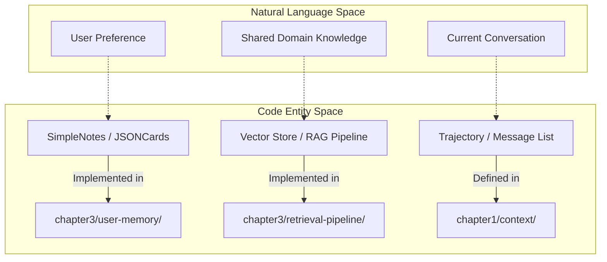
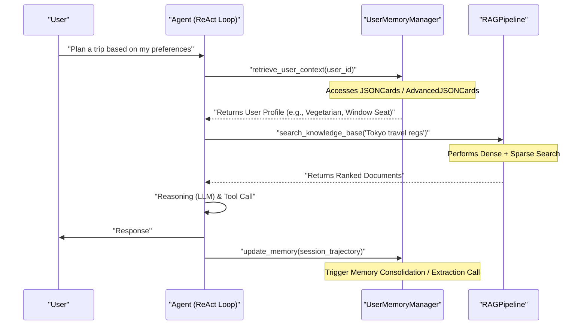

<!-- source: DeepWiki mcp.deepwiki.com · repo bojieli/ai-agent-book · page 4 Memory and Knowledge Systems (Chapter 3) · fetched 2026-10-26 -->

# Memory and Knowledge Systems (Chapter 3)

Relevant source files

The following files were used as context for generating this wiki page:

- [book-ar/chapter3.ar.md](book-ar/chapter3.ar.md)
- [book-en/chapter3.md](book-en/chapter3.md)
- [book-es/chapter3.es.md](book-es/chapter3.es.md)
- [book-hu/chapter3.md](book-hu/chapter3.md)
- [book-id/chapter3.md](book-id/chapter3.md)
- [book-ja/chapter3.ja.md](book-ja/chapter3.ja.md)
- [book-ko/chapter3.ko.md](book-ko/chapter3.ko.md)
- [book-ru/chapter3.md](book-ru/chapter3.md)
- [book-ta/chapter3.ta.md](book-ta/chapter3.ta.md)
- [book-tr/chapter3.tr.md](book-tr/chapter3.tr.md)
- [book-vi/chapter3.vi.md](book-vi/chapter3.vi.md)
- [book-zhtw/chapter3.zhtw.md](book-zhtw/chapter3.zhtw.md)

This chapter addresses the transition from single-session context management to persistent intelligence. It explores the dual-layer architecture required for production-grade agents: **User Memory** for cross-session personalization and **Knowledge Bases (RAG)** for shared expertise. While context engineering (Chapter 2) handles temporary information, Memory and Knowledge systems focus on the active, continuous process of learning, compressing, and retrieving information at scale. [book-en/chapter3.md:3-9]()

## Architecture Overview

The memory system is organized into three distinct layers based on persistence and scope:
1.  **Trajectory**: An append-only record of the current session (messages, tool calls, and observations). [book-en/chapter3.md:78-80]()
2.  **User Long-term Memory**: Persistent, structured data tied to a specific User ID, refined over multiple sessions. [book-en/chapter3.md:81-83]()
3.  **Knowledge Base (RAG)**: A collective repository of domain-specific information shared across all users. [book-en/chapter3.md:5-7]()

### Mapping Natural Language to Code Entities

The following diagram illustrates how abstract memory concepts map to specific implementations and data structures within the `chapter3/` codebase.

**Diagram: Memory Representation and Storage**

**Sources:** [book-en/chapter3.md:78-90](), [book-en/chapter3.md:114-118]()

---

## User Memory Architecture

User memory transforms raw dialogue into a concise, actionable model of the user. This involves extracting key facts (e.g., dietary restrictions, loyalty numbers) while discarding transient session data through a dedicated LLM extraction call. [book-en/chapter3.md:31-41]()

### Storage Formats
The system supports four evolving formats for storing user data, balancing simplicity against semantic richness:
*   **Simple Notes**: Atomic facts (O(1) operations) but lacks context. [book-en/chapter3.md:94-96]()
*   **Enhanced Notes**: Narrative paragraphs preserving context, though harder to update. [book-en/chapter3.md:97-98]()
*   **JSON Cards**: Hierarchical key-value pairs (e.g., `personal.contact.email`). [book-en/chapter3.md:99-100]()
*   **Advanced JSON Cards**: Includes `backstory`, `person`, `relationship`, and `timestamps` for disambiguation. [book-en/chapter3.md:101-104]()

### The Memory Pipeline
The repository implements a sophisticated extraction-comparison-decision pipeline. This includes **User as Code** paradigms where user states are represented as executable Python objects (e.g., `PassportInfo` or `Trip` dataclasses) to allow for deterministic logical reasoning, conflict detection, and validation. [book-en/chapter3.md:116-155]()

For details on implementation, storage strategies, and the three-tier evaluation framework (Basic Recall, Multi-session Retrieval, Proactive Service), see **[User Memory Architecture](#4.1)**.

**Sources:** [book-en/chapter3.md:60-64](), [book-en/chapter3.md:92-113](), [book-en/chapter3.md:122-156]()

---

## RAG Retrieval Pipeline and Agentic RAG

Retrieval-Augmented Generation (RAG) extends the agent's capabilities by providing access to massive external datasets that cannot fit within a context window. [book-en/chapter3.md:7-9]()

### The Hybrid Pipeline
The codebase utilizes a modern retrieval stack to mitigate common failure modes like stale knowledge or inaccurate retrieval:
*   **Dense Embedding**: Semantic search using vector representations.
*   **Sparse Embedding**: Keyword-based search (BM25) to capture specific technical terms.
*   **Reranking**: Refining top-K results for maximum relevance before injection into the prompt.

### Advanced RAG Patterns
Beyond simple retrieval, the system implements:
*   **Contextual Retrieval**: Improving vector search accuracy by enriching chunks with context.
*   **Structured Indexing**: Utilizing methods like RAPTOR (recursive clustering) and GraphRAG for global reasoning across documents.
*   **Agentic RAG**: Enabling the agent to perform multi-hop reasoning by iteratively searching and refining its query based on intermediate results.

For details on the retrieval stack and multi-hop reasoning experiments, see **[RAG Retrieval Pipeline and Agentic RAG](#4.2)**.

**Sources:** [book-en/chapter3.md:7-9](), [book-zhtw/chapter3.zhtw.md:7-9]()

---

## System Integration: The Memory Loop

The following diagram shows how the memory and retrieval systems interact during an agent's execution cycle, bridging natural language requests to code-level tool calls.

**Diagram: Memory and RAG Execution Flow**

**Sources:** [book-en/chapter3.md:21-39](), [book-en/chapter3.md:78-86]()

---

## Child Pages

*   **[User Memory Architecture](#4.1)**: Detailed documentation on the `chapter3/user-memory/` and `chapter3/user-memory-evaluation/` implementations, focusing on memory consolidation, "User as Code", and evaluation against the 3-level framework.
*   **[RAG Retrieval Pipeline and Agentic RAG](#4.2)**: Deep dive into the `chapter3/retrieval-pipeline/`, `chapter3/contextual-retrieval/`, and `chapter3/agentic-rag/` implementations, covering hybrid search, RAPTOR tree indexing, and GraphRAG.

---

