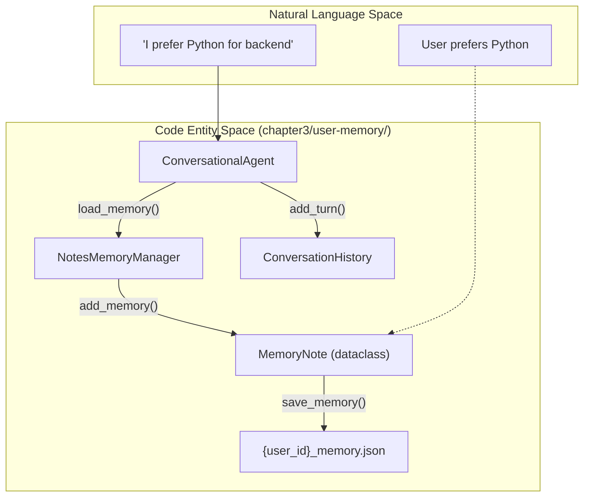
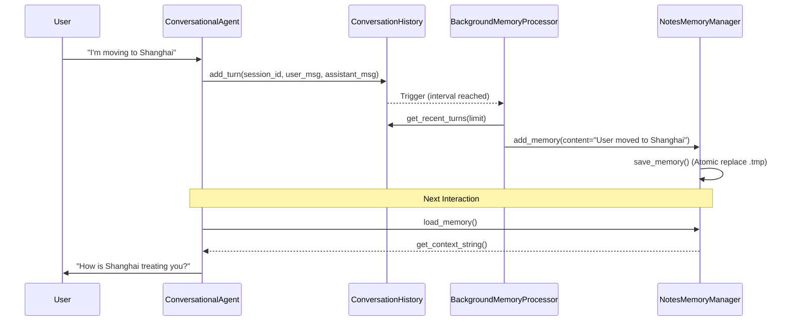

<!-- source: DeepWiki mcp.deepwiki.com · repo bojieli/ai-agent-book · page 4.1 User Memory Architecture · fetched 2026-10-26 -->

# User Memory Architecture

Relevant source files

The following files were used as context for generating this wiki page:

- [chapter3/agentic-rag-for-user-memory/README.md](chapter3/agentic-rag-for-user-memory/README.md)
- [chapter3/agentic-rag/README.md](chapter3/agentic-rag/README.md)
- [chapter3/contextual-retrieval-for-user-memory/README.md](chapter3/contextual-retrieval-for-user-memory/README.md)
- [chapter3/contextual-retrieval-for-user-memory/contextual_indexer.py](chapter3/contextual-retrieval-for-user-memory/contextual_indexer.py)
- [chapter3/contextual-retrieval-for-user-memory/test_fallback_search_empty_query.py](chapter3/contextual-retrieval-for-user-memory/test_fallback_search_empty_query.py)
- [chapter3/contextual-retrieval/README.md](chapter3/contextual-retrieval/README.md)
- [chapter3/mem0/README.md](chapter3/mem0/README.md)
- [chapter3/memobase/README.md](chapter3/memobase/README.md)
- [chapter3/memobase/locomo_benchmark.py](chapter3/memobase/locomo_benchmark.py)
- [chapter3/memobase/test_evaluate_generic_empty_query.py](chapter3/memobase/test_evaluate_generic_empty_query.py)
- [chapter3/structured-index/README.md](chapter3/structured-index/README.md)
- [chapter3/structured-knowledge-extraction/README.md](chapter3/structured-knowledge-extraction/README.md)
- [chapter3/structured-knowledge-extraction/extractor.py](chapter3/structured-knowledge-extraction/extractor.py)
- [chapter3/structured-knowledge-extraction/test_normalize_numeric.py](chapter3/structured-knowledge-extraction/test_normalize_numeric.py)
- [chapter3/user-memory-evaluation/README.md](chapter3/user-memory-evaluation/README.md)
- [chapter3/user-memory/README.md](chapter3/user-memory/README.md)
- [chapter3/user-memory/agent.py](chapter3/user-memory/agent.py)
- [chapter3/user-memory/config.py](chapter3/user-memory/config.py)
- [chapter3/user-memory/conversation_history.py](chapter3/user-memory/conversation_history.py)
- [chapter3/user-memory/conversational_agent.py](chapter3/user-memory/conversational_agent.py)
- [chapter3/user-memory/main.py](chapter3/user-memory/main.py)
- [chapter3/user-memory/memory_manager.py](chapter3/user-memory/memory_manager.py)
- [chapter3/user-memory/test_consolidate_created_at.py](chapter3/user-memory/test_consolidate_created_at.py)
- [chapter3/user-memory/test_evaluation_memory_view.py](chapter3/user-memory/test_evaluation_memory_view.py)
- [chapter3/user-memory/test_json_cards_string_payload.py](chapter3/user-memory/test_json_cards_string_payload.py)
- [chapter3/user-memory/test_recent_turns_limit_zero.py](chapter3/user-memory/test_recent_turns_limit_zero.py)
- [chapter3/user-memory/test_search_history_limit_zero.py](chapter3/user-memory/test_search_history_limit_zero.py)
- [chapter3/user-memory/test_session_scoped_history.py](chapter3/user-memory/test_session_scoped_history.py)
- [chapter3/user-memory/test_stream_empty_choices.py](chapter3/user-memory/test_stream_empty_choices.py)
- [chapter6/agent-with-event-trigger/README.md](chapter6/agent-with-event-trigger/README.md)

The User Memory system is a core component of the AI Agent architecture, enabling cross-session personalization and continuous learning. Unlike temporary context, user memory is a persistent, structured, and searchable model of the user’s preferences, habits, and history [chapter3/user-memory/conversational_agent.py:142-145](). It transforms the Agent from a stateless tool into a personalized assistant by employing specialized LLM pipelines to extract, compress, and organize information [chapter3/user-memory/main.py:3-5]().

## Memory Hierarchy and Implementation

The codebase implements a **Separated Architecture** where dialogue and memory management are decoupled into distinct processes [chapter3/user-memory/main.py:3-5]().

1.  **Conversational Agent**: A pure dialogue handler that reads memory for context but does not update it directly during the interaction [chapter3/user-memory/conversational_agent.py:41-45]().
2.  **Background Memory Processor**: A separate process that monitors conversation history and performs extraction and consolidation tasks [chapter3/user-memory/background_memory_processor.py:25-28]().
3.  **Conversation History**: An append-only record of turns, with optional vector search integration via `DifySearchClient` [chapter3/user-memory/conversation_history.py:36-37]().

### Three-Layer Evaluation Framework
To measure memory effectiveness, the `user-memory-evaluation` framework tests three levels of capability [chapter3/user-memory-evaluation/README.md:16-23]():
*   **Layer 1: Basic Recall**: Retrieval of explicit facts (e.g., account numbers, confirmation codes) [chapter3/user-memory-evaluation/README.md:16-17]().
*   **Layer 2: Contextual Reasoning**: Disambiguating information across multiple conversations and knowing when to clarify [chapter3/user-memory-evaluation/README.md:19-20]().
*   **Layer 3: Cross-Session Synthesis**: Proactive assistance based on connections surfaced across disparate sessions [chapter3/user-memory-evaluation/README.md:22-23]().

The framework uses two primary metrics: `keyword-recall` (offline substring matching) and `llm-judge` (Experiment 6-3 structured rubric covering precision, recall, reasoning, and proactivity) [chapter3/user-memory-evaluation/README.md:143-154]().

**Sources:** [chapter3/user-memory/main.py:3-17](), [chapter3/user-memory/conversational_agent.py:41-134](), [chapter3/user-memory-evaluation/README.md:10-33]()

## Storage Formats

The architecture supports four primary data formats, managed by specific subclasses of `BaseMemoryManager` [chapter3/user-memory/memory_manager.py:68-70]().

| Format | Implementation Class | Structure |
| :--- | :--- | :--- |
| **Simple Notes** | `NotesMemoryManager` | Atomic `MemoryNote` objects with IDs and tags [chapter3/user-memory/memory_manager.py:120-125](). |
| **Enhanced Notes** | `EnhancedNotesManager` | Narrative paragraphs providing full semantic context. |
| **JSON Cards** | `JSONCardMemoryManager` | Nested categories (e.g., `category`, `subcategory`, `key`, `value`) [chapter3/user-memory/memory_manager.py:48-56](). |
| **Advanced JSON Cards** | `AdvancedMemoryManager` | Entities with `backstory`, `person`, and `relationship` metadata [chapter3/contextual-retrieval-for-user-memory/README.md:77-93](). |

### "User as Code" Paradigm
Advanced implementations treat the user model as a "living software project." The system uses `MemoryProcessorConfig` to trigger periodic consolidation [chapter3/user-memory/main.py:134-140](). During this phase, raw dialogue is transformed into structured `MemoryCard` entities [chapter3/user-memory/memory_manager.py:48-56]().

**Sources:** [chapter3/user-memory/memory_manager.py:28-191](), [chapter3/contextual-retrieval-for-user-memory/README.md:60-93]()

## Memory Pipeline Implementation

The memory lifecycle follows an **Extraction-Comparison-Decision** pipeline. In Experiment 3-11, the system applies **Contextual Retrieval** to user memory, generating a "context prefix" for each conversation chunk before indexing to improve recall accuracy for fragmented dialogue [chapter3/contextual-retrieval-for-user-memory/README.md:48-57]().

### The Mem0 Pipeline
The `Mem0Agent` implements a hybrid retrieval strategy [chapter3/mem0/README.md:23-25]():
1.  **Extraction**: `Mem0` performs ADD-only extraction of facts from dialogue.
2.  **Comparison**: The system compares new facts against the `Chroma` or `Cloud` backend to prevent duplication [chapter3/mem0/README.md:132-145]().
3.  **Decision**: The system organizes memory by `user_id`, `agent_id`, and `session_id` levels [chapter3/mem0/README.md:124-130]().

### Dual-Layer Memory Flow
The `contextual-retrieval-for-user-memory` experiment implements a dual-layer system:
*   **Layer 1 (Always-on)**: Advanced JSON Cards for core facts [chapter3/contextual-retrieval-for-user-memory/README.md:60-65]().
*   **Layer 2 (On-demand)**: Contextual RAG for raw dialogue detail [chapter3/contextual-retrieval-for-user-memory/README.md:67-72]().

### Natural Language to Code Entity Mapping

This diagram bridges the gap between user dialogue and the internal classes in `chapter3/user-memory/`.

**Sources:** [chapter3/user-memory/conversational_agent.py:41-134](), [chapter3/user-memory/memory_manager.py:120-191](), [chapter3/user-memory/conversation_history.py:95-112]()

## Advanced Frameworks: Memobase

**Memobase** introduces a separation between **Profiles** (stable attributes) and **Events** (dynamic interactions) to support the LOCOMO benchmark [chapter3/memobase/README.md:14-19]().

*   **Profile**: Long-term, structured user attributes (e.g., city, job title) [chapter3/memobase/README.md:82]().
*   **Event Memory**: A timeline of interactions used to answer temporal questions (e.g., "When did we discuss budget?") [chapter3/memobase/README.md:82]().

### Data Flow: User Memory Architecture

The following diagram illustrates the interaction between the conversational agent and the background processor.

**Sources:** [chapter3/user-memory/main.py:131-160](), [chapter3/user-memory/conversational_agent.py:165-172](), [chapter3/user-memory/memory_manager.py:142-157](), [chapter3/user-memory/conversation_history.py:76-93]()

---

