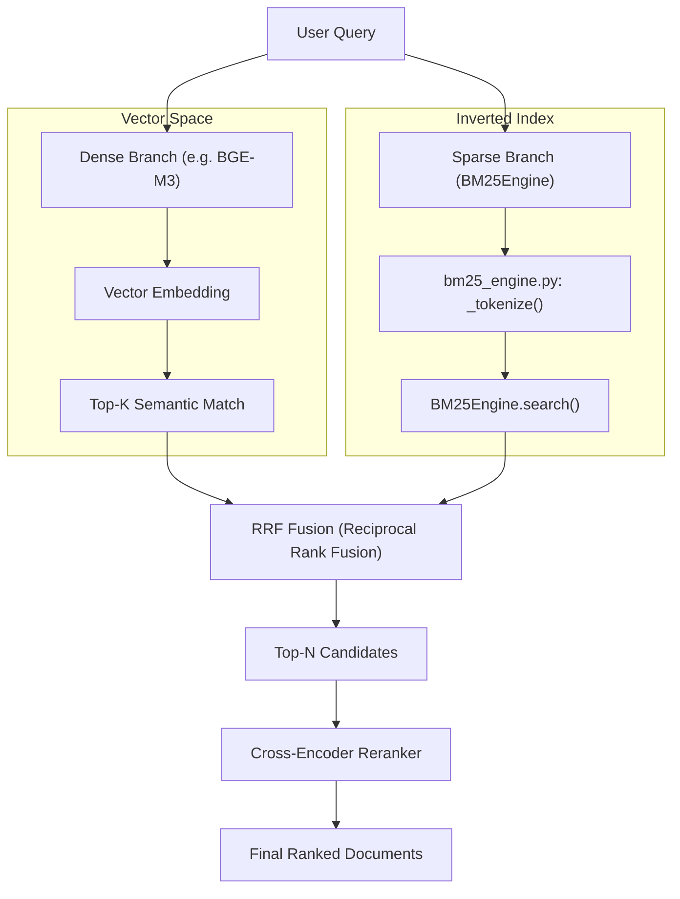
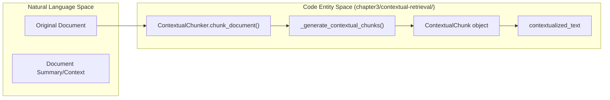
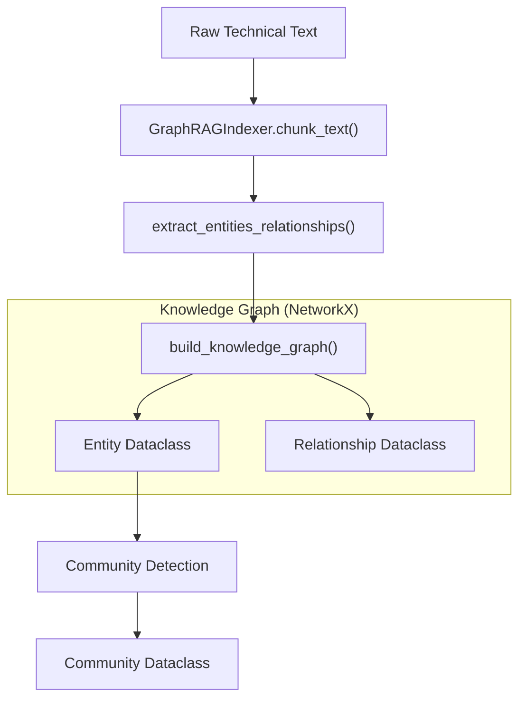
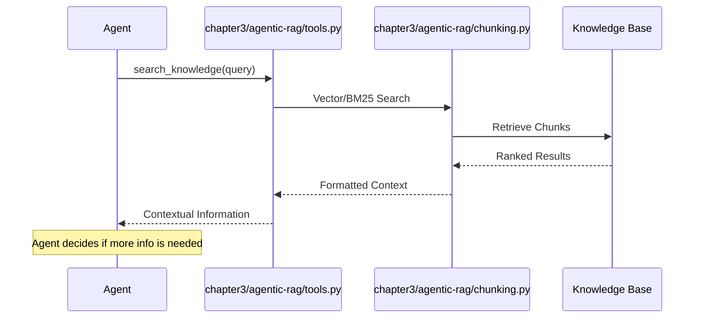

<!-- source: DeepWiki mcp.deepwiki.com · repo bojieli/ai-agent-book · page 4.2 RAG Retrieval Pipeline and Agentic RAG · fetched 2026-10-26 -->

# RAG Retrieval Pipeline and Agentic RAG

Relevant source files

The following files were used as context for generating this wiki page:

- [book-ar/chapter3.ar.md](book-ar/chapter3.ar.md)
- [book-en/chapter3.md](book-en/chapter3.md)
- [book-es/chapter3.es.md](book-es/chapter3.es.md)
- [book-hu/chapter3.md](book-hu/chapter3.md)
- [book-id/chapter3.md](book-id/chapter3.md)
- [book-ja/chapter3.ja.md](book-ja/chapter3.ja.md)
- [book-ko/chapter3.ko.md](book-ko/chapter3.ko.md)
- [book-ru/chapter3.md](book-ru/chapter3.md)
- [book-ta/chapter3.ta.md](book-ta/chapter3.ta.md)
- [book-tr/chapter3.tr.md](book-tr/chapter3.tr.md)
- [book-vi/chapter3.vi.md](book-vi/chapter3.vi.md)
- [book-zhtw/chapter3.zhtw.md](book-zhtw/chapter3.zhtw.md)
- [chapter3/agentic-rag-for-user-memory/indexer.py](chapter3/agentic-rag-for-user-memory/indexer.py)
- [chapter3/agentic-rag-for-user-memory/test_pipeline.py](chapter3/agentic-rag-for-user-memory/test_pipeline.py)
- [chapter3/agentic-rag/chunking.py](chapter3/agentic-rag/chunking.py)
- [chapter3/agentic-rag/index_local_laws.py](chapter3/agentic-rag/index_local_laws.py)
- [chapter3/agentic-rag/test_chunk_size_zero.py](chapter3/agentic-rag/test_chunk_size_zero.py)
- [chapter3/agentic-rag/tools.py](chapter3/agentic-rag/tools.py)
- [chapter3/contextual-retrieval-for-user-memory/indexer.py](chapter3/contextual-retrieval-for-user-memory/indexer.py)
- [chapter3/contextual-retrieval-for-user-memory/test_pipeline.py](chapter3/contextual-retrieval-for-user-memory/test_pipeline.py)
- [chapter3/contextual-retrieval/chunking.py](chapter3/contextual-retrieval/chunking.py)
- [chapter3/contextual-retrieval/contextual_chunking.py](chapter3/contextual-retrieval/contextual_chunking.py)
- [chapter3/contextual-retrieval/contextual_tools.py](chapter3/contextual-retrieval/contextual_tools.py)
- [chapter3/sparse-embedding/bm25_engine.py](chapter3/sparse-embedding/bm25_engine.py)
- [chapter3/sparse-embedding/test_bm25_empty_term.py](chapter3/sparse-embedding/test_bm25_empty_term.py)
- [chapter3/sparse-embedding/test_tokenize_apostrophes.py](chapter3/sparse-embedding/test_tokenize_apostrophes.py)
- [chapter3/structured-index/graphrag_indexer.py](chapter3/structured-index/graphrag_indexer.py)
- [chapter3/structured-index/test_graphrag_search_top_k.py](chapter3/structured-index/test_graphrag_search_top_k.py)
- [tests/test_ch3_bm25_reindex_doc.py](tests/test_ch3_bm25_reindex_doc.py)
- [tests/test_ch3_bm25_zero_avgdl.py](tests/test_ch3_bm25_zero_avgdl.py)

This page documents the implementation of advanced knowledge retrieval systems and the transition from static RAG to Agentic RAG. It covers hybrid search strategies, contextual indexing, structured knowledge representation (GraphRAG), and the iterative reasoning loops used in multi-hop retrieval, specifically mapping to the `chapter3/` implementations.

## 1. Hybrid Retrieval Pipeline

The core retrieval pipeline utilizes a multi-stage approach to balance semantic understanding with keyword precision. It combines dense vector embeddings with sparse BM25 scores, followed by Reciprocal Rank Fusion (RRF) and Cross-Encoder reranking.

### 1.1 Dense and Sparse Embedding
*   **Dense Retrieval**: Maps text into a continuous vector space, enabling semantic matching. The implementation in `chapter3/agentic-rag/chunking.py` handles the creation of these embeddings `[chapter3/agentic-rag/chunking.py:1-15]()`.
*   **Sparse Retrieval (BM25)**: Handles exact keyword matches, critical for technical terms or specific IDs. The `BM25Engine` implementation in `chapter3/sparse-embedding/bm25_engine.py` provides the `search` and `reindex` capabilities `[chapter3/sparse-embedding/bm25_engine.py:1-120]()`.
*   **Robust Tokenization**: The sparse engine is tested against complex scenarios, such as handling apostrophes in tokens `[chapter3/sparse-embedding/test_tokenize_apostrophes.py:1-10]()` and empty search terms `[chapter3/sparse-embedding/test_bm25_empty_term.py:1-10]()`.

### 1.2 Fusion and Reranking
To combine these disparate scoring systems, the pipeline uses **Reciprocal Rank Fusion (RRF)**. Finally, a **Cross-Encoder** (reranker) performs a computationally accurate comparison between the query and the top-N candidates.

**Hybrid Retrieval Architecture**

Sources: `[chapter3/sparse-embedding/bm25_engine.py:45-90]()`, `[chapter3/agentic-rag/chunking.py:18-154]()`.

## 2. Contextual Retrieval

Traditional RAG often fails when document chunks lose their context. **Contextual Retrieval** addresses this by prepending a "Contextual Prefix" to every chunk during the indexing phase.

*   **Implementation**: The `ContextualChunker` uses an LLM to generate chunk-specific context based on the whole document `[chapter3/contextual-retrieval/contextual_chunking.py:62-71]()`.
*   **Indexing**: The `ContextualChunk` dataclass stores the `contextualized_text`, which is the `context` + `original text` `[chapter3/contextual-retrieval/contextual_chunking.py:34-45]()`.
*   **User Memory Integration**: The `chapter3/contextual-retrieval-for-user-memory/` module applies this to personalized memory, using a specialized `indexer.py` to contextualize user facts `[chapter3/contextual-retrieval-for-user-memory/indexer.py:1-50]()`.

**Code Entity Mapping: Contextual Indexing**

Sources: `[chapter3/contextual-retrieval/contextual_chunking.py:34-177]()`, `[chapter3/contextual-retrieval-for-user-memory/indexer.py:10-45]()`.

## 3. Structured Indexing and GraphRAG

For complex technical documents, the repository implements `GraphRAGIndexer` to transform unstructured text into a graph of entities and relationships.

### 3.1 Knowledge Graph Construction
The `GraphRAGIndexer` uses an LLM to extract structured data from text chunks:
*   **Entity Extraction**: Identifies technical entities like "instructions", "registers", and "CPU features" `[chapter3/structured-index/graphrag_indexer.py:118-127]()`.
*   **Relationship Mapping**: Identifies how entities connect (e.g., "uses", "modifies", "depends_on") `[chapter3/structured-index/graphrag_indexer.py:129-130]()`.
*   **Community Detection**: Groups related entities into communities for high-level summaries `[chapter3/structured-index/graphrag_indexer.py:49-56]()`.

### 3.2 Retrieval Logic
The search implementation in `GraphRAGIndexer.search` ensures that results are only returned for positive `top_k` values to prevent unnecessary LLM or embedding calls `[chapter3/structured-index/test_graphrag_search_top_k.py:136-143]()`.

**GraphRAG Data Flow**

Sources: `[chapter3/structured-index/graphrag_indexer.py:26-193]()`.

## 4. Agentic RAG

Agentic RAG transitions from a fixed pipeline to an iterative, agent-driven process where the LLM can use tools to navigate the index.

### 4.1 Chunking and Tooling
*   **Intelligent Chunking**: The `DocumentChunker` in `chapter3/agentic-rag/chunking.py` supports semantic-aware splitting `[chapter3/agentic-rag/chunking.py:18-43]()`. It includes safety checks for edge cases like zero chunk sizes `[chapter3/agentic-rag/test_chunk_size_zero.py:1-12]()`.
*   **Retrieval Tools**: The agent uses tools defined in `chapter3/agentic-rag/tools.py` to query the knowledge base `[chapter3/agentic-rag/tools.py:1-50]()`.
*   **User Memory RAG**: In `chapter3/agentic-rag-for-user-memory/`, the `indexer.py` manages the storage of user-specific facts in a RAG-accessible format `[chapter3/agentic-rag-for-user-memory/indexer.py:1-40]()`.

### 4.2 Practical Application: Local Laws
The `chapter3/agentic-rag/index_local_laws.py` script demonstrates how to index specialized domain knowledge (e.g., local regulations) for an agent to provide expert advice `[chapter3/agentic-rag/index_local_laws.py:1-60]()`.

**Agentic RAG Tool Loop**

Sources: `[chapter3/agentic-rag/tools.py:10-45]()`, `[chapter3/agentic-rag-for-user-memory/test_pipeline.py:1-30]()`.

## 5. Validation and Testing

The RAG modules are validated through comprehensive test suites:
*   **BM25 Validation**: Tests for document re-indexing `[tests/test_ch3_bm25_reindex_doc.py:1-25]()` and the `avgdl` (average document length) edge case `[tests/test_ch3_bm25_zero_avgdl.py:1-20]()`.
*   **Pipeline Verification**: The `test_pipeline.py` in both `agentic-rag-for-user-memory` `[chapter3/agentic-rag-for-user-memory/test_pipeline.py:1-35]()` and `contextual-retrieval-for-user-memory` `[chapter3/contextual-retrieval-for-user-memory/test_pipeline.py:1-35]()` ensures that the extraction-to-retrieval loop works correctly for personalized data.

Sources: `[tests/test_ch3_bm25_reindex_doc.py:5-20]()`, `[chapter3/agentic-rag-for-user-memory/test_pipeline.py:10-25]()`.

---

