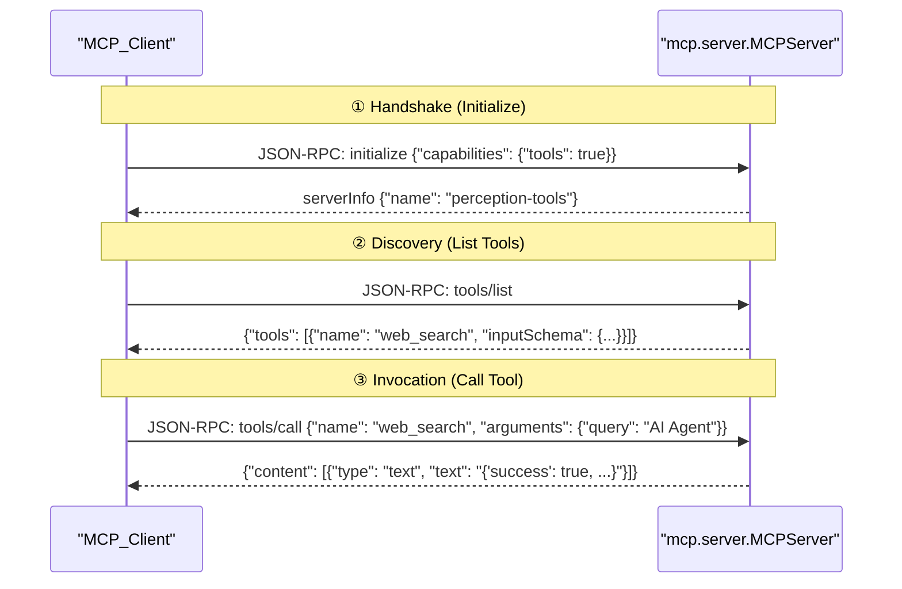
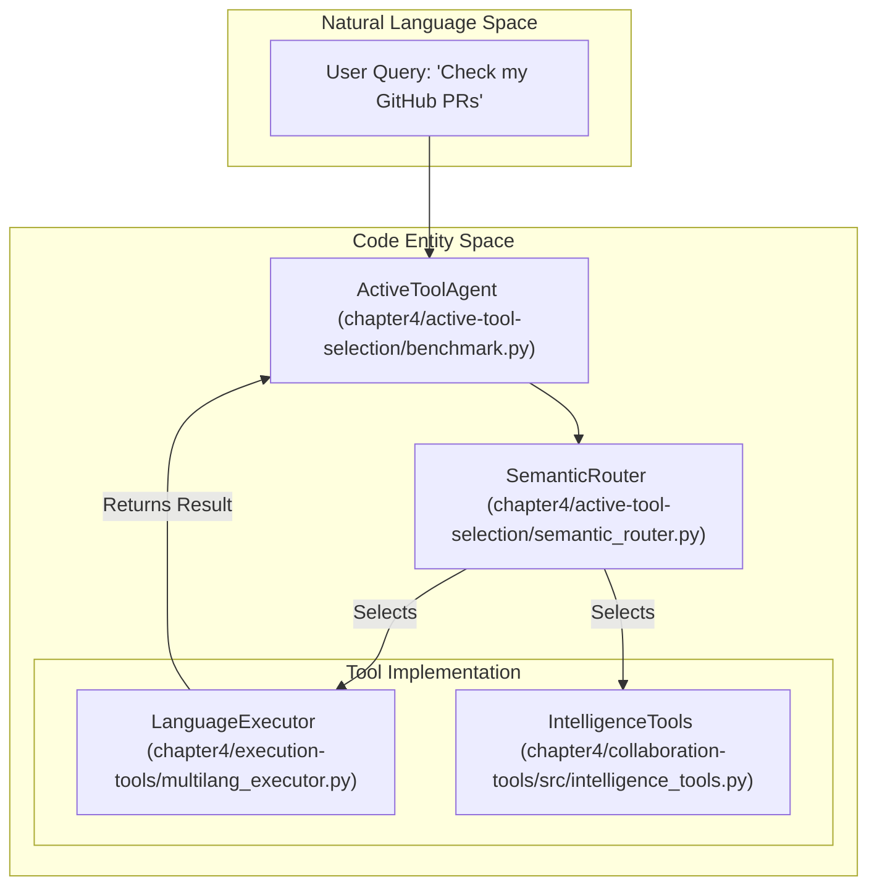

<!-- source: DeepWiki mcp.deepwiki.com · repo bojieli/ai-agent-book · page 5.1 Model Context Protocol (MCP) and Tool Design · fetched 2026-10-26 -->

# Model Context Protocol (MCP) and Tool Design

Relevant source files

The following files were used as context for generating this wiki page:

- [book-ar/chapter4.ar.md](book-ar/chapter4.ar.md)
- [book-en/chapter4.md](book-en/chapter4.md)
- [book-es/chapter4.es.md](book-es/chapter4.es.md)
- [book-he/chapter4.he.md](book-he/chapter4.he.md)
- [book-hu/chapter4.md](book-hu/chapter4.md)
- [book-id/chapter4.md](book-id/chapter4.md)
- [book-ja/chapter4.ja.md](book-ja/chapter4.ja.md)
- [book-ko/chapter4.ko.md](book-ko/chapter4.ko.md)
- [book-ru/chapter4.md](book-ru/chapter4.md)
- [book-ta/chapter4.ta.md](book-ta/chapter4.ta.md)
- [book-tr/chapter4.tr.md](book-tr/chapter4.tr.md)
- [book-vi/chapter4.vi.md](book-vi/chapter4.vi.md)
- [book-zhtw/chapter4.zhtw.md](book-zhtw/chapter4.zhtw.md)
- [chapter4/active-tool-discovery/README.md](chapter4/active-tool-discovery/README.md)
- [chapter4/active-tool-selection/README.md](chapter4/active-tool-selection/README.md)
- [chapter4/active-tool-selection/benchmark.py](chapter4/active-tool-selection/benchmark.py)
- [chapter4/active-tool-selection/demo_comparison.py](chapter4/active-tool-selection/demo_comparison.py)
- [chapter4/active-tool-selection/examples.py](chapter4/active-tool-selection/examples.py)
- [chapter4/active-tool-selection/semantic_router.py](chapter4/active-tool-selection/semantic_router.py)
- [chapter4/active-tool-selection/tests/conftest.py](chapter4/active-tool-selection/tests/conftest.py)
- [chapter4/active-tool-selection/tests/test_basic.py](chapter4/active-tool-selection/tests/test_basic.py)
- [chapter4/active-tool-selection/tests/test_parse_request_closing_tag.py](chapter4/active-tool-selection/tests/test_parse_request_closing_tag.py)
- [chapter4/active-tool-selection/tests/test_usage_none.py](chapter4/active-tool-selection/tests/test_usage_none.py)
- [chapter4/collaboration-tools/.gitignore](chapter4/collaboration-tools/.gitignore)
- [chapter4/collaboration-tools/README.md](chapter4/collaboration-tools/README.md)
- [chapter4/collaboration-tools/requirements.txt](chapter4/collaboration-tools/requirements.txt)
- [chapter4/collaboration-tools/src/intelligence_tools.py](chapter4/collaboration-tools/src/intelligence_tools.py)
- [chapter4/collaboration-tools/src/main.py](chapter4/collaboration-tools/src/main.py)
- [chapter4/collaboration-tools/subagent_comparison.py](chapter4/collaboration-tools/subagent_comparison.py)
- [chapter4/execution-tools/README.md](chapter4/execution-tools/README.md)
- [chapter4/execution-tools/execution_tools.py](chapter4/execution-tools/execution_tools.py)
- [chapter4/execution-tools/extended_tools.py](chapter4/execution-tools/extended_tools.py)
- [chapter4/execution-tools/multilang_executor.py](chapter4/execution-tools/multilang_executor.py)
- [chapter4/execution-tools/server.py](chapter4/execution-tools/server.py)
- [chapter4/execution-tools/test_github_idempotency.py](chapter4/execution-tools/test_github_idempotency.py)
- [chapter4/execution-tools/test_gui_tools.py](chapter4/execution-tools/test_gui_tools.py)
- [chapter4/execution-tools/test_multilang_output.py](chapter4/execution-tools/test_multilang_output.py)
- [chapter4/execution-tools/test_null_language.py](chapter4/execution-tools/test_null_language.py)
- [chapter4/execution-tools/test_truncate_tail_lines_zero.py](chapter4/execution-tools/test_truncate_tail_lines_zero.py)
- [chapter4/perception-tools/README.md](chapter4/perception-tools/README.md)
- [chapter4/perception-tools/cli.py](chapter4/perception-tools/cli.py)
- [chapter4/perception-tools/env.example](chapter4/perception-tools/env.example)
- [chapter4/perception-tools/src/expanded_catalog.py](chapter4/perception-tools/src/expanded_catalog.py)
- [chapter4/perception-tools/src/main.py](chapter4/perception-tools/src/main.py)
- [chapter4/perception-tools/src/xquik_tools.py](chapter4/perception-tools/src/xquik_tools.py)
- [chapter4/perception-tools/test_expanded_catalog.py](chapter4/perception-tools/test_expanded_catalog.py)
- [chapter4/perception-tools/test_imports.py](chapter4/perception-tools/test_imports.py)
- [chapter4/perception-tools/test_xquik_tools.py](chapter4/perception-tools/test_xquik_tools.py)
- [tests/test_ch4_expanded_catalog_limit_null.py](tests/test_ch4_expanded_catalog_limit_null.py)
- [tests/test_ch4_semantic_router_empty_servers.py](tests/test_ch4_semantic_router_empty_servers.py)
- [tests/test_ch4_semantic_router_stop_words_query.py](tests/test_ch4_semantic_router_stop_words_query.py)

This page documents the architecture and design principles for Agent tools, centered around the **Model Context Protocol (MCP)**. It covers the classification of tools, the transition from static to dynamic tool discovery, and the engineering patterns required to build secure, idempotent, and high-fidelity Agent-Computer Interfaces (ACI).

## 1. Tool Classification and ACI Principles

Tools are the "hands, feet, and senses" of an Agent, connecting the LLM's reasoning to the digital world [book-en/chapter4.md:3](). In this framework, tools are classified by their **Invocation Direction** and **Target of Action** [book-en/chapter4.md:9-11]().

### The Five Tool Categories
| Tool Type | Direction | Target of Action | Implementation Examples |
| :--- | :--- | :--- | :--- |
| **Perception** | Agent actively invokes | Acquire information | `web_search`, `fetch_url`, `grep_file` [book-en/chapter4.md:21]() |
| **Execution** | Agent actively invokes | Change the world | `shell_exec`, `code_interpreter`, `edit_file` [book-en/chapter4.md:23]() |
| **Collaboration** | Agent actively invokes | Drive other Agents/Humans | `spawn_subagent`, `list_agents` [book-en/chapter4.md:25]() |
| **Event-Trigger** | External triggers | Start Agent execution | `set_timer`, `monitor_shell` [book-en/chapter4.md:29]() |
| **User Comm.** | Agent actively invokes | Convey info to user | `reply_to_user`, `send_card_to_user` [book-en/chapter4.md:27]() |

### Agent-Computer Interface (ACI) Design
ACI focuses on making tools friendly to Agents rather than humans [book-en/chapter4.md:35]().
*   **Granularity vs. Generality**: Prefer general executors (like `code_interpreter`) over dozens of specialized tools to leverage the LLM's native code-generation ability [book-ja/chapter4.ja.md:49-51]().
*   **Fidelity and Schema**: Model-native tools use JSON schemas to guide correct parameter passing, which is more reliable than natural language "Skills" for complex nested objects [book-ja/chapter4.ja.md:55-57]().
*   **Description Art**: Tool descriptions should specify *when* to use them and their *boundaries* (what they cannot do) to prevent model hallucination [book-zhtw/chapter4.zhtw.md:79-81]().

**Sources:** [book-en/chapter4.md:1-35](), [book-ja/chapter4.ja.md:34-61](), [book-zhtw/chapter4.zhtw.md:12-81]()

---

## 2. Model Context Protocol (MCP)

The Model Context Protocol (MCP) is an open standard designed to solve the integration problem between diverse Agent frameworks and tool providers [book-en/chapter4.md:5]().

### MCP Architecture
MCP uses a client-server architecture where the **MCP Client** (the Agent) connects to an **MCP Server** (the tool provider). It supports transports like **stdio** for local processes and **SSE** for remote execution.

### MCP Communication Flow
The protocol follows a lifecycle of Handshake, Discovery, and Invocation. The `FastMCP` or `MCPServer` class in the SDK facilitates these interactions [chapter4/perception-tools/src/main.py:53-91]().

**Title: MCP Protocol Sequence**

**Sources:** [book-en/chapter4.md:5-31](), [chapter4/perception-tools/src/main.py:52-105](), [chapter4/perception-tools/README.md:125-144]()

---

## 3. Tool Execution and Testing Patterns

Reliability in tool design is achieved through idempotency, safety reviewers, and structured output handling.

### Execution and Security Patterns
*   **Idempotency**: The `GitHubManager` in `test_github_idempotency.py` demonstrates ensuring that repeated calls (e.g., creating a comment) do not result in duplicate side effects [chapter4/execution-tools/test_github_idempotency.py:10-45]().
*   **Sidecar/Reviewer Pattern**: The `guard_reasoning_process` tool acts as a safety gate, evaluating proposed actions against constraints before execution [chapter4/collaboration-tools/src/intelligence_tools.py:140-182]().
*   **Output Truncation**: To prevent context overflow, tools use `truncate_tail_lines` to return only the most relevant parts of a large output while persisting the full log [chapter4/execution-tools/test_truncate_tail_lines_zero.py:5-20]().

### Active Tool Selection
To handle catalogs of hundreds of tools, the `ActiveToolAgent` uses a two-step process: first identifying the required tool via a `SemanticRouter`, then fetching the schema [chapter4/active-tool-selection/semantic_router.py:12-45]().

**Title: Tool Selection Data Flow**

**Sources:** [chapter4/active-tool-selection/semantic_router.py:12-55](), [chapter4/execution-tools/test_github_idempotency.py:1-50](), [chapter4/collaboration-tools/src/intelligence_tools.py:140-155]()

---

## 4. Implementation Structure

The repository organizes tools into functional modules with corresponding test suites.

### Perception Tools (`chapter4/perception-tools/`)
*   **Expanded Catalog**: `expanded_catalog.py` manages a large set of perception capabilities, including `web_search` and `fetch_url` [chapter4/perception-tools/src/expanded_catalog.py:15-120]().
*   **Testing**: `test_expanded_catalog.py` verifies tool discovery and schema integrity [chapter4/perception-tools/test_expanded_catalog.py:10-35]().

### Execution Tools (`chapter4/execution-tools/`)
*   **Multi-language Support**: `multilang_executor.py` provides a unified interface for running Python, JavaScript, and shell scripts in a controlled environment [chapter4/execution-tools/multilang_executor.py:107-125]().
*   **Error Handling**: `test_null_language.py` and `test_multilang_output.py` ensure the executor handles malformed requests and captures `stdout/stderr` correctly [chapter4/execution-tools/test_null_language.py:5-15]().

### Collaboration Tools (`chapter4/collaboration-tools/`)
*   **Intelligence Delegation**: Tools like `complex_problem_reasoning` allow an agent to delegate heavy reasoning tasks to specialized models [chapter4/collaboration-tools/src/intelligence_tools.py:85-137]().
*   **Agent Comparison**: `subagent_comparison.py` evaluates the performance of different sub-agent configurations [chapter4/collaboration-tools/subagent_comparison.py:5-27]().

**Sources:** [chapter4/perception-tools/src/expanded_catalog.py:1-150](), [chapter4/execution-tools/multilang_executor.py:100-150](), [chapter4/collaboration-tools/src/intelligence_tools.py:32-155]()

---

