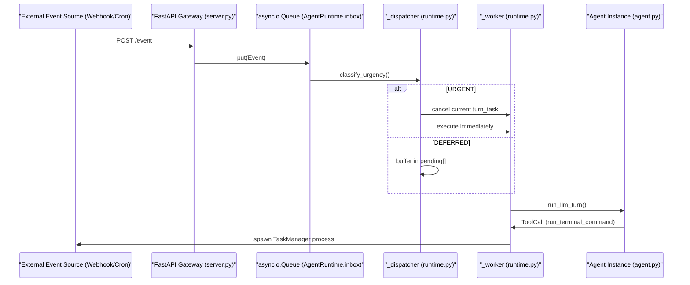
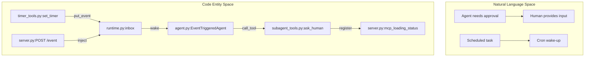

<!-- source: DeepWiki mcp.deepwiki.com · repo bojieli/ai-agent-book · page 5.2 Event-Driven Agent Architecture · fetched 2026-10-26 -->

# Event-Driven Agent Architecture

Relevant source files

The following files were used as context for generating this wiki page:

- [book-ar/chapter6.ar.md](book-ar/chapter6.ar.md)
- [book-en/chapter6.md](book-en/chapter6.md)
- [book-es/chapter6.es.md](book-es/chapter6.es.md)
- [book-hu/chapter6.md](book-hu/chapter6.md)
- [book-id/chapter6.md](book-id/chapter6.md)
- [book-ja/chapter6.ja.md](book-ja/chapter6.ja.md)
- [book-ko/chapter6.ko.md](book-ko/chapter6.ko.md)
- [book-ru/chapter6.md](book-ru/chapter6.md)
- [book-ta/chapter6.ta.md](book-ta/chapter6.ta.md)
- [book-tr/chapter6.tr.md](book-tr/chapter6.tr.md)
- [book-vi/chapter6.vi.md](book-vi/chapter6.vi.md)
- [book-zhtw/chapter6.zhtw.md](book-zhtw/chapter6.zhtw.md)
- [chapter10/README.ja.md](chapter10/README.ja.md)
- [chapter4/collaboration-tools/src/timer_tools.py](chapter4/collaboration-tools/src/timer_tools.py)
- [chapter4/collaboration-tools/test_load_expired_timer_callback.py](chapter4/collaboration-tools/test_load_expired_timer_callback.py)
- [chapter4/collaboration-tools/test_recurring_interval_positive.py](chapter4/collaboration-tools/test_recurring_interval_positive.py)
- [chapter4/collaboration-tools/test_recurring_max_occurrences_zero.py](chapter4/collaboration-tools/test_recurring_max_occurrences_zero.py)
- [chapter4/collaboration-tools/test_timer_tools.py](chapter4/collaboration-tools/test_timer_tools.py)
- [chapter6/EXPERIMENT_LEDGER.md](chapter6/EXPERIMENT_LEDGER.md)
- [chapter6/README.ar.md](chapter6/README.ar.md)
- [chapter6/README.en.md](chapter6/README.en.md)
- [chapter6/README.hu.md](chapter6/README.hu.md)
- [chapter6/README.id.md](chapter6/README.id.md)
- [chapter6/README.ja.md](chapter6/README.ja.md)
- [chapter6/README.md](chapter6/README.md)
- [chapter6/README.ru.md](chapter6/README.ru.md)
- [chapter6/README.ta.md](chapter6/README.ta.md)
- [chapter6/README.tr.md](chapter6/README.tr.md)
- [chapter6/README.vi.md](chapter6/README.vi.md)
- [chapter6/README.zh-TW.md](chapter6/README.zh-TW.md)

This page covers the architecture and implementation of agents capable of handling asynchronous events, background tasks, and human-in-the-loop (HITL) workflows. Moving beyond simple request-response loops, the event-driven approach allows agents to respond to external triggers (emails, system alerts, timers) and manage long-running execution states through the `AgentRuntime`.

## Overview of Event-Driven Architecture

Traditional agents operate in a synchronous "Wait-for-User" loop, assuming the world stands still while the model thinks [book-en/chapter6.md:5-7](). An event-driven agent, however, treats user messages as just one type of event in a continuous stream [book-en/chapter6.md:49-50](). This architecture is essential for:

*   **Proactive Action**: Taking initiative based on time (cron) or system state [book-en/chapter6.md:58-59]().
*   **Asynchronous Execution**: Handling tasks that take minutes or hours without blocking the communication channel [book-en/chapter6.md:43-45]().
*   **Timing Expansion**: Moving from turn-based interaction to continuous streams where the world "pushes" observations [book-en/chapter6.md:21-22]().

### Data Flow: Event to Action

The following diagram bridges the Natural Language Space (User/System Intent) to the Code Entity Space (FastAPI routes and Agent Logic).

**Title: Event-Driven Request Flow**

Sources: [book-en/chapter6.md:49-51](), [book-en/chapter6.md:55-57](), [book-zhtw/chapter6.zhtw.md:73-75]()

## Implementation: Event-Driven Mechanisms

The core of the event-driven system is the `AgentRuntime`, which manages the lifecycle of events and background tasks using three primary automation mechanisms [book-en/chapter6.md:55-56]().

### Key Components

1.  **Hooks**: Respond to lifecycle events such as session creation or resets [book-en/chapter6.md:57]().
2.  **Cron**: Executes periodic tasks according to standard cron expressions (e.g., generating weekly reports) [book-en/chapter6.md:58]().
3.  **Heartbeat**: A daemon process that wakes the agent every $N$ minutes to check for items requiring attention, preventing "alert fatigue" through model judgment [book-en/chapter6.md:59]().
4.  **External Channels**: Real-time event channels (e.g., `PineClaw`) that push urgent notifications like OTP requests or call status changes directly to the agent [book-zhtw/chapter6.zhtw.md:73-75]().

### Event Handling Strategies

| Strategy | Implementation Logic | Use Case |
| :--- | :--- | :--- |
| **Cancellation-based** | Urgent events (e.g., "stop") immediately cancel the current operation to handle the emergency [book-en/chapter6.md:44-45](). | User-initiated emergency stops or goal pivots. |
| **Queued (Deferred)** | Routine events are added to a queue to be processed after the current task finishes [book-en/chapter6.md:44-45](). | Non-urgent status updates or low-priority emails. |
| **Parallel Processing** | Independent lightweight queries are processed concurrently without interrupting the main task [book-en/chapter6.md:44-45](). | Status queries like "is the task done yet?". |

Sources: [book-en/chapter6.md:41-47](), [book-zhtw/chapter6.zhtw.md:81-85]()

## Human-in-the-Loop (HITL) and Triggers

In an event-driven system, HITL is treated as a specialized asynchronous event where the agent pauses and waits for external resolution.

**Title: HITL and Trigger Mapping**

Sources: [book-zhtw/chapter6.zhtw.md:81-83](), [book-zhtw/chapter6.zhtw.md:111-113](), [chapter4/collaboration-tools/src/timer_tools.py:1-10]()

## Robustness and Safe Points

The architecture implements several patterns to ensure robustness in a non-turn-based world:

*   **Virtual Identity**: Agents are assigned independent virtual identities (email, phone, storage) to isolate their actions from the user's primary accounts [book-zhtw/chapter6.zhtw.md:107-109]().
*   **Isolated Environments**: Execution occurs in sandboxed VMs or containers to prevent side effects on the host system [book-zhtw/chapter6.zhtw.md:109-110]().
*   **Shared Filesystems**: Data exchange between the agent and virtual environments uses shared volumes (e.g., `/workspace/shared`) to avoid bloating the LLM context window with large file contents [book-zhtw/chapter6.zhtw.md:113-114]().
*   **Safe Interruption**: Conversations or tasks that are interrupted are designed to be resumed naturally by maintaining a chronological event log [book-en/chapter6.md:45-49]().

### Asynchronous Tool Design
Tools in this architecture often return immediate placeholders or initiate background monitoring. For example, `monitor_shell` allows an agent to watch for specific keywords in long-running terminal output rather than blocking until the process exits [book-zhtw/chapter6.zhtw.md:83-84]().

Sources: [book-en/chapter6.md:47-49](), [book-zhtw/chapter6.zhtw.md:109-113](), [book-zhtw/chapter6.zhtw.md:113-115]()

---

