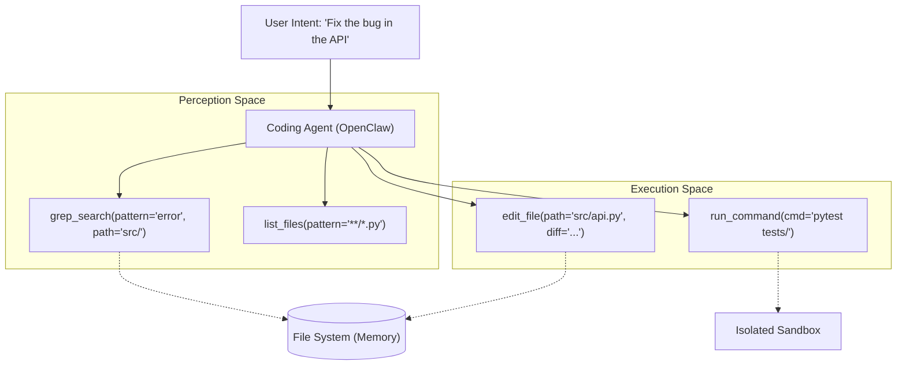
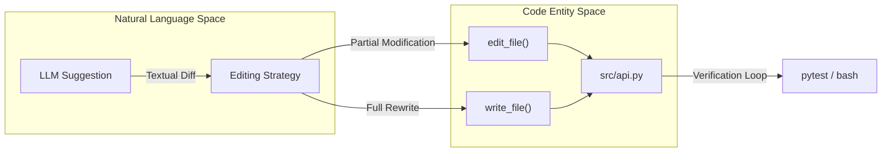

<!-- source: DeepWiki mcp.deepwiki.com · repo bojieli/ai-agent-book · page 6 Coding Agent (Chapter 5) · fetched 2026-10-26 -->

# Coding Agent (Chapter 5)

Relevant source files

The following files were used as context for generating this wiki page:

- [book-ar/chapter5.ar.md](book-ar/chapter5.ar.md)
- [book-en/chapter5.md](book-en/chapter5.md)
- [book-es/chapter5.es.md](book-es/chapter5.es.md)
- [book-id/chapter5.md](book-id/chapter5.md)
- [book-ja/chapter5.ja.md](book-ja/chapter5.ja.md)
- [book-ko/chapter5.ko.md](book-ko/chapter5.ko.md)
- [book-ru/chapter5.md](book-ru/chapter5.md)
- [book-ta/chapter5.ta.md](book-ta/chapter5.ta.md)
- [book-tr/chapter5.tr.md](book-tr/chapter5.tr.md)
- [book-vi/chapter5.vi.md](book-vi/chapter5.vi.md)
- [book-zhtw/chapter5.zhtw.md](book-zhtw/chapter5.zhtw.md)

The Coding Agent represents the architectural core of a general-purpose AI agent capable of handling open-ended tasks. By combining a minimalist set of tools with a persistent file system, a Coding Agent moves beyond predefined functions to dynamically create, execute, and refine its own capabilities. This chapter explores the **OpenClaw** framework as a reference implementation of this "Agent = Coding + File System" paradigm [book-en/chapter5.md:5-5]().

## The Minimalist Seven-Tool Toolbox

A production-grade Coding Agent does not require hundreds of specialized tools. Instead, it relies on a "meta-capability"—the ability to generate and run code to solve problems at runtime [book-en/chapter5.md:7-7](). OpenClaw defines seven core tools that cover the vast majority of software development and data processing tasks:

1.  **Code Interpreter**: A sandboxed Python environment for safe computation and math reasoning [book-en/chapter5.md:23-23]().
2.  **Bash Shell**: A terminal for executing system commands, running tests, and managing environments [book-en/chapter5.md:24-24]().
3.  **Read File**: For inspecting code, logs, configuration, and documentation [book-en/chapter5.md:25-25]().
4.  **Write File**: For creating new assets or performing complete file rewrites [book-en/chapter5.md:26-26]().
5.  **Edit File**: For precise, incremental modifications to existing code [book-en/chapter5.md:27-27]().
6.  **Glob**: Pattern-based file discovery (e.g., `**/*.py`) to locate targets [book-en/chapter5.md:28-28]().
7.  **Grep**: Content-based pattern searching within files [book-en/chapter5.md:29-29]().

### Mapping Natural Language to Code Operations
The following diagram illustrates how high-level user intents are translated into specific tool calls within the OpenClaw architecture, bridging the gap between human request and file system action.

**Diagram: Intent-to-Tool Mapping**

Sources: [book-en/chapter5.md:19-31](), [book-en/chapter5.md:39-49]()

---

## The OpenClaw Architecture

OpenClaw moves away from transient chat sessions toward a design where the **File System is the Central Hub** for memory, knowledge, and capabilities [book-zhtw/chapter5.zhtw.md:76-76](). In this model, persistence is achieved through human-readable files:

*   **`MEMORY.md`**: Stores high-level facts, user preferences, and cross-session knowledge [book-zhtw/chapter5.zhtw.md:68-68](), [book-zhtw/chapter5.zhtw.md:76-76]().
*   **Project Instruction Files**: Files like `CLAUDE.md` or `.cursorrules` act as project-level system prompts, defining build commands and code styles [book-zhtw/chapter5.zhtw.md:92-93]().
*   **Workspace Hub**: The file system serves as the nexus for information flow—reading memory, writing products, and saving experience through a persistent workspace [book-zhtw/chapter5.zhtw.md:74-74]().

### The Execution Lifecycle
OpenClaw follows a rigorous engineering loop to ensure code quality:
1.  **Project Documentation**: Read `README.md` and architecture docs to establish a cognitive framework [book-zhtw/chapter5.zhtw.md:88-90]().
2.  **Task Clarification**: Identify boundaries and active dialogue with the user for ambiguous requirements [book-zhtw/chapter5.zhtw.md:100-100]().
3.  **Design Documentation**: Plan the implementation strategy before coding to allow human intervention [book-zhtw/chapter5.zhtw.md:104-104]().
4.  **Implementation & Test-Fix**: Execute changes and run test suites; iterative repair is mandatory [book-zhtw/chapter5.zhtw.md:110-110]().
5.  **Self-Review & Sync**: Critical review of generated code and updating architectural docs [book-zhtw/chapter5.zhtw.md:112-116]().

For a deep dive into these tools and the workspace model, see **[OpenClaw Architecture and Core Tools](#6.1)**.

---

## Meta-Capabilities and Verification

Coding is not just about writing programs; it is a general-purpose problem-solving medium. It provides **rigor in thinking** (eliminating ambiguity) and **objectivity in expression** (runnable code as proof of consistency) [book-en/chapter5.md:9-9]().

### Bridging Intent to File Modification
The following diagram shows the internal logic of the file editing strategies, bridging the gap between a model's textual suggestion and the physical file system entities.

**Diagram: File Editing Flow**

Sources: [book-en/chapter5.md:26-27](), [book-zhtw/chapter5.zhtw.md:110-110]()

### Multi-Agent Feedback Loops
For complex tasks like UI generation or data analysis, Chapter 5 utilizes verification loops where the result of code execution (e.g., a rendered chart or a test log) is fed back into the agent for refinement. This "Test-Fix" loop is what distinguishes a Coding Agent from a simple code generator [book-zhtw/chapter5.zhtw.md:110-110]().

For details on editing strategies and multi-agent feedback loops, see **[File Editing Strategies and Multi-Agent Feedback Loops](#6.2)**.

---

## Child Pages
*   **[OpenClaw Architecture and Core Tools](#6.1)**: Documents the seven core tools, the sessionless workspace persistence model, project instruction files (`CLAUDE.md`, `SOUL.md`), and the core execution lifecycle.
*   **[File Editing Strategies and Multi-Agent Feedback Loops](#6.2)**: Covers file editing modes, the Proposer-Reviewer pattern for complex outputs (UI, PPT, logs), and validation artifacts used in Chapter 5 projects.

---

