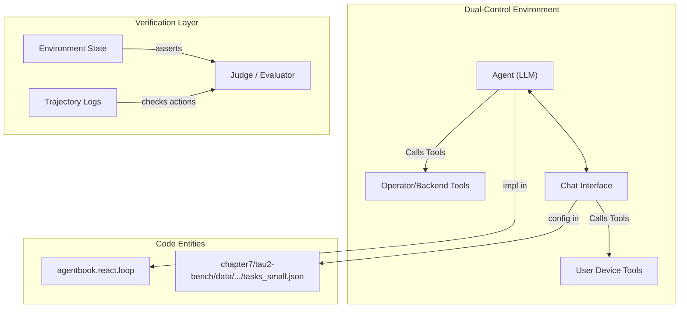
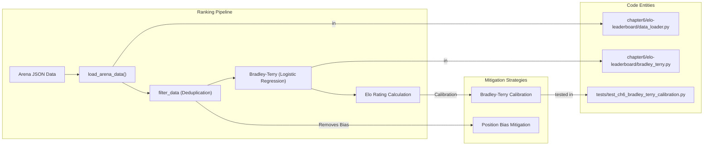

<!-- source: DeepWiki mcp.deepwiki.com · repo bojieli/ai-agent-book · page 7.2 Scoring, Metrics, and the ELO Leaderboard · fetched 2026-10-26 -->

# Scoring, Metrics, and the ELO Leaderboard

Relevant source files

The following files were used as context for generating this wiki page:

- [book-ar/chapter7.ar.md](book-ar/chapter7.ar.md)
- [book-en/chapter7.md](book-en/chapter7.md)
- [book-es/chapter7.es.md](book-es/chapter7.es.md)
- [book-hu/chapter7.md](book-hu/chapter7.md)
- [book-id/chapter7.md](book-id/chapter7.md)
- [book-ja/chapter7.ja.md](book-ja/chapter7.ja.md)
- [book-ko/chapter7.ko.md](book-ko/chapter7.ko.md)
- [book-ru/chapter7.md](book-ru/chapter7.md)
- [book-ta/chapter7.ta.md](book-ta/chapter7.ta.md)
- [book-tr/chapter7.tr.md](book-tr/chapter7.tr.md)
- [book-vi/chapter7.vi.md](book-vi/chapter7.vi.md)
- [book-zhtw/chapter7.zhtw.md](book-zhtw/chapter7.zhtw.md)
- [chapter4/collaboration-tools/src/excel_tools.py](chapter4/collaboration-tools/src/excel_tools.py)
- [chapter4/collaboration-tools/src/test_excel_max_rows_all_sheets.py](chapter4/collaboration-tools/src/test_excel_max_rows_all_sheets.py)
- [tests/test_build_site_assets.py](tests/test_build_site_assets.py)
- [tests/test_ch6_bradley_terry_calibration.py](tests/test_ch6_bradley_terry_calibration.py)
- [tests/test_ch6_bradley_terry_single_model.py](tests/test_ch6_bradley_terry_single_model.py)
- [tests/test_ch6_char_error_rate.py](tests/test_ch6_char_error_rate.py)
- [tests/test_ch6_rate_ramp_benchmark.py](tests/test_ch6_rate_ramp_benchmark.py)
- [tests/test_ch6_score_prediction_unhashable_claims.py](tests/test_ch6_score_prediction_unhashable_claims.py)
- [tests/test_ch7_evaluate_multilingual.py](tests/test_ch7_evaluate_multilingual.py)
- [tests/test_ch7_multilingual_reasoning_sft.py](tests/test_ch7_multilingual_reasoning_sft.py)

This page covers the technical implementation of Agent evaluation frameworks within the `ai-agent-book` repository. It focuses on the transition from raw agent trajectories to structured scores using rubric-based judging, the calculation of statistical metrics for reliability, the monitoring of performance-specific metrics (TTFT, TPOT), and the implementation of competitive ranking systems using the Bradley-Terry model.

## Rubric-Based Judging and Veto Dimensions

Evaluating AI Agents requires moving beyond simple string matching to semantic and procedural verification. The codebase adopts a **Rubric-based** approach where an LLM evaluates agent performance across multiple dimensions, distinguishing between "model capability" and "Harness design flaws" [book-en/chapter7.md:17]().

### The Anatomy of an Evaluation Task
A robust evaluation task, as exemplified by the `τ²-bench` telecom domain, consists of four key components:
1.  **Task Definition**: The specific ticket or request handed to the Agent [book-en/chapter7.md:37-42]().
2.  **User Scenario**: Behavioral specifications for the user simulator, including **known_info** (cognitive boundaries) and **task_instructions** (grounding requirements) [book-en/chapter7.md:44-57]().
3.  **Initial State**: Resetting both the user environment and the assistant's backend to a consistent starting point [book-en/chapter7.md:59-65]().
4.  **Evaluation Criteria**: Multi-dimensional assertions including `actions` (procedural checks), `env_assertions` (state-based verification), and `nl_assertions` (natural language correctness) [book-en/chapter7.md:67-81]().

### Dual-Control and Fact Anchoring
To prevent the "hallucination loop" where two models simply agree with each other, the framework uses a **Dual-Control** mechanism. The user simulator has its own toolset (e.g., `check_status_bar`, `run_speed_test`) and is strictly bound by **Fact Anchoring (Grounding)** [book-zhtw/chapter7.zhtw.md:89-91, 117-119]().

Sources: [book-en/chapter7.md:87-93](), [book-ko/chapter7.ko.md:117-119]()

## Performance and Observability Metrics

Correctness is only one facet of Agent quality. The repository tracks cost, latency, and throughput to assess production readiness.

### Key Performance Indicators (KPIs)
*   **TTFT (Time to First Token)**: Measures the responsiveness of the model, critical for streaming interfaces [chapter6/model-benchmark/README.md:83]().
*   **TPOT (Time Per Output Token)**: Indicates the generation speed once the context is processed [chapter6/model-benchmark/README.md:85]().
*   **KV Cache Efficiency**: Tracking `cached_tokens` allows for measuring the impact of prompt caching on both latency and cost [chapter6/agent-cost-analysis/tracer.py:48-51]().

### Cost Attribution via `Tracer`
The `Tracer` class in `chapter6/agent-cost-analysis/tracer.py` implements a hierarchical span model to attribute costs to specific components [chapter6/agent-cost-analysis/tracer.py:4-18]().

| Metric | Code Reference | Description |
| :--- | :--- | :--- |
| **Span Cost** | `tracer.py:70-133` | Total financial spend for a specific LLM or Tool call. |
| **Reasoning Tokens** | `tracer.py:48-51` | Specifically tracks tokens used by CoT models (e.g., o1). |
| **Throughput** | `README.md:85` | `output_tokens / (total_latency - TTFT)`. |

Sources: [chapter6/model-benchmark/README.md:80-90](), [chapter6/agent-cost-analysis/tracer.py:4-51]()

## Statistical Reliability: Pass@k vs. Pass^k

In stochastic environments, a single run is insufficient for evaluation.

*   **Pass@k**: The probability that at least one of $k$ generated trajectories is successful. This measures the **Capability Ceiling**—what the model is capable of achieving under ideal conditions [book-zhtw/chapter7.zhtw.md:133-136]().
*   **Pass^k (Reliability)**: The probability that the model succeeds consistently across multiple runs. This measures the **Reliability Floor**—how often the Agent will work in production [book-en/chapter7.md:135-140]().

To manage ranking uncertainty, the framework utilizes **Bootstrap Resampling** (`get_bootstrap_result`) to generate 95% confidence intervals for model ratings [tests/test_ch6_bradley_terry_calibration.py](), [chapter6/elo-leaderboard/bradley_terry.py:166-192]().

Sources: [book-zhtw/chapter7.zhtw.md:133-142](), [chapter6/elo-leaderboard/bradley_terry.py:166-180]()

## Competitive Ranking: The ELO Leaderboard

The `chapter6/elo-leaderboard/` directory implements a ranking system based on the **Bradley-Terry model**, which converts pairwise win/loss data into a global Elo rating [chapter6/elo-leaderboard/README.md:5-7]().

### Bradley-Terry MLE Implementation
The core logic uses Maximum Likelihood Estimation (MLE) to find the strength parameters that best explain the observed voting data [chapter6/elo-leaderboard/bradley_terry.py:114-116]().

### Advanced Ranking Features
*   **Online Elo Updates**: Incremental rating updates using a K-factor, allowing the leaderboard to evolve as new data arrives [chapter6/elo-leaderboard/README.md:30-41]().
*   **Position Bias Mitigation**: When judging, the system swaps model order (A/B vs B/A). A win is only recorded if the judge remains consistent [chapter6/elo-leaderboard/README.md:143-144]().
*   **Calibration**: The system uses `tests/test_ch6_bradley_terry_calibration.py` to ensure that predicted win rates match observed outcomes.

Sources: [chapter6/elo-leaderboard/README.md:24-41](), [chapter6/elo-leaderboard/data_loader.py:153-160](), [tests/test_ch6_bradley_terry_calibration.py]()

---

