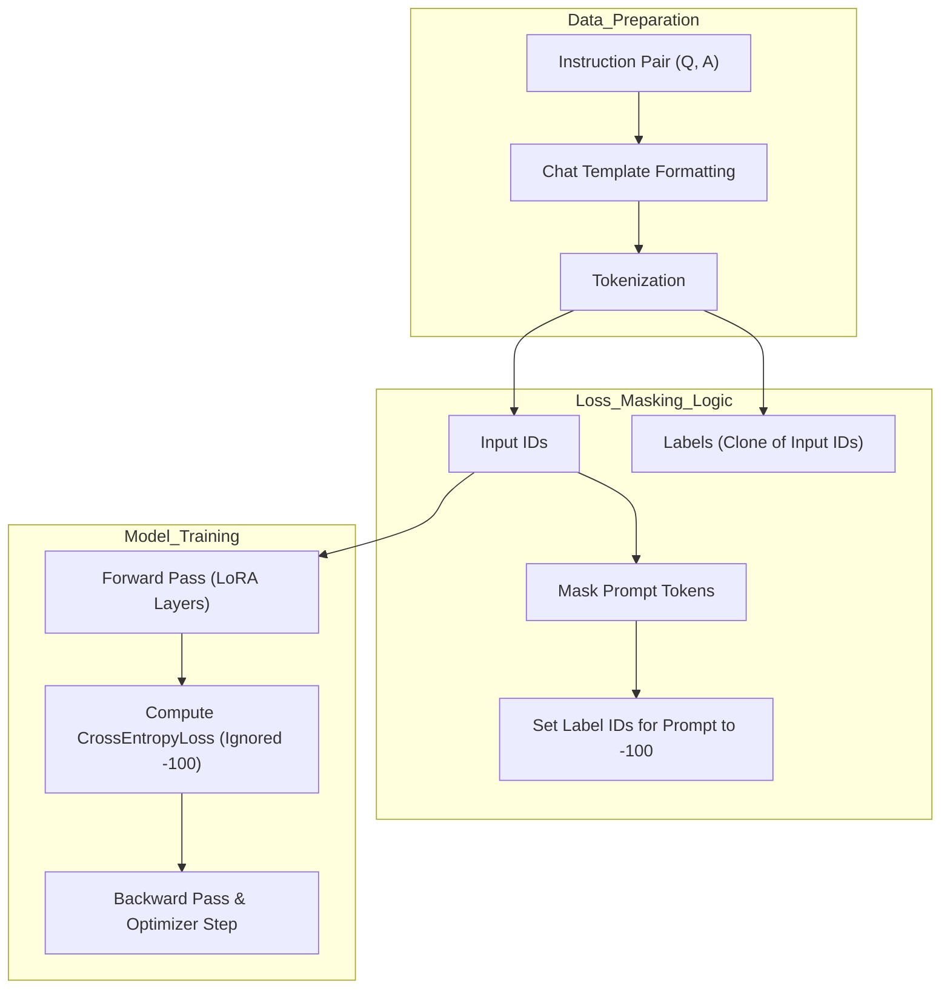
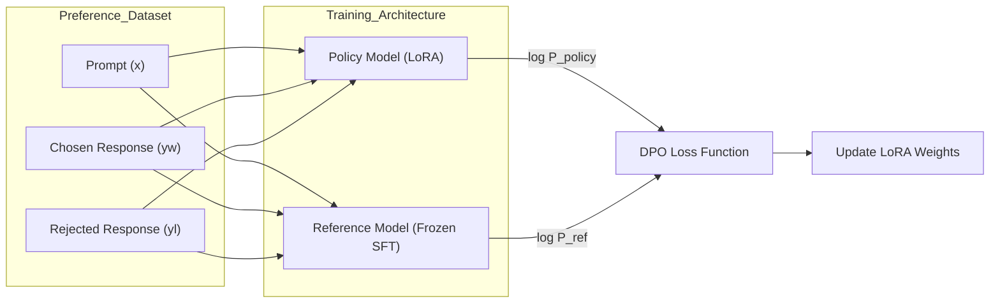

<!-- source: DeepWiki mcp.deepwiki.com · repo bojieli/ai-agent-book · page 8.1 Supervised Fine-Tuning and Preference Optimization · fetched 2026-10-26 -->

# Supervised Fine-Tuning and Preference Optimization

Relevant source files

The following files were used as context for generating this wiki page:

- [book-en/chapter8.md](book-en/chapter8.md)
- [book-es/chapter8.es.md](book-es/chapter8.es.md)
- [book-he/chapter8.he.md](book-he/chapter8.he.md)
- [book-hu/chapter8.md](book-hu/chapter8.md)
- [book-id/chapter8.md](book-id/chapter8.md)
- [book-ja/chapter8.ja.md](book-ja/chapter8.ja.md)
- [book-ko/chapter8.ko.md](book-ko/chapter8.ko.md)
- [book-ru/chapter8.md](book-ru/chapter8.md)
- [book-ta/chapter8.ta.md](book-ta/chapter8.ta.md)
- [book-tr/chapter8.tr.md](book-tr/chapter8.tr.md)
- [book-vi/chapter8.vi.md](book-vi/chapter8.vi.md)
- [book-zhtw/chapter8.zhtw.md](book-zhtw/chapter8.zhtw.md)
- [chapter8/README.ar.md](chapter8/README.ar.md)
- [chapter8/README.en.md](chapter8/README.en.md)
- [chapter8/README.es.md](chapter8/README.es.md)
- [chapter8/README.hu.md](chapter8/README.hu.md)
- [chapter8/README.id.md](chapter8/README.id.md)
- [chapter8/README.ja.md](chapter8/README.ja.md)
- [chapter8/README.ru.md](chapter8/README.ru.md)
- [chapter8/README.ta.md](chapter8/README.ta.md)
- [chapter8/README.tr.md](chapter8/README.tr.md)
- [chapter8/README.vi.md](chapter8/README.vi.md)
- [chapter8/README.zh-TW.md](chapter8/README.zh-TW.md)
- [chapter9/README.hu.md](chapter9/README.hu.md)
- [chapter9/README.id.md](chapter9/README.id.md)

This page documents the post-training pipeline used to transform a base LLM into a functional Agent. It covers the transition from **Supervised Fine-Tuning (SFT)**, which establishes instruction-following and formatting protocols, to **Preference Optimization (DPO)**, which refines model behavior using human or AI preferences. The section also details the underlying mechanics of reward modeling, KL regularization, and parameter-efficient fine-tuning via LoRA.

## 1. Overview: The Four-Part Panorama of Model Development

The repository defines the modern model capability development process as a four-stage map [book-en/chapter8.md:7-12]():
1.  **Pre-training**: Training on massive internet text to learn language rules, world knowledge, and reasoning via Next Token Prediction (NTP) [book-en/chapter8.md:9]().
2.  **Mid-training (Continued Pre-training)**: Filling gaps in domain knowledge, specific languages, or long-context capabilities using target-distribution data while maintaining the NTP objective [book-en/chapter8.md:10]().
3.  **Supervised Fine-Tuning (SFT)**: Teaching the model to follow specific protocols (e.g., JSON output, tool calling, style) using thousands of "Input-Output" pairs [book-en/chapter8.md:11]().
4.  **Reinforcement Learning (RL) / Preference Optimization**: Allowing the model to explore and improve through rewards and penalties to improve decision-making in unseen situations [book-en/chapter8.md:12]().

### SFT vs. RL: Memory vs. Generalization
The manuscript emphasizes two core threads for agent engineering:
*   **Thread One**: In controlled experiments, SFT tends to **memorize** demonstrations, while RL **generalizes** better by learning transferable strategies [book-en/chapter8.md:18]().
*   **Thread Two**: **Data and environment matter more than algorithms**. Success is determined by the Mid-training corpus, behavioral protocols in SFT, and the reliability of the simulation environment/reward signal in RL [book-en/chapter8.md:19]().

| Dimension | SFT (Supervised Fine-Tuning) | RL / Preference Optimization |
| :--- | :--- | :--- |
| **Goal** | Maximize Likelihood of Label (NTP) | Maximize Expected Reward |
| **Learning Signal** | Token-level supervision (masked) | Sequence-level reward/preference |
| **Data Type** | Thousands of "Input-Output" pairs | Task + Reward Function (No standard answer) |
| **Mechanism** | Mass-covering (covers all modes) | Mode-seeking (finds optimal peaks) |
| **Cost** | Low (hours to days) | High (often 10x-100x SFT) |

Sources: [book-en/chapter8.md:16-19](), [book-en/chapter8.md:30-37](), [book-zhtw/chapter8.zhtw.md:93-105]()

---

## 2. Supervised Fine-Tuning (SFT) Implementation

SFT is mathematically identical to pre-training (Next Token Prediction) but differs in data structure and loss calculation [book-zhtw/chapter8.zhtw.md:56-57]().

### Loss Masking and Protocol Encoding
To prevent the model from learning "how to ask the question" and focus only on "how to answer," SFT employs **Loss Masking**. During training, the tokens of the user prompt are masked so that gradients are only backpropagated through the response tokens [book-zhtw/chapter8.zhtw.md:59-60](). This process encodes **protocol knowledge** (format, style, procedure) rather than large-scale factual knowledge [book-zhtw/chapter8.zhtw.md:63-64]().

### LoRA: Parameter-Efficient Fine-Tuning
The experiments utilize **LoRA (Low-Rank Adaptation)** to reduce hardware requirements and mitigate catastrophic forgetting [book-zhtw/chapter8.zhtw.md:65-66]().
*   **Implementation**: Instead of updating the original weight matrices, LoRA attaches small low-rank "patches" (rank 1-256) [book-zhtw/chapter8.zhtw.md:66]().
*   **Application Rules**: LoRA must be applied to all major weight matrices, particularly the MLP layers. Applying it only to attention layers results in performance degradation [book-zhtw/chapter8.zhtw.md:66]().
*   **Hyperparameters**: The optimal learning rate for LoRA is typically 10x higher than that used for full-parameter fine-tuning [book-zhtw/chapter8.zhtw.md:66]().

### Data Flow: SFT Training Logic
The following diagram illustrates the SFT data flow, specifically how `loss_masking` is applied to separate prompt logic from response generation.

Title: SFT Data Flow with Loss Masking

Sources: [book-zhtw/chapter8.zhtw.md:56-66](), [book-ko/chapter8.ko.md:56-65]()

---

## 3. Preference Optimization and DPO

While SFT teaches "format," **Direct Preference Optimization (DPO)** teaches "preference." DPO is an offline optimization technique that removes the need for a separate reward model training step in the RLHF pipeline.

### The Bradley-Terry Model and Optimization Goal
DPO maximizes the log-likelihood of the "chosen" response relative to the "rejected" response. It uses the **Bradley-Terry Model** to represent the probability that one response is preferred over another [book-zhtw/chapter8.zhtw.md:86-91]().

### Regularization and mode-seeking
*   **Reference Model**: During DPO, a frozen reference model (the SFT checkpoint) is used to calculate a KL divergence penalty. This ensures the policy model does not drift too far from the instruction-following base [book-zhtw/chapter8.zhtw.md:106-108]().
*   **Mode-Seeking Behavior**: Unlike SFT, which is "mass-covering" (trying to cover all reasonable answers), RL and DPO are "mode-seeking," concentrating probability mass on high-reward peaks [book-zhtw/chapter8.zhtw.md:106-108]().

Title: DPO Preference Optimization Logic

Sources: [book-zhtw/chapter8.zhtw.md:86-108](), [book-en/chapter8.md:12-19]()

---

## 4. Capability Pre-requisites for RL

The manuscript defines a clear decision framework for when to use SFT versus RL based on model capability [book-zhtw/chapter8.zhtw.md:70-84]():

1.  **Format Support**: If a model cannot output the required format (e.g., JSON), SFT must be used first to "smooth the speech" and make rewards calculable [book-zhtw/chapter8.zhtw.md:71-72]().
2.  **Capability Support**: RL is effective only if the base model has a non-zero probability of exploring successful trajectories. If `pass@k` (the probability of at least one success in $k$ samples) is near zero, RL will fail to find positive samples to reinforce [book-zhtw/chapter8.zhtw.md:74-80]().
3.  **Mid-training Necessity**: If the model lacks domain-specific facts or long-context reasoning, Mid-training should be prioritized over SFT/RL [book-zhtw/chapter8.zhtw.md:82]().

### Pass@k and Success Probability
The probability of success $pass@k$ is calculated as:
$$ \operatorname{pass@}k = 1-(1-p)^k $$
Where $p$ is the single-sample success probability (`pass@1`). If `pass@k` is low even for large $k$, the model requires Mid-training or SFT to inject basic capabilities before RL can optimize them [book-zhtw/chapter8.zhtw.md:76-80]().

Sources: [book-zhtw/chapter8.zhtw.md:70-84](), [book-ko/chapter8.ko.md:67-70]()

---

