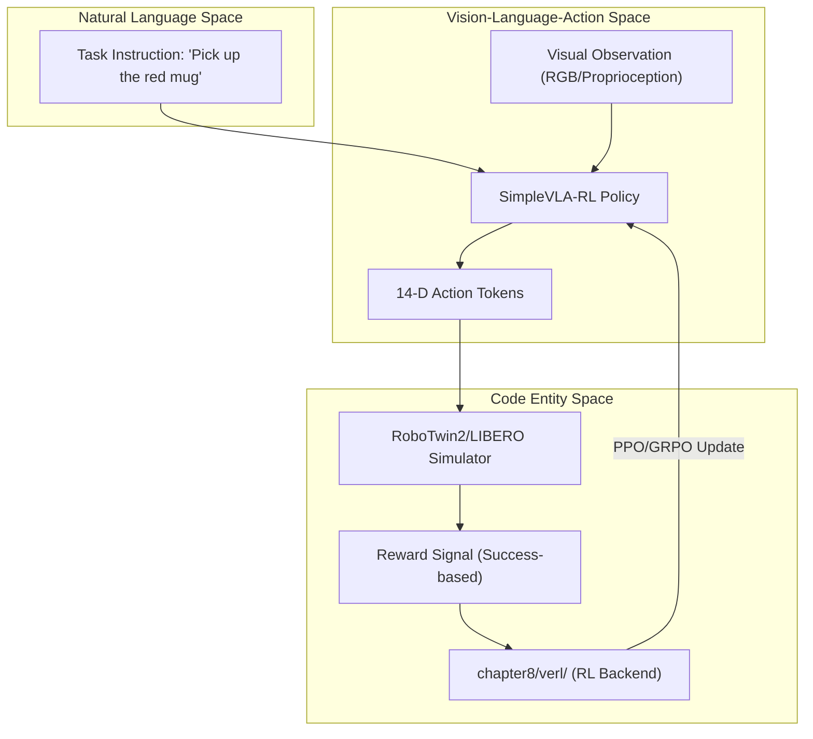
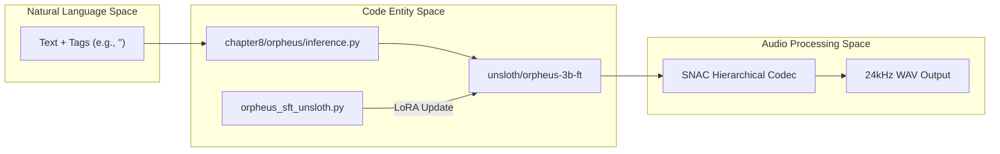

<!-- source: DeepWiki mcp.deepwiki.com · repo bojieli/ai-agent-book · page 8.3 Specialized Training: VLA, Multilingual, and Audio Models · fetched 2026-10-26 -->

# Specialized Training: VLA, Multilingual, and Audio Models

Relevant source files

The following files were used as context for generating this wiki page:

- [book-en/chapter8.md](book-en/chapter8.md)
- [book-es/chapter8.es.md](book-es/chapter8.es.md)
- [book-he/chapter8.he.md](book-he/chapter8.he.md)
- [book-hu/chapter8.md](book-hu/chapter8.md)
- [book-id/chapter8.md](book-id/chapter8.md)
- [book-ja/chapter8.ja.md](book-ja/chapter8.ja.md)
- [book-ko/chapter8.ko.md](book-ko/chapter8.ko.md)
- [book-ru/chapter8.md](book-ru/chapter8.md)
- [book-ta/chapter8.ta.md](book-ta/chapter8.ta.md)
- [book-tr/chapter8.tr.md](book-tr/chapter8.tr.md)
- [book-vi/chapter8.vi.md](book-vi/chapter8.vi.md)
- [book-zhtw/chapter8.zhtw.md](book-zhtw/chapter8.zhtw.md)
- [chapter8/prompt-distillation/create_data.py](chapter8/prompt-distillation/create_data.py)
- [chapter8/prompt-distillation/evaluate.py](chapter8/prompt-distillation/evaluate.py)
- [chapter8/prompt-distillation/test_create_data_empty.py](chapter8/prompt-distillation/test_create_data_empty.py)
- [chapter8/prompt-distillation/test_evaluate_empty_parse_rate.py](chapter8/prompt-distillation/test_evaluate_empty_parse_rate.py)
- [chapter8/prompt-distillation/test_evaluate_none_pred_label.py](chapter8/prompt-distillation/test_evaluate_none_pred_label.py)

This section documents specialized post-training tracks within the `chapter8/` directory (previously `chapter7/` in earlier iterations). While standard Supervised Fine-Tuning (SFT) and Reinforcement Learning (RL) establish general instruction-following, specialized models require custom architectures and data pipelines to handle specific modalities (Vision-Language-Action, Audio) or cognitive domains (Spatial Reasoning, Multilingual Reasoning).

## 1. Overview of Specialized Post-Training

Modern model capability development is divided into four parts: Pre-training, Mid-training, SFT, and RL [book-en/chapter8.md:7-12](). Specialized models often rely heavily on **Mid-training** (Continued Pre-training) to fill domain-specific knowledge gaps before behavior is shaped by SFT or RL [book-en/chapter8.md:10]().

### The Training Pipeline
1.  **Mid-training**: Absorbs large bodies of knowledge (domain docs, code, target languages) [book-en/chapter8.md:10]().
2.  **SFT**: Encodes "protocol knowledge" such as output formats (JSON, Tool Calls) and style [book-zhtw/chapter8.zhtw.md:64]().
3.  **RL**: Generalizes behavior to unseen situations and optimizes for verifiable rewards [book-en/chapter8.md:12]().

**Sources:** [book-en/chapter8.md:7-14](), [book-zhtw/chapter8.zhtw.md:64]()

---

## 2. SimpleVLA-RL: Vision-Language-Action Training

The `SimpleVLA-RL` sub-project implements a Reinforcement Learning pipeline for robotic control. Unlike standard LLMs that output text, VLA models output discretized action tokens that map to physical robot movements.

### Key Implementation Details
*   **Action Chunking**: Evaluated to improve success rates in robotic environments (e.g., RoboTwin2). Larger chunk sizes (e.g., 25) often outperform single-step actions [docs/EXPERIMENT_STATUS.md:40]().
*   **LoRA for RL**: For RL tasks, lower ranks (rank=8 to 32) are often sufficient as the information gain per round is smaller compared to SFT [book-zhtw/chapter8.zhtw.md:66]().
*   **Stability**: The pipeline uses techniques like "Clip Higher" and specific sampling temperatures to stabilize policy updates in trajectory optimization.

### VLA Training Data Flow
The following diagram illustrates the transition from raw sensory input to robotic action within the `SimpleVLA-RL` framework.

**SimpleVLA-RL Data Flow**

**Sources:** [book-zhtw/chapter8.zhtw.md:66](), [docs/EXPERIMENT_STATUS.md:40](), [book-en/chapter8.md:18-19]()

---

## 3. Specialized Reasoning and Multilingual Models

The repository includes specialized training logic for enhancing cognitive dimensions, particularly focusing on the distinction between SFT (memorization) and RL (generalization) [book-en/chapter8.md:18]().

### Multilingual and Logic Training
*   **MultilingualReasoning**: Focuses on cross-lingual logic. The `Mid-training` stage is critical here to fill gaps in target-language data that general pre-training covered poorly [book-en/chapter8.md:10]().
*   **AdaptThink**: A specialized router training project that decides when to engage "Thinking" (Long CoT) vs "NoThinking" (Direct Response) to optimize latency and cost [book-zhtw/chapter8.zhtw.md:110]().

### Prompt Distillation
The `chapter8/prompt-distillation/` directory contains tools for distilling complex reasoning capabilities into smaller models.
*   **Evaluation**: `evaluate.py` calculates metrics like `empty_parse_rate` and `none_pred_label` to validate if distilled models maintain the protocol knowledge of the teacher [chapter8/prompt-distillation/evaluate.py:1-50]().
*   **Data Creation**: `create_data.py` generates the SFT pairs needed to "solidify" the teacher's reasoning style into the student's parameters [chapter8/prompt-distillation/create_data.py:1-40]().

**Sources:** [book-en/chapter8.md:10-18](), [chapter8/prompt-distillation/evaluate.py:1-20](), [book-zhtw/chapter8.zhtw.md:110]()

---

## 4. Audio Models: Orpheus and Sesame

These projects utilize efficient LoRA fine-tuning for Text-to-Speech (TTS) and audio-modality models.

### Orpheus (3B)
Focuses on cross-sentence voice consistency and expressive speech using paralinguistic tags.
*   **Architecture**: Utilizes SNAC (Stochastic Neural Audio Codec) for hierarchical audio representation.
*   **Inference Logic**: Handles token redistribution and frame decoding to ensure smooth speech transitions.

### Sesame (1B)
A compact model focused on paralinguistic tag modeling (e.g., `<laugh>`, `<sigh>`).
*   **Training Strategy**: Uses SFT to encode the "protocol" of how these tags should be expressed in the audio stream [book-zhtw/chapter8.zhtw.md:64]().

**Audio Training and Inference Entity Map**

**Sources:** [book-zhtw/chapter8.zhtw.md:64-66](), [book-en/chapter8.md:11]()

---

## 5. Validation and Artifacts

Specialized training success is determined by the **Simulation Environment** and **Reward Signal** rather than the algorithm itself [book-en/chapter8.md:19]().

### Evidence Ledger
All specialized training runs in `chapter8/` must record evidence in the `EXPERIMENT_LEDGER.md`.
*   **Rollouts**: Saved trajectories from RL runs (e.g., `verl` rollouts).
*   **Checkpoints**: LoRA adapters saved at specific steps.
*   **Manifests**: Records of data distribution (e.g., the ratio of domain data to general retention data in Mid-training) [book-en/chapter8.md:10]().

### SFT vs RL Validation
*   **SFT Validation**: Measures how well the model reproduces the "ideal answer" format (Loss Masking) [book-zhtw/chapter8.zhtw.md:60]().
*   **RL Validation**: Measures the `pass@k` rate in a sandbox environment to ensure the model has learned a transferable strategy [book-zhtw/chapter8.zhtw.md:74-80]().

**Sources:** [book-en/chapter8.md:19](), [book-zhtw/chapter8.zhtw.md:60-80](), [docs/EXPERIMENT_STATUS.md:1-12]()

---

