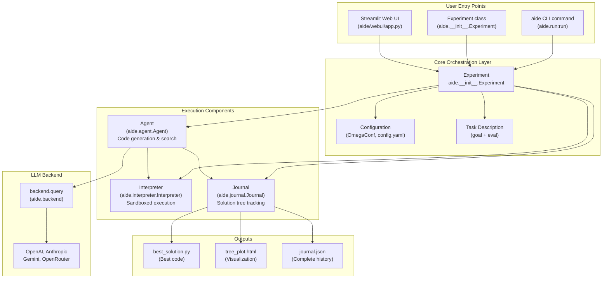
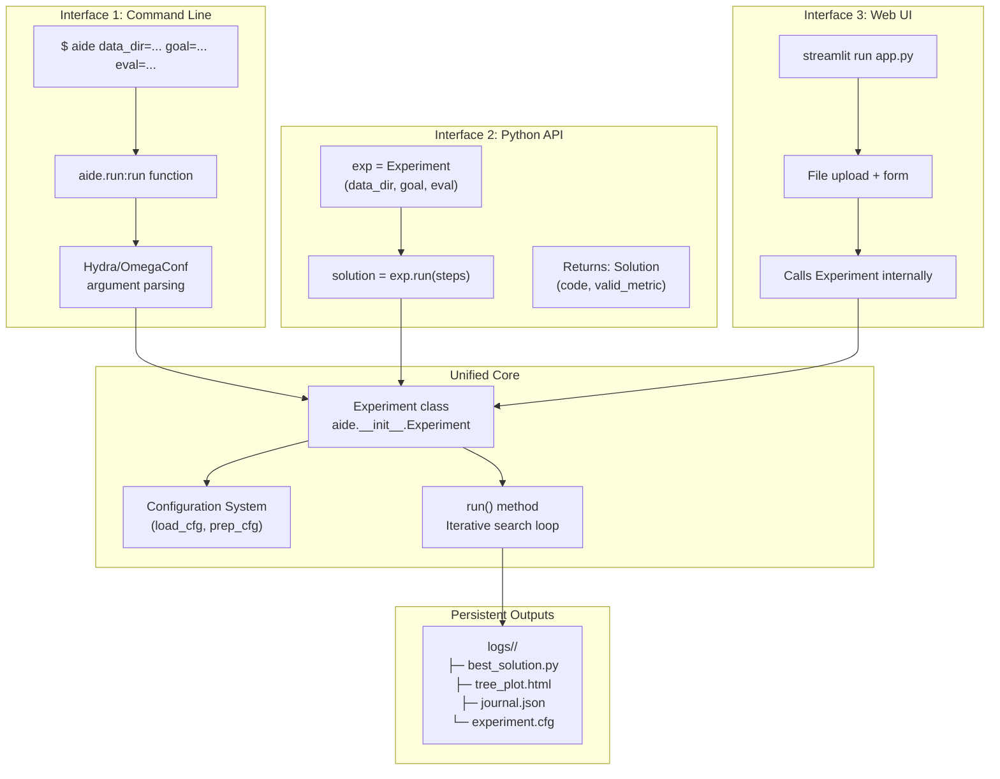
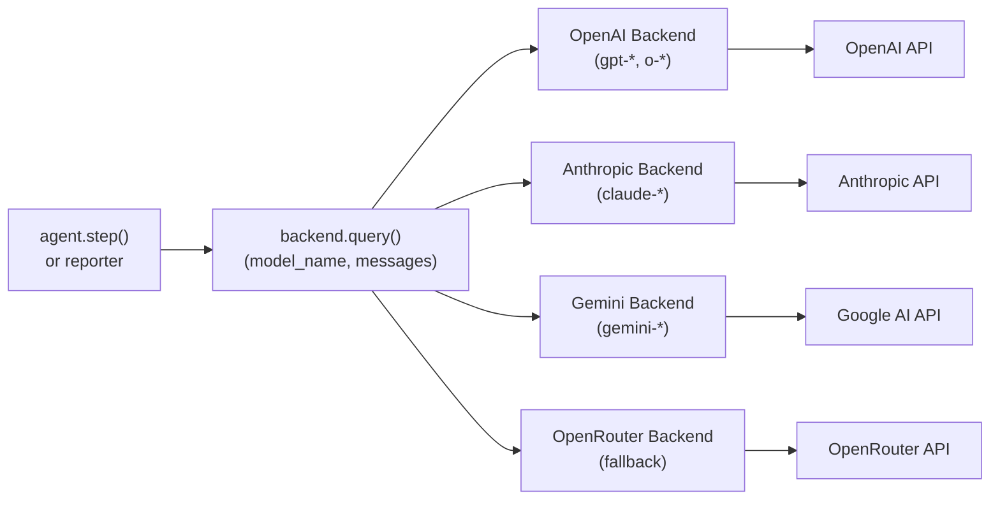

<!-- source: DeepWiki mcp.deepwiki.com · repo WecoAI/aideml · page 1 Overview · fetched 2026-10-26 -->

# Overview

<details>
<summary>Relevant source files</summary>

The following files were used as context for generating this wiki page:

- [README.md](README.md)
- [aide/__init__.py](aide/__init__.py)
- [setup.py](setup.py)

</details>


## Purpose and Scope

This page provides a high-level introduction to the AIDE ML system, explaining what it is, its core concepts, and how its main components fit together. AIDE ML is an autonomous AI agent that generates, executes, and iteratively improves machine learning code through LLM-guided tree search until a user-defined metric is optimized.

For detailed information about specific subsystems, see:
- Installation instructions: [Installation & Setup](#1.1)
- Configuration details: [Configuration System](#2.2)
- User interfaces: [User Interfaces](#3)
- LLM integration: [LLM Backend System](#4)
- Internal components: [Core Subsystems](#5)

**Sources:** [README.md:1-22](), [aide/__init__.py:1-63]()

---

## What is AIDE ML?

AIDE ML (AI-Driven Exploration in the space of code) is a Python package that automates machine learning solution development. Users provide a dataset and natural-language task description, and AIDE autonomously:

1. Generates Python code that addresses the task
2. Executes code in a sandboxed environment
3. Evaluates performance using the specified metric
4. Iteratively improves solutions through LLM-guided search
5. Produces a tree of solution attempts with the best result

The system is distributed as the `aideml` package (version 0.2.2) and exposes the `aide` command-line tool as its primary interface.

| Component | Description |
|-----------|-------------|
| **Package Name** | `aideml` |
| **CLI Entry Point** | `aide` command |
| **Main Python API** | `aide.Experiment` class |
| **Core Algorithm** | Agentic tree search over code solutions |
| **Target Users** | ML practitioners, agent-architecture researchers |

**Sources:** [README.md:19-35](), [setup.py:9-41]()

---

## Core Architecture

AIDE ML's architecture consists of four primary components orchestrated by the `Experiment` class:



**Diagram: AIDE ML Core Architecture - Main Classes and Their Relationships**

The `Experiment` class ([aide/__init__.py:23-63]()) serves as the central orchestrator, initializing and coordinating the three execution components:

- **`Agent`** ([aide/agent/]()): Generates code using LLMs and manages the search process
- **`Interpreter`** ([aide/interpreter.py]()): Executes generated code in isolated subprocess environments
- **`Journal`** ([aide/journal.py]()): Maintains a tree structure of all solution attempts with metrics

**Sources:** [aide/__init__.py:23-63](), [setup.py:36-40]()

---

## Agentic Tree Search Workflow

AIDE operates through an iterative tree search algorithm where each node represents a complete Python solution:

```mermaid
graph LR
    subgraph "Step 1: Initialization"
        A["Load config.yaml<br/>(prep_cfg)"]
        B["Prepare workspace<br/>(prep_agent_workspace)"]
        C["Initialize Journal<br/>(Journal())"]
    end
    
    subgraph "Step 2: Iterative Loop"
        D["agent.step()<br/>Generate code drafts"]
        E["interpreter.run()<br/>Execute in sandbox"]
        F["Compute metric<br/>(RMSE, AUROC, etc)"]
        G["journal records<br/>node with metric"]
        H["Prune & select<br/>next node"]
    end
    
    subgraph "Step 3: Output"
        I["journal.get_best_node()<br/>Extract top solution"]
        J["save_run()<br/>Write logs/"]
        K["Return Solution<br/>(code + valid_metric)"]
    end
    
    A --> B
    B --> C
    C --> D
    D --> E
    E --> F
    F --> G
    G --> H
    H --> D
    H --> I
    I --> J
    J --> K
```



**Diagram: Experiment Execution Flow Through Main Methods**

The workflow is implemented in the `Experiment.run()` method ([aide/__init__.py:55-62]()):

1. **Initialization**: Load configuration, prepare workspace with data files, create `Journal` instance ([aide/__init__.py:33-54]())
2. **Iteration Loop**: For each step (default 20):
   - `agent.step()` generates multiple code variations using LLMs
   - `interpreter.run()` executes each variation in a subprocess sandbox
   - Metrics are computed and recorded in the journal
   - Search heuristics select the next node to expand
3. **Output**: Extract best solution, save artifacts to `logs/` directory ([aide/__init__.py:58-62]())

The `Solution` dataclass ([aide/__init__.py:17-20]()) encapsulates the return value with two fields:
- `code`: The best Python solution as a string
- `valid_metric`: The validation metric value achieved

**Sources:** [aide/__init__.py:17-63]()

---

## User Interaction Model

AIDE provides three distinct interfaces that all converge on the `Experiment` class:



**Diagram: Three User Interfaces Converging on the Experiment Class**

### CLI Usage
The `aide` command ([setup.py:36-40]()) invokes `aide.run:run` with Hydra-based configuration:
```bash
aide data_dir="example_tasks/house_prices" \
     goal="Predict the sales price for each house" \
     eval="RMSE between log-prices"
```

### Python API Usage
Direct instantiation of `Experiment` ([aide/__init__.py:24-37]()):
```python
exp = aide.Experiment(
    data_dir="example_tasks/bitcoin_price",
    goal="Build a time series forecasting model",
    eval="RMSLE"
)
solution = exp.run(steps=20)
```

### Web UI Usage
Streamlit application at `aide/webui/app.py` provides file upload and form-based interaction ([README.md:93-103]()).

**Sources:** [README.md:69-151](), [aide/__init__.py:23-63](), [setup.py:36-40]()

---

## Key Concepts

### Task Specification
Tasks are defined through natural language descriptions consisting of:
- **`data_dir`**: Path to directory containing CSV, TXT, or JSON data files
- **`goal`**: Description of the objective (e.g., "Predict house prices")
- **`eval`**: Metric specification (e.g., "RMSE", "AUROC", "accuracy")

The `load_task_desc()` function ([aide/utils/config.py:9]()) compiles these into a structured format that guides code generation.

### Solution Tree
The `Journal` class ([aide/__init__.py:5]()) maintains a tree where:
- Each **node** represents a complete Python solution
- **Edges** represent code modifications (patches)
- **Metrics** guide which branches to expand
- The **root** is an initial solution generated from scratch

### Agentic Search
The `Agent` generates multiple code drafts per iteration (`num_drafts` parameter), creating a branching tree. Search hyperparameters control exploration vs. exploitation trade-offs.

**Sources:** [aide/__init__.py:39-49](), [README.md:36-40]()

---

## Output Artifacts

After execution, AIDE writes to `logs/<experiment-id>/`:

| File | Description | Generated By |
|------|-------------|--------------|
| `best_solution.py` | Python code with best metric | `journal.get_best_node()` |
| `tree_plot.html` | Interactive solution tree visualization | Tree plotting utilities |
| `journal.json` | Complete history of all attempts | `Journal.to_dict()` |
| `experiment.cfg` | Configuration snapshot | `save_run()` |
| `report.md` | Optional LLM-generated summary | Report generator |

The `save_run()` function ([aide/utils/config.py:11]()) persists these artifacts after each step, enabling fault tolerance and incremental progress tracking.

**Sources:** [README.md:86-89](), [aide/__init__.py:58-62]()

---

## Configuration and Extensibility

AIDE uses OmegaConf for hierarchical configuration management. The base configuration resides at `aide/utils/config.yaml` and supports CLI overrides:

```bash
aide agent.code.model="claude-4-sonnet" \
     agent.steps=50 \
     agent.search.num_drafts=10 \
     data_dir=... goal=... eval=...
```

Common configuration parameters:

| Parameter | Default | Purpose |
|-----------|---------|---------|
| `agent.code.model` | `gpt-4-turbo` | LLM for code generation |
| `agent.feedback.model` | `gpt-4o` | LLM for analysis/feedback |
| `agent.steps` | `20` | Number of search iterations |
| `agent.search.num_drafts` | `5` | Parallel drafts per iteration |
| `exec.timeout` | `300` | Code execution timeout (seconds) |

The `prep_cfg()` function ([aide/utils/config.py:13]()) merges CLI arguments with YAML defaults and performs validation.

**Sources:** [README.md:107-123](), [aide/__init__.py:33-37]()

---

## Multi-Provider LLM Support

The backend abstraction layer supports multiple LLM providers through a unified interface:



**Diagram: LLM Backend Provider Routing**

Provider selection is automatic based on model name patterns. Custom OpenAI-compatible endpoints are supported via the `OPENAI_BASE_URL` environment variable ([README.md:160]()).

**Sources:** [README.md:157-173]()

---

## Research Context

AIDE ML implements the AIDE algorithm described in [arXiv:2502.13138](https://arxiv.org/abs/2502.13138). The system has been used as a baseline or component in multiple research projects:

- **OpenAI MLE-Bench**: AIDE's tree search achieved 4× more medals than the best linear agent ([README.md:39]())
- **METR RE-Bench**: Evaluation of AI R&D capabilities ([README.md:59]())
- **Sakana AI AI-Scientist-v2**: Workshop-level automated scientific discovery ([README.md:60]())
- **Meta LLM Speedrunner**: Reproducing NanoGPT improvements ([README.md:61]())
- **SJTU ML-Master**: Integration of exploration and reasoning ([README.md:63]())

This open-source implementation serves as a reference for researchers exploring agentic systems for code optimization.

**Sources:** [README.md:39-64]()

---

