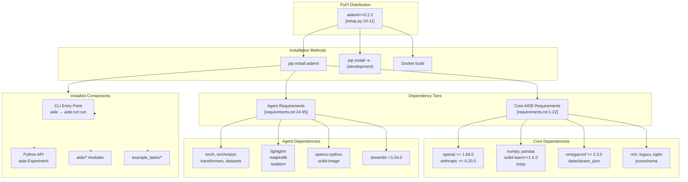
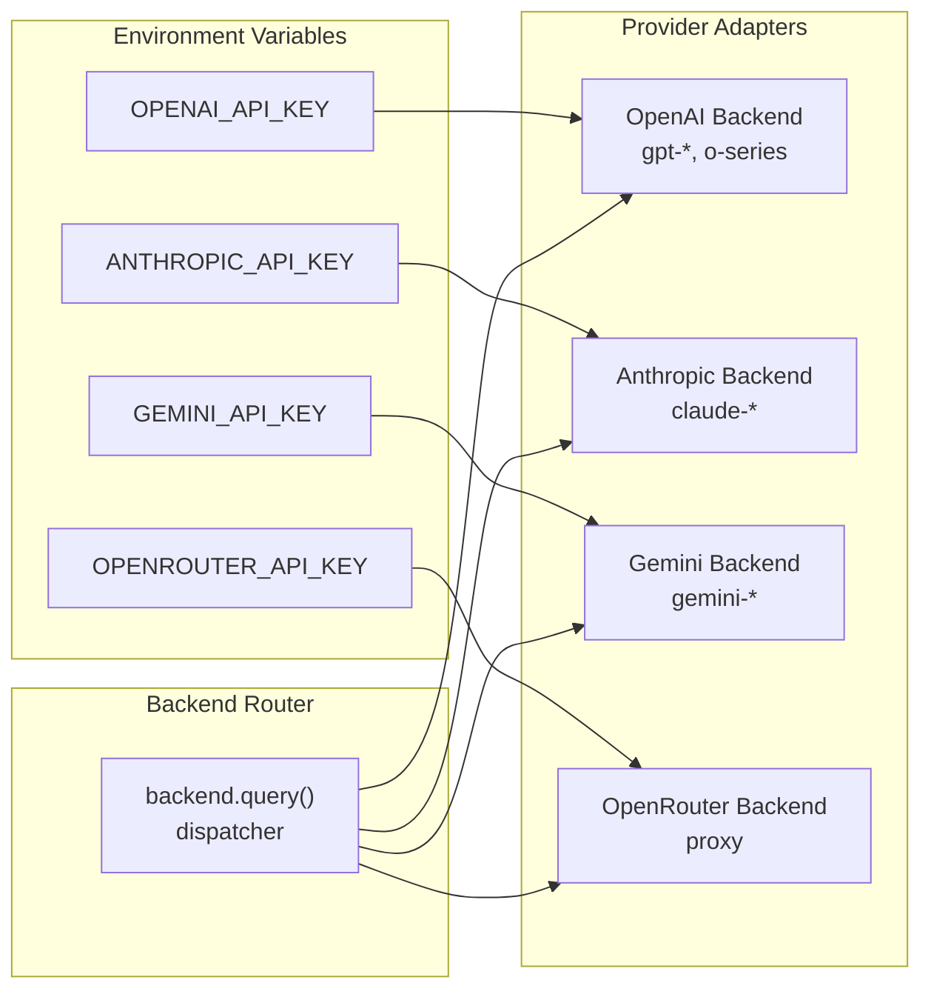
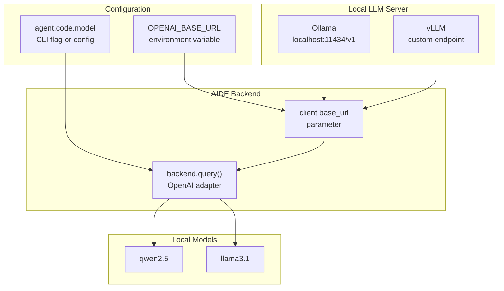
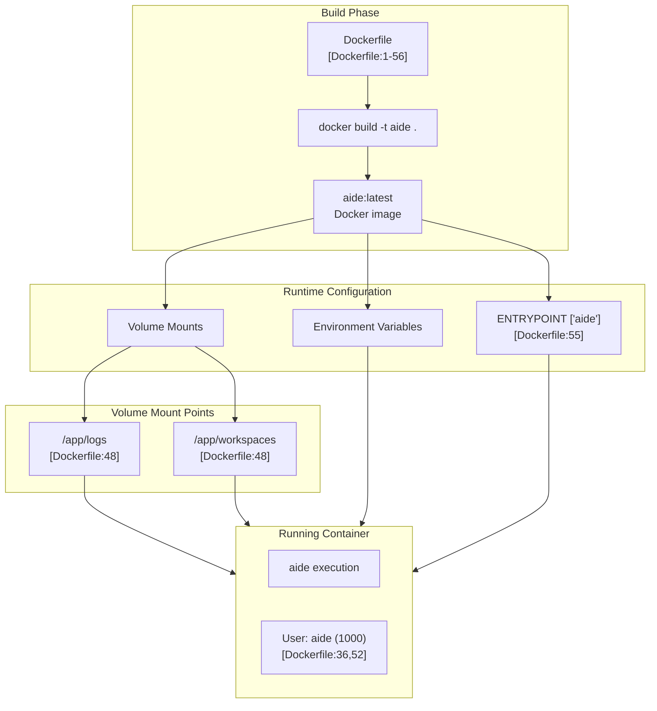

<!-- source: DeepWiki mcp.deepwiki.com · repo WecoAI/aideml · page 1.1 Installation & Setup · fetched 2026-10-26 -->

# Installation & Setup

<details>
<summary>Relevant source files</summary>

The following files were used as context for generating this wiki page:

- [.dockerignore](.dockerignore)
- [Dockerfile](Dockerfile)
- [README.md](README.md)
- [aide/utils/metric.py](aide/utils/metric.py)
- [requirements.txt](requirements.txt)
- [setup.py](setup.py)

</details>


This document provides instructions for installing AIDE ML and configuring its dependencies. It covers standard pip installation, API key setup for LLM providers, local LLM configuration, Docker deployment, and development installation.

---

## Standard Installation

AIDE ML is distributed as the `aideml` package on PyPI. The package requires Python 3.10 or higher [setup.py:34]().

### Basic Installation

```bash
pip install -U aideml
```

This installs the `aide` command-line tool and the `aide` Python package. The package version is defined in [setup.py:11]() as `0.2.2`.

**What Gets Installed**

The installation includes:
- **Console script**: `aide` command via entry point [setup.py:38]().
- **Core package**: `aide` module with all subsystems [setup.py:18]().
- **Example tasks**: Sample datasets in `aide/example_tasks/` [setup.py:24-26]().
- **Configuration templates**: Default config at `aide/utils/config.yaml` [setup.py:22]().
- **Visualization templates**: HTML templates for tree rendering [setup.py:23]().

**Sources**: [setup.py:1-42](), [README.md:74-75]()

---

## Dependency Structure

AIDE ML uses a two-tier dependency architecture that separates system requirements from agent capabilities [requirements.txt:1,24]().

### Installation Architecture



**Sources**: [setup.py:1-42](), [requirements.txt:1-95]()

### Dependency Categories

| Category | Purpose | Key Packages | Lines in requirements.txt |
|----------|---------|--------------|---------------------------|
| **LLM Integration** | Connect to AI model providers | `openai`, `anthropic` | [requirements.txt:7-8]() |
| **Data Science** | Core ML and data processing | `numpy`, `pandas`, `scikit-learn`, `scipy` | [requirements.txt:6,9,12,14]() |
| **Configuration** | YAML-based config management | `omegaconf`, `dataclasses_json` | [requirements.txt:16,15]() |
| **Utilities** | Logging, progress, formatting | `rich`, `loguru`, `tqdm` | [requirements.txt:13,17,19]() |
| **Development** | Testing and code formatting | `pytest`, `black` | [requirements.txt:10,2]() |
| **Agent Toolkit** | Libraries agent may use | `torch`, `lightgbm`, `transformers`, `optuna` | [requirements.txt:25-95]() |

The separation between core and agent requirements is documented at [requirements.txt:1]() and [requirements.txt:24](). Core requirements are minimal dependencies for AIDE system operation. Agent requirements are comprehensive ML libraries that generated code may import.

**Sources**: [requirements.txt:1-95](), [setup.py:5-7]()

---

## API Key Configuration

AIDE ML supports multiple LLM providers. At minimum, one provider's API key must be configured via environment variables.

### Supported Providers



**Sources**: [README.md:78,160,168]()

### Setting API Keys

Export the appropriate environment variable before running AIDE:

```bash
# OpenAI (recommended for default config)
export OPENAI_API_KEY="sk-..."

# Anthropic
export ANTHROPIC_API_KEY="sk-ant-..."

# Gemini
export GEMINI_API_KEY="..."

# OpenRouter (fallback provider)
export OPENROUTER_API_KEY="..."
```

**Default Model Requirements**

The default configuration uses OpenAI models:
- Code generation: `gpt-4-turbo` [README.md:120]().
- Feedback/evaluation: `gpt-4o` [README.md:164]().

To use other providers, override the model selection via CLI flags:
`aide agent.code.model="claude-3-5-sonnet-20240620" ...` [README.md:111-113]().

**Sources**: [README.md:78,111-122]()

---

## Local LLM Setup

AIDE supports local LLM endpoints that implement the OpenAI API specification [README.md:160]().

### Configuration Flow



**Sources**: [README.md:157-162]()

### Ollama Example

**1. Configure AIDE**

```bash
# Point to Ollama endpoint
export OPENAI_BASE_URL="http://localhost:11434/v1"

# Use local model for code generation
aide agent.code.model="qwen2.5" \
     data_dir=... \
     goal=... \
     eval=...
```

**2. Fully Local Setup**

To avoid all external API calls, override both the code and feedback models:

```bash
export OPENAI_BASE_URL="http://localhost:11434/v1"

aide agent.code.model="qwen2.5" \
     agent.feedback.model="qwen2.5" \
     data_dir=... \
     goal=... \
     eval=...
```

**Sources**: [README.md:157-172]()

---

## Docker Installation

AIDE provides a `Dockerfile` for containerized execution, which is useful for sandboxing the agent's code execution.

### Docker Build and Run



**Sources**: [Dockerfile:1-56](), [README.md:175-184]()

### Docker Commands

**Build Image**
```bash
docker build -t aide .
```

**Run Experiment**
```bash
docker run -it --rm \
  -v "$(pwd)/logs:/app/logs" \
  -v "$(pwd)/workspaces:/app/workspaces" \
  -e OPENAI_API_KEY=$OPENAI_API_KEY \
  aide data_dir=... goal=... eval=...
```

The container runs as a non-root user `aide` [Dockerfile:36,52]() and exposes volumes for persistent logging and workspace data [Dockerfile:48-49]().

---

## Verification

Verify the setup by running a quick test using the included example tasks [setup.py:24-26]().

```bash
# Run a 2-step optimization on the house prices example
aide data_dir="example_tasks/house_prices" \
     goal="Predict the sales price for each house" \
     eval="RMSE between log-prices" \
     agent.steps=2
```

**Expected Outputs** [README.md:86-90]():
- `logs/<id>/best_solution.py`: The best generated Python script.
- `logs/<id>/tree_plot.html`: An interactive visualization of the search tree.

**Sources**: [README.md:73-90](), [setup.py:36-40]()

---

