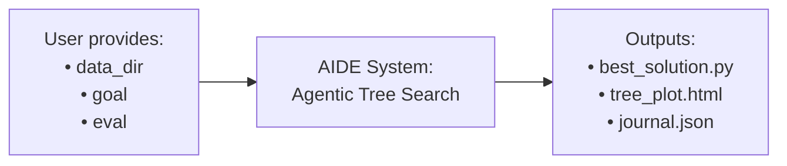
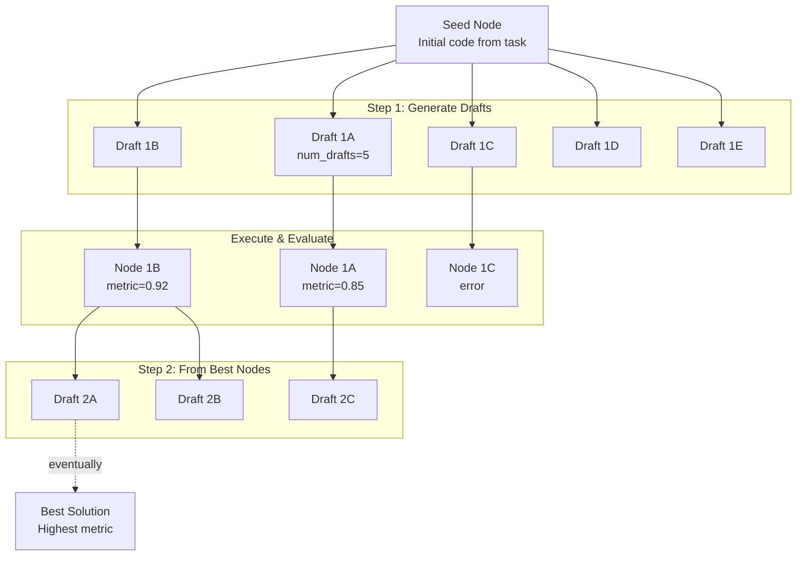
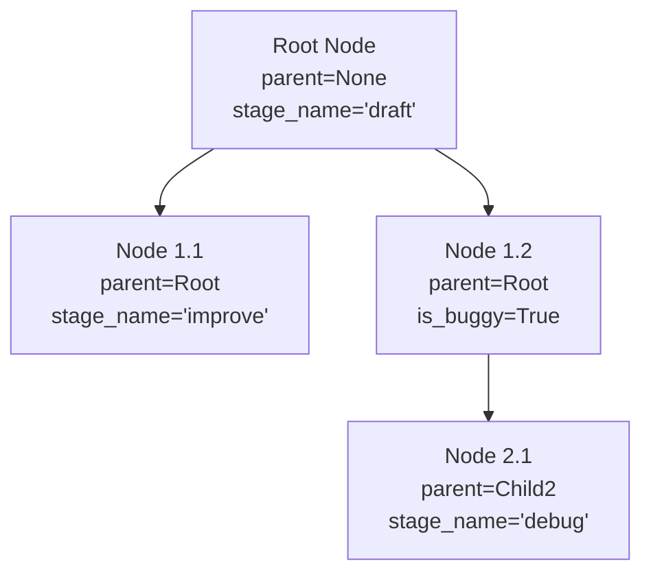
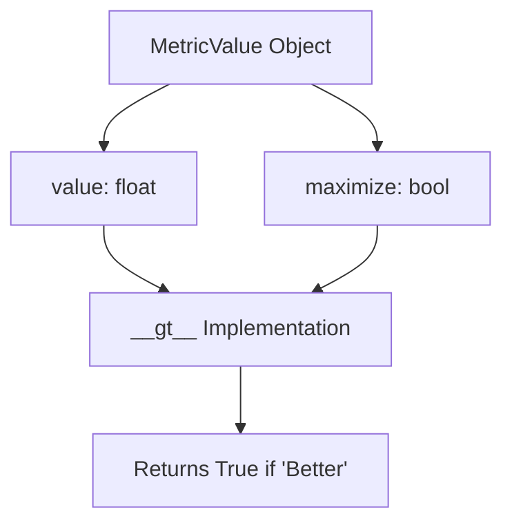

<!-- source: DeepWiki mcp.deepwiki.com · repo WecoAI/aideml · page 1.2 Key Concepts · fetched 2026-10-26 -->

# Key Concepts

Relevant source files

The following files were used as context for generating this wiki page:

- [README.md](README.md)
- [aide/journal.py](aide/journal.py)
- [aide/utils/metric.py](aide/utils/metric.py)
- [requirements.txt](requirements.txt)

This page introduces the core terminology and concepts used throughout AIDE ML. Understanding these concepts is essential for working with the system, whether through the CLI, Python API, or Web UI.

---

## Overview: What AIDE Does

AIDE ML performs **agentic tree search** in the space of code solutions. Given a machine learning task (specified as a dataset + goal + evaluation metric), AIDE autonomously generates, executes, and refines Python code until it finds a high-performing solution.

**Sources:** [README.md:19-39](), [aide/journal.py:1-8]()

---

## Agentic Tree Search

The **agentic tree search** algorithm is AIDE's core mechanism for exploring the solution space. Unlike linear approaches that refine a single solution sequentially, tree search maintains multiple solution candidates simultaneously and explores the most promising branches.

### How It Works

1.  **Start with a seed node** - Initial code generated from task description.
2.  **Generate drafts** - LLM creates multiple code variations (configured via `num_drafts`).
3.  **Execute and evaluate** - Each draft runs in a sandbox; results are captured.
4.  **Create child nodes** - Successful variations become new `Node` objects in the `Journal`.
5.  **Prune and select** - Best-performing nodes (highest `MetricValue`) guide the next iteration.
6.  **Repeat** - Process continues for configured `agent.steps`.

**Sources:** [README.md:39-40](), [aide/journal.py:172-181]()

---

## Solution Tree Structure

The **solution tree** is a directed graph where each node represents a complete Python solution, and edges represent the evolution from parent to child.

### Tree Components

| Component | Description | Code Reference |
| :--- | :--- | :--- |
| **Node** | A single code sample + execution results | `aide.journal.Node` [aide/journal.py:22-50]() |
| **Journal** | The collection of nodes representing the tree | `aide.journal.Journal` [aide/journal.py:135-138]() |
| **Parent/Child** | Links defining the tree topology | `Node.parent`, `Node.children` [aide/journal.py:33-34]() |
| **Draft Node** | Initial solution drafts with no parent | `Journal.draft_nodes` [aide/journal.py:154-156]() |
| **Leaf** | A node with no children | `Node.is_leaf` [aide/journal.py:81-83]() |

**Sources:** [aide/journal.py:56-65](), [aide/journal.py:154-156]()

---

## Nodes: Code Solutions and Their Context

A `Node` encapsulates the code, execution metadata, and evaluation metrics.

### Node Anatomy

| Attribute | Role | Code Pointer |
| :--- | :--- | :--- |
| `code` | The Python script generated by the LLM | [aide/journal.py:26]() |
| `plan` | The LLM's natural language design for the code | [aide/journal.py:27]() |
| `metric` | A `MetricValue` object representing performance | [aide/journal.py:46]() |
| `is_buggy` | Boolean flag indicating if code failed or has no metric | [aide/journal.py:49]() |
| `_term_out` | Captured terminal output from execution | [aide/journal.py:37]() |
| `exc_info` | Exception information if execution failed | [aide/journal.py:40]() |

### Node Stages
A node's `stage_name` is determined by its position and parent's status:
*   **draft**: No parent [aide/journal.py:63-64]().
*   **debug**: Parent exists and `is_buggy` is True [aide/journal.py:65]().
*   **improve**: Parent exists and is not buggy [aide/journal.py:65]().

**Sources:** [aide/journal.py:22-101]()

---

## Metrics: Guiding the Search

Metrics are represented by the `MetricValue` class, which allows for comparisons where "greater than" means "better than," regardless of whether the objective is to maximize or minimize.

### Optimization Logic

*   **Maximize**: `MetricValue(0.9, maximize=True) > MetricValue(0.8, maximize=True)` is True.
*   **Minimize**: `MetricValue(10.0, maximize=False) > MetricValue(20.0, maximize=False)` is True (lower is better).
*   **Errors**: `WorstMetricValue` always compares worse than any valid metric [aide/utils/metric.py:66-70]().

**Sources:** [aide/utils/metric.py:11-38](), [aide/utils/metric.py:66-79]()

---

## Task Specification: Goal and Eval

AIDE uses natural language to define the objective.

*   **Goal**: A string describing the task (e.g., "Build a time series forecasting model").
*   **Eval**: A string describing the metric (e.g., "RMSLE").

The system uses these to guide the LLM's `plan` and subsequent `code` generation. The results of execution are then parsed to populate the `Node.metric`.

**Sources:** [README.md:137-141](), [aide/journal.py:182-191]()

---

## The Journal: Recording the Search

The `Journal` acts as a central repository for all nodes explored during an experiment.

### Key Capabilities
*   **Best Node Selection**: `get_best_node()` finds the node with the highest `MetricValue` among non-buggy nodes [aide/journal.py:172-181]().
*   **Summary Generation**: `generate_summary()` creates a text overview of all successful designs and their metrics for the LLM to use as context [aide/journal.py:182-192]().
*   **Persistence**: The `Journal` is a `DataClassJsonMixin`, allowing it to be serialized to `journal.json` [aide/journal.py:135]().

**Sources:** [aide/journal.py:135-192]()

---

## LLM-Driven Optimization Process

The optimization is an iterative cycle managed by the `Agent`.

1.  **Drafting**: The agent proposes code based on the `goal`.
2.  **Interpreting**: The `Interpreter` executes the code and returns an `ExecutionResult` [aide/journal.py:67]().
3.  **Absorbing**: The node "absorbs" the execution result (stdout, time, exceptions) [aide/journal.py:67-73]().
4.  **Analyzing**: The agent analyzes the output to update `Node.analysis` and `Node.metric` [aide/journal.py:44-46]().
5.  **Refining**: If the node is buggy, it enters a "debug" path; if successful, it enters an "improve" path [aide/journal.py:56-65]().

**Sources:** [aide/journal.py:67-73](), [README.md:39-40]()

---

