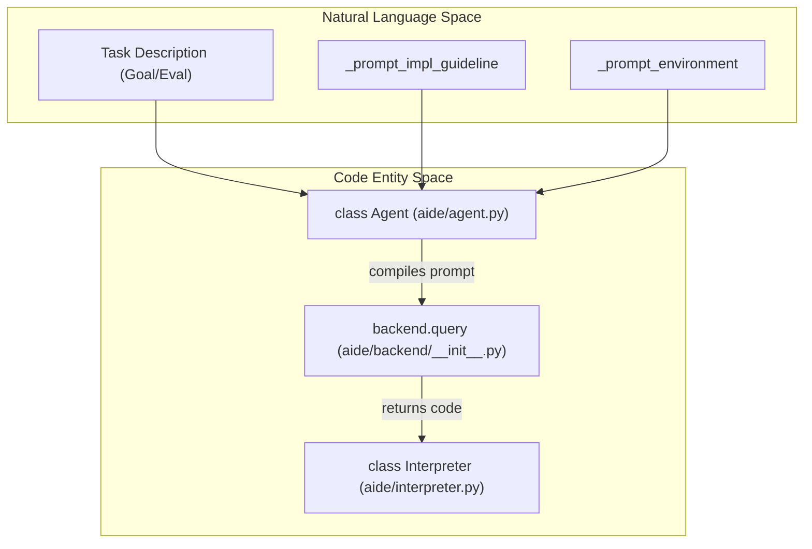
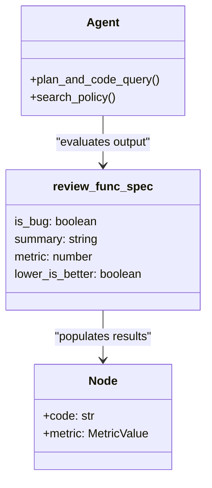

<!-- source: DeepWiki mcp.deepwiki.com · repo WecoAI/aideml · page 1.3 Example Tasks & Sample Results · fetched 2026-10-26 -->

# Example Tasks & Sample Results

Relevant source files

The following files were used as context for generating this wiki page:

- [LICENSE](LICENSE)
- [aide/agent.py](aide/agent.py)
- [aide/example_tasks/bitcoin_price.md](aide/example_tasks/bitcoin_price.md)
- [aide/example_tasks/bitcoin_price/BTC-USD.csv](aide/example_tasks/bitcoin_price/BTC-USD.csv)
- [aide/example_tasks/house_prices.md](aide/example_tasks/house_prices.md)
- [aide/example_tasks/house_prices/data_description.txt](aide/example_tasks/house_prices/data_description.txt)
- [aide/example_tasks/house_prices/sample_submission.csv](aide/example_tasks/house_prices/sample_submission.csv)
- [aide/example_tasks/house_prices/test.csv](aide/example_tasks/house_prices/test.csv)
- [aide/example_tasks/house_prices/train.csv](aide/example_tasks/house_prices/train.csv)
- [sample_results/bike-sharing-demand.py](sample_results/bike-sharing-demand.py)
- [sample_results/digit-recognizer.py](sample_results/digit-recognizer.py)
- [sample_results/house-prices-advanced-regression-techniques.py](sample_results/house-prices-advanced-regression-techniques.py)
- [sample_results/nlp-getting-started.py](sample_results/nlp-getting-started.py)
- [sample_results/spaceship-titanic.py](sample_results/spaceship-titanic.py)

This document showcases the example tasks included with AIDE ML, demonstrates how to structure custom tasks, and documents the benchmark results generated across various data science competitions.

---

## Purpose and Scope

AIDE ML is designed to autonomously solve data science problems by performing a tree search over possible code solutions. To facilitate testing and benchmarking, the repository includes:

- **Included example tasks**: Pre-packaged datasets (House Prices, Bitcoin Price) used for local validation.
- **Benchmark results**: A collection of 66+ AIDE-generated solutions for Kaggle competitions located in the `sample_results/` directory.
- **Custom task guidelines**: Technical specifications for data directory layouts and goal definitions.

---

## Included Example Tasks

AIDE provides two built-in examples that represent common machine learning patterns: regression and time series forecasting.

| Task Name | Domain | Files | Goal |
|-----------|--------|-------|------|
| **House Prices** | Tabular Regression | `train.csv`, `test.csv`, `data_description.txt` | Predict the `SalePrice` variable for house IDs in the test set [aide/example_tasks/house_prices.md:1-2](). |
| **Bitcoin Price** | Time Series | `BTC-USD.csv` | Build a time series forecasting model for the Bitcoin close price [aide/example_tasks/bitcoin_price.md:1-2](). |

### Task Specification Details
The `house_prices` task includes a detailed `data_description.txt` [aide/example_tasks/house_prices/data_description.txt:1-30]() which AIDE uses to understand feature semantics (e.g., `MSSubClass`, `MSZoning`). Both tasks specify the evaluation metric as **Root-Mean-Squared-Error (RMSE)** between the logarithms of predicted and observed values [aide/example_tasks/house_prices.md:8-9](), [aide/example_tasks/bitcoin_price.md:4-5]().

---

## Benchmark Solutions (sample_results/)

The `sample_results/` directory contains high-quality Python scripts generated by AIDE for various Kaggle competitions. These serve as benchmarks for the system's performance and as templates for human data scientists.

### Key Benchmark Examples

| Competition | Implementation Highlights | File Reference |
|-------------|---------------------------|----------------|
| **House Prices** | Uses interaction terms (e.g., `OverallQual_X_GrLivArea`), `SimpleImputer`, and `Lasso` regression [sample_results/house-prices-advanced-regression-techniques.py:15-54](). | `sample_results/house-prices-advanced-regression-techniques.py` |
| **Digit Recognizer** | Implements a PyTorch CNN with `Conv2d`, `MaxPool2d`, and `Adam` optimizer [sample_results/digit-recognizer.py:35-56](). | `sample_results/digit-recognizer.py` |
| **Bike Sharing** | Features engineering with cyclic transformations (`sin`/`cos` for hours/months) and `LGBMRegressor` [sample_results/bike-sharing-demand.py:12-42](). | `sample_results/bike-sharing-demand.py` |

### Code Generation Patterns
AIDE-generated scripts typically follow a standard pipeline:
1. **Data Loading**: Reading from `./input/` [sample_results/bike-sharing-demand.py:8-9]().
2. **Preprocessing**: Feature engineering and scaling [sample_results/house-prices-advanced-regression-techniques.py:31-50]().
3. **Validation**: Splitting data to compute local metrics [sample_results/digit-recognizer.py:19-20]().
4. **Submission**: Saving predictions to `./working/submission.csv` [sample_results/bike-sharing-demand.py:58]().

**Sources:** [sample_results/house-prices-advanced-regression-techniques.py:1-80](), [sample_results/digit-recognizer.py:1-80](), [sample_results/bike-sharing-demand.py:1-59]()

---

## Custom Task Structure

To run AIDE on a custom problem, the task must be structured such that the `Agent` can correctly interpret the environment and requirements.

### Data Flow & Prompting
The `Agent` class constructs the prompt for the LLM based on the task description and environment guidelines.

**Sources:** [aide/agent.py:47-60](), [aide/agent.py:118-141](), [aide/agent.py:95-115]()

### Implementation Guidelines
When AIDE generates code, it adheres to the following internal constraints defined in `Agent._prompt_impl_guideline`:
- **Isolation**: Data must be read from `./input` [aide/agent.py:125]().
- **Outputs**: Test predictions must be saved to `./working/submission.csv` [aide/agent.py:126]().
- **Self-Containment**: The solution must be a single-file Python program [aide/agent.py:121]().
- **Metrics**: The script must print the evaluation metric computed on a hold-out set [aide/agent.py:120]().

### Review Mechanism
After execution, AIDE uses a `review_func_spec` to extract structured data from the run:

**Sources:** [aide/agent.py:19-44](), [aide/agent.py:153-167]()

---

## Task Execution & Evaluation

The system handles metrics through the `MetricValue` class, which allows for consistent comparison across different task types (minimization vs. maximization).

| Task Type | Target Metric | Direction |
|-----------|---------------|-----------|
| Regression | RMSE / MSE | Minimize (`lower_is_better: true`) |
| Classification | Accuracy / F1 | Maximize (`lower_is_better: false`) |

If a script fails to run, the system assigns a `WorstMetricValue` to the node to ensure the tree search prunes that branch [aide/agent.py:11]().

**Sources:** [aide/agent.py:32-39](), [aide/agent.py:11]()

---

