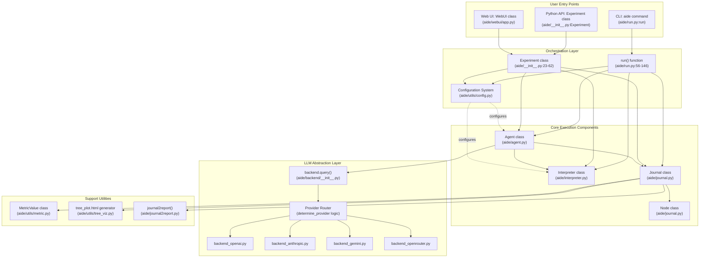
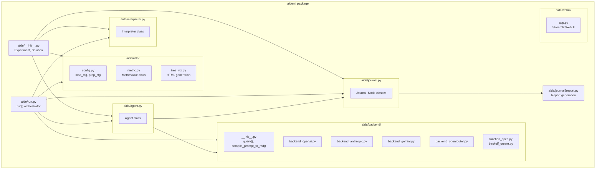
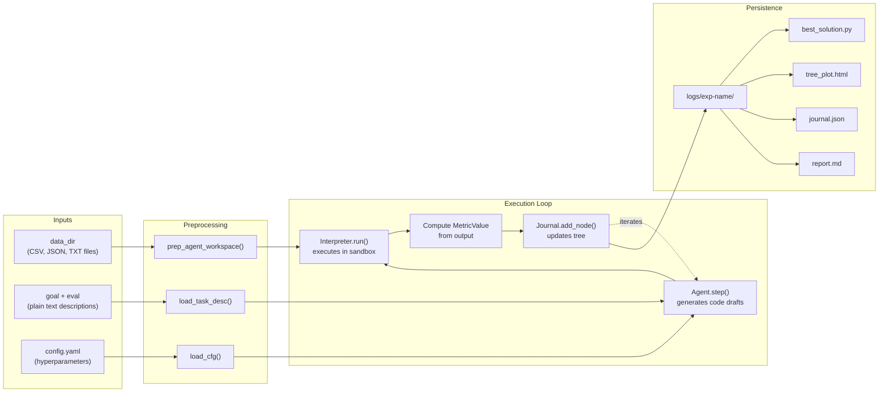

<!-- source: DeepWiki mcp.deepwiki.com · repo WecoAI/aideml · page 2 System Architecture · fetched 2026-10-26 -->

# System Architecture

Relevant source files

The following files were used as context for generating this wiki page:

- [LICENSE](LICENSE)
- [aide/__init__.py](aide/__init__.py)
- [aide/agent.py](aide/agent.py)
- [aide/example_tasks/bitcoin_price/BTC-USD.csv](aide/example_tasks/bitcoin_price/BTC-USD.csv)
- [aide/example_tasks/house_prices/data_description.txt](aide/example_tasks/house_prices/data_description.txt)
- [aide/run.py](aide/run.py)

## Purpose and Scope

This document provides a high-level architectural overview of AIDE ML, focusing on the core components, their relationships, and how they map to code entities in the codebase. The architecture centers around five primary subsystems: the `Experiment` orchestrator, the `Agent` code generator, the `Interpreter` execution sandbox, the `Journal` solution tracker, and the Backend LLM abstraction layer.

For details on the iterative execution algorithm and tree search mechanics, see [Experiment Execution Flow](#2.1). For configuration system specifics, see [Configuration System](#2.2). For deeper dives into individual subsystems, see [Core Subsystems](#5) and its children.

---

## Core Components Overview

AIDE ML's architecture is organized into five core components that work together to implement agentic tree search over code solutions:

| Component | Primary Class/Module | Location | Responsibility |
|-----------|---------------------|----------|----------------|
| **Experiment** | `Experiment` class | [aide/__init__.py:23-62]() | Top-level orchestrator; initializes components, coordinates execution, returns best solution |
| **Agent** | `Agent` class | [aide/agent.py:47-60]() | Generates code drafts using LLMs, manages search strategy, creates solution tree nodes |
| **Interpreter** | `Interpreter` class | [aide/interpreter.py]() | Executes Python code in isolated sandbox, enforces timeouts, captures stdout/stderr/exceptions |
| **Journal** | `Journal` and `Node` classes | [aide/journal.py]() | Maintains solution tree structure, tracks metrics and bugs, selects best nodes |
| **Backend** | `backend.query` function | [aide/backend/__init__.py]() | Abstracts multiple LLM providers (OpenAI, Anthropic, Gemini, OpenRouter) behind unified interface |

Additionally, a **Configuration System** (see [Configuration System](#2.2)) manages experiment parameters using OmegaConf, and **Utilities** provide metrics, visualization, and reporting.

Sources: [aide/__init__.py:23-63](), [aide/run.py:1-150](), [aide/agent.py:47-60]()

---

## Component Relationships

The following diagram maps AIDE's architectural components to their concrete implementations in code:

**Key Relationships:**

- **User Layer** provides three entry points that converge on either `run()` or `Experiment`.
- **Orchestration Layer** initializes components using configuration and coordinates their execution via `agent.step()` [aide/run.py:132]().
- **Agent** drives the search by generating code via `Backend`, tracking results in `Journal`, and executing via `Interpreter`.
- **Journal** maintains the tree structure using `Node` objects and `MetricValue` for comparisons [aide/journal.py]().
- **Backend** abstracts LLM differences through provider-specific implementations.

Sources: [aide/__init__.py:23-62](), [aide/run.py:56-146](), [aide/agent.py:47-60](), [aide/backend/__init__.py]()

---

## Module Structure

AIDE ML's package is organized into focused modules with clear responsibilities:

**Module Responsibilities:**

- **aide/__init__.py**: Public API surface, exposes `Experiment` class and `Solution` dataclass [aide/__init__.py:18-63]().
- **aide/run.py**: CLI entry point, orchestrates full experiment with `Rich` UI [aide/run.py:56-146]().
- **aide/agent.py**: Code generation, tree search strategy (`search_policy`), and prompt construction [aide/agent.py:61-92]().
- **aide/backend/**: Multi-provider LLM abstraction with unified query interface.
- **aide/interpreter.py**: Sandboxed Python execution with timeout enforcement.
- **aide/journal.py**: Solution tree data structure and metric tracking.
- **aide/utils/**: Configuration loading, metrics, and helper functions.
- **aide/journal2report.py**: LLM-powered report generation from experiment history [aide/journal2report.py]().

Sources: [aide/__init__.py](), [aide/run.py](), [aide/agent.py](), [aide/backend/__init__.py]()

---

## Key Abstractions and Their Roles

### Experiment Class

The `Experiment` class ([aide/__init__.py:23-62]()) serves as the primary public API for programmatic use. It:

- Accepts task specification (`data_dir`, `goal`, `eval`).
- Initializes workspace, configuration, and core components.
- Exposes a `run(steps)` method that executes the tree search loop [aide/__init__.py:55-63]().
- Returns a `Solution` dataclass containing best code and metric.

### Agent Class

The `Agent` class ([aide/agent.py:47-60]()) implements the code generation and search logic. It:

- Generates multiple code drafts per iteration using LLM via `plan_and_code_query` [aide/agent.py:153-171]().
- Implements a `search_policy` to decide between drafting new nodes, debugging buggy nodes, or improving the greedy best node [aide/agent.py:61-92]().
- Manages search hyperparameters (`num_drafts`, `debug_prob`, `max_debug_depth`).

### Interpreter Class

The `Interpreter` class ([aide/interpreter.py]()) provides isolated code execution. It:

- Runs Python code in subprocess with timeout enforcement.
- Captures stdout, stderr, and exceptions.
- Returns `ExecutionResult` including metrics and terminal output.
- Provides `cleanup_session()` for resource management [aide/run.py:136]().

### Journal and Node Classes

The `Journal` class ([aide/journal.py]()) maintains the solution tree structure:

- Stores tree as collection of `Node` objects.
- Each `Node` tracks code, metric, bugs, and parent/children relationships.
- Provides `get_best_node()` to retrieve highest-scoring valid solution [aide/run.py:33]().

### Backend Query Function

The `backend.query()` function ([aide/backend/__init__.py]()) abstracts LLM access:

- Accepts model name, messages, optional function specifications.
- Routes to appropriate provider based on model name patterns.
- Returns unified response format across providers.

Sources: [aide/__init__.py:23-62](), [aide/agent.py:47-171](), [aide/run.py:32-53](), [aide/backend/__init__.py]()

---

## Data Flow Architecture

The following diagram shows how data flows through AIDE from inputs to outputs:

**Data Flow Sequence:**

1. **Input Processing**: Task specification and configuration are loaded; workspace is prepared with data files [aide/run.py:60-64]().
2. **Execution Loop**: Agent generates code → Interpreter executes → Metrics computed → Journal records results [aide/run.py:131-135]().
3. **Persistence**: At each step and completion, state is saved to log directory with multiple output formats [aide/run.py:133]().

Sources: [aide/run.py:56-146](), [aide/utils/config.py](), [aide/__init__.py:55-62]()

---

## Layered Architecture

AIDE ML follows a layered architecture with clear separation of concerns:

### Layer 1: User Interface (Entry Points)

- **CLI** ([aide/run.py:56-146]()): `aide` command using Rich console UI.
- **Python API** ([aide/__init__.py:23-62]()): `Experiment` class for programmatic control.
- **Web UI** ([aide/webui/app.py]()): Streamlit-based browser interface.

### Layer 2: Orchestration

The orchestration layer coordinates execution via the `run()` function or `Experiment` class, managing the lifecycle of the agentic search.

### Layer 3: Core Execution

Core components implement the agentic tree search:
- **Agent**: Generates code variations using `search_policy` [aide/agent.py:61-92]().
- **Interpreter**: Executes code in isolation.
- **Journal**: Maintains solution tree and tracks progress.

### Layer 4: LLM Abstraction

The backend layer decouples AIDE from specific LLM providers, providing a unified `query()` interface [aide/backend/__init__.py]().

---

## Execution Context and Isolation

AIDE implements multiple levels of isolation to ensure safe and reproducible experiments:

| Isolation Level | Mechanism | Purpose |
|----------------|-----------|---------|
| **Workspace Directory** | `prep_agent_workspace()` | Isolates data files and generated code [aide/run.py:64]() |
| **Process Isolation** | Subprocess in `Interpreter` | Protects main process from crashes/hangs |
| **Timeout Enforcement** | `cfg.exec.timeout` | Prevents infinite loops or long-running code [aide/agent.py:124]() |
| **Log Directory** | `cfg.log_dir` | Separates results from multiple runs [aide/run.py:106]() |

Sources: [aide/run.py:60-106](), [aide/agent.py:118-128](), [aide/interpreter.py]()

---

## Component Initialization Sequence

The initialization sequence is nearly identical between CLI and Python API modes:

1. **Load Config**: `load_cfg()` or `_load_cfg()` [aide/run.py:57]().
2. **Load Task**: `load_task_desc(cfg)` [aide/run.py:60]().
3. **Prepare Workspace**: `prep_agent_workspace(cfg)` [aide/run.py:64]().
4. **Create Journal**: `Journal()` [aide/run.py:72]().
5. **Create Agent**: `Agent(task_desc, cfg, journal)` [aide/run.py:73]().
6. **Create Interpreter**: `Interpreter(cfg.workspace_dir, ...)` [aide/run.py:78]().
7. **Execute Loop**: `agent.step(exec_callback=...)` [aide/run.py:132]().
8. **Save Results**: `save_run(cfg, journal)` [aide/run.py:133]().

Sources: [aide/run.py:56-146](), [aide/__init__.py:23-62]()

---

