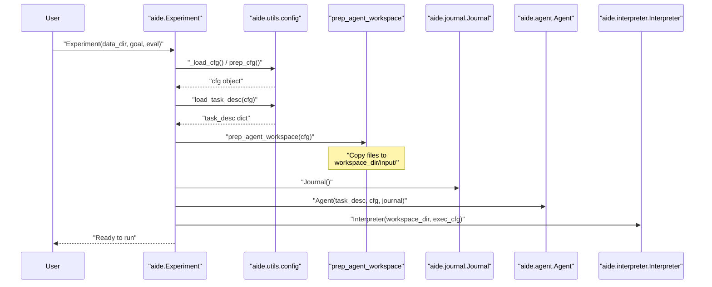
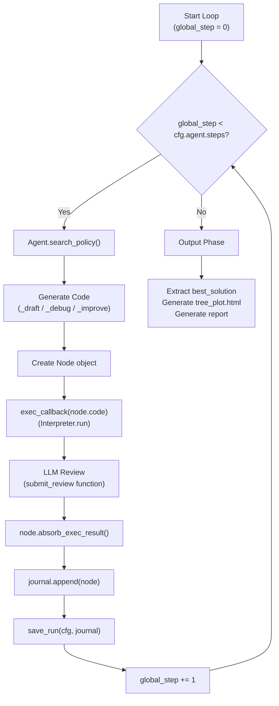
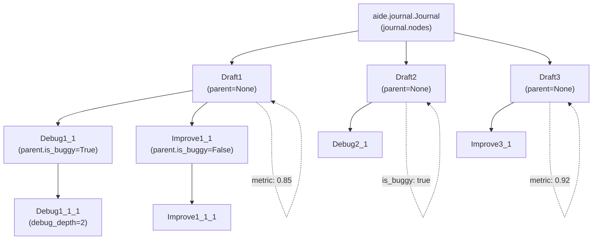
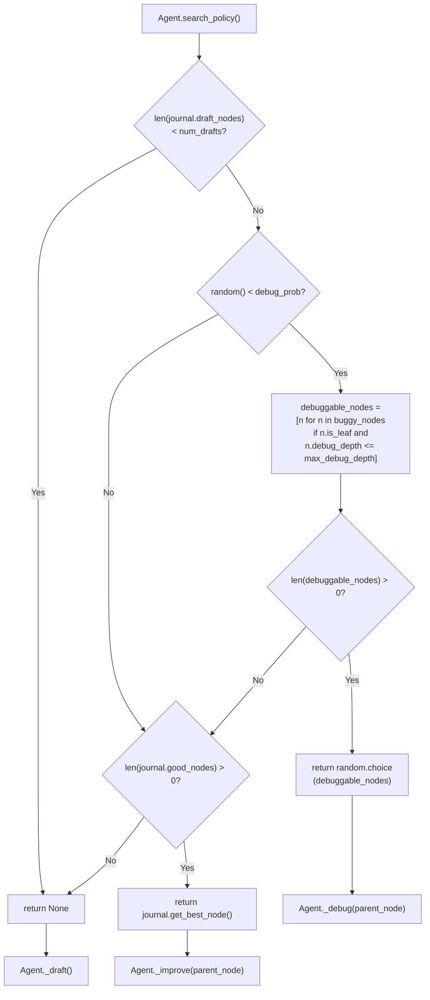
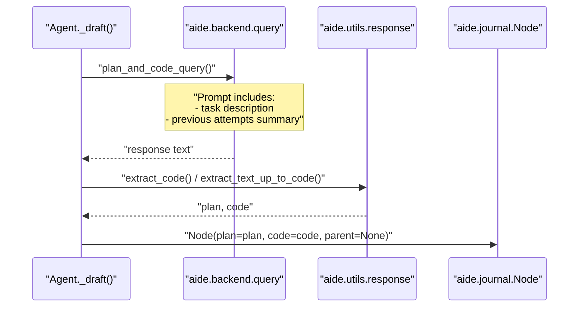
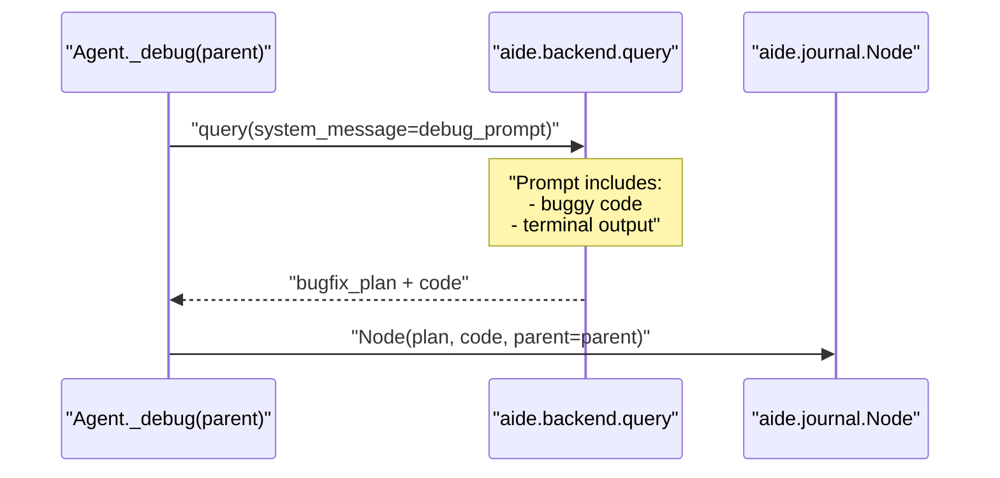
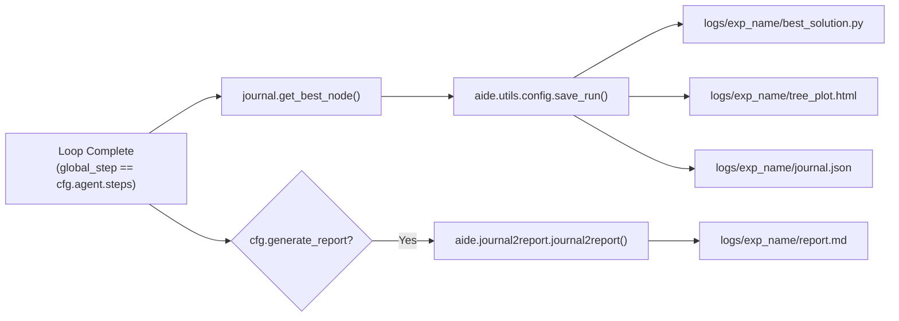

<!-- source: DeepWiki mcp.deepwiki.com · repo WecoAI/aideml · page 2.1 Experiment Execution Flow · fetched 2026-10-26 -->

# Experiment Execution Flow

<details>
<summary>Relevant source files</summary>

The following files were used as context for generating this wiki page:

- [.github/workflows/linter.yml](.github/workflows/linter.yml)
- [LICENSE](LICENSE)
- [aide/__init__.py](aide/__init__.py)
- [aide/agent.py](aide/agent.py)
- [aide/example_tasks/bitcoin_price/BTC-USD.csv](aide/example_tasks/bitcoin_price/BTC-USD.csv)
- [aide/example_tasks/house_prices/data_description.txt](aide/example_tasks/house_prices/data_description.txt)
- [aide/interpreter.py](aide/interpreter.py)
- [aide/run.py](aide/run.py)

</details>


This document details the iterative agentic tree search algorithm that drives AIDE's experiment execution. The flow encompasses initialization, iterative code generation and evaluation, metric-guided node selection, and output generation. Each experiment maintains a complete solution tree that records all attempts and their performance.

## Overview

An AIDE experiment executes as a loop of generate-execute-evaluate-select cycles. The system starts by initializing workspace and components, then iteratively generates code variations (drafts, debugs, improvements), executes them in a sandbox, computes performance metrics, and uses those metrics to guide which nodes to explore next. After completing the configured number of steps, the best solution is extracted and outputs are generated.

Sources: [aide/run.py:56-149](), [aide/__init__.py:23-62]()

## Initialization Phase

Before entering the search loop, the experiment sets up the necessary workspace and components:

**Initialization Steps**

| Step | Component | Purpose | Implementation |
|------|-----------|---------|----------------|
| 1. Load Configuration | `load_cfg()` | Load YAML config + CLI overrides | [aide/run.py:57-57]() |
| 2. Prepare Task Description | `load_task_desc()` | Compile goal + eval into prompt dict | [aide/run.py:60-60]() |
| 3. Setup Workspace | `prep_agent_workspace()` | Copy data files to `workspace_dir/input/` | [aide/run.py:63-64]() |
| 4. Initialize Journal | `Journal()` | Create empty solution tree | [aide/run.py:72-72]() |
| 5. Initialize Agent | `Agent()` | Create code generation agent | [aide/run.py:73-77]() |
| 6. Initialize Interpreter | `Interpreter()` | Create sandboxed execution environment | [aide/run.py:78-81]() |

Sources: [aide/run.py:57-81](), [aide/__init__.py:33-53]()

Title: Experiment Component Initialization

Sources: [aide/__init__.py:23-53](), [aide/run.py:56-81]()

## Iterative Search Loop

After initialization, the experiment enters the main loop that continues for `cfg.agent.steps` iterations:

Title: AIDE Iterative Search Loop

Sources: [aide/run.py:131-136](), [aide/__init__.py:55-59](), [aide/agent.py:276-294]()

**Loop Execution in `run.py`**

The main loop in [aide/run.py:131-136]() executes:
```python
while global_step < cfg.agent.steps:
    agent.step(exec_callback=exec_callback)
    save_run(cfg, journal)
    global_step = len(journal)
    live.update(generate_live())
```

**Loop Execution in `Experiment.run()`**

The Python API version in [aide/__init__.py:55-59]() follows a similar pattern:
```python
for _i in range(steps):
    self.agent.step(exec_callback=self.interpreter.run)
    save_run(self.cfg, self.journal)
```

Sources: [aide/run.py:131-136](), [aide/__init__.py:55-59]()

## Node Types and Solution Tree

### Solution Tree Hierarchy

Title: Solution Tree Structure

Sources: [aide/journal.py:56-65](), [aide/run.py:32-53]()

**Node Types Based on `stage_name`**

Each `Node` has a `stage_name` property that identifies its role:

- **Draft nodes**: Initial solutions with `parent is None` [aide/journal.py:57-58]()
- **Debug nodes**: Children of buggy nodes where `parent.is_buggy is True` [aide/journal.py:61-62]()
- **Improve nodes**: Children of successful nodes where `parent.is_buggy is False` [aide/journal.py:64-65]()

### Node Data Structure

The `Node` class in [aide/journal.py:21-49]() stores:

| Field | Type | Purpose |
|-------|------|---------|
| `code` | `str` | Python implementation |
| `plan` | `str` | Natural language description |
| `parent` | `Node \| None` | Parent node reference |
| `children` | `set[Node]` | Child nodes |
| `is_buggy` | `bool` | Whether execution failed |
| `metric` | `MetricValue` | Validation performance |
| `analysis` | `str` | LLM evaluation summary |
| `term_out` | `str` | Execution terminal output |

Sources: [aide/journal.py:21-49]()

## Search Policy: Node Selection Strategy

The `Agent.search_policy()` method in [aide/agent.py:61-92]() determines which node to expand next:

Title: Search Policy Logic

Sources: [aide/agent.py:61-92]()

**Selection Strategy**

1. **Drafting Phase**: If `len(draft_nodes) < num_drafts`, return `None` to trigger `_draft()` [aide/agent.py:66-68]()
2. **Debug Mode** (probability `debug_prob`): 
   - Filter for debuggable nodes: buggy, leaf, `debug_depth <= max_debug_depth` [aide/agent.py:73-77]()
   - Select random debuggable node to trigger `_debug()` [aide/agent.py:80-80]()
3. **Improvement Mode**: Select `journal.get_best_node()` to trigger `_improve()` [aide/agent.py:90-92]()

Sources: [aide/agent.py:61-92]()

## Code Generation: Drafts, Debugs, and Improvements

### Draft Generation: `Agent._draft()`

Title: Draft Generation Flow

Sources: [aide/agent.py:175-205]()

The `_draft()` method in [aide/agent.py:175-205]():
- Calls `plan_and_code_query()` to get both NL plan and code in one call [aide/agent.py:153-173]()
- Includes task description and `journal.generate_summary()` of previous attempts [aide/agent.py:192-192]()
- Creates `Node` with `parent=None` [aide/agent.py:204-204]()

### Debug Generation: `Agent._debug()`

Title: Debug Generation Flow

Sources: [aide/agent.py:243-269]()

The `_debug()` method in [aide/agent.py:243-269]():
- Receives a buggy `parent_node` from `search_policy()` [aide/agent.py:243-243]()
- Sends `parent_node.code` and `parent_node.term_out` to LLM [aide/agent.py:255-256]()
- Requests a specific bugfix based on execution logs [aide/agent.py:248-248]()

### Improvement Generation: `Agent._improve()`

The `_improve()` method in [aide/agent.py:207-241]():
- Receives best-performing `parent_node` from `search_policy()` [aide/agent.py:207-207]()
- Sends `parent_node.code` and `parent_node.analysis` to LLM [aide/agent.py:219-220]()
- Requests a single atomic improvement to the working solution [aide/agent.py:212-212]()

Sources: [aide/agent.py:207-241]()

## Execution and Evaluation Pipeline

### Agent.step() Workflow

The `Agent.step()` method in [aide/agent.py:276-294]() orchestrates the full generate-execute-evaluate cycle:

1. Calls `search_policy()` to select a parent node [aide/agent.py:277-277]()
2. Generates code via `_draft()`, `_debug()`, or `_improve()` [aide/agent.py:279-284]()
3. Executes code using `exec_callback(node.code)` [aide/agent.py:286-286]()
4. Evaluates execution with `_evaluate_node()` which queries the LLM [aide/agent.py:287-287]()
5. Stores results via `node.absorb_exec_result()` [aide/agent.py:289-293]()
6. Appends node to `journal.append(node)` [aide/agent.py:294-294]()

Sources: [aide/agent.py:276-294]()

### LLM-Based Evaluation: `review_func_spec`

The agent uses structured function calling to extract evaluation results from the LLM via `submit_review` [aide/agent.py:19-44]().

**Function Specification**
From [aide/agent.py:19-44](), the `review_func_spec` defines:
- `is_bug`: Boolean indicating execution failure [aide/agent.py:24-27]()
- `summary`: Analysis of performance or bug description [aide/agent.py:28-31]()
- `metric`: Validation metric value [aide/agent.py:32-35]()
- `lower_is_better`: Optimization direction [aide/agent.py:36-39]()

Sources: [aide/agent.py:19-44]()

### Code Execution: `Interpreter.run()`

The `exec_callback` typically points to `Interpreter.run()`, which:
- Executes code in isolated subprocess with timeout [aide/interpreter.py:176-180]()
- Captures stdout, stderr via `RedirectQueue` [aide/interpreter.py:131-131]()
- Returns `ExecutionResult` containing terminal output and return code [aide/interpreter.py:27-38]()

Sources: [aide/interpreter.py:91-230]()

## Metric-Guided Selection and Pruning

### Journal Tree Queries

The `Journal` class in [aide/journal.py:134-193]() provides filtered views of the solution tree:

| Property/Method | Implementation | Purpose |
|----------------|----------------|---------|
| `draft_nodes` | `[n for n in self.nodes if n.parent is None]` | Get initial drafts [aide/journal.py:145-147]() |
| `buggy_nodes` | `[n for n in self.nodes if n.is_buggy]` | Get failed executions [aide/journal.py:149-151]() |
| `good_nodes` | `[n for n in self.nodes if not n.is_buggy]` | Get successful executions [aide/journal.py:153-155]() |
| `get_best_node()` | `max(nodes, key=lambda n: n.metric)` | Get highest metric node [aide/journal.py:165-180]() |

Sources: [aide/journal.py:134-193]()

### Best Node Selection

The `get_best_node()` method in [aide/journal.py:165-180]() is critical for both the search policy and final output. It uses the `MetricValue` class which implements comparison operators (`__gt__`, `__lt__`) that respect the `lower_is_better` flag [aide/utils/metric.py]().

Sources: [aide/journal.py:165-180](), [aide/utils/metric.py]()

## Output Phase

After the iterative loop completes, the experiment generates primary outputs:

Title: Output Generation Phase

Sources: [aide/run.py:138-146](), [aide/__init__.py:61-62]()

### Best Solution Extraction

From [aide/__init__.py:61-62](), the Python API returns a `Solution` object containing the best code and its metric:
```python
best_node = self.journal.get_best_node(only_good=False)
return Solution(code=best_node.code, valid_metric=best_node.metric.value)
```
Sources: [aide/__init__.py:61-62]()

### Optional Report Generation

If `cfg.generate_report` is enabled, AIDE calls `journal2report()` to synthesize the findings from the solution tree into a technical report [aide/run.py:138-146]().

Sources: [aide/run.py:138-146](), [aide/journal2report.py]()

---

