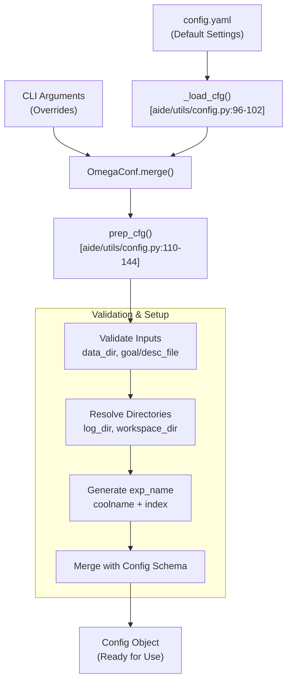
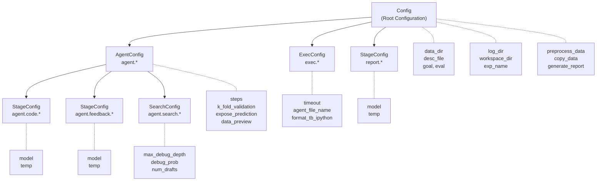
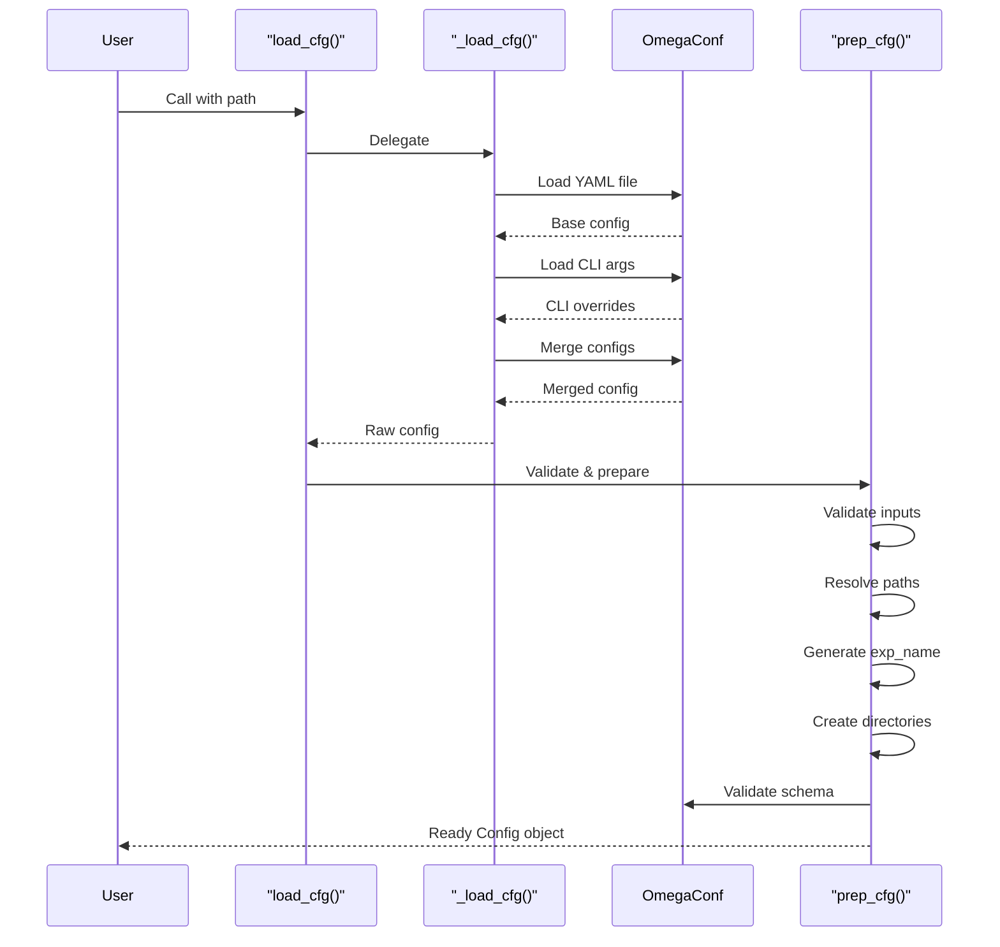

<!-- source: DeepWiki mcp.deepwiki.com · repo WecoAI/aideml · page 2.2 Configuration System · fetched 2026-10-26 -->

# Configuration System

<details>
<summary>Relevant source files</summary>

The following files were used as context for generating this wiki page:

- [aide/utils/config.py](aide/utils/config.py)
- [aide/utils/config.yaml](aide/utils/config.yaml)
- [setup.py](setup.py)

</details>


## Purpose and Scope

The Configuration System manages all parameters that control AIDE's behavior, including LLM model selection, search hyperparameters, execution limits, workspace setup, and experiment tracking. It uses OmegaConf for hierarchical YAML-based configuration with CLI override support.

This page covers configuration schema, loading mechanisms, validation, and workspace preparation. For details on how configuration values are used during execution, see [Experiment Execution Flow](). For agent-specific parameters, see [Agent & Search System]().

---

## Configuration Architecture

AIDE's configuration system is built on **OmegaConf**, enabling:
- **YAML file storage** with structured defaults in `aide/utils/config.yaml` [aide/utils/config.yaml:1-59]()
- **CLI overrides** via dot-notation (e.g., `agent.steps=30`) [aide/utils/config.py:101-102]()
- **Type-safe access** through Python dataclasses [aide/utils/config.py:29-82]()
- **Validation** against schema definitions [aide/utils/config.py:141-142]()

The system separates configuration into logical groups: agent settings, execution parameters, LLM model configurations, and workspace paths.

### Configuration Loading Flow



**Sources:** [aide/utils/config.py:96-144](), [aide/utils/config.py:105-108]()

---

## Configuration Schema

The configuration schema is defined through nested dataclasses that provide type hints and structure. The actual configuration is stored in YAML, but these classes ensure type safety during the merge process.

### Dataclass Hierarchy



**Sources:** [aide/utils/config.py:29-82]()

### Configuration Dataclass Definitions

| Dataclass | Location | Fields | Purpose |
|-----------|----------|--------|---------|
| `StageConfig` | [aide/utils/config.py:29-32]() | `model: str`, `temp: float` | LLM model configuration for a specific stage (code, feedback, report) |
| `SearchConfig` | [aide/utils/config.py:35-39]() | `max_debug_depth: int`, `debug_prob: float`, `num_drafts: int` | Tree search hyperparameters |
| `AgentConfig` | [aide/utils/config.py:42-52]() | `steps`, `k_fold_validation`, `expose_prediction`, `data_preview`, `code`, `feedback`, `search` | Agent behavior and nested stage configs |
| `ExecConfig` | [aide/utils/config.py:55-59]() | `timeout: int`, `agent_file_name: str`, `format_tb_ipython: bool` | Code execution parameters |
| `Config` | [aide/utils/config.py:63-82]() | All paths, flags, and nested configs | Root configuration object |

**Sources:** [aide/utils/config.py:26-82]()

---

## Default Configuration File

The default configuration is defined in `aide/utils/config.yaml`. This file serves as the template for all experiments.

### Core Parameters

```yaml
# Task Input
data_dir: null              # Required: path to task data
desc_file: null             # Optional: plaintext task description file
goal: null                  # Alternative: task goal string
eval: null                  # Optional: evaluation criteria string

# Output Directories
log_dir: logs               # Where results are saved
workspace_dir: workspaces   # Where agent executes code

# Data Handling
preprocess_data: True       # Unzip archives in data directory
copy_data: True            # Copy vs symlink (prevents data modification)

exp_name: null             # Auto-generated if not provided
```

### Execution Configuration

```yaml
exec:
  timeout: 3600                # Max execution time (seconds)
  agent_file_name: runfile.py  # Name of generated code file
  format_tb_ipython: False     # Use IPython traceback formatting
```

### Agent Configuration

```yaml
agent:
  steps: 20                    # Number of improvement iterations
  k_fold_validation: 5         # Cross-validation folds (1 disables CV)
  expose_prediction: False     # Generate prediction function
  data_preview: True           # Show data samples to agent
  
  code:
    model: o4-mini             # LLM for code generation
    temp: 0.5                  # Temperature for code diversity
  
  feedback:
    model: gpt-4.1-mini        # LLM for output analysis
    temp: 0.5                  # Temperature for feedback
  
  search:
    max_debug_depth: 3         # Max debugging iterations per node
    debug_prob: 0.5            # Probability of debugging vs new draft
    num_drafts: 5              # Code drafts per iteration
```

**Sources:** [aide/utils/config.yaml:1-59]()

---

## Configuration Loading and Merging

### Load Process

The configuration system loads and merges settings in two stages:

1. **Loading** (`_load_cfg`): Reads YAML and merges CLI arguments using `OmegaConf.from_cli()` [aide/utils/config.py:96-102]().
2. **Preparation** (`prep_cfg`): Validates inputs, resolves paths, and sets up directories [aide/utils/config.py:110-144]().



**Sources:** [aide/utils/config.py:96-108](), [aide/utils/config.py:110-144]()

### CLI Override Mechanism

OmegaConf supports dot-notation overrides from the command line. The merge operation prioritizes CLI arguments over YAML defaults [aide/utils/config.py:101-102]():

```bash
# Override single values
aide data_dir=my_data agent.steps=30

# Override nested values
aide agent.code.model=gpt-4o agent.search.num_drafts=10
```

---

## Configuration Validation

The `prep_cfg` function validates the configuration before experiment execution.

### Validation Rules

| Check | Condition | Error Message |
|-------|-----------|---------------|
| Data directory | `cfg.data_dir is None` | "`data_dir` must be provided." |
| Task description | `cfg.desc_file is None and cfg.goal is None` | "You must provide either...`goal=...` or...`desc_file=...`." |

**Sources:** [aide/utils/config.py:111-117]()

### Path Resolution

AIDE resolves paths to absolute locations and handles relative references to example tasks [aide/utils/config.py:119-124]():

```python
if cfg.data_dir.startswith("example_tasks/"):
    cfg.data_dir = Path(__file__).parent.parent / cfg.data_dir
cfg.data_dir = Path(cfg.data_dir).resolve()
```

### Schema Validation

The final configuration is validated against the `Config` dataclass schema to ensure type correctness [aide/utils/config.py:141-142]():

```python
cfg_schema: Config = OmegaConf.structured(Config)
cfg = OmegaConf.merge(cfg_schema, cfg)
```

---

## Experiment Naming and Directory Structure

### Automatic Naming

If `exp_name` is not provided, AIDE generates a unique name using a consecutive index and a random slug [aide/utils/config.py:133-135]():

```python
ind = max(_get_next_logindex(top_log_dir), _get_next_logindex(top_workspace_dir))
cfg.exp_name = cfg.exp_name or coolname.generate_slug(3)
cfg.exp_name = f"{ind}-{cfg.exp_name}"
```

The `_get_next_logindex` function scans existing directories to find the highest integer prefix [aide/utils/config.py:84-93]().

### Workspace Preparation

The `prep_agent_workspace` function sets up the filesystem for the agent [aide/utils/config.py:177-185]():

1.  **Directories**: Creates `input/` and `working/` inside the experiment workspace [aide/utils/config.py:179-180]().
2.  **Data Link/Copy**: Uses `copytree` to bring data from `cfg.data_dir` to `workspace_dir/input`. It uses symlinks unless `cfg.copy_data` is True [aide/utils/config.py:182]().
3.  **Preprocessing**: If `cfg.preprocess_data` is True, it runs `preproc_data` (e.g., unzipping) on the input files [aide/utils/config.py:183-184]().

---

## Task Description Loading

AIDE supports two methods for specifying the task, implemented in `load_task_desc` [aide/utils/config.py:151-174]():

1.  **Description File**: If `cfg.desc_file` is set, the system reads the file content directly [aide/utils/config.py:155-162]().
2.  **Goal/Eval Args**: If no file is provided, it uses `cfg.goal` and `cfg.eval` to construct a task description dictionary [aide/utils/config.py:165-174]().

---

## Saving Experiment Results

The `save_run` function persists the state and results [aide/utils/config.py:187-200]():

- **Journal**: Saved as `journal.json` using `serialize.dump_json` [aide/utils/config.py:191]().
- **Config**: The active `Config` object is saved as `config.yaml` [aide/utils/config.py:193]().
- **Visualization**: Generates `tree_plot.html` via `tree_export.generate` [aide/utils/config.py:195]().
- **Best Solution**: Extracts the best code from the journal and saves it as `best_solution.py` [aide/utils/config.py:197-199]().

**Sources:** [aide/utils/config.py:1-200](), [aide/utils/config.yaml:1-59]()

---

