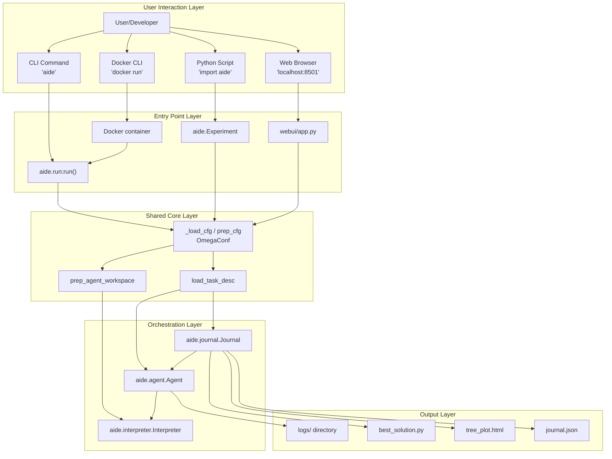
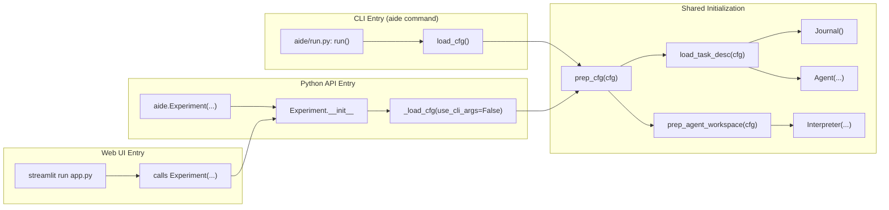
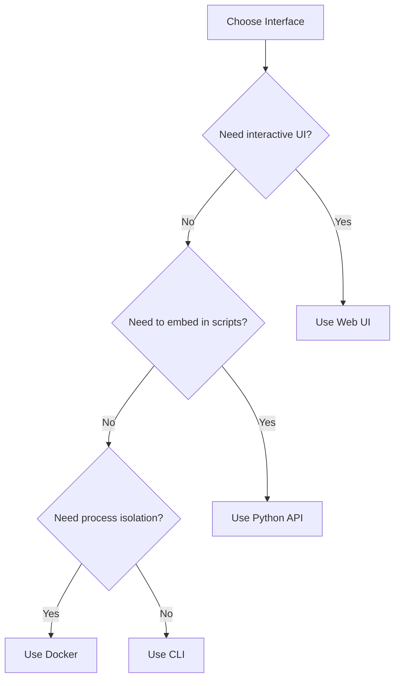

<!-- source: DeepWiki mcp.deepwiki.com · repo WecoAI/aideml · page 3 User Interfaces · fetched 2026-10-26 -->

# User Interfaces

Relevant source files

The following files were used as context for generating this wiki page:

- [README.md](README.md)
- [aide/__init__.py](aide/__init__.py)
- [aide/run.py](aide/run.py)

## Purpose and Scope

This page provides an overview of the four interface options for interacting with AIDE ML: the Web UI, Command Line Interface (CLI), Python API, and Docker containerization. All interfaces converge on the same core `Experiment` orchestration layer and produce identical output artifacts.

For detailed documentation of individual interfaces, see:
- [Web UI](#3.1) — Streamlit-based interactive interface
- [Command Line Interface](#3.2) — `aide` CLI command
- [Python API](#3.3) — `Experiment` class for programmatic control
- [Docker](#3.4) — Containerized deployment

For information about the underlying execution flow that all interfaces trigger, see [Experiment Execution Flow](#2.1).

---

## Interface Options Summary

AIDE ML provides four distinct ways to initiate and monitor experiments, each suited to different user workflows:

| Interface | Entry Point | Primary Use Case | Output Method |
|-----------|-------------|------------------|---------------|
| **Web UI** | `streamlit run app.py` | Non-technical users, exploratory work | Browser-based tabs with live updates |
| **CLI** | `aide` command | ML practitioners, quick iterations | Terminal with Rich console UI |
| **Python API** | `aide.Experiment` class | Researchers, programmatic control | Returns `Solution` dataclass |
| **Docker** | `docker run aideml` | Deployment, reproducibility | Same as CLI, containerized |

**Sources:** [README.md:69-184](), [aide/run.py:56-149]()

---

## Architecture: Convergence on Shared Core

All four interfaces share the same underlying execution engine. User-facing differences are limited to input mechanisms and output presentation, while core logic remains identical.

### Interface Integration Architecture

**Description:** This diagram shows how all user interfaces funnel through interface-specific entry points into a unified core. The CLI uses `aide.run:run()` with OmegaConf configuration management, the Python API instantiates `aide.Experiment` directly, the Web UI wraps the Python API in Streamlit components, and Docker containerizes the CLI. All four paths converge on the same configuration system, workspace preparation, and orchestration components (`Journal`, `Agent`, `Interpreter`). Output artifacts are identical regardless of interface choice.

**Sources:** [aide/__init__.py:1-63](), [aide/run.py:56-82](), [README.md:69-184]()

---

## Entry Points and Initialization

### Entry Point Code Paths

**Description:** This diagram traces the code execution path from each entry point to the shared initialization sequence. The CLI command calls `aide.run:run()` which uses `load_cfg()` for configuration. The Python API's `Experiment.__init__` calls `_load_cfg(use_cli_args=False)` to avoid parsing CLI arguments. All paths converge on `prep_cfg()`, which triggers task description loading, workspace preparation, and initialization of the three core components: `Journal`, `Agent`, and `Interpreter`.

**Sources:** [aide/__init__.py:23-54](), [aide/run.py:56-82](), [README.md:126-151]()

---

## Data Flow Across Interfaces

### Input → Processing → Output

| Stage | CLI | Python API | Web UI | Docker |
|-------|-----|------------|--------|--------|
| **Input Method** | Command-line arguments | Constructor parameters | Streamlit widgets + file upload | CLI args via `docker run` |
| **Configuration** | `load_cfg` → `cfg` | Direct parameter assignment | Form inputs → `Experiment(...)` | Environment variables + CLI args |
| **Progress Display** | Rich console `Live` display | Python logging (`logging.INFO`) | Streamlit tabs with live updates | Terminal output (same as CLI) |
| **Output Location** | `logs/<exp_id>/` directory | Same + returns `Solution` object | Same + displays in browser tabs | Mounted volume at `/app/logs/` |
| **Tree Visualization** | HTML file in log dir | HTML file in log dir | Displayed in UI | HTML file in mounted volume |

**Sources:** [README.md:72-184](), [aide/__init__.py:55-62](), [aide/run.py:99-135]()

---

## Interface Selection Guidance

### Decision Matrix

**Description:** This decision tree helps users select the appropriate interface. Non-technical users or those preferring visual feedback choose the Web UI. Researchers integrating AIDE into existing Python workflows use the Python API to access the `Solution` return type. ML practitioners performing rapid iterations prefer the CLI for its speed and config override capabilities. Deployment scenarios or reproducibility requirements favor Docker for dependency isolation.

**Sources:** [README.md:31-35](), [README.md:69-184]()

---

## Common Interface Patterns

### Configuration Override Hierarchy

All interfaces support configuration overrides with the following precedence (highest to lowest):

1. **Runtime parameters** (Python API constructor args, CLI flags)
2. **Environment variables** (`OPENAI_API_KEY`, `OPENAI_BASE_URL`)
3. **Defaults** (hardcoded in configuration utilities)

Example configuration across interfaces:

| Setting | CLI Syntax | Python API Syntax | Web UI Input |
|---------|------------|-------------------|--------------|
| Data directory | `data_dir="path/"` | `data_dir="path/"` | File upload widget |
| Goal description | `goal="Predict X"` | `goal="Predict X"` | Text area field |
| Evaluation metric | `eval="RMSE"` | `eval="RMSE"` | Text input field |
| Number of steps | `agent.steps=50` | `steps=50` (in `run()`) | Number input widget |

**Sources:** [README.md:108-123](), [aide/__init__.py:24-37](), [aide/run.py:56-61]()

---

## Output Artifacts (Universal)

Regardless of interface choice, all experiments produce the same output structure in `logs/<exp_id>/`:

| File | Description | Generated By |
|------|-------------|--------------|
| `best_solution.py` | Python code with highest metric | `Journal.get_best_node()` |
| `tree_plot.html` | Interactive solution tree visualization | `save_run()` |
| `journal.json` | Complete search history with all nodes | `save_run()` |
| `report.md` | Optional LLM-generated technical report | `journal2report()` |

**Sources:** [README.md:86-90](), [aide/__init__.py:55-62](), [aide/run.py:133-145]()

---

## Interface Implementation Details

### CLI Implementation
- **Entry point:** `aide.run:run` function [aide/run.py:56-149]()
- **Console UI:** Uses `rich.live.Live` and `rich.progress.Progress` for terminal visualization [aide/run.py:84-135]()
- **Tree View:** `journal_to_rich_tree` converts internal `Journal` state to a terminal-rendered tree [aide/run.py:32-53]()

### Python API Implementation
- **Main class:** `aide.Experiment` [aide/__init__.py:23-54]()
- **Execution:** `run(steps)` method iterates through `agent.step()` and returns a `Solution` dataclass [aide/__init__.py:55-62]()
- **Return type:** `Solution` containing the final `code` and `valid_metric` [aide/__init__.py:17-21]()

### Web UI Implementation
- **Framework:** Streamlit application located in `aide/webui/app.py` [README.md:93-103]()
- **Functionality:** Provides sidebar for API keys and task parameters, showing live logs and trees [README.md:101-103]()

### Docker Implementation
- **Usage:** Run via `docker run` to provide a pre-configured environment [README.md:175-184]()
- **Persistence:** Uses volume mounts for logs and data [README.md:182]()

**Sources:** [README.md:69-184](), [aide/__init__.py:1-63](), [aide/run.py:1-150]()

---

