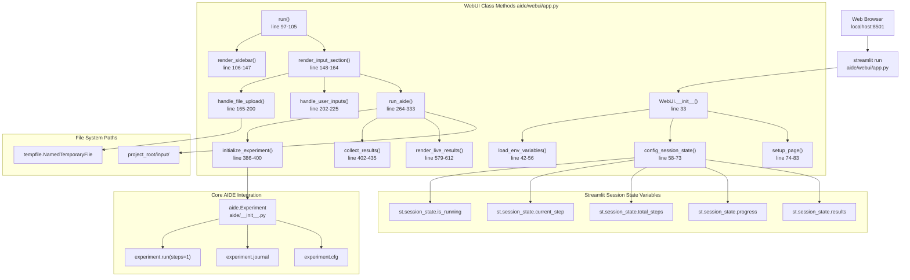
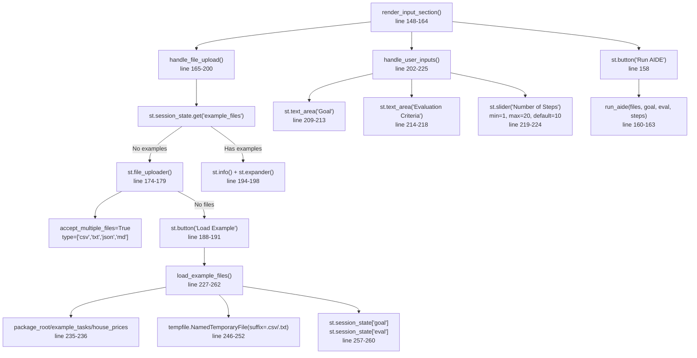
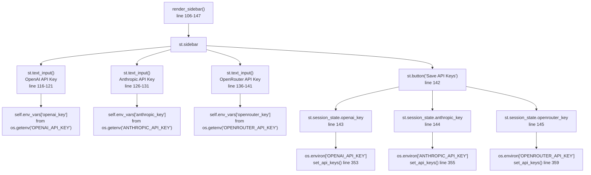
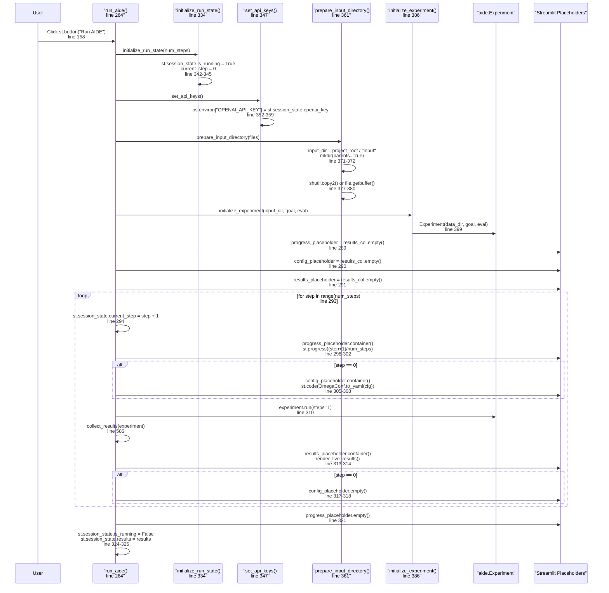
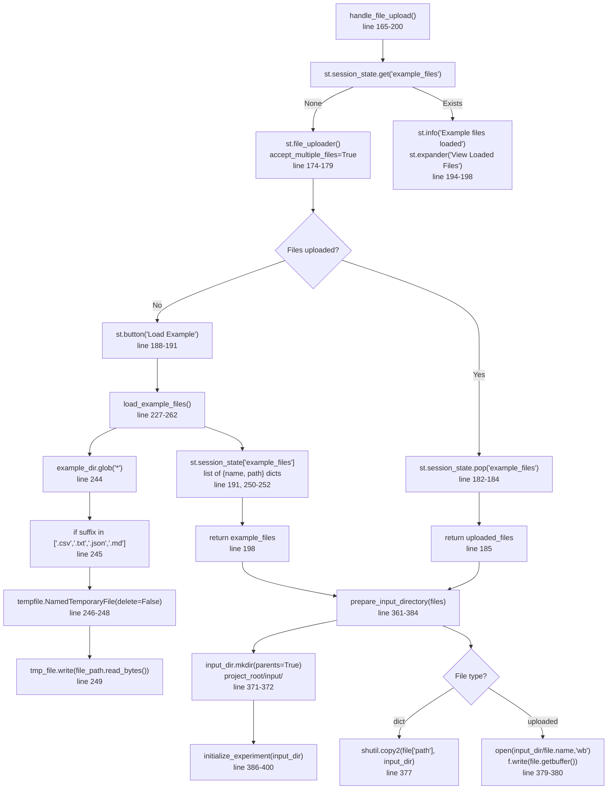
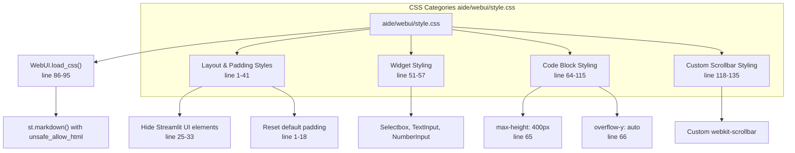
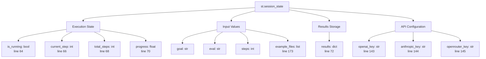

<!-- source: DeepWiki mcp.deepwiki.com · repo WecoAI/aideml · page 3.1 Web UI · fetched 2026-10-26 -->

# Web UI

Relevant source files

The following files were used as context for generating this wiki page:

- [.streamlit/config.toml](.streamlit/config.toml)
- [aide/webui/__init__.py](aide/webui/__init__.py)
- [aide/webui/app.py](aide/webui/app.py)
- [aide/webui/style.css](aide/webui/style.css)

The Web UI provides a Streamlit-based graphical interface for running AIDE ML experiments through a web browser. This interface allows users to upload data files, configure experiment parameters, and monitor real-time progress without requiring command-line knowledge.

For programmatic access to AIDE's functionality, see [Python API](3.3). For command-line usage, see [Command Line Interface](3.2).

## Purpose and Architecture

The Web UI is implemented as a single-page Streamlit application that wraps the core `Experiment` class, providing an intuitive interface for machine learning practitioners who prefer graphical tools over CLI or programmatic interfaces.

### Component Overview

This diagram maps the `WebUI` class structure to its concrete implementation in code:

Sources: [aide/webui/app.py:28-73](), [aide/webui/app.py:97-164](), [aide/webui/app.py:264-333](), [aide/webui/app.py:386-612]()

### Key Class Structure

The `WebUI` class orchestrates the entire web interface through several core methods:

| Method | Purpose | Key Functionality |
|--------|---------|-------------------|
| `__init__()` | Initialize web application | Load environment variables, configure session state, setup page [aide/webui/app.py:33-40]() |
| `run()` | Main application entry point | Render sidebar and input sections, manage layout [aide/webui/app.py:97-105]() |
| `render_sidebar()` | API key configuration | Handle OpenAI, Anthropic, OpenRouter API keys [aide/webui/app.py:106-147]() |
| `render_input_section()` | Experiment setup | File upload, goal/eval input, experiment execution [aide/webui/app.py:148-164]() |
| `run_aide()` | Execute AIDE experiment | Initialize and run `Experiment` with progress tracking [aide/webui/app.py:264-333]() |
| `render_live_results()` | Display results | Show tree visualization, solution code, metrics [aide/webui/app.py:579-612]() |

Sources: [aide/webui/app.py:28-616]()

## User Interface Components

### Input Section

The input section allows users to configure experiments through three primary mechanisms, implemented in `render_input_section()` and related methods:

Sources: [aide/webui/app.py:148-225](), [aide/webui/app.py:227-262]()

### Sidebar Configuration

The sidebar manages API key configuration for supported LLM backends:

Note: The Web UI also supports Gemini API keys via environment variables (`GEMINI_API_KEY`), loaded in `load_env_variables()` at [aide/webui/app.py:54]() and set in `set_api_keys()` at [aide/webui/app.py:356-357](), though the UI input field is not currently rendered in the sidebar.

Sources: [aide/webui/app.py:42-56](), [aide/webui/app.py:106-147](), [aide/webui/app.py:347-360]()

## Experiment Execution Flow

The `run_aide()` method at [aide/webui/app.py:264-333]() executes AIDE experiments through a multi-step process with real-time progress updates:

Sources: [aide/webui/app.py:264-333](), [aide/webui/app.py:334-360](), [aide/webui/app.py:361-400]()

### File Handling Implementation

The Web UI processes files through a multi-stage pipeline that handles both user uploads and example datasets:

Sources: [aide/webui/app.py:165-200](), [aide/webui/app.py:227-262](), [aide/webui/app.py:361-400]()

## Results Display System

The Web UI provides comprehensive results visualization through a tabbed interface implemented in `render_live_results()`:

```mermaid
graph TB
    render_live["render_live_results(experiment)<br/>line 579-612"] --> collect["collect_results(experiment)<br/>line 586"]
    
    collect --> read_solution["solution_path.read_text()<br/>cfg.log_dir/best_solution.py<br/>line 413-417"]
    collect --> extract_journal["for node in experiment.journal.nodes<br/>line 419-427"]
    collect --> build_dict["results dict: solution, config, journal, tree_path<br/>line 429-434"]
    
    render_live --> create_tabs["st.tabs(['Tree', 'Solution', 'Config', 'Journal', 'Plot'])<br/>line 589-597"]
    
    create_tabs --> tab0["tabs[0]: Tree Visualization"]
    create_tabs --> tab1["tabs[1]: Best Solution"]
    create_tabs --> tab2["tabs[2]: Config"]
    create_tabs --> tab3["tabs[3]: Journal"]
    create_tabs --> tab4["tabs[4]: Validation Plot"]
    
    tab0 --> tree_viz["render_tree_visualization(results)<br/>line 437-456"]
    tree_viz --> read_html["open(tree_path,'r')<br/>line 449"]
    tree_viz --> render_component["components.html(html_content, height=600)<br/>line 451"]
    
    tab1 --> best_sol["render_best_solution(results)<br/>line 458-470"]
    best_sol --> code_python["st.code(solution_code, language='python')<br/>line 468"]
    
    tab2 --> config_disp["render_config(results)<br/>line 472-483"]
    config_disp --> code_yaml["st.code(results['config'], language='yaml')<br/>line 481"]
    
    tab3 --> journal_disp["render_journal(results)<br/>line 485-501"]
    journal_disp --> parse_json["json.loads(results['journal'])<br/>line 495"]
    journal_disp --> code_json["st.code(formatted_journal, language='json')<br/>line 497"]
    
    tab4 --> metric_disp["st.metric('Best Validation Score')<br/>line 609-610"]
    tab4 --> plot_func["render_validation_plot(results, step)<br/>line 523-577"]
    plot_func --> parse_metrics["for node in journal_data: float(node['metric'])<br/>line 537-544"]
    plot_func --> plotly_scatter["go.Scatter(x=steps, y=metrics)<br/>line 550-558"]
    plot_func --> display_chart["st.plotly_chart(fig, key=f'plot_{step}')<br/>line 572"]
```

Sources: [aide/webui/app.py:402-435](), [aide/webui/app.py:437-577](), [aide/webui/app.py:579-612]()

### Data Collection and Processing

The `collect_results()` method at [aide/webui/app.py:402-435]() aggregates experiment data for display:

| Data Source | Code Reference | Processing | Output Format |
|-------------|----------------|------------|---------------|
| `experiment.cfg.log_dir/best_solution.py` | [line 413-417]() | `solution_path.read_text()` | Python code string |
| `experiment.cfg` | [line 431]() | `OmegaConf.to_yaml(experiment.cfg)` | YAML configuration |
| `experiment.journal.nodes` | [line 419-427]() | List comprehension extracting `node.step`, `node.code`, `node.metric.value`, `node.is_buggy` | JSON array of node dicts |
| `experiment.cfg.log_dir/tree_plot.html` | [line 433]() | `str(experiment.cfg.log_dir / "tree_plot.html")` | HTML file path string |

The method returns a dictionary with keys: `solution`, `config`, `journal`, and `tree_path`.

Sources: [aide/webui/app.py:402-435]()

## Styling and Customization

The Web UI uses custom CSS to provide a clean interface by modifying default Streamlit component behaviors:

### CSS Architecture

Sources: [aide/webui/style.css:1-173](), [aide/webui/app.py:86-95]()

### Streamlit Configuration

The `.streamlit/config.toml` file defines the application theme and behavior:

| Setting | Value | Purpose |
|---------|-------|---------|
| `primaryColor` | `#0D0F18` | Primary accent color [line 3]() |
| `backgroundColor` | `#F0EFE9` | Main background [line 4]() |
| `secondaryBackgroundColor` | `#FFFFFF` | Card backgrounds [line 5]() |
| `hideTopBar` | `true` | Clean interface [line 12]() |
| `toolbarMode` | `minimal` | Reduced UI clutter [line 15]() |

Sources: [.streamlit/config.toml:1-18]()

## Session State Management

The Web UI maintains experiment state across user interactions through Streamlit's session state:

Sources: [aide/webui/app.py:59-73](), [aide/webui/app.py:142-146](), [aide/webui/app.py:352-359]()

---

