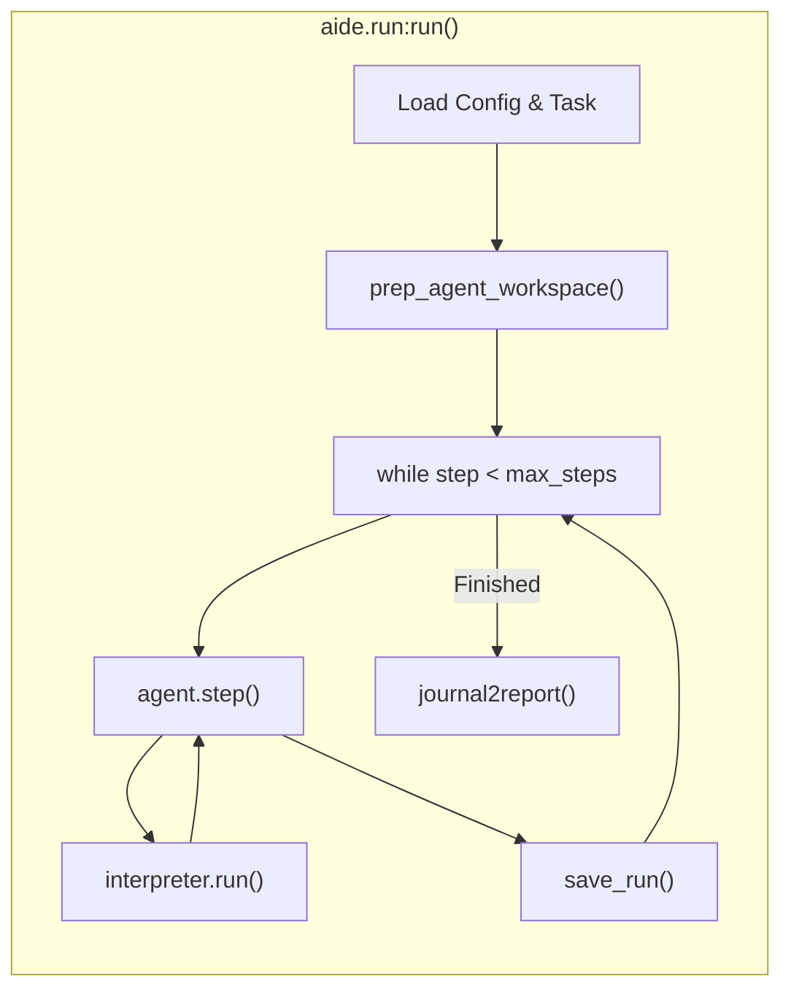

<!-- source: DeepWiki mcp.deepwiki.com · repo WecoAI/aideml · page 3.2 Command Line Interface · fetched 2026-10-26 -->

# Command Line Interface

<details>
<summary>Relevant source files</summary>

The following files were used as context for generating this wiki page:

- [README.md](README.md)
- [aide/run.py](aide/run.py)
- [setup.py](setup.py)

</details>


The Command Line Interface (CLI) provides a streamlined way to execute AIDE ML experiments from the terminal using the `aide` command. This interface is optimized for batch processing, automation scripts, and users who prefer command-line workflows over graphical interfaces.

## CLI Entry Point and Implementation

The `aide` command is registered as a console script entry point in [setup.py:37-40]() and maps to the `run` function in the `aide.run` module [aide/run.py:56](). The CLI utilizes `omegaconf` for hierarchical configuration management, allowing users to override any parameter defined in the default `config.yaml` [aide/run.py:57]().

### CLI Data Flow and Code Entities

The following diagram illustrates how the CLI command transforms user input into internal code objects and execution state.

```mermaid
graph TD
    subgraph "Natural Language Space"
        UserCmd["'aide data_dir=... goal=... eval=...'"]
        GoalStr["'Predict churn'"]
        EvalStr["'AUROC'"]
    end

    subgraph "Code Entity Space"
        RunFn["aide.run:run()"]
        CfgObj["OmegaConf Cfg"]
        TaskDesc["TaskDescription"]
        JournalObj["aide.journal:Journal"]
        AgentObj["aide.agent:Agent"]
        InterpreterObj["aide.interpreter:Interpreter"]
    end

    UserCmd --> RunFn
    GoalStr -.-> TaskDesc
    EvalStr -.-> TaskDesc
    RunFn --> CfgObj
    CfgObj --> TaskDesc
    TaskDesc --> AgentObj
    JournalObj --> AgentObj
    RunFn --> InterpreterObj
    AgentObj -->|agent.step()| InterpreterObj
```
Sources: [aide/run.py:56-81](), [setup.py:37-40](), [README.md:38-39]()

## Usage and Parameters

The CLI accepts parameters using a hierarchical dot notation. Parameters are specified as `key=value` pairs and are merged with the default configuration found in `aide/utils/config.yaml` [setup.py:22]().

### Core Parameters

| Parameter | Description | Default |
|-----------|-------------|---------|
| `data_dir` | Path to the dataset directory [README.md:81]() | Required |
| `goal` | Natural language task description [README.md:82]() | Required |
| `eval` | Evaluation metric specification [README.md:83]() | Required |

### Advanced Search & Model Options

Users can tune the tree search and LLM behavior directly via the CLI [README.md:107-114]().

| Flag | Purpose | Default |
| --- | --- | --- |
| `agent.code.model` | LLM used to write code [README.md:120]() | `gpt-4-turbo` |
| `agent.steps` | Total improvement iterations [README.md:121]() | `20` |
| `agent.search.num_drafts` | Number of code drafts generated per step [README.md:122]() | `5` |

Sources: [README.md:116-123](), [aide/run.py:57-60]()

## Execution Lifecycle

When `aide` is executed, the `run()` function orchestrates several subsystems:

1.  **Configuration Loading**: Loads defaults via `load_cfg()` and merges CLI overrides [aide/run.py:57]().
2.  **Workspace Preparation**: Calls `prep_agent_workspace(cfg)` to copy and extract dataset files into a working directory [aide/run.py:64]().
3.  **Component Initialization**: Instantiates the `Journal` (to track the solution tree), the `Agent` (the LLM logic), and the `Interpreter` (the execution sandbox) [aide/run.py:72-81]().
4.  **Live Terminal UI**: Uses the `rich` library to display a real-time dashboard including the task description, a progress bar, and a visual representation of the solution tree [aide/run.py:84-130]().
5.  **Iterative Step**: Enters a loop calling `agent.step()` until `agent.steps` is reached [aide/run.py:131-135]().

### Internal Execution Flow


Sources: [aide/run.py:56-145]()

## Output and Artifacts

The CLI produces artifacts in the `logs/` directory. Each run is assigned a unique ID or experiment name [aide/run.py:58]().

### Output Locations

| Artifact | Location | Description |
|----------|----------|-------------|
| **Best Solution** | `logs/<id>/best_solution.py` | The Python script with the highest metric [README.md:88](). |
| **Visual Tree** | `logs/<id>/tree_plot.html` | An interactive HTML plot of the search tree [README.md:89](). |
| **Technical Report** | `logs/<id>/report.md` | An LLM-generated report of the experiment findings [aide/run.py:142](). |
| **Workspace** | `cfg.workspace_dir` | The temporary directory where code was executed [aide/run.py:105](). |

### Terminal Visualization

The CLI provides a live-updating dashboard using `rich.live`. It visualizes the `Journal` as a tree structure where:
*   `●` represents a successful execution with its metric [aide/run.py:42-44]().
*   `◍ bug` represents a script that failed to execute [aide/run.py:37]().
*   The best performing node is highlighted in **bold green** [aide/run.py:39-42]().

Sources: [aide/run.py:32-53](), [aide/run.py:126-130](), [README.md:86-90]()

---

