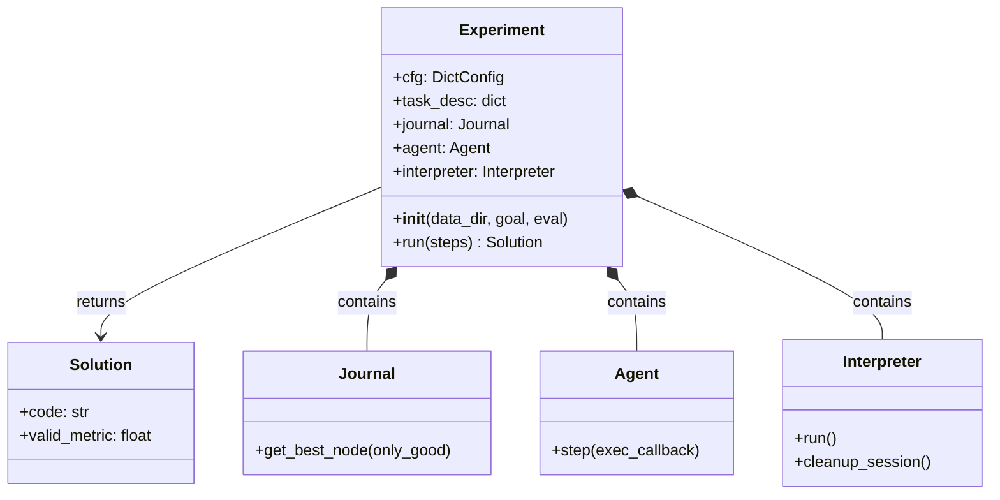
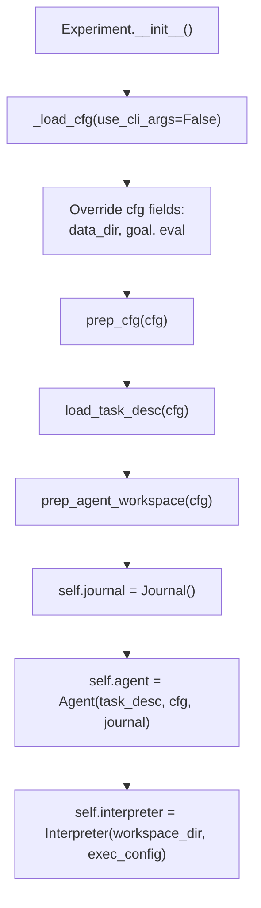
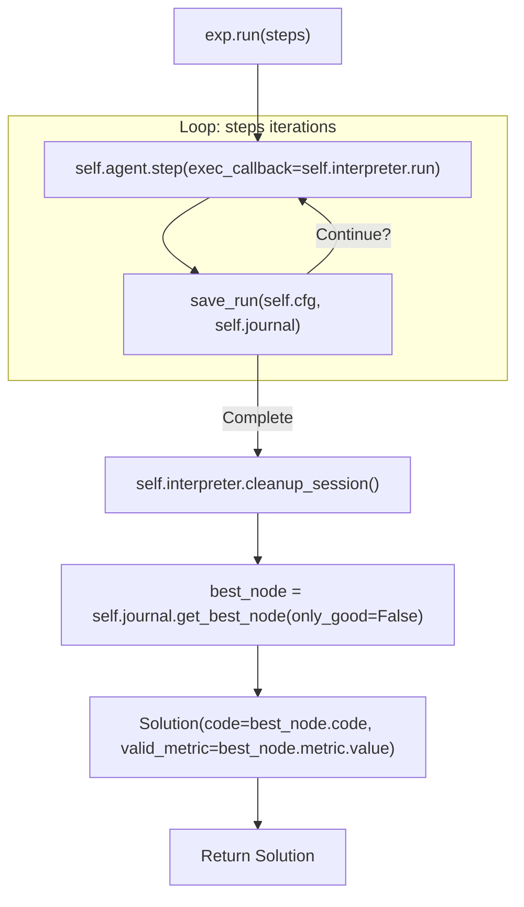
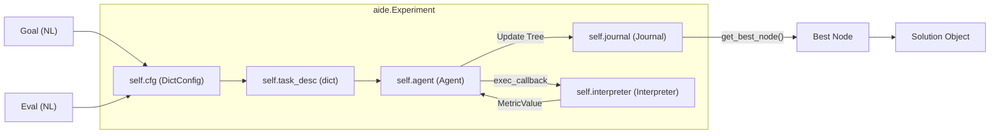

<!-- source: DeepWiki mcp.deepwiki.com · repo WecoAI/aideml · page 3.3 Python API · fetched 2026-10-26 -->

# Python API

<details>
<summary>Relevant source files</summary>

The following files were used as context for generating this wiki page:

- [README.md](README.md)
- [aide/__init__.py](aide/__init__.py)

</details>


## Purpose and Scope

This document describes AIDE ML's programmatic Python API, specifically the `aide.Experiment` class that allows developers to run AIDE experiments directly from Python code. This interface is ideal for researchers who need to integrate AIDE into larger workflows, run automated experiments, or build custom applications on top of AIDE's capabilities.

For command-line usage, see [Command Line Interface](#3.2). For the web-based interface, see [Web UI](#3.1). For system architecture details, see [System Architecture](#2).

---

## API Overview

The Python API provides a simple two-step interface:

1.  **Instantiate** an `Experiment` object with task parameters.
2.  **Run** the experiment for a specified number of steps.
3.  **Receive** a `Solution` object containing the best code and validation metric.

```python
import aide

exp = aide.Experiment(
    data_dir="example_tasks/house_prices",
    goal="Predict the sales price for each house",
    eval="RMSE between log-prices"
)

solution = exp.run(steps=20)
print(f"Metric: {solution.valid_metric}")
print(f"Code:\n{solution.code}")
```

**Sources**: [aide/__init__.py:1-63](), [README.md:128-151]()

---

## Experiment Class

### Class Definition

The `Experiment` class is defined in [aide/__init__.py:23-63]() and serves as the primary entry point for programmatic access to AIDE's functionality.

**Class Structure and Relationships**


**Sources**: [aide/__init__.py:17-63]()

---

## Constructor: `__init__`

### Signature

```python
def __init__(self, data_dir: str, goal: str, eval: str | None = None)
```

### Parameters

| Parameter | Type | Required | Description |
|-----------|------|----------|-------------|
| `data_dir` | `str` | Yes | Path to directory containing task data files (CSV, TXT, JSON, etc.) |
| `goal` | `str` | Yes | Natural language description of the task objective |
| `eval` | `str \| None` | No | Optional description of evaluation metric (e.g., "RMSE", "AUROC") |

### Initialization Flow

The constructor performs key operations to set up the environment and internal components:

**Experiment Initialization Sequence**


#### Configuration Loading
The constructor calls `_load_cfg(use_cli_args=False)` to load the default configuration from [aide/config.yaml](), explicitly disabling CLI argument parsing [aide/__init__.py:33](). This ensures programmatic usage is not affected by external command-line arguments.

#### Configuration Override
The provided `data_dir`, `goal`, and `eval` parameters override the loaded configuration, which is then finalized via `prep_cfg` [aide/__init__.py:34-37]().

#### Workspace Preparation
The `prep_agent_workspace()` function copies or symlinks data files from `data_dir` to the experiment's workspace directory, isolating each experiment's data [aide/__init__.py:42]().

#### Component Initialization
Three core components are instantiated:
1.  **Journal**: Tracks the solution tree and node history [aide/__init__.py:44]().
2.  **Agent**: Manages code generation and search logic [aide/__init__.py:45-49]().
3.  **Interpreter**: Sandboxed Python execution environment configured with the workspace directory [aide/__init__.py:50-53]().

**Sources**: [aide/__init__.py:24-53](), [aide/utils/config.py:8-14]()

---

## Run Method: `run()`

### Signature

```python
def run(self, steps: int) -> Solution
```

### Parameters

| Parameter | Type | Description |
|-----------|------|-------------|
| `steps` | `int` | Number of tree search iterations to perform |

### Return Value

Returns a `Solution` object containing the best code found and its associated validation metric [aide/__init__.py:62]().

### Execution Flow

**Run Method Execution Flow**


### Implementation Details

1.  **Agent Step**: Each iteration calls `self.agent.step()` with `self.interpreter.run` passed as the execution callback [aide/__init__.py:57]().
2.  **Save Results**: After each step, `save_run()` persists the current journal state and configuration to disk [aide/__init__.py:58]().
3.  **Cleanup**: After all steps complete, the interpreter's session (e.g., multiprocessing resources) is cleaned up [aide/__init__.py:59]().
4.  **Best Solution Extraction**: The journal is queried for the best node using `get_best_node(only_good=False)`, which returns the node with the highest (or lowest) metric value [aide/__init__.py:61]().

**Sources**: [aide/__init__.py:55-63]()

---

## Solution Dataclass

### Definition

```python
@dataclass
class Solution:
    code: str
    valid_metric: float
```

The `Solution` dataclass is a simple container for the final results of an experiment [aide/__init__.py:17-21]().

### Fields

| Field | Type | Description |
|-------|------|-------------|
| `code` | `str` | Complete Python code of the best solution found during search |
| `valid_metric` | `float` | Validation metric value achieved by this solution |

**Sources**: [aide/__init__.py:17-21]()

---

## Internal Component Interaction

### Data Flow Diagram

This diagram bridges the "Natural Language Space" (Goal/Eval) to the "Code Entity Space" (Agent, Journal, Interpreter).

**Data Flow from Input to Solution**


**Sources**: [aide/__init__.py:23-63]()

---

## Complete Usage Example

The following example demonstrates how to use the API with logging to monitor progress:

```python
import aide
import logging

def main():
    # Setup logging to see AIDE's internal progress
    logging.basicConfig(level=logging.INFO)
    aide_logger = logging.getLogger("aide")
    aide_logger.setLevel(logging.INFO)
    
    print("Starting experiment...")
    exp = aide.Experiment(
        data_dir="example_tasks/bitcoin_price",
        goal="Build a time series forecasting model for bitcoin close price.",
        eval="RMSLE"
    )

    # Run for 2 steps
    best_solution = exp.run(steps=2)

    print(f"Best solution has validation metric: {best_solution.valid_metric}")
    print(f"Best solution code:\n{best_solution.code}")
    print("Experiment finished.")

if __name__ == '__main__':
    main()
```

**Sources**: [README.md:128-151]()

---

## Configuration System Integration

The `Experiment` class automatically loads the default configuration and applies programmatic overrides. While the constructor only accepts `data_dir`, `goal`, and `eval`, the underlying `self.cfg` (an OmegaConf `DictConfig`) can be modified before calling `run()` for advanced usage:

```python
exp = aide.Experiment(data_dir="...", goal="...")
# Modify search hyperparameters directly
exp.cfg.agent.search.num_drafts = 10
exp.cfg.agent.code.model = "claude-3-5-sonnet-20240620"

solution = exp.run(steps=5)
```

**Sources**: [aide/__init__.py:37](), [aide/utils/config.py:13]()

---

