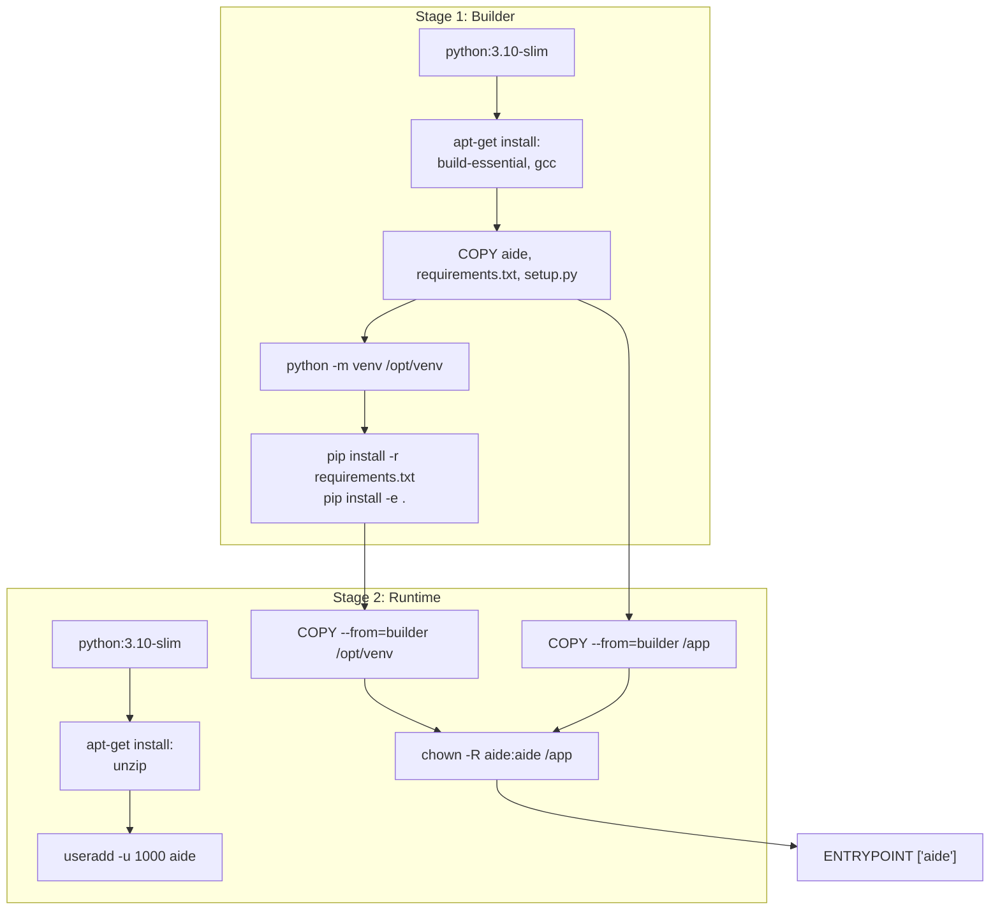
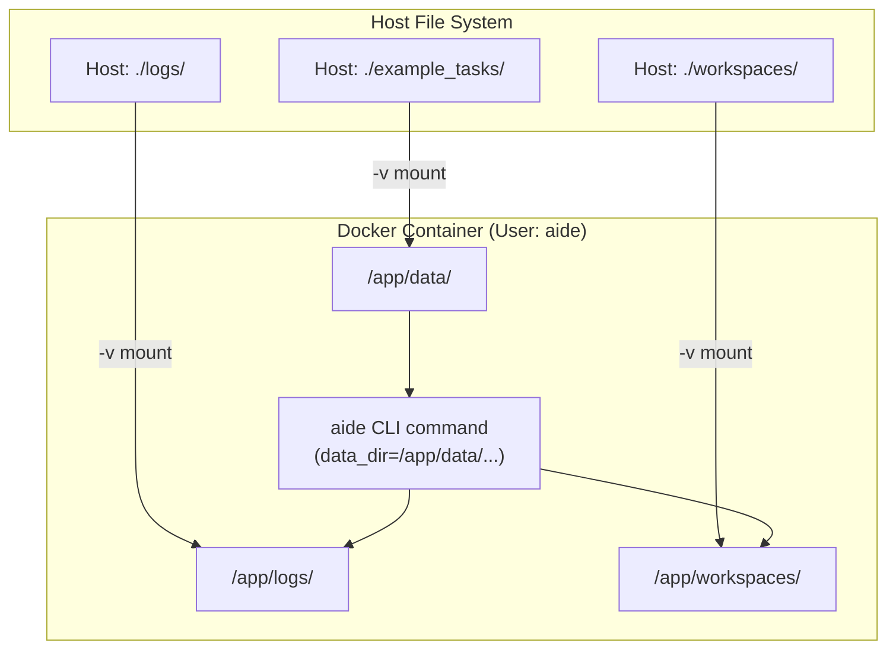
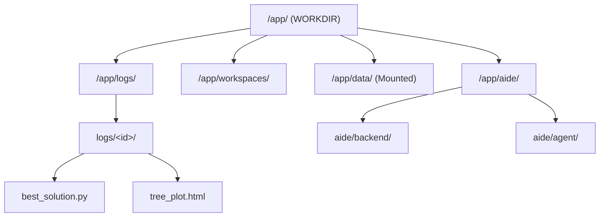

<!-- source: DeepWiki mcp.deepwiki.com · repo WecoAI/aideml · page 3.4 Docker · fetched 2026-10-26 -->

# Docker

<details>
<summary>Relevant source files</summary>

The following files were used as context for generating this wiki page:

- [.dockerignore](.dockerignore)
- [Dockerfile](Dockerfile)
- [README.md](README.md)

</details>


This page provides instructions for building and running AIDE ML in Docker containers, including volume mount configuration, environment variable setup, and container execution patterns. Docker containerization enables isolated, reproducible execution of AIDE experiments across different environments.

For information about other user interfaces, see [User Interfaces](#3). For CLI usage details outside of Docker, see [Command Line Interface](#3.2).

---

## Overview

AIDE ML can be containerized using Docker to provide:
- **Isolated execution environment** with all dependencies pre-installed.
- **Reproducible builds** across different machines.
- **Volume persistence** for logs, workspaces, and input data.
- **Simplified deployment** without manual dependency management.
- **Security isolation** for the sandboxed Python interpreter.

The Docker approach wraps the standard AIDE CLI and shares the same core execution flow.

**Sources:** [README.md:19-21](), [Dockerfile:1-56]()

---

## Building the Docker Image

### Basic Build

The repository includes a multi-stage `Dockerfile` at the root level that defines the container image.

```bash
docker build -t aide .
```

### Build Process

The build uses a two-stage process to minimize final image size while ensuring all build-time dependencies (like `gcc` for some ML libraries) are available during installation.



**Container Image Structure**

- **Base Image**: `python:3.10-slim` [Dockerfile:4]().
- **Non-Root User**: Runs as user `aide` (UID 1000) for security [Dockerfile:36]().
- **Working Directory**: `/app` [Dockerfile:45]().
- **Entrypoint**: Configured to execute the `aide` CLI command directly [Dockerfile:55]().

**Sources:** [Dockerfile:1-56](), [README.md:126-151]()

---

## Running Containers

### Volume Mount Architecture

AIDE requires volume mounts to persist data between container runs and access host resources. The container is configured with internal directories for logs and workspaces [Dockerfile:48]().



**Volume Mount Purposes**

| Container Path | Purpose |
|----------------|---------|
| `/app/logs` | Stores experiment outputs including `best_solution.py` and `tree_plot.html` [README.md:88-89](). |
| `/app/workspaces` | Contains temporary execution environments for the sandboxed interpreter. |
| `/app/data` | Provides input datasets and task specifications to the agent. |

**Sources:** [Dockerfile:47-49](), [README.md:81-84]()

---

## Standard Execution Pattern

### Complete Run Command

```bash
docker run -it --rm \
  -v "$(pwd)/logs:/app/logs" \
  -v "$(pwd)/workspaces:/app/workspaces" \
  -v "$(pwd)/example_tasks:/app/data" \
  -e OPENAI_API_KEY="your-key" \
  aide data_dir=/app/data/house_prices goal="Predict price" eval="RMSE"
```

**Command Breakdown**

| Flag/Argument | Description |
|---------------|-------------|
| `-it` | Allocates interactive terminal for live progress display. |
| `--rm` | Automatically removes container after execution completes. |
| `-v` | Mounts host directories to container paths for persistence. |
| `-e OPENAI_API_KEY` | Passes API key environment variable into container [README.md:78](). |
| `aide ...` | Executes the AIDE CLI with specified parameters [README.md:81-83](). |

---

## Environment Variables

### API Credentials

The container requires LLM API credentials passed via `-e` flags. These are used by the backend routing system to authenticate with providers.

```bash
# OpenAI (Default)
-e OPENAI_API_KEY="sk-..."

# Anthropic
-e ANTHROPIC_API_KEY="sk-ant-..."

# Custom/Local Endpoints (e.g., Ollama)
-e OPENAI_BASE_URL="http://host.docker.internal:11434/v1"
```

**Sources:** [README.md:78](), [README.md:160]()

---

## File System Layout Inside Container

### Container Directory Structure



When the `aide` command runs inside the container with `data_dir=/app/data/house_prices`:
1. **Data loading**: The agent reads task files from the mounted `/app/data/` directory.
2. **Workspace creation**: The interpreter creates isolated environments in `/app/workspaces/`.
3. **Output writing**: Results are written to `/app/logs/` which persists to the host.

**Sources:** [Dockerfile:45-49](), [README.md:86-90]()

---

## Common Usage Patterns

### Pattern 1: Using Claude Models
```bash
docker run -it --rm \
  -v "$(pwd)/logs:/app/logs" \
  -e ANTHROPIC_API_KEY="${ANTHROPIC_API_KEY}" \
  aide agent.code.model="claude-3-5-sonnet-20241022" \
       data_dir=/app/data/bitcoin_price \
       goal="Forecast price" \
       eval="RMSLE"
```

### Pattern 2: Local LLM with Ollama
For Docker containers to reach host services (like Ollama) on Mac/Windows, use `host.docker.internal`.
```bash
docker run -it --rm \
  -v "$(pwd)/logs:/app/logs" \
  -e OPENAI_BASE_URL="http://host.docker.internal:11434/v1" \
  aide agent.code.model="qwen2.5" \
       data_dir=/app/data/house_prices \
       goal="Predict price" \
       eval="RMSE"
```

**Sources:** [README.md:111-114](), [README.md:160-162]()

---

## Accessing Results

After the run finishes, files are available on the host via the mounted `logs` directory:

| File | Description |
|------|-------------|
| `logs/<id>/best_solution.py` | The best code generated by the agent [README.md:88](). |
| `logs/<id>/tree_plot.html` | Interactive visualization of the solution tree [README.md:89](). |

**Sources:** [README.md:86-90]()

---

## Limitations and Considerations

### Permissions
The container runs as user `aide` (UID 1000) [Dockerfile:36](). Ensure the host directories mounted via `-v` have appropriate permissions for this UID to write logs and workspaces.

### Network
The container must have outbound network access to reach LLM providers unless a local endpoint is configured via `OPENAI_BASE_URL`.

**Sources:** [Dockerfile:36-52](), [README.md:160-162]()

---

