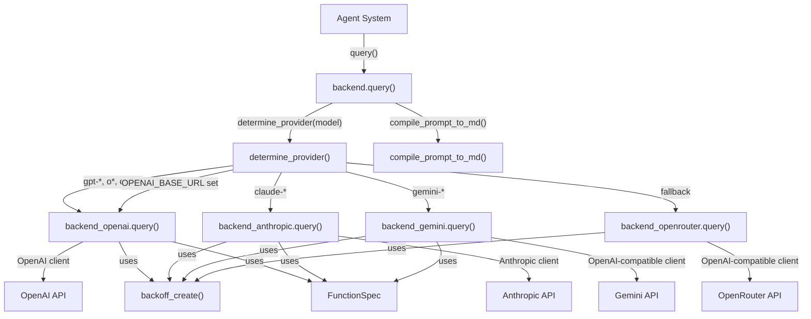
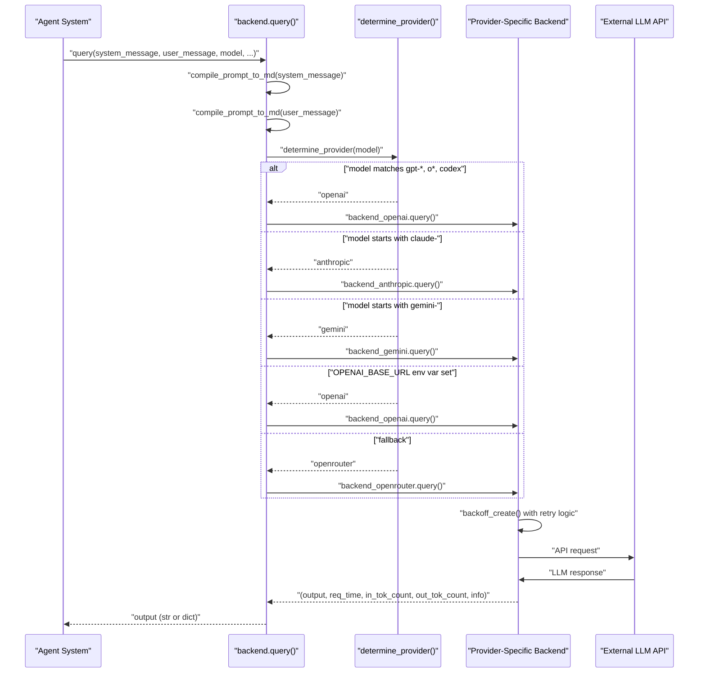
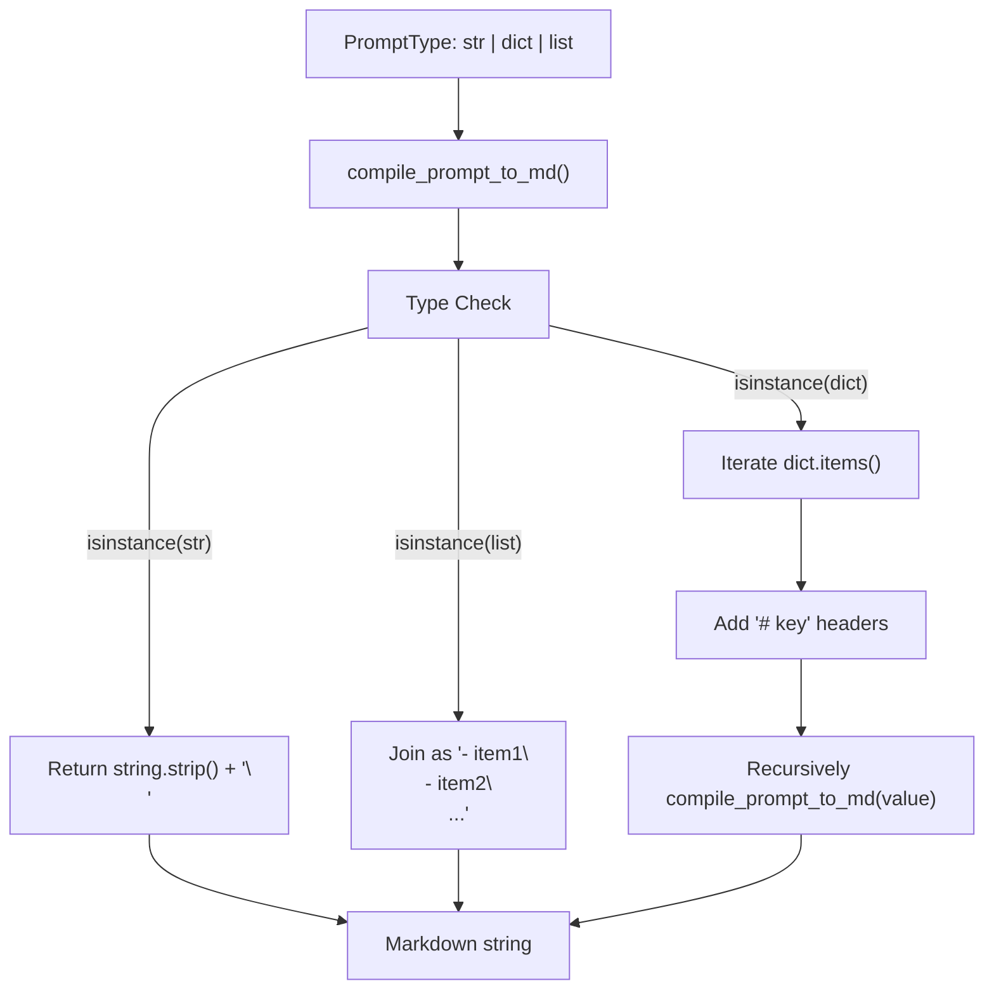
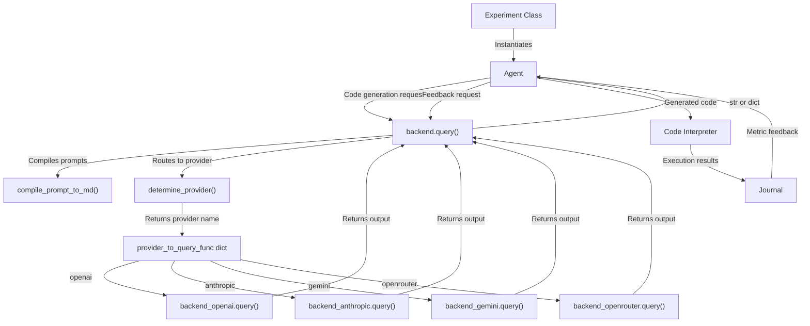

<!-- source: DeepWiki mcp.deepwiki.com · repo WecoAI/aideml · page 4 LLM Backend System · fetched 2026-10-26 -->

# LLM Backend System

<details>
<summary>Relevant source files</summary>

The following files were used as context for generating this wiki page:

- [aide/backend/__init__.py](aide/backend/__init__.py)
- [aide/backend/utils.py](aide/backend/utils.py)

</details>


## Purpose and Scope

The Backend System provides a unified interface for AIDE to communicate with various Large Language Model (LLM) providers. It abstracts away provider-specific API differences, allowing the rest of the system to interact with different LLMs through a consistent interface. The system supports multiple providers (OpenAI, Anthropic, Gemini, and OpenRouter) and includes features such as function calling, error handling with automatic retries, and standardized prompt formatting.

For information about specific provider integrations, see [OpenAI Integration](#4.2), [Anthropic Integration](#4.3), [Gemini Integration](#4.4), and [OpenRouter Integration](#4.5). For details on function calling capabilities and backend utilities, see [Backend Utilities & Function Calling](#4.6).

## System Architecture

### Backend System Component Structure



Sources: [aide/backend/__init__.py:1-75](), [aide/backend/utils.py:1-120]()

## Query Flow

### LLM Query Processing Sequence



Sources: [aide/backend/__init__.py:10-74](), [aide/backend/utils.py:17-30]()

## Main Interface

The Backend System exposes a single main function `query()` that serves as the unified interface for all LLM interactions:

```python
def query(
    system_message: PromptType | None,
    user_message: PromptType | None,
    model: str,
    temperature: float | None = None,
    max_tokens: int | None = None,
    func_spec: FunctionSpec | None = None,
    **model_kwargs,
) -> OutputType:
    # Implementation details...
```

This function:
1. Takes system and user messages (which can be strings, dictionaries, or lists via `PromptType` [aide/backend/utils.py:9]())
2. Accepts a model identifier (e.g., "gpt-4-turbo", "claude-3-opus")
3. Supports common parameters like temperature and max_tokens
4. Allows for function calling via the `func_spec` parameter [aide/backend/__init__.py:40]()
5. Returns either a string completion or a function call result (`OutputType` [aide/backend/utils.py:11]())

Sources: [aide/backend/__init__.py:34-74]()

## Provider Routing

### Provider Determination Logic

The system identifies the appropriate provider based on the model name using the `determine_provider()` function at [aide/backend/__init__.py:10-23]():

| Model Pattern | Provider | Notes |
|---------------|----------|-------|
| `gpt-*`, `o*`, `codex-mini-latest` | `openai` | Uses regex pattern `^(gpt-.*|o\d+(-.*)?|codex-mini-latest)$` |
| `claude-*` | `anthropic` | All Claude models |
| `gemini-*` | `gemini` | All Gemini models |
| Custom (with `OPENAI_BASE_URL` env var) | `openai` | Allows local LLM endpoints [aide/backend/__init__.py:19-20]() |
| All others | `openrouter` | Fallback for multi-model proxy |

The routing logic is implemented with priority checks:
1. First checks for OpenAI patterns (gpt, o-series, codex) [aide/backend/__init__.py:12-13]()
2. Then checks for provider-specific prefixes (claude, gemini) [aide/backend/__init__.py:14-17]()
3. Then checks if `OPENAI_BASE_URL` environment variable is set [aide/backend/__init__.py:19-20]()
4. Falls back to OpenRouter for all other models [aide/backend/__init__.py:22-23]()

Once the provider is determined, the appropriate query function is selected from the `provider_to_query_func` mapping at [aide/backend/__init__.py:26-31]().

Sources: [aide/backend/__init__.py:10-31]()

## Function Specification

The `FunctionSpec` class at [aide/backend/utils.py:57-120]() provides a unified representation for function calling across different LLM providers:

```python
@dataclass
class FunctionSpec(DataClassJsonMixin):
    name: str
    json_schema: dict  # JSON schema
    description: str
```

The class includes properties that convert the specification to provider-specific formats:

| Property | Target API | Description |
|----------|-----------|-------------|
| `as_openai_tool_dict` | OpenAI Chat Completions | Converts to OpenAI's tool format with `type: "function"` [aide/backend/utils.py:68-77]() |
| `openai_tool_choice_dict` | OpenAI Chat Completions | Format for specifying tool choice [aide/backend/utils.py:80-84]() |
| `as_anthropic_tool_dict` | Anthropic | Converts to Anthropic's tool format using `input_schema` [aide/backend/utils.py:87-93]() |
| `anthropic_tool_choice_dict` | Anthropic | Format for specifying tool choice with `type: "tool"` [aide/backend/utils.py:96-101]() |
| `as_openai_responses_tool_dict` | OpenAI Responses API | Alternative OpenAI API format [aide/backend/utils.py:104-111]() |
| `openai_responses_tool_choice_dict` | OpenAI Responses API | Tool choice for Responses API [aide/backend/utils.py:114-119]() |

Sources: [aide/backend/utils.py:57-120]()

## Error Handling and Retries

The system implements robust error handling with an exponential backoff strategy for retrying failed API calls through the `backoff_create()` function at [aide/backend/utils.py:17-30]():

**Backoff Parameters:**
- Wait strategy: Exponential backoff (`backoff.expo`)
- Maximum delay: 60 seconds
- Growth factor: 1.5

The function wraps API calls and automatically retries on specified exceptions:
```python
@backoff.on_predicate(
    wait_gen=backoff.expo,
    max_value=60,
    factor=1.5,
)
def backoff_create(
    create_fn: Callable, retry_exceptions: list[Exception], *args, **kwargs
)
```

Sources: [aide/backend/utils.py:17-30]()

## Prompt Handling

### Prompt Formatting Pipeline



The `compile_prompt_to_md()` function at [aide/backend/utils.py:43-54]() standardizes different prompt input formats:

**Input Type Handling:**

| Input Type | Processing | Example Output |
|------------|-----------|----------------|
| `str` | Strip whitespace, add newline [aide/backend/utils.py:44-45]() | `"Hello\n"` |
| `list` | Convert to Markdown bullets [aide/backend/utils.py:46-47]() | `"- item1\n- item2\n"` |
| `dict` | Hierarchical Markdown headers [aide/backend/utils.py:49-54]() | `"# Section\n## Subsection\n..."` |

Sources: [aide/backend/utils.py:43-54]()

## Integration with AIDE Architecture

### Backend System in AIDE Context



The Backend System at [aide/backend/__init__.py]() serves as the critical bridge between AIDE's Agent and external LLM providers. The `query()` function at line 34-74 abstracts all provider differences, ensuring consistent response formats regardless of which model is used. The Agent calls this function for both code generation and feedback analysis without needing to know the underlying provider details.

Sources: [aide/backend/__init__.py:1-75](), [aide/backend/utils.py:1-120]()

## Summary

The Backend System provides a robust abstraction layer for LLM interactions in AIDE. By unifying the interface for different providers, handling error cases, and standardizing formats, it allows the rest of the system to work with LLMs without needing to handle provider-specific details. The system's modular design makes it easily extensible to support additional providers or models in the future.

---

