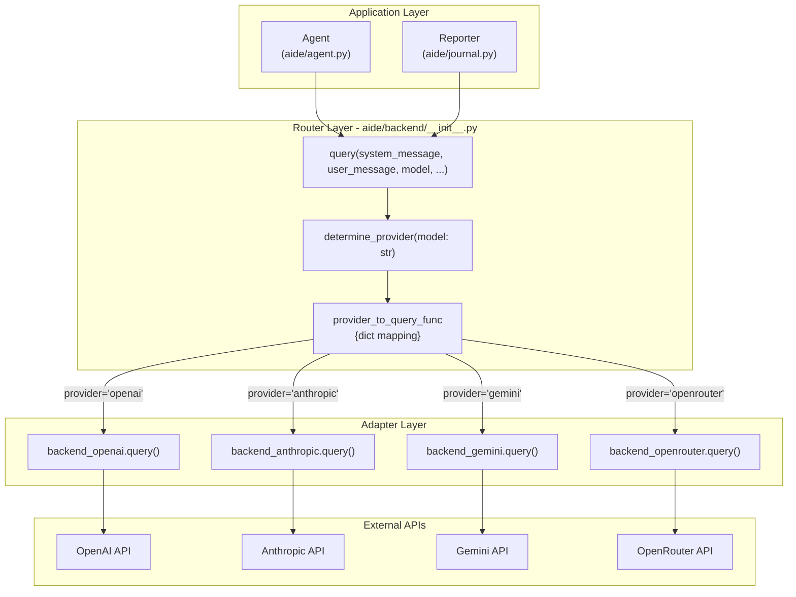
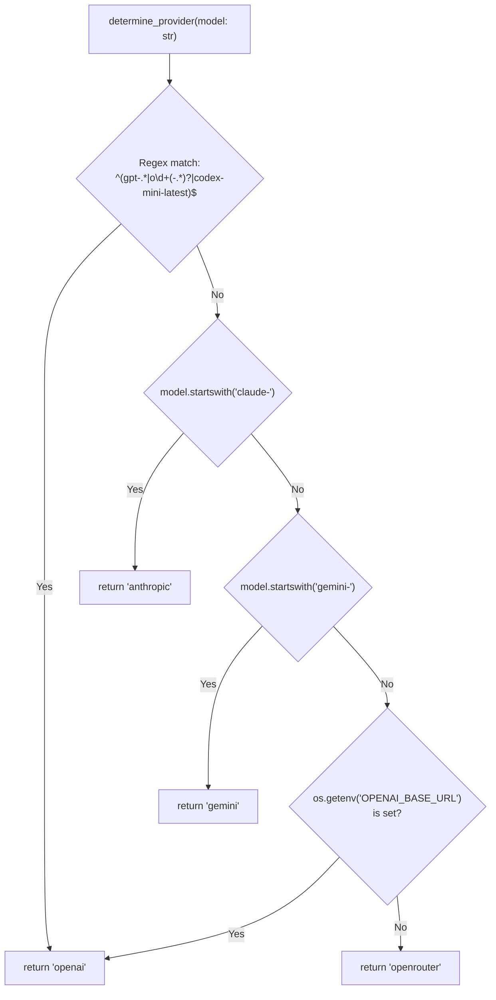
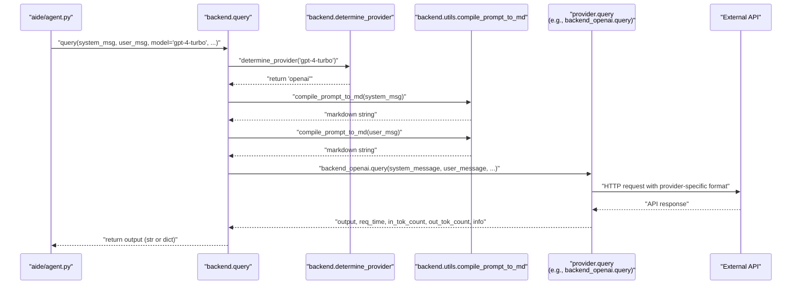
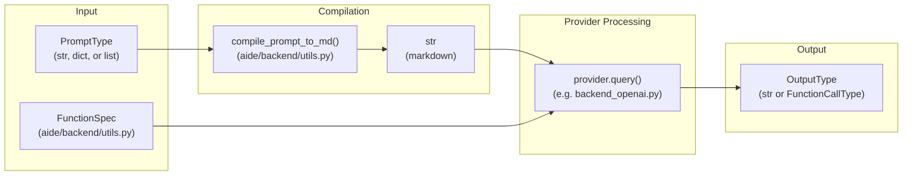

<!-- source: DeepWiki mcp.deepwiki.com · repo WecoAI/aideml · page 4.1 Backend Architecture & Router · fetched 2026-10-26 -->

# Backend Architecture & Router

<details>
<summary>Relevant source files</summary>

The following files were used as context for generating this wiki page:

- [aide/backend/__init__.py](aide/backend/__init__.py)
- [aide/backend/utils.py](aide/backend/utils.py)

</details>


## Purpose & Scope

This document explains AIDE's LLM backend router architecture, which provides a unified interface for querying multiple LLM providers (OpenAI, Anthropic, Gemini, OpenRouter). The router automatically determines the appropriate provider based on model naming conventions and dispatches requests accordingly.

This page covers the central `backend.query` function, provider determination logic, and the adapter pattern that enables multi-provider support. For details on individual provider implementations, see [OpenAI Integration](#4.2), [Anthropic Integration](#4.3), [Gemini Integration](#4.4), and [OpenRouter Integration](#4.5). For backend utilities like function calling and retry mechanisms, see [Backend Utilities & Function Calling](#4.6).

## Backend Router Architecture

The backend system uses a router pattern where a single `query` function provides a unified interface for all LLM interactions. This design decouples the Agent and other components from provider-specific implementation details.

**Architecture: Backend Router Pattern**



Sources: [aide/backend/__init__.py:1-75]()

## The Query Function Interface

The `backend.query` function serves as the single entry point for all LLM requests. It accepts standardized parameters and returns a unified output type.

**Function Signature**

```python
def query(
    system_message: PromptType | None,
    user_message: PromptType | None,
    model: str,
    temperature: float | None = None,
    max_tokens: int | None = None,
    func_spec: FunctionSpec | None = None,
    **model_kwargs,
) -> OutputType
```

| Parameter | Type | Description |
|-----------|------|-------------|
| `system_message` | `PromptType \| None` | System prompt (str, dict, or list) - compiled to markdown |
| `user_message` | `PromptType \| None` | User prompt (str, dict, or list) - compiled to markdown |
| `model` | `str` | Model identifier (e.g., "gpt-4-turbo", "claude-3-5-sonnet-20241022") |
| `temperature` | `float \| None` | Sampling temperature (defaults to provider-specific default) |
| `max_tokens` | `int \| None` | Maximum tokens to generate |
| `func_spec` | `FunctionSpec \| None` | Optional function calling specification |
| `**model_kwargs` | `dict` | Additional provider-specific parameters |

**Return Type**: `OutputType` - Either a `str` (text completion) or `FunctionCallType` (dict with function call details when `func_spec` is provided).

Sources: [aide/backend/__init__.py:34-57](), [aide/backend/utils.py:9-11]()

## Provider Determination Logic

The `determine_provider` function implements model-based routing using pattern matching and environment variable checks.

**Provider Determination: Model Name to Provider Mapping**



### Provider Routing Rules

The routing logic follows this priority order:

1. **OpenAI Pattern**: Matches `gpt-*`, `o1`, `o1-preview`, `o1-mini`, `o3-mini`, or `codex-mini-latest` [aide/backend/__init__.py:12-13]()
2. **Anthropic Pattern**: Matches `claude-*` prefix [aide/backend/__init__.py:14-15]()
3. **Gemini Pattern**: Matches `gemini-*` prefix [aide/backend/__init__.py:16-17]()
4. **Custom OpenAI Endpoint**: If `OPENAI_BASE_URL` environment variable is set, route unknown models to OpenAI backend (enables local LLM support) [aide/backend/__init__.py:19-20]()
5. **OpenRouter Fallback**: All other models route to OpenRouter [aide/backend/__init__.py:22-23]()

**Model Pattern Examples**

| Model String | Detected Provider | Rationale |
|--------------|------------------|-----------|
| `gpt-4-turbo` | `openai` | Matches `gpt-*` pattern |
| `o1-preview` | `openai` | Matches `o\d+(-.*)?` pattern |
| `claude-3-5-sonnet-20241022` | `anthropic` | Matches `claude-*` prefix |
| `gemini-1.5-pro` | `gemini` | Matches `gemini-*` prefix |
| `meta-llama/llama-3-70b` | `openrouter` | No pattern match, falls to OpenRouter |
| `custom-model` (with `OPENAI_BASE_URL` set) | `openai` | Environment variable triggers OpenAI route |

Sources: [aide/backend/__init__.py:10-23]()

## Provider Registry & Adapter Pattern

The backend system uses a dictionary-based registry to map provider names to their query functions, implementing the Adapter pattern.

**Provider Registry Structure**

```python
provider_to_query_func = {
    "openai": backend_openai.query,
    "anthropic": backend_anthropic.query,
    "openrouter": backend_openrouter.query,
    "gemini": backend_gemini.query,
}
```

The `query` function uses this registry to dispatch requests:

```python
provider = determine_provider(model)
query_func = provider_to_query_func[provider]
output, req_time, in_tok_count, out_tok_count, info = query_func(
    system_message=compile_prompt_to_md(system_message) if system_message else None,
    user_message=compile_prompt_to_md(user_message) if user_message else None,
    func_spec=func_spec,
    **model_kwargs,
)
```

### Adapter Pattern Benefits

This architecture provides:

- **Extensibility**: New providers can be added by implementing a `query` function and adding an entry to the registry [aide/backend/__init__.py:26-31]()
- **Decoupling**: Application code interacts only with `backend.query`, not provider-specific implementations [aide/backend/__init__.py:34-42]()
- **Consistency**: All provider adapters must conform to the same signature and return format [aide/backend/__init__.py:67-72]()
- **Dynamic Routing**: Provider selection happens at runtime based on model string [aide/backend/__init__.py:65-66]()

Sources: [aide/backend/__init__.py:26-31](), [aide/backend/__init__.py:65-72]()

## Query Execution Flow

This diagram shows the complete data flow from application code through the router to a specific provider.

**Data Flow: Application Request to Provider Response**



### Query Return Values

Provider-specific query functions return a tuple with five elements:

1. `output` (OutputType): String completion or function call dict
2. `req_time` (float): Request duration in seconds
3. `in_tok_count` (int): Input token count
4. `out_tok_count` (int): Output token count
5. `info` (dict): Additional metadata

The main `backend.query` function extracts only the `output` and returns it to the caller, discarding timing and token information at the router level.

Sources: [aide/backend/__init__.py:67-74]()

## Prompt Compilation System

The router automatically compiles prompts from structured formats to markdown strings before passing them to provider-specific backends.

### PromptType Definition

```python
PromptType = str | dict | list
```

The `compile_prompt_to_md` function in `backend.utils` converts structured prompts:

**Supported Prompt Formats**

| Format | Input Example | Compiled Output |
|--------|---------------|-----------------|
| String | `"You are a helpful assistant."` | `"You are a helpful assistant.\n"` |
| List | `["Task 1", "Task 2"]` | `"- Task 1\n- Task 2\n"` |
| Dict | `{"Goal": "description", "Context": {...}}` | Hierarchical markdown with headers |

**Dictionary Compilation**: Nested dictionaries become markdown headers:

```python
{
    "Task": "Predict prices",
    "Context": {
        "Dataset": "housing.csv",
        "Features": ["sqft", "bedrooms"]
    }
}
```

Compiles to:

```markdown
# Task
Predict prices

## Dataset
housing.csv

## Features
- sqft
- bedrooms
```

Sources: [aide/backend/utils.py:43-54](), [aide/backend/utils.py:9]()

## Function Calling Abstraction

The router supports function calling through the `FunctionSpec` class, which provides provider-agnostic tool definitions.

**FunctionSpec Structure**

```python
@dataclass
class FunctionSpec(DataClassJsonMixin):
    name: str
    json_schema: dict  # JSON schema
    description: str
```

When `func_spec` is provided to `backend.query`, the return type becomes a dictionary containing function call details rather than a text string.

### Provider-Specific Tool Formats

The `FunctionSpec` class includes properties to convert the generic specification to provider-specific formats:

| Provider | Property | Format Notes |
|----------|----------|--------------|
| OpenAI (Chat) | `as_openai_tool_dict` | Uses `"function"` type with `"parameters"` key [aide/backend/utils.py:68-77]() |
| OpenAI (Responses) | `as_openai_responses_tool_dict` | Similar format, different API endpoint [aide/backend/utils.py:104-111]() |
| Anthropic | `as_anthropic_tool_dict` | Uses `"input_schema"` instead of `"parameters"` [aide/backend/utils.py:87-93]() |

**Tool Choice Properties**: Each provider format also has a corresponding `*_tool_choice_dict` property to force tool usage (e.g., `openai_tool_choice_dict` or `anthropic_tool_choice_dict`).

Sources: [aide/backend/utils.py:57-119](), [aide/backend/__init__.py:40](), [aide/backend/__init__.py:53]()

## Type System

The backend module defines a concise type system for LLM interactions.

**Core Types**

```python
PromptType = str | dict | list
FunctionCallType = dict
OutputType = str | FunctionCallType
```

| Type | Description | Used For |
|------|-------------|----------|
| `PromptType` | Flexible prompt format | System/user messages before compilation |
| `FunctionCallType` | Dictionary with function call details | Return value when `func_spec` is provided |
| `OutputType` | Union of string or function call | Return type of `query` function |

**Type Flow Through System**



Sources: [aide/backend/utils.py:9-11]()

## Backend Module Imports

The router module imports all provider backends and utilities at initialization:

```python
from . import backend_anthropic, backend_openai, backend_openrouter, backend_gemini
from .utils import FunctionSpec, OutputType, PromptType, compile_prompt_to_md
```

This structure allows:
- Provider backends to be imported as `backend_openai`, `backend_anthropic`, etc. [aide/backend/__init__.py:1]()
- Utility types and functions to be imported from `backend.utils` [aide/backend/__init__.py:2]()
- The `query` function to be accessed as `backend.query` from outside the module [aide/backend/__init__.py:34]()

Sources: [aide/backend/__init__.py:1-2]()

## Error Handling & Logging

The router uses Python's logging system to track provider selection and errors:

```python
logger = logging.getLogger("aide")
```

Provider determination is deterministic and does not log by default. Individual provider adapters handle their own logging, retry logic, and error handling. A `backoff_create` utility is provided in `backend.utils` to handle exponential backoff for API calls.

Sources: [aide/backend/__init__.py:4-7](), [aide/backend/utils.py:17-30]()

---

