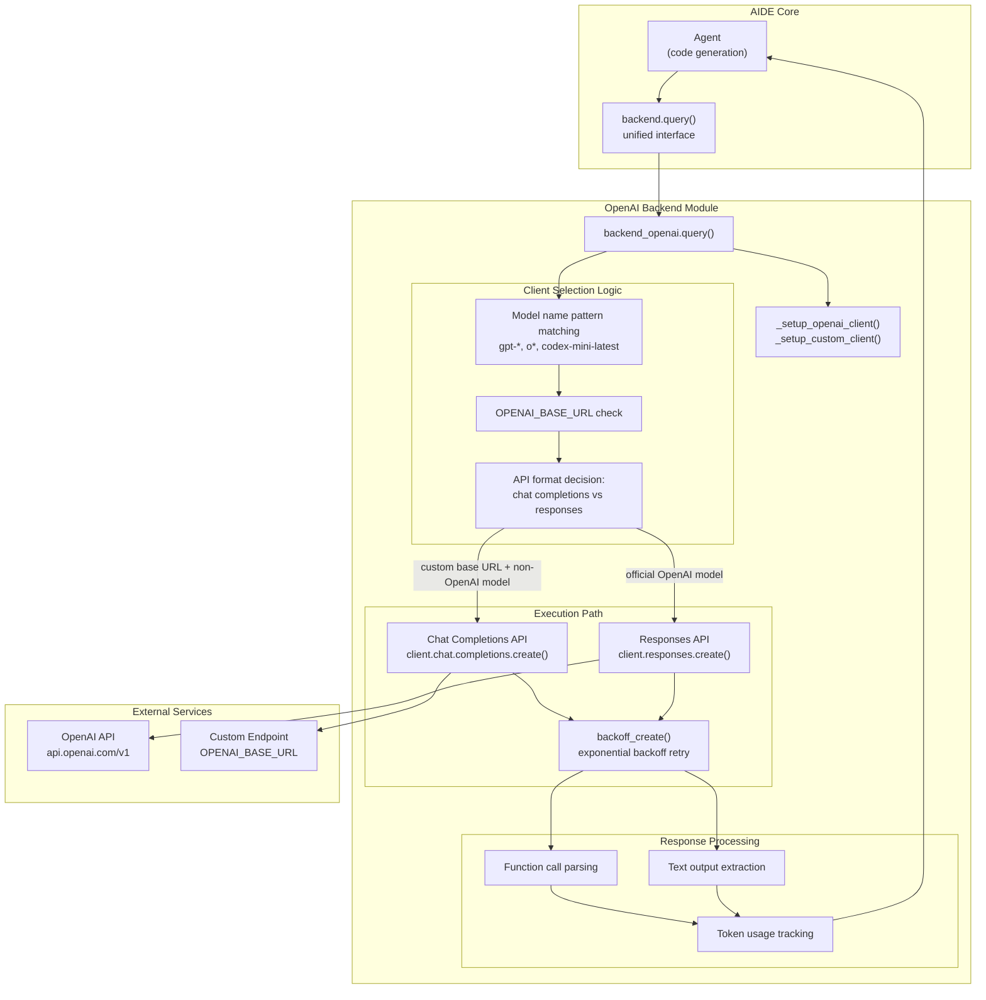
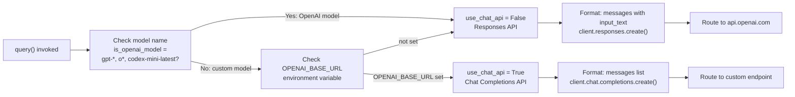
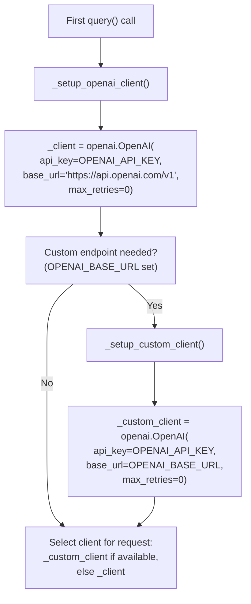
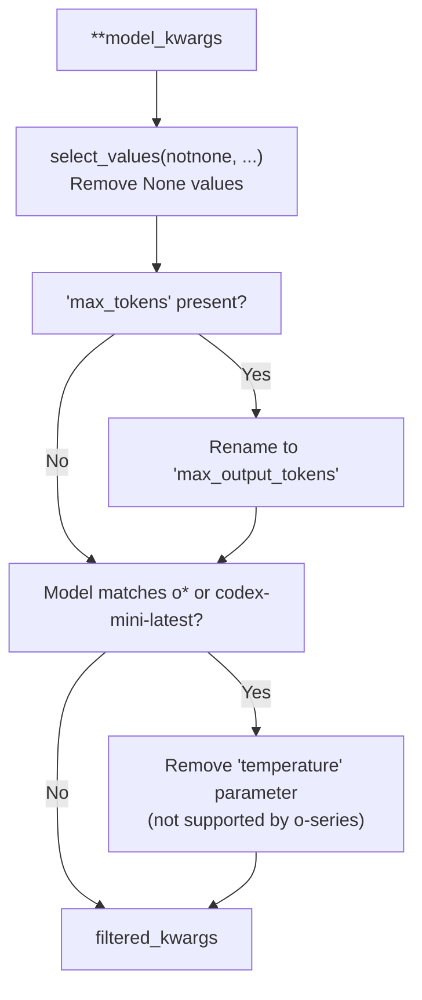
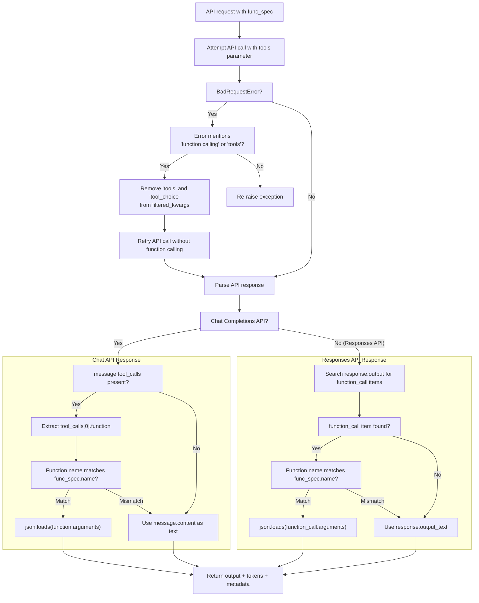
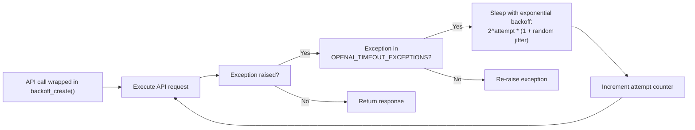
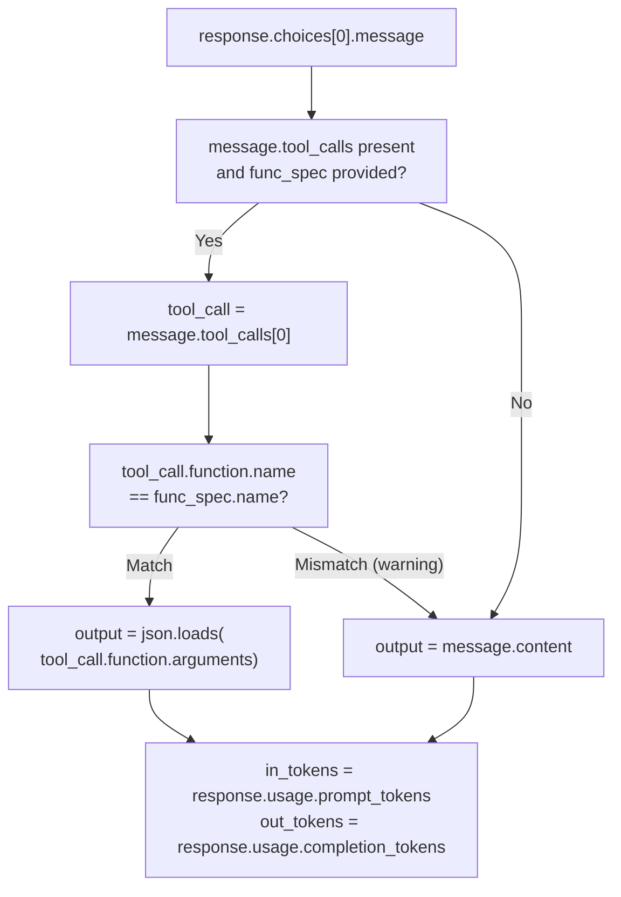
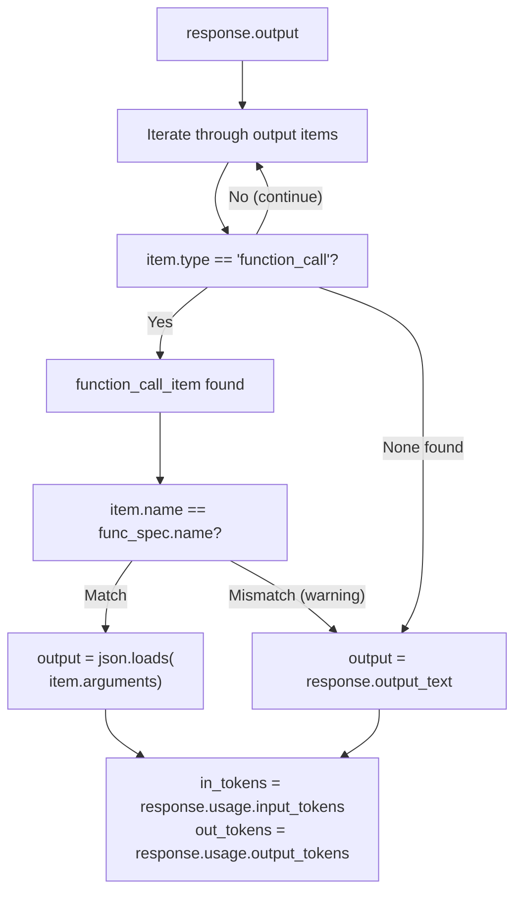
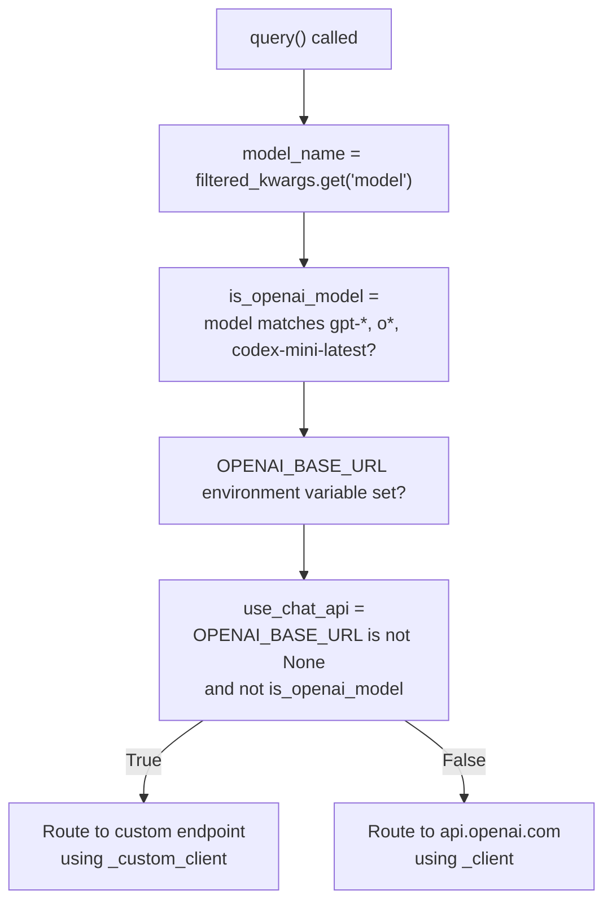
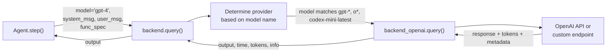

<!-- source: DeepWiki mcp.deepwiki.com · repo WecoAI/aideml · page 4.2 OpenAI Integration · fetched 2026-10-26 -->

# OpenAI Integration

<details>
<summary>Relevant source files</summary>

The following files were used as context for generating this wiki page:

- [aide/backend/backend_openai.py](aide/backend/backend_openai.py)

</details>


## Purpose and Scope

This document describes the OpenAI backend implementation in AIDE ML, located at [aide/backend/backend_openai.py:1-239](). The OpenAI backend is one of four LLM provider integrations (see [Backend Architecture & Router](#4.1) for the full system) and serves as the primary interface for OpenAI models including GPT-4, o-series reasoning models, and custom OpenAI-compatible endpoints.

The OpenAI backend provides:
- Support for official OpenAI API models (`gpt-*`, `o*`, `codex-mini-latest`)
- Two distinct API formats: chat completions and responses
- Function calling with graceful degradation
- Custom base URL support for local or third-party OpenAI-compatible servers
- Exponential backoff retry logic for transient failures

For integration with other LLM providers, see [Anthropic Integration](#4.3), [Gemini Integration](#4.4), and [OpenRouter Integration](#4.5). For shared utilities like `FunctionSpec` and `backoff_create`, see [Backend Utilities & Function Calling](#4.6).

**Sources:** [aide/backend/backend_openai.py:1-15]()

---

## Architecture Overview

The OpenAI backend acts as an adapter between AIDE's unified backend interface and OpenAI's API, handling provider-specific details while exposing a consistent interface to the rest of the system.



**Diagram: OpenAI Backend Architecture and Request Flow**

The backend router determines whether to use the OpenAI backend based on model name patterns (see [aide/backend/__init__.py]() for routing logic). Once selected, `query()` determines which of two API formats to use based on whether a custom base URL is configured and whether the model matches official OpenAI patterns.

**Sources:** [aide/backend/backend_openai.py:48-116]()

---

## Supported Models and API Formats

The OpenAI backend supports two distinct API formats, each with different request/response structures and use cases.

### Model Recognition Patterns

| Pattern | Examples | Description |
|---------|----------|-------------|
| `gpt-*` | `gpt-4`, `gpt-4-turbo`, `gpt-3.5-turbo` | Standard GPT models |
| `o*` | `o1-preview`, `o1-mini`, `o3-mini` | Reasoning models (o-series) |
| `codex-mini-latest` | `codex-mini-latest` | Codex model variant |

**Sources:** [aide/backend/backend_openai.py:66-68](), [aide/backend/backend_openai.py:73]()

### API Format Selection Logic

The backend selects between two API formats based on configuration and model type:



**Diagram: API Format Selection Decision Tree**

**Chat Completions API** (standard OpenAI format):
- Used for custom endpoints (local servers, third-party providers)
- Standard message format: `[{"role": "system", "content": "..."}]`
- Invoked via `client.chat.completions.create()`
- See [aide/backend/backend_openai.py:76-109]()

**Responses API** (OpenAI-specific format):
- Used for official OpenAI models
- Enhanced message format: `[{"role": "system", "content": [{"type": "input_text", "text": "..."}]}]`
- Invoked via `client.responses.create()`
- See [aide/backend/backend_openai.py:84-116]()

**Sources:** [aide/backend/backend_openai.py:71-94]()

---

## Client Configuration and Initialization

The OpenAI backend maintains two separate client instances, each lazily initialized using the `@once` decorator to ensure single initialization.

### Client Instances

| Client | Purpose | Configuration Source | Code Reference |
|--------|---------|---------------------|----------------|
| `_client` | Official OpenAI API | `OPENAI_API_KEY` environment variable | [aide/backend/backend_openai.py:28-34]() |
| `_custom_client` | Custom endpoints | `OPENAI_BASE_URL` + `OPENAI_API_KEY` | [aide/backend/backend_openai.py:36-46]() |

### Initialization Flow



**Diagram: Client Initialization Sequence**

Both clients disable built-in retries (`max_retries=0`) because AIDE implements its own retry logic with exponential backoff through `backoff_create()` (see [Backend Utilities & Function Calling](#4.6)).

**Environment Variables:**
- `OPENAI_API_KEY`: Required for authentication with OpenAI or compatible endpoints
- `OPENAI_BASE_URL`: Optional; when set, enables routing to custom endpoints

**Sources:** [aide/backend/backend_openai.py:17-18](), [aide/backend/backend_openai.py:28-46]()

---

## Query Function Interface

The `query()` function is the primary entry point for the OpenAI backend, called by the backend router with a unified interface.

### Function Signature

```python
def query(
    system_message: str | None,
    user_message: str | None,
    func_spec: FunctionSpec | None = None,
    **model_kwargs,
) -> tuple[OutputType, float, int, int, dict]:
```

**Sources:** [aide/backend/backend_openai.py:48-53]()

### Parameters and Return Values

| Parameter | Type | Description |
|-----------|------|-------------|
| `system_message` | `str \| None` | System prompt providing context and instructions |
| `user_message` | `str \| None` | User query or task description |
| `func_spec` | `FunctionSpec \| None` | Optional function/tool specification for structured output |
| `**model_kwargs` | `dict` | Model-specific parameters (model, temperature, max_tokens, etc.) |

**Return tuple:**
1. `OutputType`: Either structured dict (function call) or text string
2. `float`: Request duration in seconds
3. `int`: Input token count
4. `int`: Output token count
5. `dict`: Additional metadata (model, system_fingerprint, created timestamp)

### Parameter Processing

The function applies several transformations to incoming parameters:



**Diagram: Parameter Preprocessing Pipeline**

O-series reasoning models (`o1-preview`, `o1-mini`, etc.) and `codex-mini-latest` do not accept a `temperature` parameter, so it's automatically removed when detected.

**Sources:** [aide/backend/backend_openai.py:61-69]()

---

## Function Calling Support

The OpenAI backend supports function calling (also called "tool use") with automatic fallback to text generation if the model doesn't support it.

### Function Specification Format

When `func_spec` is provided, it's converted to the appropriate format for each API:

| API Format | Tool Specification | Tool Choice | Code Reference |
|------------|-------------------|-------------|----------------|
| Chat Completions | `func_spec.as_openai_tool_dict` | `func_spec.openai_tool_choice_dict` | [aide/backend/backend_openai.py:81-82]() |
| Responses | `func_spec.as_openai_responses_tool_dict` | `func_spec.openai_responses_tool_choice_dict` | [aide/backend/backend_openai.py:92-93]() |

### Function Call Processing Flow



**Diagram: Function Calling Execution and Fallback Logic**

### Graceful Degradation

When a model doesn't support function calling, the backend catches `openai.BadRequestError` and checks if the error message mentions function calling:

1. If function calling error detected: Remove `tools` and `tool_choice` parameters and retry as plain text generation [aide/backend/backend_openai.py:118-144]()
2. If other error: Re-raise the exception [aide/backend/backend_openai.py:146-147]()

This allows seamless use of both function-capable and function-incapable models without manual configuration.

**Sources:** [aide/backend/backend_openai.py:80-93](), [aide/backend/backend_openai.py:117-147](), [aide/backend/backend_openai.py:154-180](), [aide/backend/backend_openai.py:186-222]()

---

## Error Handling and Retry Logic

The OpenAI backend implements robust error handling with exponential backoff for transient failures.

### Retryable Exceptions

The backend defines a set of transient exceptions that warrant retry:

```python
OPENAI_TIMEOUT_EXCEPTIONS = (
    openai.RateLimitError,      # API rate limits exceeded
    openai.APIConnectionError,   # Network connectivity issues
    openai.APITimeoutError,      # Request timeout
    openai.InternalServerError,  # OpenAI server errors (5xx)
)
```

**Sources:** [aide/backend/backend_openai.py:20-25]()

### Retry Mechanism

All API calls are wrapped in `backoff_create()`, which implements exponential backoff with jitter:



**Diagram: Exponential Backoff Retry Flow**

The retry mechanism is shared across all backends via the `backoff_create()` utility (see [Backend Utilities & Function Calling](#4.6) for implementation details).

**Chat Completions API calls:**
```python
response = backoff_create(
    client_to_use.chat.completions.create,
    OPENAI_TIMEOUT_EXCEPTIONS,
    messages=messages,
    **filtered_kwargs,
)
```

**Responses API calls:**
```python
response = backoff_create(
    _client.responses.create,
    OPENAI_TIMEOUT_EXCEPTIONS,
    input=messages,
    **filtered_kwargs,
)
```

**Sources:** [aide/backend/backend_openai.py:104-116](), [aide/backend/backend_openai.py:131-144]()

---

## Response Parsing and Token Tracking

The backend extracts structured output, tracks token usage, and returns metadata for all requests.

### Output Extraction by API Type

**Chat Completions API:**



**Diagram: Chat Completions Response Parsing**

**Sources:** [aide/backend/backend_openai.py:152-183]()

**Responses API:**



**Diagram: Responses API Response Parsing**

**Sources:** [aide/backend/backend_openai.py:184-225]()

### Metadata Collection

Both API formats return consistent metadata:

| Field | Source (Chat API) | Source (Responses API) |
|-------|-------------------|------------------------|
| `system_fingerprint` | `response.system_fingerprint` | `response.system_fingerprint` |
| `model` | `response.model` | `response.model` |
| `created` | `response.created` | `response.created` |

**Sources:** [aide/backend/backend_openai.py:227-231]()

### Logging

The backend logs comprehensive information about each request:

1. **Request logging:** System and user messages [aide/backend/backend_openai.py:95]()
2. **Response logging:** Model name, duration, token counts [aide/backend/backend_openai.py:233-235]()
3. **Output logging:** Final output value [aide/backend/backend_openai.py:236]()

All logs use the `"aide"` logger namespace for consistent filtering and formatting.

**Sources:** [aide/backend/backend_openai.py:13](), [aide/backend/backend_openai.py:95](), [aide/backend/backend_openai.py:233-236]()

---

## Custom Endpoint Support

The OpenAI backend supports routing requests to custom OpenAI-compatible endpoints, enabling use of local models or third-party providers.

### Configuration

Custom endpoints are configured via environment variables:

| Variable | Purpose | Example |
|----------|---------|---------|
| `OPENAI_BASE_URL` | Base URL for custom endpoint | `http://localhost:11434/v1` (Ollama) |
| `OPENAI_API_KEY` | Authentication key | `sk-...` or `ollama` |

When `OPENAI_BASE_URL` is set and the model name doesn't match official OpenAI patterns, the backend automatically routes to the custom endpoint using the Chat Completions API.

### Custom Endpoint Decision Logic



**Diagram: Custom Endpoint Routing Logic**

### Example Usage Patterns

**Ollama local models:**
```bash
export OPENAI_BASE_URL="http://localhost:11434/v1"
export OPENAI_API_KEY="ollama"
# Then use model names like "llama3", "codellama", etc.
```

**Third-party OpenAI-compatible services:**
```bash
export OPENAI_BASE_URL="https://api.together.xyz/v1"
export OPENAI_API_KEY="your-together-api-key"
# Then use Together AI model names
```

The backend automatically selects `_custom_client` when available, falling back to `_client` if the custom client wasn't initialized.

**Sources:** [aide/backend/backend_openai.py:36-46](), [aide/backend/backend_openai.py:71-78](), [aide/backend/backend_openai.py:101-109]()

---

## Integration with AIDE System

The OpenAI backend integrates with the broader AIDE system through the backend router and agent.

### Call Chain



**Diagram: OpenAI Backend Integration in AIDE Request Flow**

The Agent specifies which LLM model to use through configuration:
- `agent.code.model`: Model for code generation
- `agent.feedback.model`: Model for feedback/analysis
- `report.model`: Model for report generation

When any of these is an OpenAI model (matches patterns `gpt-*`, `o*`, or `codex-mini-latest`), the backend router dispatches to `backend_openai.query()`.

### Token Tracking

Token counts returned by the OpenAI backend are aggregated at the experiment level for cost tracking and analysis. The Journal records token usage per step, enabling users to monitor API consumption.

**Sources:** [aide/backend/backend_openai.py:48-238]()

---

## Summary

The OpenAI backend provides a robust, feature-rich integration with OpenAI's API and compatible endpoints:

| Feature | Implementation |
|---------|---------------|
| **Model Support** | GPT-4, o-series reasoning models, Codex, custom models |
| **API Formats** | Chat Completions (standard) and Responses (OpenAI-specific) |
| **Function Calling** | Full support with graceful degradation |
| **Custom Endpoints** | Local servers, third-party providers via `OPENAI_BASE_URL` |
| **Error Handling** | Exponential backoff retry for transient failures |
| **Parameter Handling** | Automatic adaptation for o-series models |
| **Response Parsing** | Structured function output or text, with token tracking |

The dual API format support and custom endpoint capabilities make this backend versatile enough to handle official OpenAI models, local development with Ollama, and third-party OpenAI-compatible services through a single unified interface.

**Sources:** [aide/backend/backend_openai.py:1-239]()

---

