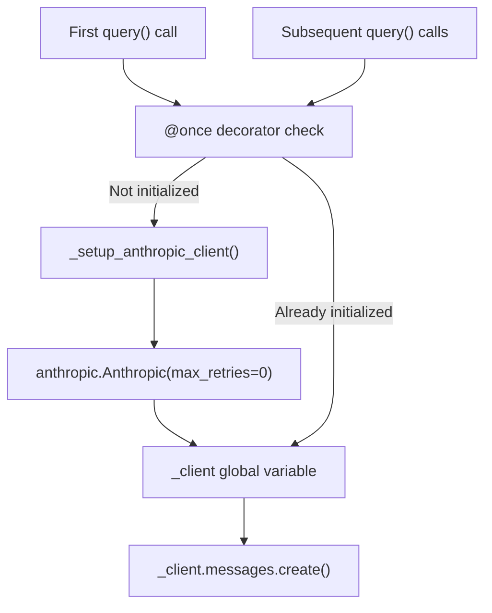
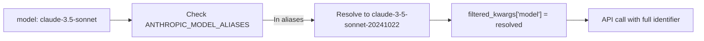
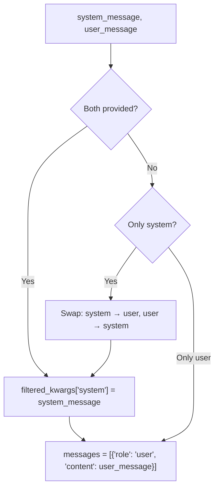
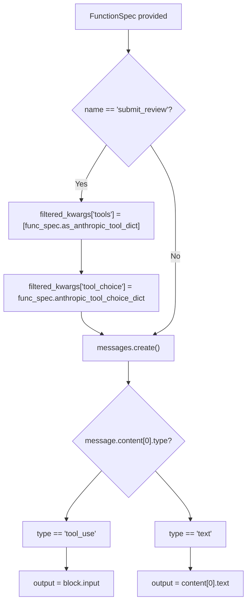
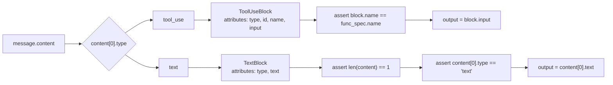
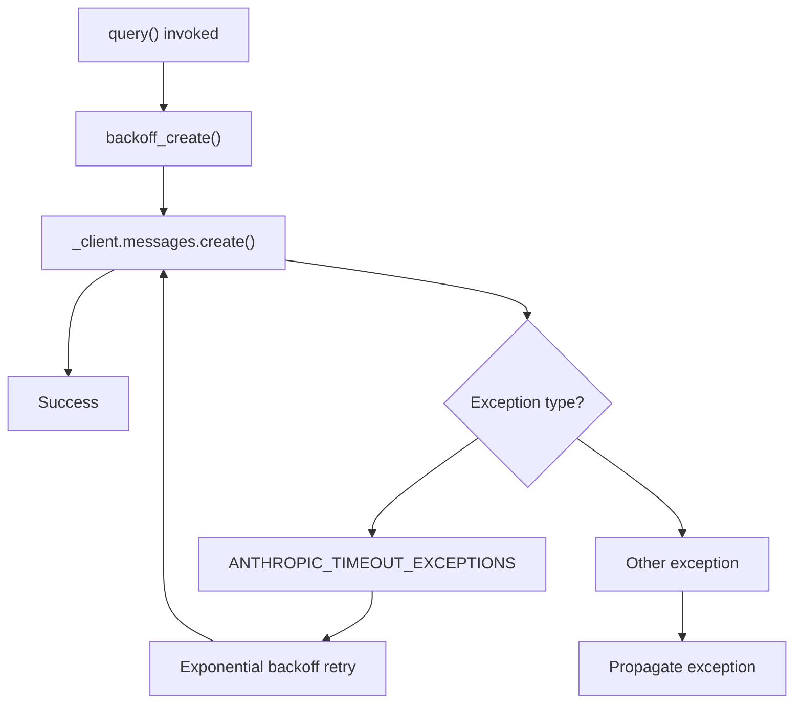
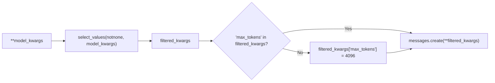
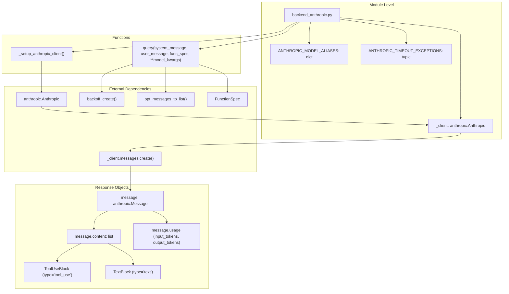
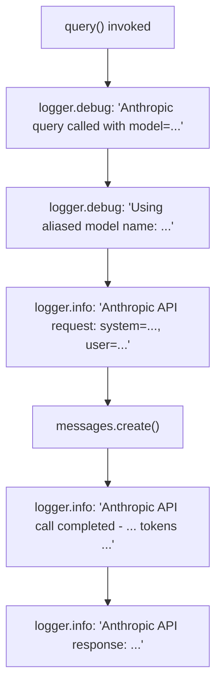

<!-- source: DeepWiki mcp.deepwiki.com · repo WecoAI/aideml · page 4.3 Anthropic Integration · fetched 2026-10-26 -->

# Anthropic Integration

<details>
<summary>Relevant source files</summary>

The following files were used as context for generating this wiki page:

- [aide/backend/backend_anthropic.py](aide/backend/backend_anthropic.py)

</details>


## Purpose and Scope

This document describes AIDE's integration with Anthropic's Claude API through the `backend_anthropic.py` module. This backend provides support for Claude models (claude-3.5-sonnet, claude-3.7-sonnet, etc.) with Anthropic-specific features including tool use (Anthropic's terminology for function calling), model aliasing, and message format requirements.

For the overall multi-provider backend architecture and routing logic, see [Backend Architecture & Router](#4.1). For details on function calling abstractions shared across providers, see [Backend Utilities & Function Calling](#4.6). For other LLM provider integrations, see [OpenAI Integration](#4.2), [Gemini Integration](#4.4), and [OpenRouter Integration](#4.5).

**Sources:** [aide/backend/backend_anthropic.py:1-118]()

## Module Overview

The Anthropic backend provides a standardized interface that conforms to AIDE's multi-provider query signature while handling Anthropic-specific API requirements. It is automatically selected by the backend router when model names match the `claude-*` pattern.

### Key Components

| Component | Type | Purpose |
|-----------|------|---------|
| `_client` | `anthropic.Anthropic` | Global client instance (singleton pattern) |
| `_setup_anthropic_client()` | Function | Client initialization with `@once` decorator |
| `query()` | Function | Main entry point matching AIDE's backend interface |
| `ANTHROPIC_MODEL_ALIASES` | Dict | Maps short model names to full version identifiers |
| `ANTHROPIC_TIMEOUT_EXCEPTIONS` | Tuple | Exception types for retry logic |

**Sources:** [aide/backend/backend_anthropic.py:12-31]()

## Client Initialization

The Anthropic client is initialized lazily using the `@once` decorator from `funcy`, ensuring a single global instance is created on first use.



The client is configured with `max_retries=0` because AIDE implements its own retry logic using `backoff_create` (see [Error Handling & Retries](#error-handling--retries)).

**Sources:** [aide/backend/backend_anthropic.py:27-30]()

## Model Aliases

The backend maintains a mapping from short model names to full version identifiers to simplify configuration and provide stable references across API version updates.

| Alias | Full Model Identifier |
|-------|----------------------|
| `claude-3.5-sonnet` | `claude-3-5-sonnet-20241022` |
| `claude-3.7-sonnet` | `claude-3-7-sonnet-20250219` |



The alias resolution occurs early in the `query()` function and is logged for debugging purposes.

**Sources:** [aide/backend/backend_anthropic.py:21-54]()

## Query Function Interface

The `query()` function provides AIDE's standardized backend interface with Anthropic-specific implementation:

```python
def query(
    system_message: str | None,
    user_message: str | None,
    func_spec: FunctionSpec | None = None,
    **model_kwargs,
) -> tuple[OutputType, float, int, int, dict]:
```

### Return Values

| Position | Type | Description |
|----------|------|-------------|
| 0 | `OutputType` (str or dict) | Text response or tool use parameters |
| 1 | `float` | Request time in seconds |
| 2 | `int` | Input tokens consumed |
| 3 | `int` | Output tokens generated |
| 4 | `dict` | Metadata (`stop_reason`, `model`) |

**Sources:** [aide/backend/backend_anthropic.py:33-38]()

## Message Format Requirements

Anthropic has specific message format requirements that differ from other providers:

### System Message Handling



**Key Requirement:** Anthropic requires at least one user message and does not allow conversations with only a system message. If only `system_message` is provided, it is swapped to become the user message.

**Sources:** [aide/backend/backend_anthropic.py:61-70]()

## Tool Use (Function Calling)

Anthropic uses "tool use" terminology instead of "function calling". When a `FunctionSpec` is provided with name `submit_review`, the backend configures tool use with forced invocation.



### Tool Use Configuration

When tool use is configured, the backend:
1. Converts `FunctionSpec` to Anthropic's tool format using `func_spec.as_anthropic_tool_dict`
2. Forces tool invocation with `func_spec.anthropic_tool_choice_dict`
3. Validates that the response contains a tool use block
4. Extracts parameters from `block.input` (Anthropic's term for function parameters)

**Sources:** [aide/backend/backend_anthropic.py:56-95]()

## Response Processing

The backend processes two types of responses based on the message content structure:

### Response Type Detection



### Usage Tracking

Token usage is extracted from the response metadata:

```python
in_tokens = message.usage.input_tokens
out_tokens = message.usage.output_tokens
```

**Sources:** [aide/backend/backend_anthropic.py:84-105]()

## Error Handling & Retries

The backend defines Anthropic-specific timeout exceptions that trigger the backoff retry mechanism:

| Exception Class | Trigger Condition |
|----------------|-------------------|
| `anthropic.RateLimitError` | API rate limits exceeded |
| `anthropic.APIConnectionError` | Network connectivity issues |
| `anthropic.APITimeoutError` | Request timeout |
| `anthropic.InternalServerError` | Server-side errors (5xx) |



The `backoff_create` utility (defined in `aide/backend/utils.py`) implements exponential backoff with jitter for the specified exception types.

**Sources:** [aide/backend/backend_anthropic.py:14-19](), [aide/backend/backend_anthropic.py:75-80]()

## Parameter Filtering & Defaults

The backend filters out `None` values from `model_kwargs` and applies Anthropic-specific defaults:



**Default Value:** If `max_tokens` is not specified, it defaults to `4096`, which is appropriate for Claude models.

**Sources:** [aide/backend/backend_anthropic.py:44-46]()

## Code Entity Reference Map

This diagram maps natural language concepts to concrete code entities in the Anthropic backend:



**Sources:** [aide/backend/backend_anthropic.py:1-118]()

## Integration with AIDE Components

The Anthropic backend integrates with AIDE's broader system through standardized interfaces:

| AIDE Component | Integration Point | Description |
|----------------|------------------|-------------|
| Backend Router | Model name pattern `claude-*` | Router dispatches to this backend for Claude models |
| Agent | `query()` return signature | Agent receives text or structured tool use output |
| FunctionSpec | `as_anthropic_tool_dict`, `anthropic_tool_choice_dict` | Cross-provider tool definition format |
| Configuration | `filtered_kwargs['model']` | Accepts model name from experiment config |
| Logging | `logger` (module-level) | Logs requests, responses, and token usage |

**Sources:** [aide/backend/backend_anthropic.py:6](), [aide/backend/backend_anthropic.py:10](), [aide/backend/backend_anthropic.py:33-117]()

## Logging and Observability

The backend provides structured logging at INFO and DEBUG levels:



**Logged Information:**
- Model name and alias resolution
- System and user message content
- Request duration and token counts
- Response content (truncated for long outputs)

**Sources:** [aide/backend/backend_anthropic.py:49-54](), [aide/backend/backend_anthropic.py:72](), [aide/backend/backend_anthropic.py:112-115]()

---

