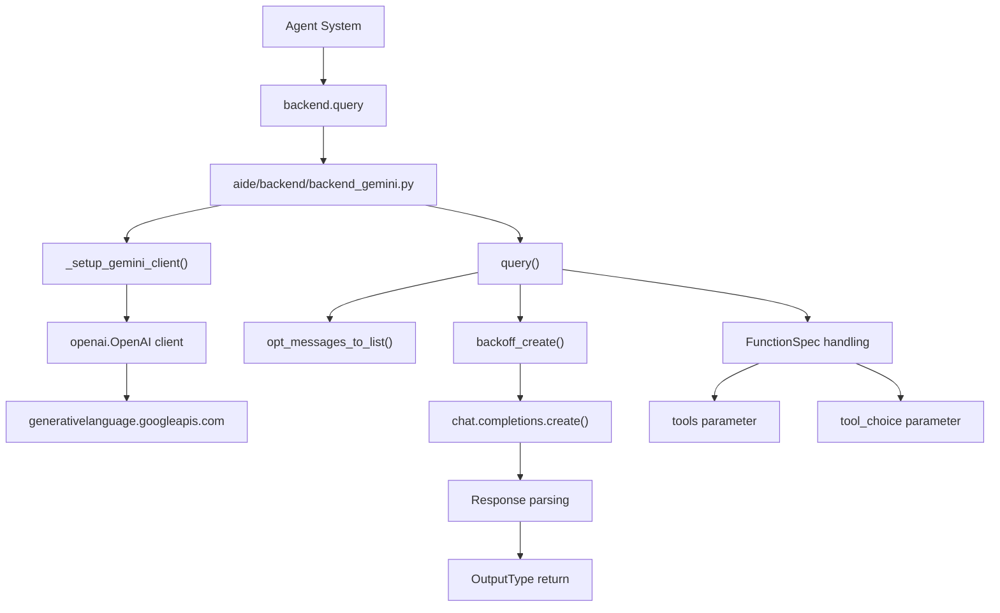
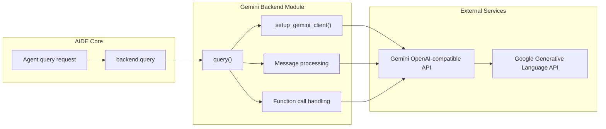
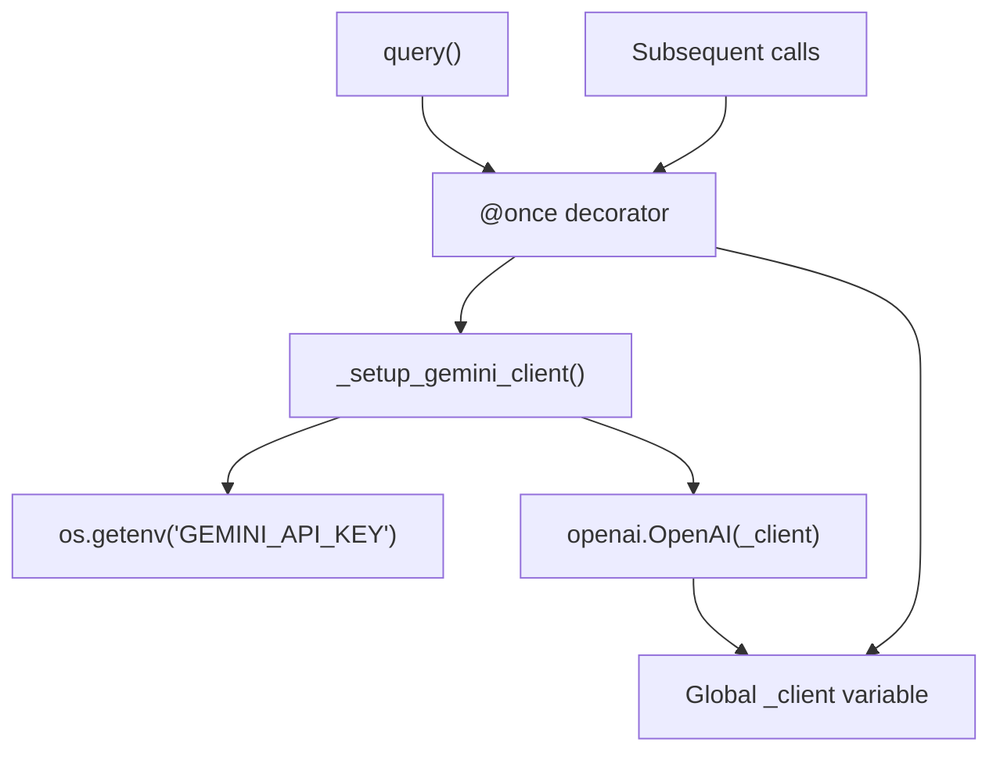
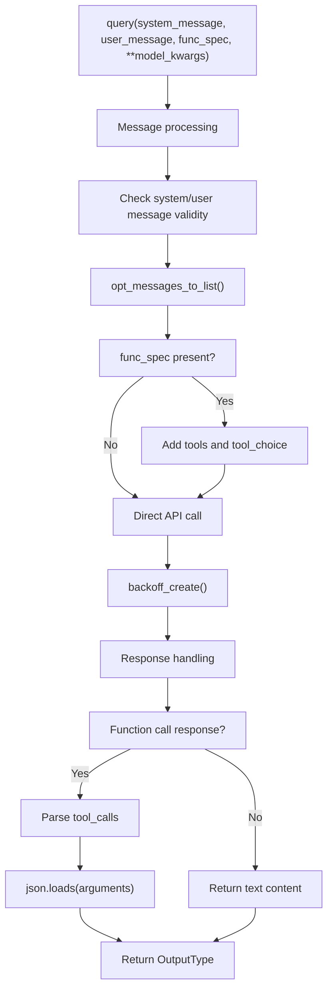
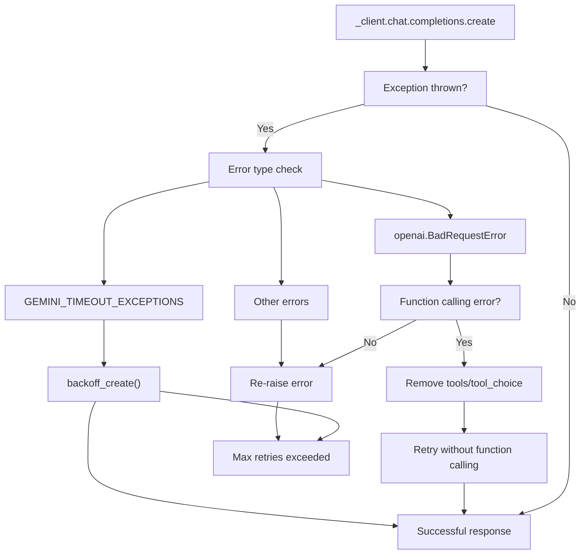
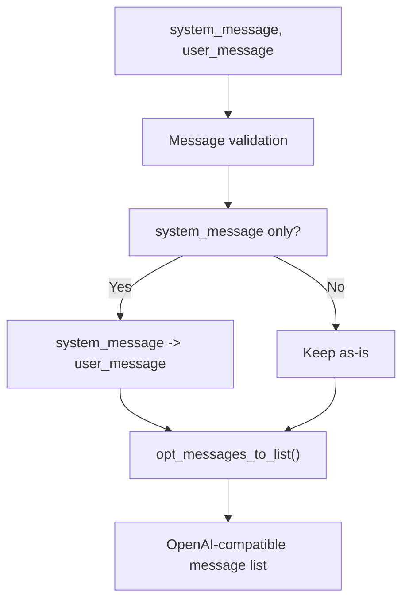

<!-- source: DeepWiki mcp.deepwiki.com · repo WecoAI/aideml · page 4.4 Gemini Integration · fetched 2026-10-26 -->

# Gemini Integration

Relevant source files

The following files were used as context for generating this wiki page:

- [aide/backend/backend_gemini.py](aide/backend/backend_gemini.py)

This document covers AIDE ML's integration with Google's Gemini API through the backend system. It explains how Gemini models are accessed via an OpenAI-compatible interface, including configuration, function calling capabilities, and error handling mechanisms.

For information about the broader backend architecture and how Gemini fits into the multi-LLM system, see [Backend Architecture & Router](#4.1). For details about function calling specifications used across all backends, see [Backend Utilities & Function Calling](#4.6).

## Architecture Overview

AIDE ML integrates with Google's Gemini API by leveraging Gemini's OpenAI-compatible endpoint. This allows AIDE to use the same interface patterns as other LLM providers while accessing Gemini's unique capabilities.

### Gemini Backend Integration Flow

**Sources:** [aide/backend/backend_gemini.py:1-146]()

### Backend System Integration

**Sources:** [aide/backend/backend_gemini.py:35-145]()

## Configuration and Setup

### API Key Configuration

The Gemini backend requires a `GEMINI_API_KEY` environment variable for authentication. The client setup occurs automatically on first use through the `@once` decorator [aide/backend/backend_gemini.py:24-25]().

| Configuration | Value | Source |
|---------------|-------|---------|
| Base URL | `https://generativelanguage.googleapis.com/v1beta/openai/` | [aide/backend/backend_gemini.py:27]() |
| API Key | `GEMINI_API_KEY` environment variable | [aide/backend/backend_gemini.py:30]() |
| Max Retries | `0` (handled by custom backoff logic) | [aide/backend/backend_gemini.py:32]() |

### Client Initialization

**Sources:** [aide/backend/backend_gemini.py:24-33]()

## Query Interface and Function Calling

### Main Query Function

The `query()` function serves as the primary interface, accepting system messages, user messages, and optional function specifications. It returns a tuple containing the output, timing information, and token usage [aide/backend/backend_gemini.py:35-40]().

**Sources:** [aide/backend/backend_gemini.py:35-145]()

### Function Calling Support

Gemini integration includes sophisticated function calling support with graceful degradation when models don't support tool use.

| Component | Purpose | Implementation |
|-----------|---------|----------------|
| `FunctionSpec` | Function specification object | [aide/backend/backend_gemini.py:38]() |
| `tools` parameter | OpenAI-compatible tool definition | [aide/backend/backend_gemini.py:58]() |
| `tool_choice` parameter | Force function call execution | [aide/backend/backend_gemini.py:59]() |
| Fallback mechanism | Handle unsupported function calling | [aide/backend/backend_gemini.py:74-91]() |

## Error Handling and Retry Logic

### Exception Handling Strategy

**Sources:** [aide/backend/backend_gemini.py:66-94]()

### Retry Configuration

The backend uses a custom retry mechanism through `backoff_create()` for specific timeout-related exceptions defined in `GEMINI_TIMEOUT_EXCEPTIONS` [aide/backend/backend_gemini.py:16-21]():

| Exception Type | Handling | Source |
|----------------|----------|---------|
| `openai.RateLimitError` | Exponential backoff retry | [aide/backend/backend_gemini.py:17]() |
| `openai.APIConnectionError` | Network retry logic | [aide/backend/backend_gemini.py:18]() |
| `openai.APITimeoutError` | Timeout handling | [aide/backend/backend_gemini.py:19]() |
| `openai.InternalServerError` | Server error retry | [aide/backend/backend_gemini.py:20]() |

## Message Processing and Response Handling

### Message Format Adaptation

Gemini has specific requirements for message formatting: it does not allow a missing user message. If only a system message is provided, the backend swaps it to the user message position [aide/backend/backend_gemini.py:48-51]().

**Sources:** [aide/backend/backend_gemini.py:48-54]()

### Response Processing

The backend handles both text and function call responses with comprehensive logging and error recovery:

| Response Type | Processing | Source |
|---------------|------------|---------|
| Text content | Direct content extraction from `choice.message.content` | [aide/backend/backend_gemini.py:102]() |
| Function calls | JSON parsing of `first_call.function.arguments` | [aide/backend/backend_gemini.py:113-123]() |
| Missing tool calls | Fallback to text content if `tool_calls` is empty | [aide/backend/backend_gemini.py:106-111]() |
| Function name mismatch | Warning and text fallback if name != `func_spec.name` | [aide/backend/backend_gemini.py:115-120]() |

**Sources:** [aide/backend/backend_gemini.py:99-145]()

---

