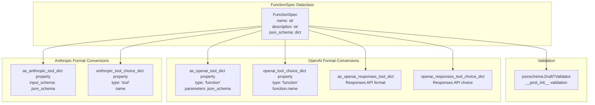
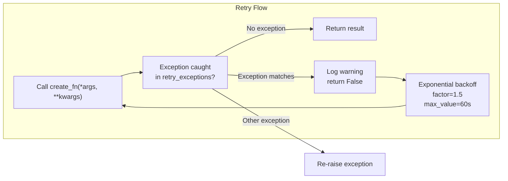
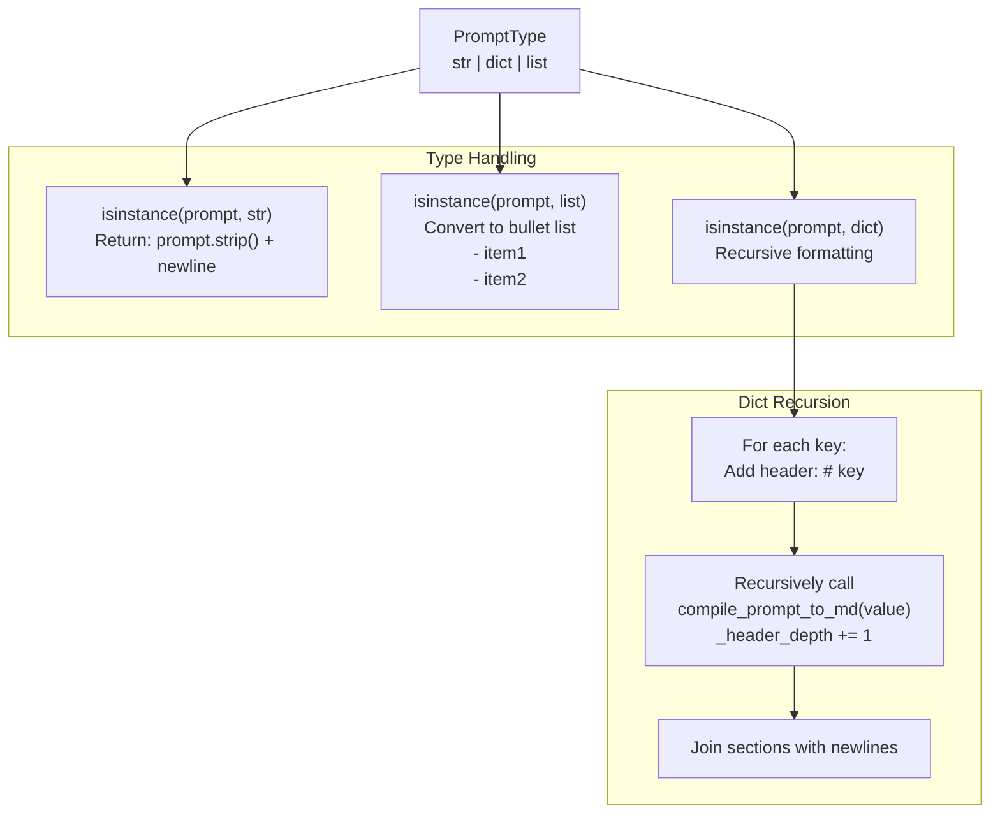
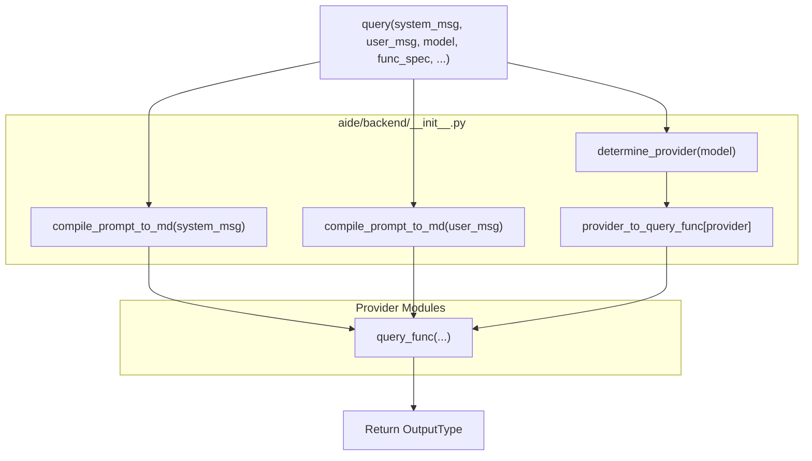

<!-- source: DeepWiki mcp.deepwiki.com · repo WecoAI/aideml · page 4.6 Backend Utilities & Function Calling · fetched 2026-10-26 -->

# Backend Utilities & Function Calling

<details>
<summary>Relevant source files</summary>

The following files were used as context for generating this wiki page:

- [aide/backend/__init__.py](aide/backend/__init__.py)
- [aide/backend/utils.py](aide/backend/utils.py)

</details>


## Purpose and Scope

This document covers the shared utility functions and abstractions in AIDE's LLM backend system, specifically those defined in `aide/backend/utils.py` and the main entry point in `aide/backend/__init__.py`. These utilities provide cross-cutting functionality that enables consistent behavior across multiple LLM providers, including:

- **Function calling abstractions** via the `FunctionSpec` class for tool use across OpenAI, Anthropic, and Gemini.
- **Retry logic** with exponential backoff for handling transient API failures.
- **Prompt compilation** for standardizing inputs from structured formats into Markdown.
- **Provider determination** for routing model strings to the correct backend implementation.

For information about how individual providers implement their APIs and use these utilities, see the provider-specific pages: [OpenAI Integration](#4.2), [Anthropic Integration](#4.3), [Gemini Integration](#4.4), and [OpenRouter Integration](#4.5). For the overall backend architecture and routing logic, see [Backend Architecture & Router](#4.1).

**Sources:** [aide/backend/utils.py:1-120](), [aide/backend/__init__.py:1-75]()

---

## Type Definitions

The utilities module defines several type aliases that standardize data types across the backend system:

| Type Alias | Definition | Purpose |
|------------|------------|---------|
| `PromptType` | `str \| dict \| list` | Represents prompts in multiple formats: plain string, structured dict, or list of items |
| `FunctionCallType` | `dict` | Represents a function call response from an LLM |
| `OutputType` | `str \| FunctionCallType` | Union type for LLM outputs: either text or a function call |

These type aliases appear throughout the backend codebase to ensure consistent handling of inputs and outputs regardless of the LLM provider.

**Sources:** [aide/backend/utils.py:9-11]()

---

## FunctionSpec: Cross-Provider Tool Definition

### Overview

The `FunctionSpec` class ([aide/backend/utils.py:57-119]()) is a dataclass that provides a unified representation of function/tool definitions across different LLM providers. Each provider has its own API format for function calling:

- **OpenAI** uses "tools" with nested "function" objects and "parameters" [aide/backend/utils.py:68-77]().
- **Anthropic** uses "tools" with "input_schema" instead of "parameters" [aide/backend/utils.py:87-93]().
- **Gemini** supports OpenAI-compatible format via client libraries.

`FunctionSpec` abstracts these differences by storing the core components (name, description, JSON schema) and providing conversion properties for each provider format.

**Sources:** [aide/backend/utils.py:57-119]()

### Architecture



**Diagram: FunctionSpec class structure showing validation and provider-specific conversion properties**

**Sources:** [aide/backend/utils.py:57-119]()

### Conversion Methods

The `FunctionSpec` class provides six conversion properties that transform the unified representation into provider-specific formats:

#### OpenAI Chat Completions Format

The `as_openai_tool_dict` property ([aide/backend/utils.py:68-77]()) returns:

```python
{
    "type": "function",
    "function": {
        "name": self.name,
        "description": self.description,
        "parameters": self.json_schema,
    },
}
```

Used by the OpenAI backend when calling the chat completions API with tools.

#### OpenAI Responses API Format

The `as_openai_responses_tool_dict` property ([aide/backend/utils.py:104-111]()) provides a flattened format:

```python
{
    "type": "function",
    "name": self.name,
    "description": self.description,
    "parameters": self.json_schema,
}
```

This format is used by OpenAI's newer Responses API (used by o-series models).

#### Anthropic Tool Format

The `as_anthropic_tool_dict` property ([aide/backend/utils.py:87-93]()) adapts to Anthropic's terminology:

```python
{
    "name": self.name,
    "description": self.description,
    "input_schema": self.json_schema,  # Key difference: "input_schema" not "parameters"
}
```

Note that Anthropic uses `input_schema` instead of `parameters` for the JSON schema.

#### Tool Choice Formats

Each provider also requires a specific format for forcing the LLM to use a particular tool:

- `openai_tool_choice_dict` ([aide/backend/utils.py:80-84]()): OpenAI chat format.
- `openai_responses_tool_choice_dict` ([aide/backend/utils.py:114-119]()): OpenAI responses format.
- `anthropic_tool_choice_dict` ([aide/backend/utils.py:96-101]()): Anthropic format with `type: "tool"`.

**Sources:** [aide/backend/utils.py:68-119]()

### Schema Validation

The `__post_init__` method ([aide/backend/utils.py:63-65]()) validates the JSON schema using `jsonschema.Draft7Validator.check_schema()` to ensure it conforms to JSON Schema Draft 7 specification. This catches configuration errors early before attempting to call LLM APIs.

**Sources:** [aide/backend/utils.py:63-65]()

---

## Retry Mechanism: backoff_create

### Function Signature and Behavior

The `backoff_create` function ([aide/backend/utils.py:17-29]()) implements retry logic with exponential backoff for handling transient API failures:

```python
@backoff.on_predicate(
    wait_gen=backoff.expo,
    max_value=60,
    factor=1.5,
)
def backoff_create(
    create_fn: Callable, retry_exceptions: list[Exception], *args, **kwargs
)
```

### Backoff Strategy



**Diagram: Exponential backoff retry logic with configurable exception types**

**Sources:** [aide/backend/utils.py:17-29]()

### Parameters

| Parameter | Type | Description |
|-----------|------|-------------|
| `create_fn` | `Callable` | The function to call (typically an LLM API client method) |
| `retry_exceptions` | `list[Exception]` | List of exception types that should trigger retry |
| `*args, **kwargs` | Any | Arguments forwarded to `create_fn` |

### Backoff Configuration

The `@backoff.on_predicate` decorator configures the retry behavior:

- **`wait_gen=backoff.expo`**: Exponential backoff strategy (2^n seconds).
- **`factor=1.5`**: Multiplier for exponential growth.
- **`max_value=60`**: Maximum wait time capped at 60 seconds.

When a matching exception occurs, the function logs it ([aide/backend/utils.py:28]()) and returns `False`, which signals the decorator to retry after waiting.

### Usage in Backends

Each provider backend uses `backoff_create` to wrap API calls with appropriate exception lists. For example, OpenAI backends retry on `openai.RateLimitError` and `openai.APIConnectionError`, while Anthropic retries on rate limits and timeouts.

**Sources:** [aide/backend/utils.py:17-29]()

---

## Message Formatting: opt_messages_to_list

The `opt_messages_to_list` function ([aide/backend/utils.py:32-40]()) converts optional system and user messages into the standard message list format expected by most LLM APIs:

```python
def opt_messages_to_list(
    system_message: str | None, user_message: str | None
) -> list[dict[str, str]]:
    messages = []
    if system_message:
        messages.append({"role": "system", "content": system_message})
    if user_message:
        messages.append({"role": "user", "content": user_message})
    return messages
```

### Behavior

- Accepts optional `system_message` and `user_message` parameters.
- Returns a list of message dictionaries with `role` and `content` keys.
- Skips messages that are `None` or empty.
- Always returns a list (empty if both messages are `None`).

This function simplifies backend implementations by handling the common pattern of constructing message lists from optional components.

**Sources:** [aide/backend/utils.py:32-40]()

---

## Prompt Compilation: compile_prompt_to_md

### Overview

The `compile_prompt_to_md` function ([aide/backend/utils.py:43-54]()) converts structured prompts (dictionaries, lists, or strings) into formatted Markdown text. This allows AIDE to maintain prompts in structured formats while generating human-readable Markdown for LLM consumption.

**Sources:** [aide/backend/utils.py:43-54]()

### Compilation Rules



**Diagram: Recursive prompt compilation algorithm supporting nested structures**

**Sources:** [aide/backend/utils.py:43-54]()

### Format Examples

| Input Type | Example Input | Output Format |
|------------|---------------|---------------|
| String | `"Write a function"` | `"Write a function\n"` |
| List | `["Step 1", "Step 2"]` | `"- Step 1\n- Step 2\n\n"` |
| Dict (flat) | `{"Task": "description"}` | `"# Task\ndescription\n"` |
| Dict (nested) | `{"Task": {"Sub": "text"}}` | `"# Task\n## Sub\ntext\n"` |

The `_header_depth` parameter ([aide/backend/utils.py:43]()) controls the markdown header level (`#`, `##`, `###`, etc.) for nested dictionary structures, increasing by 1 at each recursion level.

**Sources:** [aide/backend/utils.py:43-54]()

---

## Unified Query Entry Point

The `query` function in `aide/backend/__init__.py` acts as the primary interface for all LLM interactions in the system. It handles provider determination, prompt compilation, and delegation to specific backend modules.

### Provider Determination Logic

The `determine_provider` function ([aide/backend/__init__.py:10-23]()) routes model strings based on naming patterns:
- **OpenAI**: Models matching `gpt-*`, `o*`, or `codex-mini-latest`. Also used if `OPENAI_BASE_URL` is set.
- **Anthropic**: Models starting with `claude-`.
- **Gemini**: Models starting with `gemini-`.
- **OpenRouter**: Fallback for all other models.

### Data Flow in `query()`



**Diagram: Execution flow of the unified backend query function**

**Sources:** [aide/backend/__init__.py:10-75](), [aide/backend/utils.py:43-54]()

---

## Integration Summary

The backend utilities provide essential abstractions that enable AIDE's multi-provider LLM architecture:

1. **Prompt Processing**: `compile_prompt_to_md()` is called within the main `query` function ([aide/backend/__init__.py:68-69]()) to ensure all backends receive consistent Markdown inputs.
2. **Function Calling**: The `FunctionSpec` object passed to `query` is converted by specific backends (e.g., `backend_openai` or `backend_anthropic`) using the properties defined in `utils.py`.
3. **Resilience**: API client calls are wrapped in `backoff_create()` within the provider-specific modules to handle transient errors.
4. **Standardization**: `opt_messages_to_list()` is used by backends to convert the compiled Markdown strings into the standard `{"role": "...", "content": "..."}` format.

**Sources:** [aide/backend/utils.py:1-120](), [aide/backend/__init__.py:1-75]()

---

