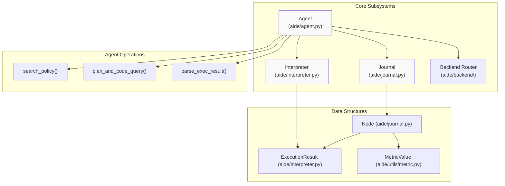
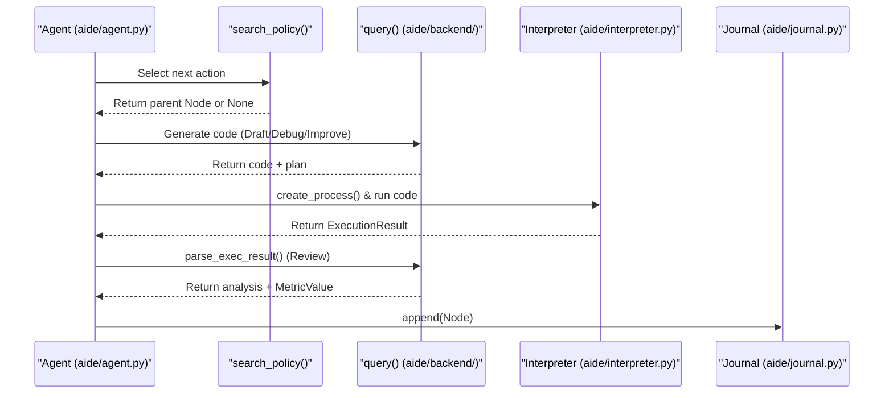
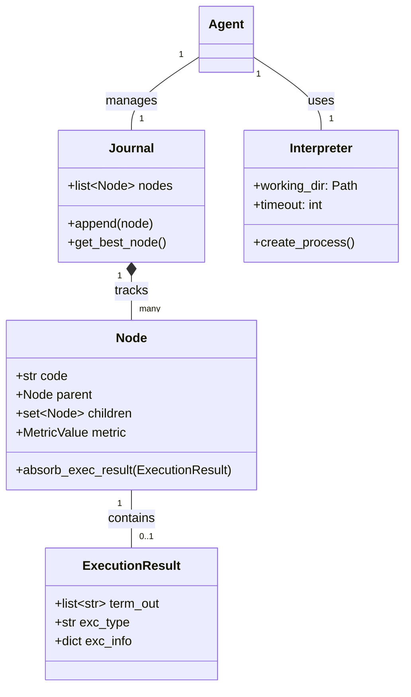

<!-- source: DeepWiki mcp.deepwiki.com · repo WecoAI/aideml · page 5 Core Subsystems · fetched 2026-10-26 -->

# Core Subsystems

Relevant source files

The following files were used as context for generating this wiki page:

- [.github/workflows/linter.yml](.github/workflows/linter.yml)
- [LICENSE](LICENSE)
- [aide/agent.py](aide/agent.py)
- [aide/example_tasks/bitcoin_price/BTC-USD.csv](aide/example_tasks/bitcoin_price/BTC-USD.csv)
- [aide/example_tasks/house_prices/data_description.txt](aide/example_tasks/house_prices/data_description.txt)
- [aide/interpreter.py](aide/interpreter.py)
- [aide/journal.py](aide/journal.py)

This document provides a technical overview of AIDE ML's internal architecture and core subsystems. It covers the fundamental components that implement AIDE's agentic tree search for autonomous machine learning code generation, including their interactions and data flows.

For details on specific user interfaces, see [User Interfaces](#3). For information about LLM backend integrations, see [LLM Backend System](#4). For development and extension information, see [Developer Guide](#6).

## Overview

AIDE ML's core architecture consists of five primary subsystems that work together to implement autonomous ML code generation through agentic tree search:

| Subsystem | Primary Classes | Purpose |
|-----------|-----------------|---------|
| **Agent & Search** | `Agent` | Orchestrates code generation, debugging, and improvement decisions using search hyperparameters. |
| **Code Interpreter** | `Interpreter`, `ExecutionResult` | Provides isolated Python code execution with timeout enforcement and I/O capture. |
| **Journal & Solution Tree** | `Journal`, `Node` | Maintains the solution tree structure, tracking code, metrics, and parent-child relationships. |
| **Visualization & Reporting** | `tree_plot.html` | Generates visual representations of the search process and final technical reports. |
| **Metrics & Evaluation** | `MetricValue`, `WorstMetricValue` | Handles solution scoring, optimization direction, and error-state comparison semantics. |

## System Architecture

**Sources:** [aide/agent.py:47-60](), [aide/journal.py:22-50](), [aide/interpreter.py:91-116](), [aide/journal.py:135-138]()

## Subsystem Details

### Agent & Search System (#5.1)
The `Agent` is the central orchestrator. It uses `Agent.search_policy()` [aide/agent.py:61-92]() to decide whether to draft a new solution, debug a buggy one, or improve an existing high-performing node. It manages search hyperparameters like `num_drafts`, `debug_prob`, and `max_debug_depth` [aide/agent.py:66-76]().
For details, see [Agent & Search System](#5.1).

### Code Interpreter (#5.2)
The `Interpreter` [aide/interpreter.py:91-116]() executes generated code in a separate `multiprocessing.Process` [aide/interpreter.py:176-180](). It captures `stdout`/`stderr` via a `RedirectQueue` [aide/interpreter.py:76-89]() and handles exceptions by generating summaries and stack traces [aide/interpreter.py:40-73]().
For details, see [Code Interpreter](#5.2).

### Journal & Solution Tree (#5.3)
The `Journal` [aide/journal.py:135-138]() acts as a database of `Node` objects [aide/journal.py:22-50](). Each node stores its code, execution metadata, and its position in the search tree via `parent` and `children` references [aide/journal.py:33-34]().
For details, see [Journal & Solution Tree](#5.3).

### Visualization & Reporting (#5.4)
AIDE provides tools to visualize the `Journal` as an interactive tree. This includes generating a `tree_plot.html` and producing final technical reports that summarize the findings across the "good" nodes in the journal [aide/journal.py:182-192]().
For details, see [Visualization & Reporting](#5.4).

### Metrics & Evaluation (#5.5)
The `MetricValue` class [aide/utils/metric.py]() provides a standardized way to compare results. It supports both maximization (e.g., Accuracy) and minimization (e.g., MSE) [aide/agent.py:36-39](). `WorstMetricValue` is used to represent nodes that failed to execute, ensuring they are ranked lower than any valid result.
For details, see [Metrics & Evaluation](#5.5).

## Agent-Driven Execution Flow

The core execution cycle demonstrates how subsystems collaborate to implement the agentic tree search:

**Sources:** [aide/agent.py:61-92](), [aide/agent.py:153-174](), [aide/interpreter.py:169-181](), [aide/journal.py:148-151]()

## Key Data Relationships

The relationship between core data structures forms the foundation for AIDE's solution tracking:

**Sources:** [aide/journal.py:22-50](), [aide/journal.py:135-151](), [aide/interpreter.py:27-38](), [aide/interpreter.py:91-116]()

## Integration Points

The subsystems integrate through well-defined interfaces that maintain separation of concerns:

| Integration | Interface | Data Exchange |
|-------------|-----------|---------------|
| **Agent ↔ Interpreter** | `Interpreter.run()` | `str` (code) → `ExecutionResult` |
| **Agent ↔ Journal** | `Journal.append()` | `Node` objects |
| **Agent ↔ Backend** | `backend.query()` | `Prompt` → `str` (completion) |
| **Node ↔ ExecutionResult** | `Node.absorb_exec_result()` | Metadata transfer [aide/journal.py:67-73]() |
| **Journal ↔ Node** | `Node.parent` | Tree structure [aide/journal.py:33-34]() |

**Sources:** [aide/agent.py:276-295](), [aide/journal.py:67-73](), [aide/interpreter.py:133-168]()

---

