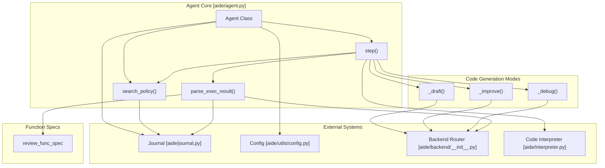
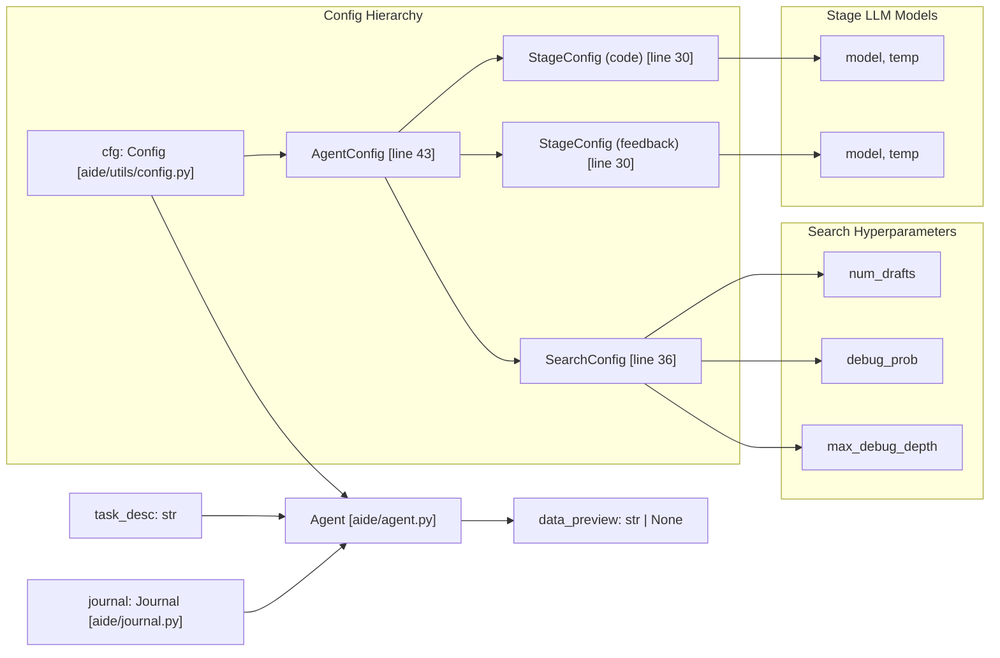
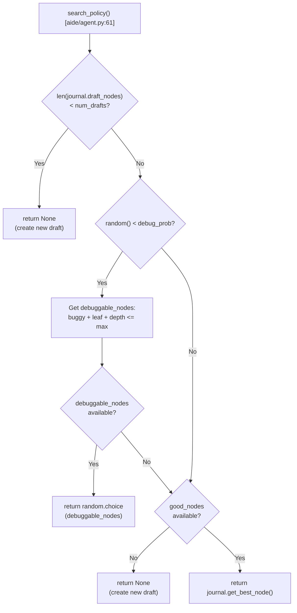
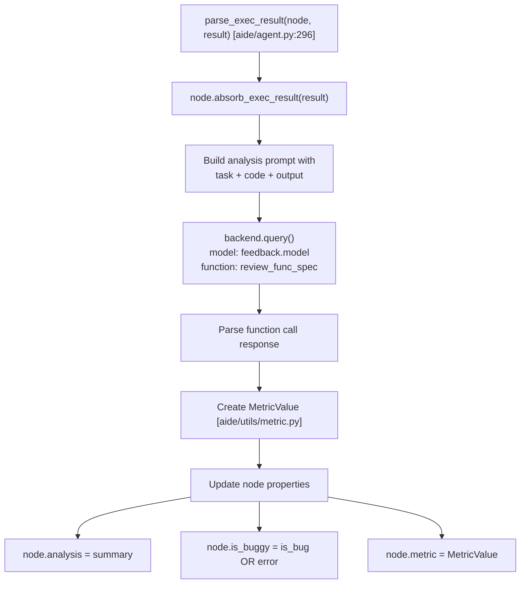
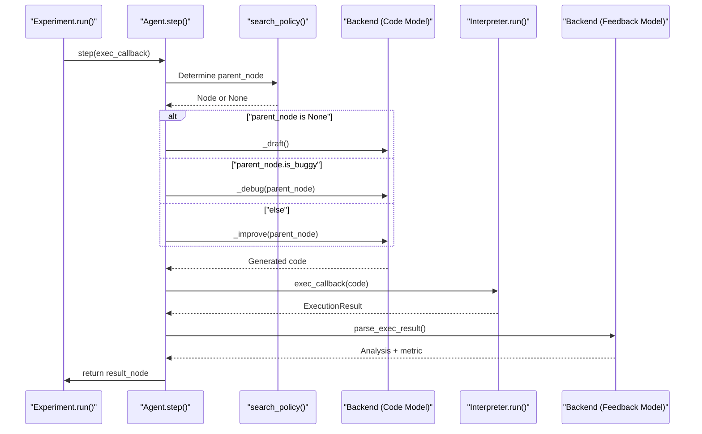

<!-- source: DeepWiki mcp.deepwiki.com · repo WecoAI/aideml · page 5.1 Agent & Search System · fetched 2026-10-26 -->

# Agent & Search System

Relevant source files

The following files were used as context for generating this wiki page:

- [LICENSE](LICENSE)
- [aide/agent.py](aide/agent.py)
- [aide/example_tasks/bitcoin_price/BTC-USD.csv](aide/example_tasks/bitcoin_price/BTC-USD.csv)
- [aide/example_tasks/house_prices/data_description.txt](aide/example_tasks/house_prices/data_description.txt)
- [aide/utils/config.py](aide/utils/config.py)

This document provides technical documentation for AIDE's Agent and its tree search mechanism. The `Agent` class orchestrates autonomous code generation using configurable search hyperparameters to balance exploration (drafting new solutions), exploitation (improving good solutions), and debugging (fixing buggy solutions). The agent interacts with LLM backends to generate, analyze, and refine code through an iterative feedback loop.

**Key Search Hyperparameters:**
- `num_drafts`: Number of independent solution drafts to create.
- `debug_prob`: Probability of debugging vs. improving at each step.
- `max_debug_depth`: Maximum iterations allowed for debugging a single branch.

For information about the solution tree structure and node management, see page 5.3. For details about code execution, see page 5.2. For LLM backend integration details, see section 4.

## Agent Architecture Overview

The `Agent` class [aide/agent.py:47-48]() serves as the central orchestrator for AIDE's autonomous code generation process, integrating with multiple subsystems to implement a feedback-driven search strategy.

**Agent System Flow Diagram**

**Sources:** [aide/agent.py:47-340](), [aide/journal.py:11-13](), [aide/utils/config.py:63-81]()

## Core Agent Class and Initialization

The `Agent` class is initialized with three key dependencies that define its operational context:

| Component | Type | Purpose |
|-----------|------|---------|
| `task_desc` | `str` | Natural language description of the ML task [aide/agent.py:50]() |
| `cfg` | `Config` | System configuration including search parameters [aide/agent.py:51]() |
| `journal` | `Journal` | Solution tree state and node tracking [aide/agent.py:52]() |

The agent maintains a `data_preview` property that provides context about the input dataset, generated on-demand via `update_data_preview()` [aide/agent.py:271-274]().

**Agent Configuration Mapping**

**Sources:** [aide/agent.py:47-59](), [aide/agent.py:271-274](), [aide/utils/config.py:29-53]()

## Search Hyperparameters

The agent's behavior is controlled by three key search hyperparameters defined in `SearchConfig` [aide/utils/config.py:36-40]():

| Parameter | Type | Purpose |
|-----------|------|---------|
| `num_drafts` | `int` | Controls how many independent solution drafts are created before improving existing ones [aide/agent.py:66-68](). |
| `debug_prob` | `float` | Probability (0.0-1.0) of selecting a buggy node to debug versus improving the best non-buggy node [aide/agent.py:71-82](). |
| `max_debug_depth` | `int` | Maximum consecutive debugging attempts allowed for a single buggy branch [aide/agent.py:76](). |

These parameters directly influence the `search_policy()` method's decision-making process, creating a balance between exploration, exploitation, and debugging.

**Sources:** [aide/utils/config.py:36-40](), [aide/agent.py:61-92]()

## Search Policy and Node Selection

The `search_policy()` method implements the core decision logic for tree search, determining which node to work on next [aide/agent.py:61-62]().

**Node Selection Logic**

**Node Selection Rules:**

| Condition | Action | Return Value |
|-----------|--------|--------------|
| `len(journal.draft_nodes) < num_drafts` | Create new independent draft | `None` [aide/agent.py:68]() |
| Random roll < `debug_prob` AND debuggable nodes exist | Debug randomly selected buggy node | Buggy `Node` [aide/agent.py:80]() |
| Random roll >= `debug_prob` OR no debuggable nodes | Improve best non-buggy solution | Best `Node` [aide/agent.py:92]() |

**Sources:** [aide/agent.py:61-92](), [aide/journal.py:66-88]()

## Code Generation Modes and LLM Interaction

The agent operates in three distinct modes, each with specialized prompting strategies. All modes use the model and temperature specified in `cfg.agent.code` [aide/agent.py:160-161]().

### Draft Mode (`_draft`)
Creates initial solution drafts from scratch using task description and memory from previous attempts [aide/agent.py:175]().
- **System Prompt**: Environment + Guidelines + Response Format [aide/agent.py:182-184]().
- **User Prompt**: Task description + Memory from `journal.generate_summary()` [aide/agent.py:185-188]().

### Improve Mode (`_improve`) 
Enhances existing good solutions with atomic, experimental improvements [aide/agent.py:207]().
- **System Prompt**: Includes instruction to "make a single atomic improvement" [aide/agent.py:218]().
- **User Prompt**: Includes parent code, parent analysis, and task goal [aide/agent.py:221-229]().

### Debug Mode (`_debug`)
Fixes buggy solutions using execution output and error information [aide/agent.py:241]().
- **User Prompt**: Includes buggy code and the execution output/error trace [aide/agent.py:254-263]().

**Sources:** [aide/agent.py:175-269](), [aide/utils/config.py:29-33]()

## Result Analysis and Feedback Loop

The agent implements a result analysis system using structured function calling via `review_func_spec` [aide/agent.py:19-44](). This uses the **feedback LLM model** specified in `cfg.agent.feedback` [aide/agent.py:311-312]().

**Analysis and Feedback Flow**

**`review_func_spec` Schema [aide/agent.py:19-44]():**
- `is_bug`: Boolean indicating execution failure.
- `summary`: String proposing a fix or summarizing findings.
- `metric`: Numeric value of the validation metric.
- `lower_is_better`: Optimization direction (minimize vs maximize).

**Sources:** [aide/agent.py:19-44](), [aide/agent.py:296-339](), [aide/utils/metric.py:10-25]()

## Step Execution and Integration

The main `step()` method orchestrates the complete agent workflow [aide/agent.py:276]().

**Step Execution Sequence**

**Sources:** [aide/agent.py:276-294](), [aide/interpreter.py:112-115](), [aide/utils/config.py:56-60]()

## Prompt Engineering Components

The agent employs modular prompt components:
- **Environment Context (`_prompt_environment`)**: Lists available ML packages like `scikit-learn`, `xgboost`, and `torch` [aide/agent.py:94-115]().
- **Implementation Guidelines (`_prompt_impl_guideline`)**: Enforces self-contained scripts, timeout awareness, and input/output directory conventions [aide/agent.py:118-141]().
- **Response Format (`_prompt_resp_fmt`)**: Requests a natural language sketch followed by a single markdown code block [aide/agent.py:143-151]().

**Sources:** [aide/agent.py:94-151](), [aide/agent.py:153-173]()

---

