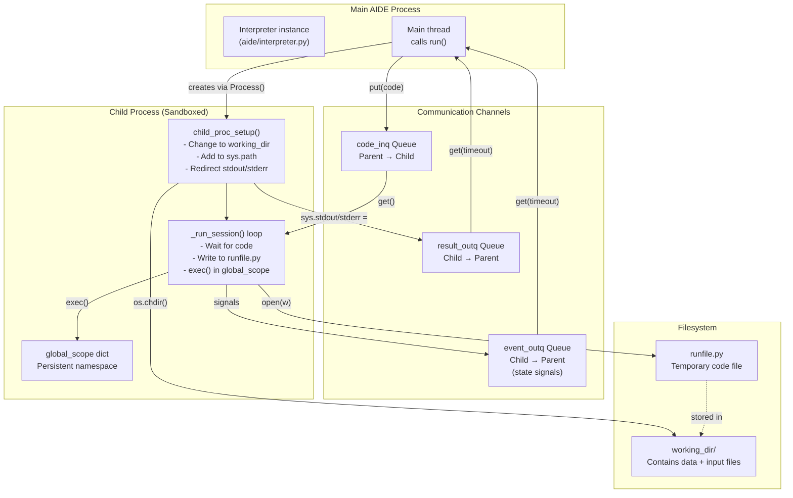
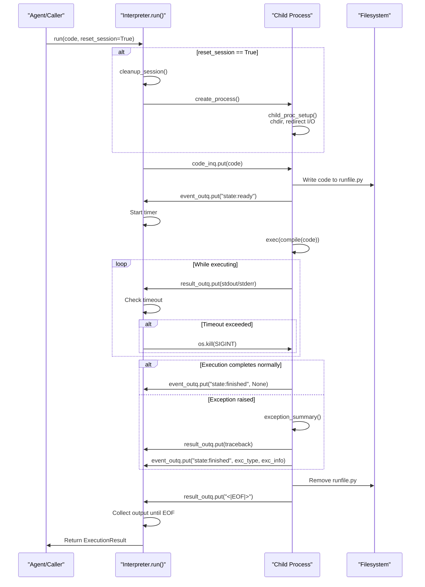
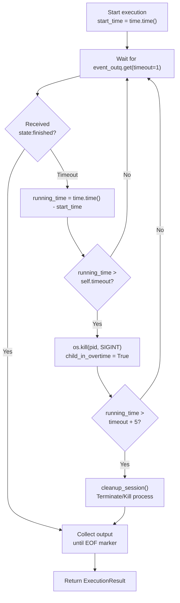
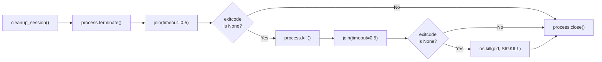

<!-- source: DeepWiki mcp.deepwiki.com · repo WecoAI/aideml · page 5.2 Code Interpreter · fetched 2026-10-26 -->

# Code Interpreter

<details>
<summary>Relevant source files</summary>

The following files were used as context for generating this wiki page:

- [.github/workflows/linter.yml](.github/workflows/linter.yml)
- [aide/interpreter.py](aide/interpreter.py)

</details>


## Purpose and Scope

The Code Interpreter is AIDE's sandboxed Python execution environment that runs agent-generated code in isolation with resource constraints. It uses multiprocessing to create separate processes for code execution, enforces timeout limits, captures all output (stdout, stderr), and handles exceptions gracefully. This subsystem ensures that potentially buggy or infinite-loop code generated by the Agent cannot crash or hang the main AIDE process.

For information about how the Agent generates code that gets passed to the Interpreter, see [Agent & Search System](#5.1). For details about how execution results are stored in the solution tree, see [Journal & Solution Tree](#5.3).

**Sources:** [aide/interpreter.py:1-312]()

---

## Architecture Overview

The Interpreter uses Python's `multiprocessing` module to create isolated child processes that execute code independently from the main AIDE process. This design provides strong isolation boundaries and enables reliable timeout enforcement through OS-level signals.

### Class Structure

| Class/Component | Purpose | Key Responsibilities |
|----------------|---------|---------------------|
| `Interpreter` | Main interpreter controller | Process lifecycle management, timeout enforcement, I/O collection |
| `ExecutionResult` | Result container | Stores terminal output, execution time, exception details |
| `RedirectQueue` | I/O redirection | Captures stdout/stderr into multiprocessing Queue |
| `exception_summary()` | Exception formatter | Generates formatted traceback strings (Python or IPython style) |

The `Interpreter` class [aide/interpreter.py:91-116]() is initialized with a working directory, timeout limit, formatting preference, and the name of the temporary code file.

**Sources:** [aide/interpreter.py:26-38](), [aide/interpreter.py:76-89](), [aide/interpreter.py:91-116]()

---

## Multiprocessing Isolation Model



**Diagram: Multiprocessing Architecture and Communication Flow**

The Interpreter creates a child process via `Process()` [aide/interpreter.py:176-180]() that runs `_run_session()` [aide/interpreter.py:133-167](). Three `Queue` objects facilitate bidirectional communication: `code_inq` sends code to execute, `result_outq` receives stdout/stderr output, and `event_outq` receives state signals (ready/finished).

**Sources:** [aide/interpreter.py:169-180](), [aide/interpreter.py:133-167](), [aide/interpreter.py:118-131]()

---

## Execution Flow

### Sequence Diagram



**Diagram: Code Execution Sequence**

The execution flow follows these phases [aide/interpreter.py:205-311]():

1. **Session Reset**: If `reset_session=True`, terminate any existing process and create a new one [aide/interpreter.py:220-224]().
2. **Code Submission**: Send code via `code_inq` queue [aide/interpreter.py:230]().
3. **Child Setup**: Child writes code to `runfile.py` and signals "state:ready" [aide/interpreter.py:142-145]().
4. **Execution**: Child runs `exec(compile(code, filename, "exec"), global_scope)` [aide/interpreter.py:147]().
5. **Output Collection**: Parent collects stdout/stderr from `result_outq` [aide/interpreter.py:285-299]().
6. **Timeout Monitoring**: Parent checks elapsed time and sends `SIGINT` if needed [aide/interpreter.py:268-283]().
7. **Completion**: Child signals "state:finished" with exception info (if any) [aide/interpreter.py:159-161]().
8. **Result Assembly**: Parent collects all output and constructs `ExecutionResult` [aide/interpreter.py:301-311]().

**Sources:** [aide/interpreter.py:205-311](), [aide/interpreter.py:133-167]()

---

## Queue-Based Communication System

The Interpreter uses three multiprocessing `Queue` objects for inter-process communication [aide/interpreter.py:174-175]():

### Queue Purposes

| Queue Name | Direction | Content Type | Purpose |
|-----------|-----------|--------------|---------|
| `code_inq` | Parent → Child | `str` (Python code) | Sends code snippets to execute |
| `result_outq` | Child → Parent | `str` (output lines) | Streams stdout/stderr and EOF marker |
| `event_outq` | Child → Parent | `tuple` (state, metadata) | Signals execution state transitions |

### RedirectQueue Implementation

The `RedirectQueue` class [aide/interpreter.py:76-89]() wraps a multiprocessing Queue to act as a file-like object:

```python
sys.stdout = sys.stderr = RedirectQueue(result_outq)
```

This redirection [aide/interpreter.py:131]() captures all print statements and error messages into the queue, allowing the parent process to collect them. The `write()` method includes a 5-second timeout [aide/interpreter.py:83]() to prevent blocking if the queue fills up.

### State Signals

The `event_outq` carries state transitions [aide/interpreter.py:145](), [aide/interpreter.py:159-161]():

- `("state:ready",)` - Child is ready to execute code
- `("state:finished", None, None, None)` - Execution completed successfully
- `("state:finished", exc_type, exc_info, exc_stack)` - Execution raised an exception

The EOF marker `"<|EOF|>"` [aide/interpreter.py:167]() in `result_outq` signals the end of output for the current execution.

**Sources:** [aide/interpreter.py:174-175](), [aide/interpreter.py:76-88](), [aide/interpreter.py:131](), [aide/interpreter.py:145](), [aide/interpreter.py:159-167]()

---

## Timeout Enforcement Mechanism

The Interpreter enforces execution time limits through a combination of polling, OS signals, and process termination [aide/interpreter.py:268-283]().

### Timeout Strategy



**Diagram: Timeout Enforcement Logic**

The timeout enforcement uses a three-tier approach:

1. **Polling Loop**: Parent waits for `event_outq.get(timeout=1)` [aide/interpreter.py:252](), checking elapsed time on each timeout.
2. **SIGINT Signal**: When timeout is exceeded, send `SIGINT` [aide/interpreter.py:273]() to the child process (converted to `KeyboardInterrupt` in Python [aide/interpreter.py:156-157]()).
3. **Hard Termination**: If child doesn't respond within 5 additional seconds, forcefully terminate using `cleanup_session()` [aide/interpreter.py:276-283]().

The default timeout is 3600 seconds (1 hour) [aide/interpreter.py:95](). When a timeout occurs, the exception type is changed from `KeyboardInterrupt` to `TimeoutError` [aide/interpreter.py:157](), [aide/interpreter.py:303-306]().

**Sources:** [aide/interpreter.py:268-283](), [aide/interpreter.py:252](), [aide/interpreter.py:273](), [aide/interpreter.py:156-157](), [aide/interpreter.py:303-306]()

---

## Output Capture and Exception Handling

### Output Collection

The parent process collects all output from the child by reading from `result_outq` until the EOF marker is encountered [aide/interpreter.py:285-299]():

```python
while not self.result_outq.empty() or not output or output[-1] != "<|EOF|>":
    try:
        output.append(self.result_outq.get(timeout=1))
    except queue.Empty:
        # ... handling ...
```

The collection includes a timeout mechanism [aide/interpreter.py:293-295]() to prevent hanging if the child process dies unexpectedly.

### Exception Handling

When an exception occurs in the child process, the `exception_summary()` function [aide/interpreter.py:40-73]() generates a formatted traceback:

| Feature | Implementation | Purpose |
|---------|---------------|---------|
| Traceback Format | Standard Python or IPython (`VerboseTB`) | Configurable via `format_tb_ipython` parameter [aide/interpreter.py:42-47]() |
| Stack Filtering | Removes lines containing `"aide/"` or `"importlib"` | Hides internal framework code from tracebacks [aide/interpreter.py:50-57]() |
| Path Normalization | Replaces full path with just filename | Makes tracebacks more readable [aide/interpreter.py:61]() |
| Exception Metadata | Extracts `args`, `name`, `msg`, `obj` attributes | Provides structured exception information [aide/interpreter.py:63-68]() |
| Stack Extraction | Converts to list of `(filename, lineno, name, line)` tuples | Enables programmatic analysis [aide/interpreter.py:70-71]() |

The `ExecutionResult` dataclass [aide/interpreter.py:26-38]() contains:
- `term_out`: List of output lines (stdout + stderr)
- `exec_time`: Execution duration in seconds
- `exc_type`: Exception class name (or `None`)
- `exc_info`: Dictionary of exception attributes
- `exc_stack`: List of stack frame tuples

**Sources:** [aide/interpreter.py:285-311](), [aide/interpreter.py:40-73](), [aide/interpreter.py:26-38]()

---

## Session Management

### Process Lifecycle

The Interpreter supports two execution modes controlled by the `reset_session` parameter in `run()` [aide/interpreter.py:205]():

| Mode | `reset_session` | Behavior | Use Case |
|------|----------------|----------|----------|
| Isolated | `True` (default) | Creates new process, fresh `global_scope` | Each code execution is independent [aide/interpreter.py:220-224]() |
| Persistent | `False` | Reuses existing process and `global_scope` | Variables/imports persist across runs |

The persistent mode allows the child process to maintain state in its `global_scope` dictionary [aide/interpreter.py:138](), enabling multi-step executions where later code can reference earlier definitions.

### Cleanup Procedure

The `cleanup_session()` method [aide/interpreter.py:182-203]() implements a graceful-to-forceful termination sequence:



**Diagram: Process Cleanup Escalation**

The cleanup uses escalating force:
1. **Terminate**: Send `SIGTERM` and wait 0.5 seconds [aide/interpreter.py:187-188]().
2. **Kill**: If still alive, send `SIGKILL` and wait 0.5 seconds [aide/interpreter.py:192-193]().
3. **Force Kill**: As last resort, use `os.kill(pid, signal.SIGKILL)` [aide/interpreter.py:197]().

**Sources:** [aide/interpreter.py:182-203](), [aide/interpreter.py:205](), [aide/interpreter.py:138](), [aide/interpreter.py:220-224]()

---

## Configuration Options

The `Interpreter` constructor [aide/interpreter.py:92-107]() accepts these parameters:

| Parameter | Type | Default | Purpose |
|-----------|------|---------|---------|
| `working_dir` | `Path \| str` | (required) | Working directory for code execution; must exist [aide/interpreter.py:109-112]() |
| `timeout` | `int` | `3600` | Maximum execution time in seconds (1 hour) [aide/interpreter.py:113]() |
| `format_tb_ipython` | `bool` | `False` | Use IPython's `VerboseTB` for formatted tracebacks [aide/interpreter.py:114]() |
| `agent_file_name` | `str` | `"runfile.py"` | Temporary filename for code being executed [aide/interpreter.py:115]() |

### Working Directory Behavior

The child process:
1. Changes working directory to `working_dir` [aide/interpreter.py:123]().
2. Adds `working_dir` to `sys.path` [aide/interpreter.py:127]() for imports.
3. Writes code to `agent_file_name` in this directory [aide/interpreter.py:142-143]().
4. Removes the file after execution [aide/interpreter.py:164]().

This ensures the code has access to input data files and can import local modules while keeping the directory clean between runs.

### Warning Suppression

The child process uses the `shutup` library [aide/interpreter.py:120-122]() to mute all Python warnings, preventing warning messages from cluttering the captured output.

**Sources:** [aide/interpreter.py:92-116](), [aide/interpreter.py:123](), [aide/interpreter.py:127](), [aide/interpreter.py:142-143](), [aide/interpreter.py:164](), [aide/interpreter.py:120-122]()

---

## Integration with AIDE System

The Interpreter is used by the Agent during the execution phase of the tree search loop. The typical usage pattern from the Agent involves creating an `Interpreter` instance and calling its `run()` method [aide/interpreter.py:205]().

The `ExecutionResult` object [aide/interpreter.py:26-38]() is stored in the Journal's node structure, allowing AIDE to:
- Display execution output in the tree visualization.
- Compute performance metrics from successful runs.
- Generate feedback on errors for the next iteration.
- Track execution time for each solution attempt.

For details on how the Agent generates the code passed to the Interpreter, see [Agent & Search System](#5.1). For information on how `ExecutionResult` is stored and analyzed, see [Journal & Solution Tree](#5.3).

**Sources:** [aide/interpreter.py:26-38](), [aide/interpreter.py:205-311]()

---

