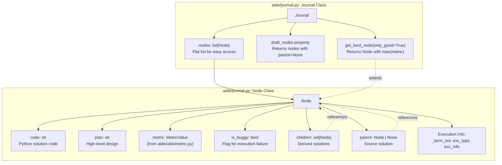
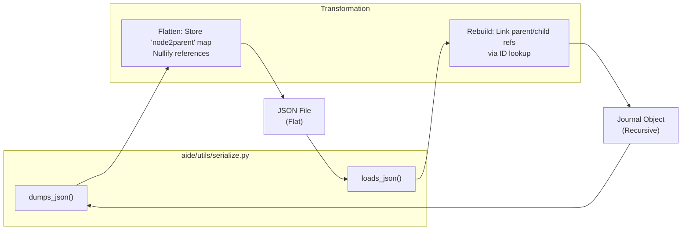

<!-- source: DeepWiki mcp.deepwiki.com · repo WecoAI/aideml · page 5.3 Journal & Solution Tree · fetched 2026-10-26 -->

# Journal & Solution Tree

<details>
<summary>Relevant source files</summary>

The following files were used as context for generating this wiki page:

- [aide/journal.py](aide/journal.py)
- [aide/utils/serialize.py](aide/utils/serialize.py)

</details>


## Purpose and Scope

This document describes the Journal and its solution tree data structure, which forms the central state management system in AIDE ML. The Journal maintains a tree of code solution attempts (`Node` objects), tracks their execution results and metrics, manages parent-child relationships for incremental improvements, and provides methods for selecting the best-performing solution.

The Journal is defined in `aide/journal.py` and serves as the primary data exchange format between the `Agent`, `Interpreter`, and `Visualization` subsystems.

---

## Overview

The Journal serves as AIDE's memory system, maintaining a complete history of the agentic tree search process. Each code solution attempt is stored as a `Node` object containing the code, execution results, computed metrics, and parent-child links. The tree structure enables exploration of solution variations while preserving the lineage of improvements.

### Data Flow & System Mapping

The following diagram maps the logical concepts of the solution tree to the specific class structures and properties defined in `aide/journal.py`.



**Sources:** [aide/journal.py:21-50](), [aide/journal.py:135-167](), [aide/journal.py:172-181]()

---

## Node Data Structure

A `Node` represents a single solution attempt. It is a dataclass that inherits from `DataClassJsonMixin` for easy serialization [aide/journal.py:22]().

### Key Attributes
- **Code & Plan**: Stores the source code and the agent's textual plan [aide/journal.py:26-27]().
- **Lineage**: `parent` and `children` attributes define the tree topology [aide/journal.py:33-34](). When a node is initialized with a parent, it automatically adds itself to the parent's `children` set [aide/journal.py:51-53]().
- **Execution Results**: After the `Interpreter` runs the code, the node "absorbs" the `ExecutionResult` [aide/journal.py:67-73](). This includes `exc_type` (exception type), `exc_info`, and `term_out` (terminal output).
- **Evaluation**: Stores a `MetricValue` and an `is_buggy` boolean. A node is automatically considered buggy if an exception occurred or no valid metric was produced [aide/journal.py:46-49]().

### Node Stages
The `stage_name` property [aide/journal.py:55-65]() categorizes nodes based on their relationship to their parent:
- `draft`: No parent (root node).
- `debug`: Parent exists and was `is_buggy`.
- `improve`: Parent exists and was not buggy.

**Sources:** [aide/journal.py:21-102]()

---

## Journal Class Interface

The `Journal` class is a collection of `Node` objects representing the entire search tree [aide/journal.py:135-138]().

### Best Node Selection
The `get_best_node()` method is the primary way AIDE identifies the winning solution [aide/journal.py:172-181](). It uses Python's `max()` function on the list of nodes, leveraging the comparison logic defined in the `MetricValue` class.

```python
def get_best_node(self, only_good=True) -> None | Node:
    if only_good:
        nodes = self.good_nodes # Filters out is_buggy nodes
        if not nodes:
            return None
    else:
        nodes = self.nodes
    return max(nodes, key=lambda n: n.metric)
```

### Filtering Properties
The Journal provides helper properties to slice the tree:
- `draft_nodes`: Nodes where `parent is None` [aide/journal.py:154-156]().
- `buggy_nodes`: Nodes where `is_buggy` is `True` [aide/journal.py:159-161]().
- `good_nodes`: Nodes where `is_buggy` is `False` [aide/journal.py:164-166]().

**Sources:** [aide/journal.py:135-181]()

---

## Serialization and Persistence

Because the `Node` and `Journal` structures are recursive (parents have children, children have parents), standard JSON serialization would result in infinite loops or redundant data. AIDE uses a custom serialization strategy in `aide/utils/serialize.py`.

### Serialization Logic (`dumps_json`)
1. Creates a deep copy of the Journal [aide/utils/serialize.py:13]().
2. Extracts the tree structure into a flat `node2parent` mapping (mapping child IDs to parent IDs) [aide/utils/serialize.py:14]().
3. Temporarily nullifies the `parent` and `children` references on the node objects to break the recursion [aide/utils/serialize.py:15-17]().
4. Serializes the flat list of nodes and the `node2parent` map to JSON [aide/utils/serialize.py:19-25]().

### Deserialization Logic (`loads_json`)
1. Reconstructs the `Node` objects from the JSON dictionary [aide/utils/serialize.py:38-39]().
2. Uses the `node2parent` map to re-establish the object references [aide/utils/serialize.py:42-45]().
3. Calls `__post_init__` on the children to populate the `children` sets on the parents [aide/utils/serialize.py:45]().



**Sources:** [aide/utils/serialize.py:10-52]()

---

## Interactive Sessions

In addition to the main solution tree, the system supports an `InteractiveSession` class [aide/journal.py:105-131](). This is used when the agent interacts with a Jupyter-like environment.

- **Trace Generation**: The `generate_nb_trace()` method converts a sequence of nodes into a formatted string that mimics an IPython notebook, including `In [x]` and `Out [x]` markers [aide/journal.py:118-131]().
- **Sequential Storage**: Unlike the tree-based Journal, the session stores nodes in a simple list [aide/journal.py:111]().

**Sources:** [aide/journal.py:104-131]()

---

## Summary of Data Flow

1. **Generation**: The `Agent` creates a `Node` with `code` and `plan`.
2. **Execution**: The `Interpreter` executes the code; the `Node` calls `absorb_exec_result()` [aide/journal.py:67]().
3. **Evaluation**: A `MetricValue` is assigned to `node.metric` [aide/journal.py:46]().
4. **Expansion**: If the agent decides to improve or debug, a new `Node` is created with the current node as its `parent`.
5. **Selection**: The `Journal` identifies the `best_node` for the final report or next iteration [aide/journal.py:172]().

**Sources:** [aide/journal.py:1-181]()

---

