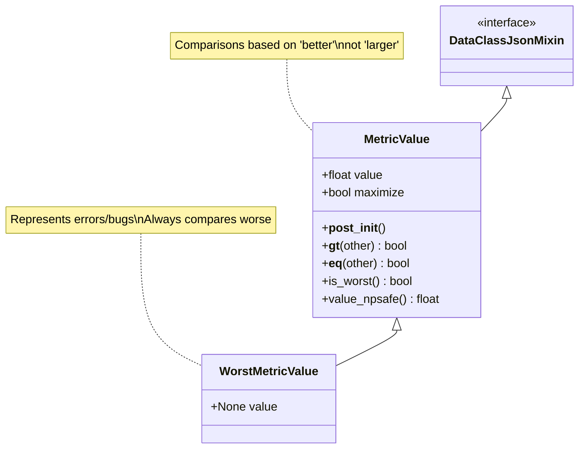
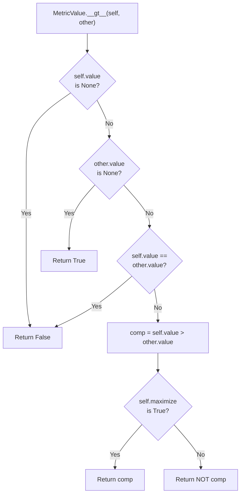
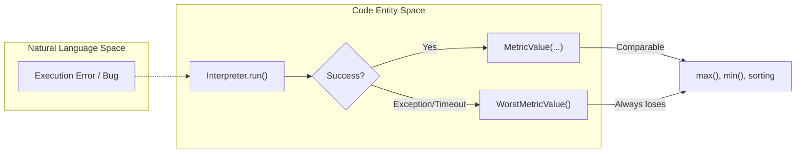
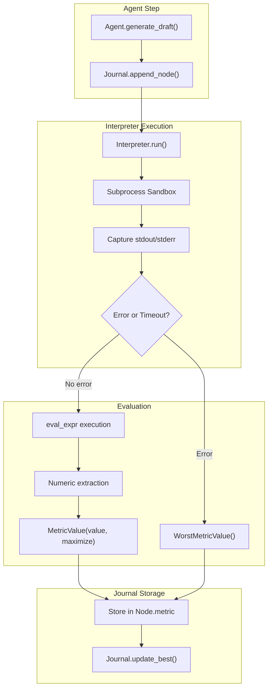

<!-- source: DeepWiki mcp.deepwiki.com · repo WecoAI/aideml · page 5.5 Metrics & Evaluation · fetched 2026-10-26 -->

# Metrics & Evaluation

Relevant source files

The following files were used as context for generating this wiki page:

- [aide/utils/metric.py](aide/utils/metric.py)
- [aide/utils/response.py](aide/utils/response.py)
- [requirements.txt](requirements.txt)

## Purpose & Scope

This document describes AIDE's metric system, which quantifies the quality of generated code solutions and drives the tree search optimization process. The core abstraction is the `MetricValue` class, which represents numeric performance values with explicit optimization direction (maximize or minimize) and provides comparison semantics based on which value is "better" rather than numerically larger.

For information about how metrics are computed during code execution, see [Code Interpreter](#5.2). For details on how metrics are stored and used in the solution tree, see [Journal & Solution Tree](#5.3). For the agent's use of metrics in search and pruning, see [Agent & Search System](#5.1).

---

## MetricValue Class

The `MetricValue` class in [aide/utils/metric.py:9-63]() is the fundamental abstraction for representing and comparing solution quality. It wraps a numeric value along with metadata about optimization direction.

### Data Structure

**Sources:** [aide/utils/metric.py:9-79]()

### Key Properties

| Property | Type | Description |
|----------|------|-------------|
| `value` | `float \| int \| np.number \| None` | The numeric metric value (e.g., RMSE, accuracy). [aide/utils/metric.py:17]() |
| `maximize` | `bool \| None` | Optimization direction: `True` for metrics to maximize (accuracy), `False` for metrics to minimize (RMSE). [aide/utils/metric.py:18]() |
| `is_worst` | `bool` | Returns `True` if `value is None`, indicating an invalid/error state. [aide/utils/metric.py:56-58]() |
| `value_npsafe` | `float` | Returns `value` or `float('nan')` if `None`, safe for numpy operations. [aide/utils/metric.py:61-62]() |

**Sources:** [aide/utils/metric.py:11-63]()

### Comparison Semantics

The `MetricValue` class implements `@total_ordering` [aide/utils/metric.py:10]() to enable comparisons based on which value is **better**, not which is numerically larger. This is critical for supporting both maximization (accuracy, F1) and minimization (RMSE, MAE) metrics with unified comparison logic.

**Implementation Details:**

The comparison logic in [aide/utils/metric.py:25-38]() follows this algorithm:

1. If `self.value is None`, return `False` (worst value is never better) [aide/utils/metric.py:27-28]().
2. If `other.value is None`, return `True` (any valid value beats worst) [aide/utils/metric.py:29-30]().
3. If values are equal, return `False` (no strict inequality) [aide/utils/metric.py:34-35]().
4. Compare numerically: `comp = self.value > other.value` [aide/utils/metric.py:37]().
5. Return `comp` if maximizing, `not comp` if minimizing [aide/utils/metric.py:38]().

This allows the system to use standard Python comparison operators (`>`, `<`, `max()`, `min()`) consistently, regardless of whether a higher or lower numeric value is better.

**Sources:** [aide/utils/metric.py:25-41]()

### String Representation

The `__str__` method [aide/utils/metric.py:46-53]() provides intuitive visualization with directional arrows:

| Optimization Direction | Symbol | Example Output |
|------------------------|--------|----------------|
| Maximize | ↑ | `Metric↑(0.9234)` |
| Minimize | ↓ | `Metric↓(0.0567)` |
| Unknown | ? | `Metric?(0.5000)` |
| Worst (None) | ? | `Metric?(nan)` |

**Sources:** [aide/utils/metric.py:46-62]()

---

## WorstMetricValue for Error Handling

The `WorstMetricValue` class in [aide/utils/metric.py:65-78]() is a specialized subclass that represents invalid metrics resulting from code execution errors, timeouts, or exceptions.

### Characteristics

**Key Properties:**
- `value` is always `None` [aide/utils/metric.py:72]().
- Inherits comparison logic from `MetricValue`.
- Always returns `False` for `self > other` when `self.value is None` [aide/utils/metric.py:27-28]().
- Ensures buggy solutions are never selected as "best".

**Usage Pattern:**

When the interpreter catches an exception or timeout during code execution, the system creates a `WorstMetricValue` to represent the failed solution. This allows the failed attempt to remain in the solution tree for analysis while ensuring it never beats a successful solution in comparisons.

**Sources:** [aide/utils/metric.py:65-78]()

---

## Metric Computation & Integration

### Metric Flow Through System

**Sources:** [aide/utils/metric.py:1-79]()

### Metric Computation Context

The actual metric computation occurs when the user-provided `eval` expression is evaluated after code execution. Common patterns include:

| Task Type | Typical Metrics | Optimization Direction |
|-----------|----------------|------------------------|
| Regression | RMSE, MAE, R² | Minimize (RMSE, MAE), Maximize (R²) |
| Classification | Accuracy, F1, AUROC | Maximize |
| Ranking | NDCG, MAP | Maximize |
| Generation | Perplexity, BLEU | Minimize (Perplexity), Maximize (BLEU) |

The system expects the `eval` expression to return a scalar numeric value. For example:
- `"rmse(y_test, y_pred)"` for regression
- `"accuracy_score(y_test, y_pred)"` for classification

**Sources:** Based on system architecture from high-level diagrams

---

## MetricValue in Journal Operations

### Best Node Selection

The Journal uses `MetricValue` comparisons to track the best solution found so far. When a new node is evaluated, the system compares its metric to the current best using the `>` operator. Because `MetricValue.__gt__` implements "better than" semantics [aide/utils/metric.py:25-38](), this logic works correctly for both maximization and minimization metrics without conditional branches.

### Node Pruning

During tree search, the agent maintains a frontier of active nodes. When the frontier grows too large, pruning selects the top-K nodes by metric. The pruning logic leverages Python's built-in sorting with `MetricValue` comparisons.

**Sources:** [aide/utils/metric.py:10-38]()

---

## Serialization & Persistence

The `MetricValue` class inherits from `DataClassJsonMixin` [aide/utils/metric.py:11](), enabling automatic JSON serialization for journal persistence. This allows the complete solution tree, including all metric values, to be saved to `journal.json` and restored for analysis or visualization.

**Sources:** [aide/utils/metric.py:1-6, 11]()

---

## Type Safety & Validation

The `__post_init__` method [aide/utils/metric.py:20-23]() enforces type constraints:

1. **Type Check:** Ensures `value` is numeric (float, int, or numpy numeric types) [aide/utils/metric.py:22]().
2. **Normalization:** Converts all numeric types to Python `float` for consistency [aide/utils/metric.py:23]().
3. **None Handling:** Allows `None` to pass through for `WorstMetricValue` [aide/utils/metric.py:21]().

This prevents subtle bugs from numpy scalar types (e.g., `np.float64`) having different comparison semantics than Python floats.

**Sources:** [aide/utils/metric.py:20-23]()

---

