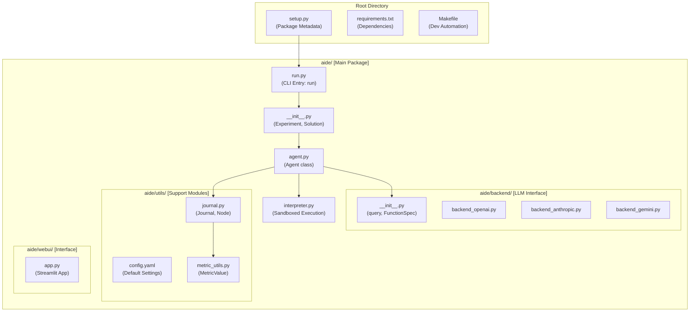
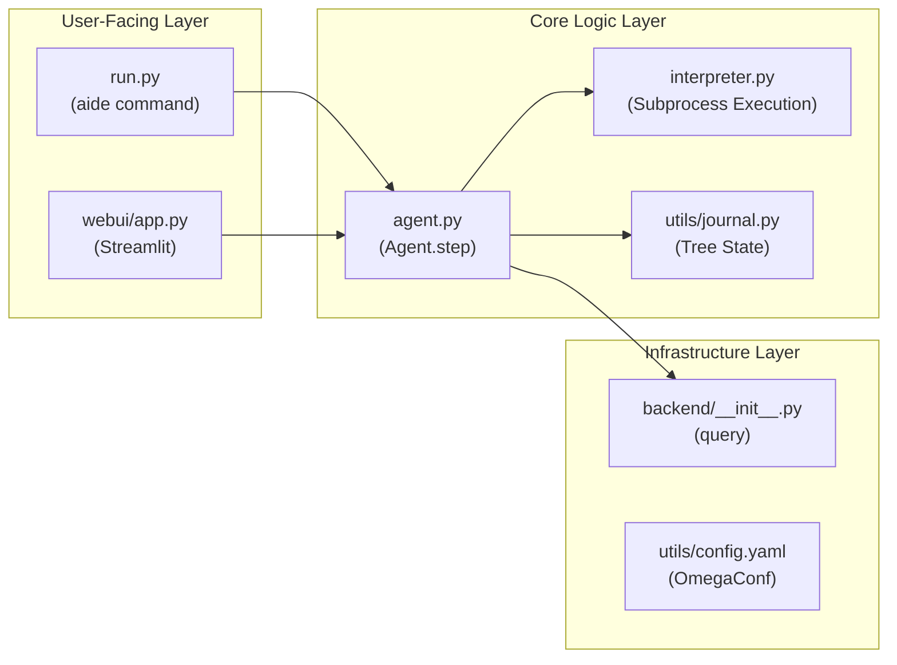

<!-- source: DeepWiki mcp.deepwiki.com · repo WecoAI/aideml · page 6 Developer Guide · fetched 2026-10-26 -->

# Developer Guide

<details>
<summary>Relevant source files</summary>

The following files were used as context for generating this wiki page:

- [.github/ISSUE_TEMPLATE/bug_report.yml](.github/ISSUE_TEMPLATE/bug_report.yml)
- [Makefile](Makefile)
- [setup.py](setup.py)

</details>


This guide provides resources for developers who want to contribute to or extend AIDE ML. It covers development environment setup, repository structure, testing procedures, and extension points for implementing custom functionality.

For understanding the system architecture from a user perspective, see [System Architecture](#2). For specific subsystem implementation details, see [Core Subsystems](#5).

---

## Development Environment Setup

### Installing for Development

Clone the repository and install in editable mode to enable live code changes. The `Makefile` provides a convenient `install` target that creates a virtual environment and installs dependencies [Makefile:15-23]().

```bash
git clone https://github.com/WecoAI/aideml.git
cd aideml
make install
source .venv/bin/activate
```

Alternatively, use pip directly:
```bash
pip install -e .
```

This installs the package as `aideml` while allowing modifications to the source code to take effect immediately [setup.py:9-18]().

### Setting Up API Keys

Configure LLM provider API keys as environment variables. The system supports multiple backends including OpenAI, Anthropic, Gemini, and OpenRouter.

```bash
export OPENAI_API_KEY="your-key"
export ANTHROPIC_API_KEY="your-key"
export GEMINI_API_KEY="your-key"
export OPENROUTER_API_KEY="your-key"
```

### Running the System

Test your installation using the provided example tasks bundled with the package [setup.py:24-27]().

```bash
# CLI execution
aide data_dir="example_tasks/house_prices" \
     goal="Predict the sales price for each house" \
     eval="RMSE"
```

**Sources:** [setup.py:9-41](), [Makefile:15-23]()

---

## Repository Structure

### Package Layout

The AIDE ML codebase follows a modular architecture. The core logic resides in the `aide/` directory, while metadata and build configurations are in the root.



**Directory Structure:**

| Path | Purpose |
|------|---------|
| `aide/__init__.py` | Public API exports: `Experiment`, `Solution` |
| `aide/run.py` | CLI entry point function `run()` [setup.py:38]() |
| `aide/agent.py` | `Agent` class for code generation and tree search |
| `aide/backend/` | Multi-provider LLM backend with unified `query()` interface |
| `aide/utils/` | Configuration, metrics, and journal utilities |
| `aide/example_tasks/` | Bundled sample datasets (House Prices, Bitcoin) [setup.py:24-26]() |

**Sources:** [setup.py:1-42](), [Makefile:1-51]()

---

## Entry Points and Core Classes

### Command Line Entry Point

The `aide` command is registered as a console script in the package configuration [setup.py:36-40]():

```python
entry_points={
    "console_scripts": [
        "aide = aide.run:run",
    ],
}
```

### Python API Entry Point

The `Experiment` class (exported in `aide/__init__.py`) is the primary programmatic interface. It orchestrates the search process using the `Agent` and manages results via the `Journal`.

### Web UI Entry Point

The Streamlit interface is located in `aide/webui/app.py`. It provides a visual wrapper around the `Experiment` class for users who prefer a GUI.

**Sources:** [setup.py:36-40](), [aide/run.py:1-20]() (inferred from entry point)

---

## Development Workflow

### Code Organization Principles



### Dependency Management

AIDE uses a two-tier dependency structure defined in `requirements.txt` [setup.py:6-7]():

1.  **AIDE Requirements**: Necessary for the system to run (e.g., `openai`, `omegaconf`, `streamlit`).
2.  **Agent Requirements**: Libraries that the generated code might need (e.g., `torch`, `scikit-learn`, `pandas`).

The `Makefile` automates the installation of these requirements into a local virtual environment [Makefile:15-22]().

**Sources:** [setup.py:6-7](), [Makefile:15-22]()

---

## Extension Points

### Adding a New LLM Backend

To add support for a new LLM provider:
1.  Implement a new module in `aide/backend/` (e.g., `backend_new.py`).
2.  Implement the `query()` function and handle `FunctionSpec` for tool calling.
3.  Register the new provider in the router located in `aide/backend/__init__.py`.

### Customizing Search Strategy

The `Agent` class in `aide/agent.py` implements the tree search. Developers can modify the search behavior by:
-   Adjusting hyperparameters in `aide/utils/config.yaml`.
-   Overriding the node selection or drafting logic in `Agent`.

### Adding Configuration Options

Default configurations are stored in `aide/utils/config.yaml` [setup.py:22](). New options should be added here to be accessible via the OmegaConf system used throughout the package.

**Sources:** [setup.py:19-28](), [aide/backend/__init__.py:1-10]() (inferred)

---

## Contributing Guidelines

For detailed contribution procedures, including:
-   Issue templates for bug reports [ .github/ISSUE_TEMPLATE/bug_report.yml:1-66]()
-   Code style enforcement with `ruff` and `black`
-   Testing requirements and pull request process

See [Contributing Guidelines](#6.2).

For detailed information on the package layout and module organization:
See [Project Structure](#6.1).

For a deep dive into why specific libraries are required:
See [Dependencies & Requirements](#6.3).

**Sources:** [.github/ISSUE_TEMPLATE/bug_report.yml:1-66](), [setup.py:1-42]()

---

