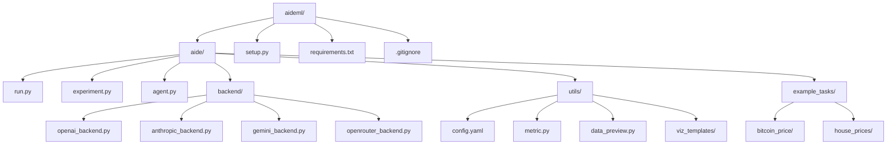
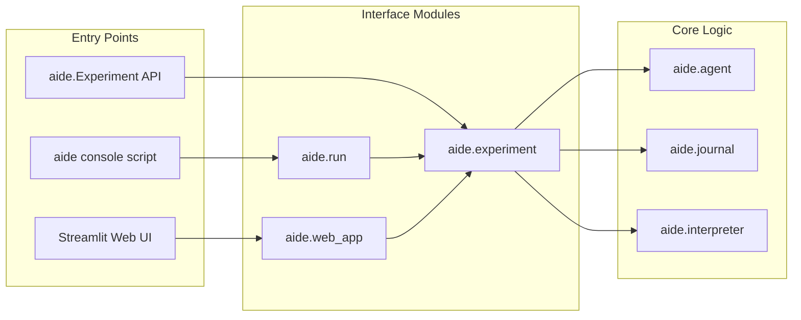
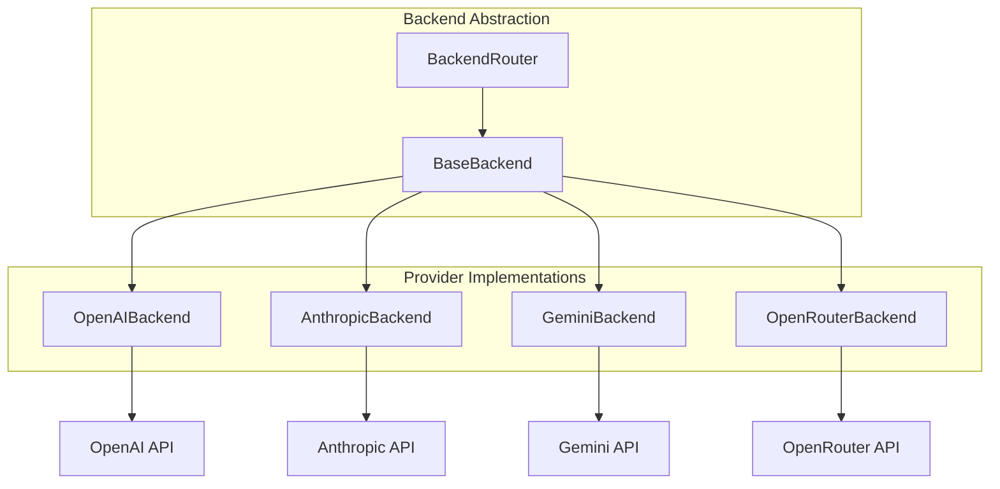
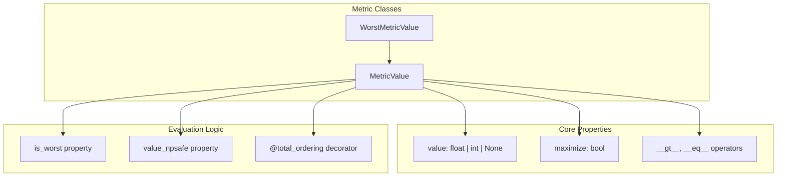
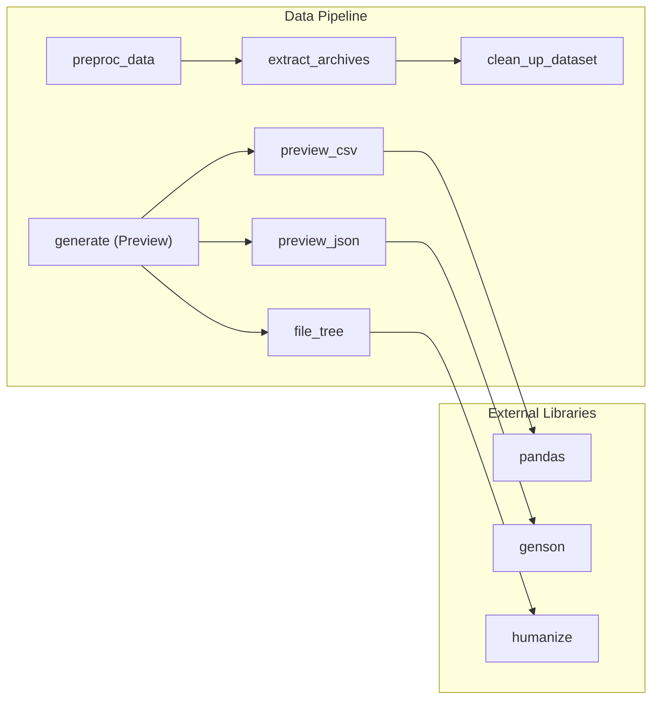
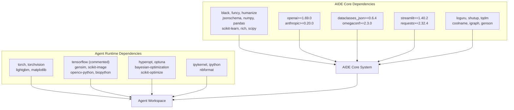
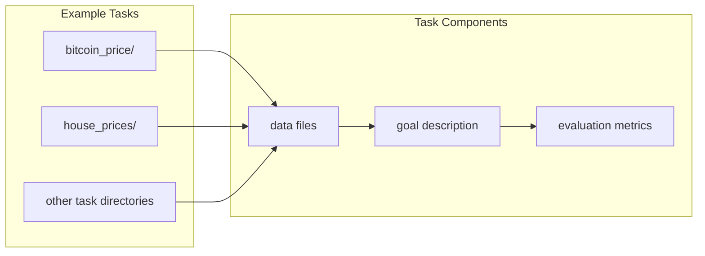

<!-- source: DeepWiki mcp.deepwiki.com · repo WecoAI/aideml · page 6.1 Project Structure · fetched 2026-10-26 -->

# Project Structure

Relevant source files

The following files were used as context for generating this wiki page:

- [aide/utils/__init__.py](aide/utils/__init__.py)
- [aide/utils/data_preview.py](aide/utils/data_preview.py)
- [setup.py](setup.py)

This document provides an overview of the AIDE ML codebase organization, including the main package structure, key modules, and how the different components are organized on disk. This covers the physical layout and architectural organization of the code. For information about the logical architecture and system design, see [System Architecture](#2). For details about specific subsystems, see [Core Subsystems](#5).

## Package Overview

AIDE ML is organized as a Python package named `aideml` with the main code located in the `aide/` directory. The project follows a modular architecture with clear separation between user interfaces, core logic, backend integrations, and utilities.

### High-Level Directory Structure

Sources: [setup.py:18-28](), [aide/utils/data_preview.py:1-153]()

## Core Module Organization

The main `aide` package is structured around the key architectural components identified in the system design:

### Entry Points and Interfaces

The main entry point is defined in `setup.py` as `aide = aide.run:run`, which provides the command-line interface.

Sources: [setup.py:36-40]()

### Backend Integration Layer

The backend system is organized in a dedicated `backend/` subdirectory with separate modules for each LLM provider:

| Module | Purpose | Key Classes |
|--------|---------|-------------|
| `openai_backend.py` | OpenAI API integration | `OpenAIBackend` |
| `anthropic_backend.py` | Anthropic Claude integration | `AnthropicBackend` |
| `gemini_backend.py` | Google Gemini integration | `GeminiBackend` |
| `openrouter_backend.py` | OpenRouter multi-model access | `OpenRouterBackend` |

Sources: Inferred from package structure in [setup.py:20-28]()

## Data Structures and Utilities

### Metrics System

The metrics evaluation system is implemented in the `utils/` directory with a sophisticated comparison framework:

The `MetricValue` class implements sophisticated comparison logic where "better" values are determined by the `maximize` flag, not just numeric comparison.

### Data Preview and Processing

The `aide/utils/` directory provides essential utilities for data handling and preparation for the LLM agent:

| Function/Module | File | Purpose |
|-----------------|------|---------|
| `generate()` | `data_preview.py` | Generates a textual preview of a directory and its files for the agent's context [aide/utils/data_preview.py:121-153]() |
| `preview_csv()` | `data_preview.py` | Summarizes CSV structure, columns, and data types [aide/utils/data_preview.py:59-108]() |
| `preview_json()` | `data_preview.py` | Generates a JSON schema from a sample file using `genson` [aide/utils/data_preview.py:111-118]() |
| `preproc_data()` | `__init__.py` | Orchestrates archive extraction and cleanup [aide/utils/__init__.py:98-101]() |
| `extract_archives()` | `__init__.py` | Unzips files and handles nested directory structures [aide/utils/__init__.py:49-96]() |

Sources: [aide/utils/data_preview.py:1-153](), [aide/utils/__init__.py:1-101]()

## Configuration and Templates

The `utils/` directory contains:

| Component | Location | Purpose |
|-----------|----------|---------|
| Configuration defaults | `utils/config.yaml` | Default experiment settings |
| Visualization templates | `utils/viz_templates/` | HTML templates for tree visualization |
| Metric evaluation | `utils/metric.py` | MetricValue and comparison logic |

Sources: [setup.py:20-28]()

## Dependencies and Requirements

### Core Dependencies

The project has a two-tier dependency structure defined in `requirements.txt`:

The requirements are split into two categories:
- **AIDE requirements**: Core system dependencies for the AIDE framework itself
- **Agent requirements**: ML libraries that the AI agent might need when generating code

Sources: [setup.py:35](), [requirements.txt:1-95]()

### Package Metadata

The package is configured in `setup.py` with the following key properties:

| Property | Value |
|----------|-------|
| Package name | `aideml` |
| Current version | `0.2.2` |
| Python requirement | `>=3.10` |
| Entry point | `aide = aide.run:run` |
| Package discovery | `find_packages()` |

The package includes data files for configuration, visualization templates, and example tasks.

Sources: [setup.py:9-41]()

## Example Tasks and Workspaces

### Example Task Structure

The project includes pre-built example tasks to demonstrate AIDE's capabilities:

Sources: [setup.py:24-27]()

### Runtime Workspaces

The `.gitignore` file reveals that AIDE creates runtime directories during execution:

| Directory | Purpose |
|-----------|---------|
| `workspaces/` | Agent execution environments |
| `logs/` | Experiment execution logs |
| `.gradio/` | Gradio web interface cache |

These directories are excluded from version control as they contain generated content and execution artifacts.

Sources: Inferred from package behavior and setup.

---

