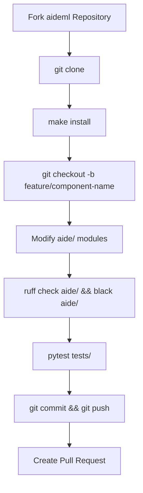
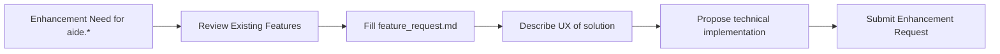
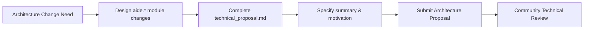
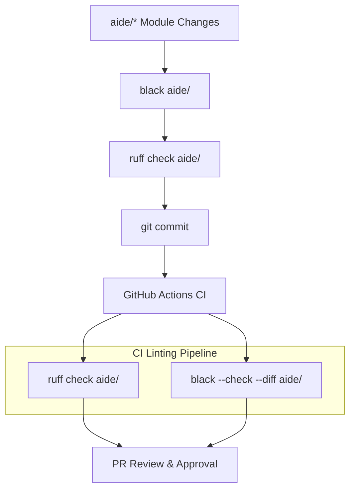
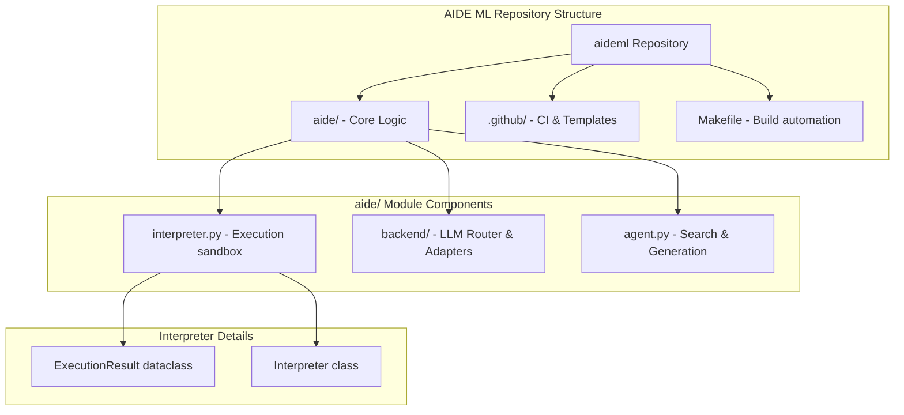

<!-- source: DeepWiki mcp.deepwiki.com · repo WecoAI/aideml · page 6.2 Contributing Guidelines · fetched 2026-10-26 -->

# Contributing Guidelines

Relevant source files

The following files were used as context for generating this wiki page:

- [.github/ISSUE_TEMPLATE/bug_report.yml](.github/ISSUE_TEMPLATE/bug_report.yml)
- [.github/ISSUE_TEMPLATE/feature_request.md](.github/ISSUE_TEMPLATE/feature_request.md)
- [.github/ISSUE_TEMPLATE/technical_proposal.md](.github/ISSUE_TEMPLATE/technical_proposal.md)
- [.github/pull_request_template.md](.github/pull_request_template.md)
- [.github/workflows/linter.yml](.github/workflows/linter.yml)
- [Makefile](Makefile)
- [aide/interpreter.py](aide/interpreter.py)

This document outlines the process for contributing to the AIDE ML project. It covers how to report bugs, request features, propose technical changes, and submit code contributions to the core `aide` module and its subsystems. For information about the codebase organization, see [Project Structure](#6.1).

## Getting Started

AIDE ML welcomes contributions to its autonomous machine learning agent system. Before contributing, ensure you understand:

1.  The core `aide.Experiment` API and tree search architecture
2.  The multi-LLM backend system in `aide/backend/`
3.  The `aide.agent.Agent` and `aide.journal.Journal` components
4.  GitHub workflows and Python development practices

Contributors should be familiar with the modular architecture consisting of the agent system, code interpreter, solution journal, and LLM backend abstraction layer.

### Development Setup for AIDE ML

To contribute to the AIDE ML codebase, you can use the provided `Makefile` to automate environment setup.

**Development Environment Setup for AIDE ML Components**

The `make install` command automates the creation of a virtual environment and installs AIDE in editable mode [Makefile:15-23]().

| Component | Location | Purpose |
| :--- | :--- | :--- |
| `aide.Experiment` | `aide/experiment.py` | Main experiment controller |
| `aide.agent.Agent` | `aide/agent.py` | AI agent for code generation |
| `aide.journal.Journal` | `aide/journal.py` | Solution tree management |
| `aide.backend.*` | `aide/backend/` | LLM provider interfaces |
| `Interpreter` | `aide/interpreter.py` | Sandboxed Python execution [aide/interpreter.py:91-107]() |

Sources: [Makefile:15-23](), [aide/interpreter.py:91-107](), [.github/pull_request_template.md:1-8]()

## Types of Contributions

AIDE ML accepts several types of contributions targeting different system components.

### Bug Reports

Bug reports help identify issues in the `aide` module components. The bug report template collects system-specific information such as the LLM used and the installation method [ .github/ISSUE_TEMPLATE/bug_report.yml:27-50]().

**Required Information for AIDE ML Bug Reports**

| Field | Purpose | Examples |
| :--- | :--- | :--- |
| Installation Method | Determines environment context | Commandline, Docker, Python Script [ .github/ISSUE_TEMPLATE/bug_report.yml:27-36]() |
| AIDE Version | Version compatibility tracking | `0.1.4`, `main` branch [ .github/ISSUE_TEMPLATE/bug_report.yml:39-44]() |
| LLM | Backend-specific issues | `gpt-4-turbo`, `claude-3-5-sonnet` [ .github/ISSUE_TEMPLATE/bug_report.yml:46-50]() |
| Operating System | Platform-specific bugs | MacOS, Linux, WSL [ .github/ISSUE_TEMPLATE/bug_report.yml:53-60]() |

**Bug Report Workflow for AIDE ML Components**

Sources: [.github/ISSUE_TEMPLATE/bug_report.yml:1-66]()

### Feature Requests

Feature requests target enhancements to AIDE ML's autonomous agent capabilities. The template structures requests for system improvements by asking for the problem description and the desired UX [.github/ISSUE_TEMPLATE/feature_request.md:10-18]().

**AIDE ML Feature Request Structure**

Sources: [.github/ISSUE_TEMPLATE/feature_request.md:1-19]()

### Technical Proposals

Technical proposals address significant architectural changes to AIDE ML's core systems, such as changes to the `Interpreter`'s process isolation or `Agent` search logic [.github/ISSUE_TEMPLATE/technical_proposal.md:1-19]().

**Technical Proposal Workflow for AIDE ML Architecture**

Sources: [.github/ISSUE_TEMPLATE/technical_proposal.md:1-19]()

## Code Standards for AIDE ML

AIDE ML maintains code quality standards across all `aide.*` modules through automated tooling.

### Linting and Formatting Pipeline

The project uses `ruff` for linting and `black` for formatting. These are enforced via GitHub Actions on every push and pull request [.github/workflows/linter.yml:1-26]().

**AIDE ML Code Quality Tools**

| Tool | Version | Command | Purpose |
| :--- | :--- | :--- | :--- |
| **Ruff** | `0.7.1` | `ruff check aide/` | Python linting and static analysis [.github/workflows/linter.yml:20-23]() |
| **Black** | `24.3.0` | `black --check aide/` | Code formatting consistency [.github/workflows/linter.yml:21-25]() |

**Code Quality Enforcement Flow**

Sources: [.github/workflows/linter.yml:1-26]()

## Pull Request Requirements

When submitting a pull request, use the provided template to ensure all necessary information is captured:

1.  **Description**: A simple description of the goal and a summary of changes in the code [.github/pull_request_template.md:1-4]().
2.  **Issue Linking**: Specify which issues the PR fixes [.github/pull_request_template.md:5]().
3.  **Visuals**: Include screenshots or videos for UI-related changes [.github/pull_request_template.md:7-9]().

## AIDE ML Repository Architecture

Understanding the repository structure is essential for contributing to AIDE ML's modular system.

**AIDE ML Codebase Organization**

**Code Contribution Target Areas**

| Directory | Components | Contribution Focus |
| :--- | :--- | :--- |
| `aide/` | Core modules | `Agent`, `Journal`, `Interpreter` [aide/interpreter.py:91]() |
| `aide/backend/` | LLM providers | New provider adapters, routing logic |
| `.github/` | Infrastructure | CI workflows, issue templates [.github/workflows/linter.yml:1]() |

Sources: [aide/interpreter.py:91-116](), [Makefile:1-24](), [.github/workflows/linter.yml:1-26]()

## Best Practices for Contributors

1.  **Isolate Execution**: When modifying the `Interpreter`, ensure changes respect the `multiprocessing.Process` isolation and timeout limits [aide/interpreter.py:169-180]().
2.  **Clean Up**: Use the `Makefile` to clean up local workspaces and logs using `make clean` [Makefile:46-50]().
3.  **Check Existing Issues**: Before filing a bug, check if a similar issue already exists [.github/ISSUE_TEMPLATE/bug_report.yml:10-16]().
4.  **Formatting**: Always run `black` before committing to avoid CI failures [.github/workflows/linter.yml:24-25]().

Sources: [aide/interpreter.py:169-180](), [Makefile:46-50](), [.github/ISSUE_TEMPLATE/bug_report.yml:10-16](), [.github/workflows/linter.yml:24-25]()

---

