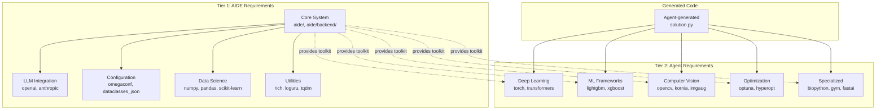
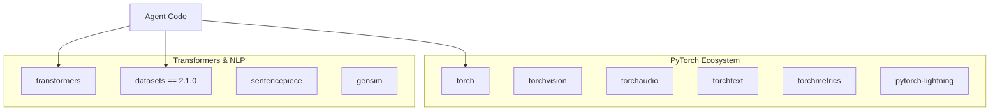
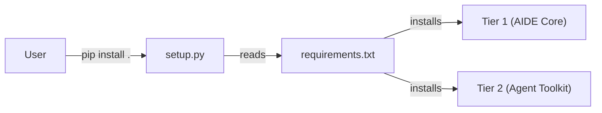

<!-- source: DeepWiki mcp.deepwiki.com · repo WecoAI/aideml · page 6.3 Dependencies & Requirements · fetched 2026-10-26 -->

# Dependencies & Requirements

Relevant source files

The following files were used as context for generating this wiki page:

- [.github/workflows/python-publish.yml](.github/workflows/python-publish.yml)
- [aide/utils/metric.py](aide/utils/metric.py)
- [requirements.txt](requirements.txt)
- [setup.py](setup.py)

This document details AIDE ML's two-tier dependency structure, explaining the distinction between core system requirements and agent-accessible packages. The system maintains separate dependency categories to keep the core lean while providing agents with a comprehensive toolkit for diverse ML tasks. For project structure information, see [Project Structure](#6.1). For contribution guidelines, see [Contributing Guidelines](#6.2).

## Overview

AIDE ML uses a two-tier dependency architecture:

**Tier 1** dependencies are required for AIDE to function as a system. **Tier 2** dependencies are libraries the agent may import when generating code solutions. This separation allows users to install a lightweight core system while providing agents with access to a comprehensive ML ecosystem.

Sources: [requirements.txt:1-95](), [setup.py:1-42]()

## Core AIDE Requirements (Tier 1)

These dependencies are essential for AIDE's core functionality and are always installed when you install the `aideml` package via `setup.py` [setup.py:35-35]().

### LLM Backend Integration

AIDE supports multiple LLM providers through specific client libraries.

| Package | Version | Purpose |
|---------|---------|---------|
| `openai` | `>= 1.69.0` | OpenAI API client for GPT models |
| `anthropic` | `>= 0.20.0` | Anthropic API client for Claude models |
| `requests` | `>= 2.32.4` | HTTP library for custom endpoints and Gemini/OpenRouter |

Sources: [requirements.txt:7-11]()

### Configuration & Data Management

| Package | Version | Purpose |
|---------|---------|---------|
| `omegaconf` | `>= 2.3.0` | Hierarchical configuration from YAML and CLI |
| `dataclasses_json` | `>= 0.6.4` | JSON serialization for dataclasses like `MetricValue` |
| `jsonschema` | `4.19.2` | Schema validation for configurations |
| `genson` | `>= 1.2.0` | JSON schema generation |

The `MetricValue` class [aide/utils/metric.py:11-11]() uses `DataClassJsonMixin` for serialization [aide/utils/metric.py:6-6]().

Sources: [requirements.txt:5,15-16,22](), [aide/utils/metric.py:1-11]()

### Data Science Stack

These core libraries are used for internal data handling and metric comparison.

| Package | Version | Purpose |
|---------|---------|---------|
| `numpy` | `1.26.2` | Numerical computing and type handling in `MetricValue` |
| `pandas` | `2.1.4` | Data manipulation |
| `scikit-learn` | `1.5.0` | ML utilities |
| `scipy` | `1.11.4` | Scientific computing |

The `MetricValue` class [aide/utils/metric.py:11-11]() relies on `numpy` types for its `value` field [aide/utils/metric.py:17-17]() and performs type validation against `np.number` [aide/utils/metric.py:22-22]().

Sources: [requirements.txt:6,9,12,14](), [aide/utils/metric.py:5,17,22]()

### User Interface & Logging

| Package | Version | Purpose |
|---------|---------|---------|
| `rich` | `13.7.0` | Terminal UI and rich logging |
| `loguru` | `0.7.2` | System logging |
| `tqdm` | `4.66.3` | Progress bars |
| `streamlit` | `~=1.54.0` | Web UI framework |

Sources: [requirements.txt:13,17-19,93]()

### Utilities

| Package | Version | Purpose |
|---------|---------|---------|
| `funcy` | `2.0` | Functional programming utilities |
| `humanize` | `4.8.0` | Human-readable formatting |
| `coolname` | `>= 2.2.0` | Random experiment name generation |
| `igraph` | `>= 0.11.3` | Graph structure for solution tree |
| `shutup` | `>= 0.2.0` | Warning suppression |
| `backoff` | Latest | Retry logic for API calls |
| `python-dotenv` | Latest | Environment variable loading |

Sources: [requirements.txt:3-4,18,20-21,92,94]()

## Agent Requirements (Tier 2)

These packages are available for agent-generated code to import. The agent may use any of these libraries when crafting solutions for ML tasks.

### Deep Learning & NLP

| Category | Packages |
|----------|----------|
| PyTorch | `torch`, `torchvision`, `torchaudio`, `torchtext`, `pytorch-lightning`, `torchmetrics`, `torchinfo` |
| NLP | `transformers`, `datasets`, `sentencepiece`, `gensim` |

Sources: [requirements.txt:25-28,43,66,80-83,85-86]()

### Classical ML & Optimization

| Category | Packages |
|----------|----------|
| Frameworks | `lightgbm`, `scikit-learn`, `scipy`, `xgboost` (implicit via agent need) |
| Optimization | `optuna`, `hyperopt`, `bayesian-optimization`, `scikit-optimize` |
| Specialized | `imbalanced-learn`, `hmmlearn`, `bayespy==0.5.1`, `sklearn-pandas` |

Sources: [requirements.txt:30,47-48,50,57,59-60,63-64,79]()

### Computer Vision & Processing

| Category | Packages |
|----------|----------|
| Processing | `opencv-python`, `scikit-image`, `imgaug`, `Pillow`, `imagecodecs`, `kornia` |
| Documents | `pdf2image`, `PyPDF`, `pyocr` |

Sources: [requirements.txt:45-46,56,61,71-72,87-89]()

### Domain-Specific & Utilities

| Domain | Packages |
|--------|----------|
| Bioinformatics | `biopython` |
| Audio | `librosa` |
| Reinforcement Learning | `gym` |
| Symbolic Math | `sympy` |
| Acceleration | `numba` |
| Time Series | `arrow`, `markovify` |

Sources: [requirements.txt:49,53-55,67,78,84]()

## Dependency Management

### Installation via setup.py

AIDE is packaged using `setuptools`. The `setup.py` file [setup.py:1-42]() reads `requirements.txt` [setup.py:6-7]() and passes them to `install_requires` [setup.py:35-35]().

The package also includes essential non-code data [setup.py:19-28]():
- `requirements.txt` for reference within the package.
- `utils/config.yaml` for default settings.
- `utils/viz_templates/*` for HTML reporting.
- `example_tasks/*` for benchmarking.

Sources: [setup.py:6-7,19-28,35]()

### Dependency Strategy

| Strategy | Packages | Rationale |
|----------|----------|-----------|
| **Exact Pins (`==`)** | `numpy`, `pandas`, `scikit-learn`, `rich`, `loguru`, `datasets` | Prevents breaking changes in core data handling and reporting. |
| **Compatible (`~=`)** | `black`, `pytest`, `streamlit` | Allows minor updates while maintaining major version stability. |
| **Minimum (`>=`)** | `openai`, `anthropic`, `omegaconf`, `requests` | Ensures access to modern LLM features and security patches. |
| **Unpinned** | `torch`, `transformers`, `lightgbm` | Allows the environment to use the latest ML advancements. |

Sources: [requirements.txt:1-95]()

### Rationale for Two-Tier Structure

1.  **Environment Reproducibility**: By pinning core dependencies (Tier 1), AIDE ensures that the search logic and evaluation metrics [aide/utils/metric.py:11-79]() behave consistently across different installations.
2.  **Agent Capabilities**: Data science is a broad field. Including Tier 2 requirements like `biopython`, `librosa`, and `gym` ensures the agent can handle diverse tasks (genomics, audio processing, RL) without the user needing to manually install specialized libraries for every new problem.
3.  **Sandboxing & Execution**: The agent's code is executed by an interpreter. Having these libraries pre-installed in the environment where AIDE runs allows the interpreter to execute agent solutions without runtime dependency resolution overhead.

Sources: [requirements.txt:1-95](), [setup.py:1-42]()

---

