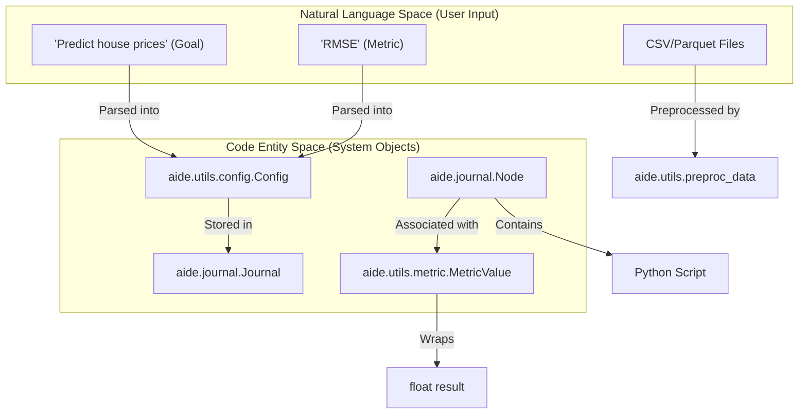
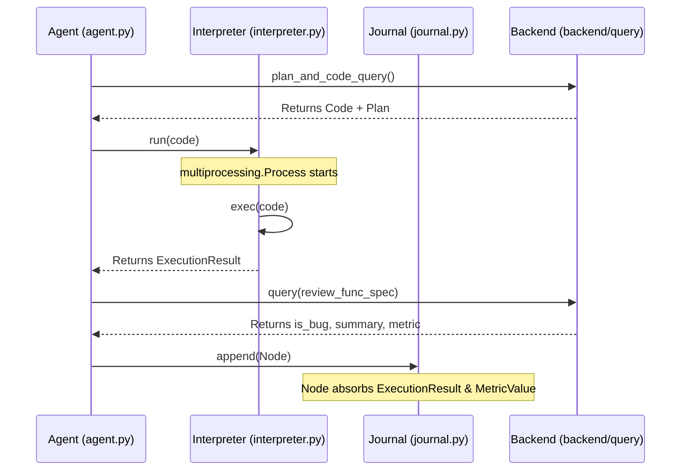

<!-- source: DeepWiki mcp.deepwiki.com · repo WecoAI/aideml · page 7 Glossary · fetched 2026-10-26 -->

# Glossary

Relevant source files

The following files were used as context for generating this wiki page:

- [.github/workflows/linter.yml](.github/workflows/linter.yml)
- [LICENSE](LICENSE)
- [README.md](README.md)
- [aide/agent.py](aide/agent.py)
- [aide/backend/__init__.py](aide/backend/__init__.py)
- [aide/backend/utils.py](aide/backend/utils.py)
- [aide/example_tasks/bitcoin_price/BTC-USD.csv](aide/example_tasks/bitcoin_price/BTC-USD.csv)
- [aide/example_tasks/house_prices/data_description.txt](aide/example_tasks/house_prices/data_description.txt)
- [aide/interpreter.py](aide/interpreter.py)
- [aide/journal.py](aide/journal.py)
- [aide/utils/config.py](aide/utils/config.py)
- [aide/utils/metric.py](aide/utils/metric.py)
- [requirements.txt](requirements.txt)

This glossary defines the core technical terms, domain concepts, and internal jargon used throughout the AIDE ML codebase. It serves as a reference for onboarding engineers to understand how natural language task descriptions are transformed into an executable and optimized solution tree.

## Core Concepts

### Agentic Tree Search
The primary algorithm used by AIDE to explore the space of possible code solutions. Unlike a linear agent that only tries to improve its last attempt, AIDE maintains a tree of solutions, allowing it to backtrack, branch out from promising nodes, or debug specific failures.
*   **Implementation**: Controlled by the `Agent` class which implements the `search_policy` to decide whether to draft, debug, or improve [aide/agent.py:47-92]().
*   **Hyperparameters**: Defined in `SearchConfig` (e.g., `num_drafts`, `debug_prob`, `max_debug_depth`) [aide/utils/config.py:36-40]().

### Journal
The centralized data structure that records the history of the experiment. It acts as a container for the solution tree, tracking all generated code, execution results, and metrics.
*   **Implementation**: `Journal` class in [aide/journal.py:135-138]().
*   **Serialization**: Saved as `journal.json` in the experiment log directory [aide/utils/config.py:191]().

### Node
A single unit in the `Journal` representing one iteration of a Python script. Every `Node` contains the code, the LLM's natural language plan, and the execution metadata.
*   **Implementation**: `Node` class in [aide/journal.py:22-50]().
*   **Relationships**: Nodes have a `parent` and a set of `children`, forming the tree structure [aide/journal.py:33-34]().

### Stage Name
A categorization of a `Node` based on its origin in the search process:
*   `draft`: An initial solution with no parent [aide/journal.py:63-64]().
*   `debug`: A node created to fix a parent that was marked as `is_buggy` [aide/journal.py:65]().
*   `improve`: A node created to enhance the performance of a successful parent [aide/journal.py:65]().

---

## Technical Definitions & Code Pointers

### Interpreter
A sandboxed execution environment that runs the agent's code in a separate process to capture output and enforce constraints.
*   **Isolation**: Uses `multiprocessing.Process` to prevent the agent's code from crashing the main application [aide/interpreter.py:176-180]().
*   **Timeout**: Enforces a maximum execution time (default 3600s) to prevent infinite loops [aide/interpreter.py:113]().
*   **I/O Capture**: Redirects `stdout` and `stderr` to a `RedirectQueue` for logging and LLM feedback [aide/interpreter.py:131]().

### MetricValue
A specialized class for handling machine learning metrics. It supports both maximization (e.g., Accuracy) and minimization (e.g., RMSE).
*   **Optimization Direction**: Controlled by the `maximize` boolean [aide/utils/metric.py:18]().
*   **Comparison**: The `__gt__` operator is overloaded to return `True` if a value is *better* according to the optimization goal, not just numerically larger [aide/utils/metric.py:25-38]().
*   **WorstMetricValue**: A subclass used when code fails to run, ensuring buggy nodes are always ranked lower than successful ones [aide/utils/metric.py:65-72]().

### FunctionSpec
A schema definition used to guide LLMs in generating structured JSON output (tool calling).
*   **Role**: Used specifically for the `submit_review` function where the LLM evaluates the output of a script [aide/agent.py:19-44]().
*   **Multi-backend Support**: Provides methods to convert the schema into formats required by OpenAI, Anthropic, or Gemini [aide/backend/utils.py:68-119]().

---

## Architecture Visualizations

### Natural Language to Code Entity Mapping
This diagram shows how user-provided natural language inputs are mapped to specific internal Python classes and configuration objects.

**NL Space to Code Entity Space**

**Sources:** [aide/utils/config.py:63-81](), [aide/journal.py:22-50](), [aide/utils/metric.py:11-18]()

### Code Execution & Feedback Flow
This diagram illustrates the lifecycle of a single code snippet, from generation to evaluation and tree integration.

**Execution and Journaling Flow**

**Sources:** [aide/agent.py:153-162](), [aide/interpreter.py:169-181](), [aide/journal.py:67-73](), [aide/agent.py:19-44]()

---

## Summary Table of Key Terms

| Term | Definition | File Pointer |
| :--- | :--- | :--- |
| **Draft** | An initial node created without a parent at the start of the search. | [aide/journal.py:63]() |
| **Buggy Node** | A node where `is_buggy` is True, either due to an exception or LLM review. | [aide/journal.py:160]() |
| **Search Policy** | The logic determining if the next step is drafting, debugging, or improving. | [aide/agent.py:61]() |
| **Workspace** | The local directory where the agent reads data and writes temporary files. | [aide/utils/config.py:177]() |
| **Backoff** | Retrying LLM requests with exponential wait times on failure. | [aide/backend/utils.py:17]() |
| **Prompt Compilation** | Converting nested dicts/lists into Markdown for LLM consumption. | [aide/backend/utils.py:43]() |

**Sources:** [aide/journal.py:63-161](), [aide/agent.py:61-92](), [aide/utils/config.py:177-186](), [aide/backend/utils.py:17-54]()