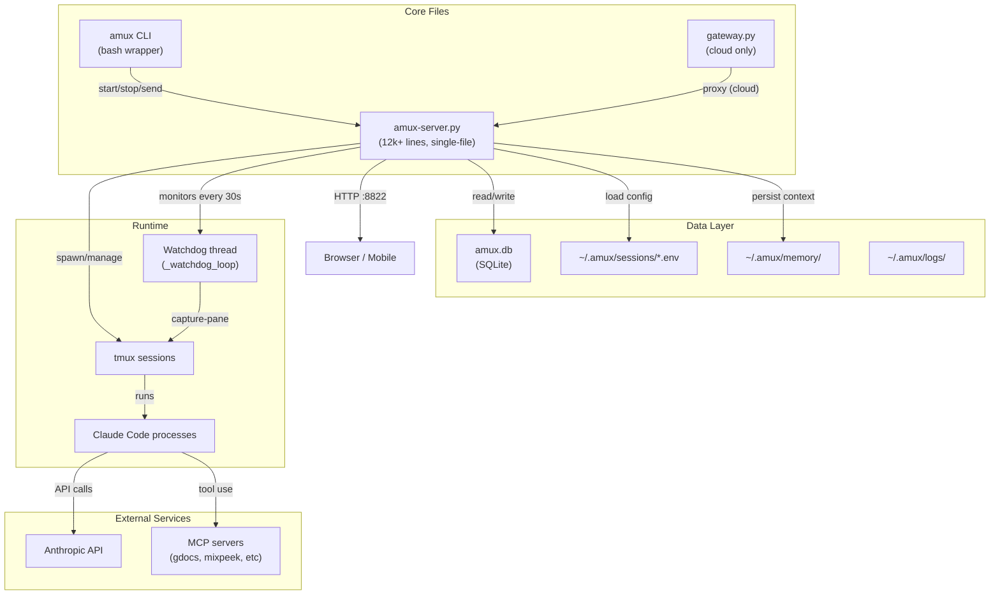
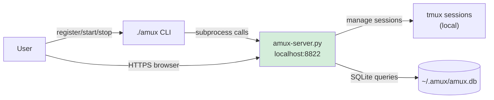
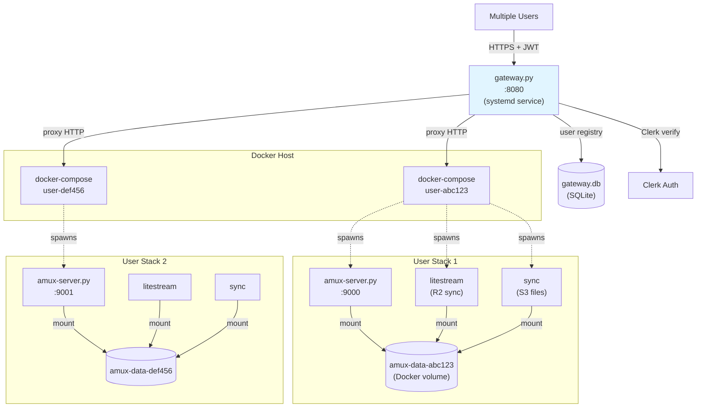
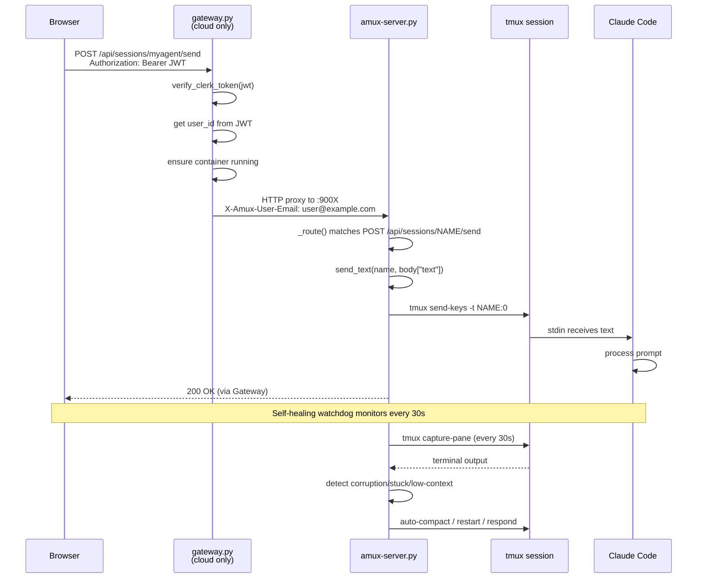
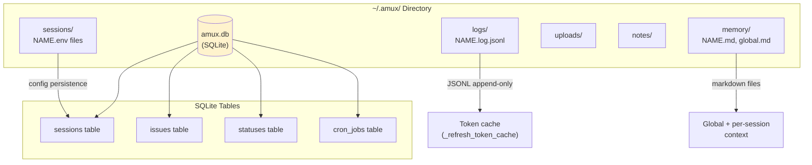

<!-- source: DeepWiki mcp.deepwiki.com · repo mixpeek/amux · page 1 Overview · fetched 2026-10-26 -->

# Overview

Relevant source files

The following files were used as context for generating this wiki page:

- [README.md](README.md)
- [amux-server.py](amux-server.py)
- [cloud/gateway/gateway.py](cloud/gateway/gateway.py)
- [site/llms.txt](site/llms.txt)
- [site/sitemap.xml](site/sitemap.xml)
- [test.mjs](test.mjs)

## Purpose and Scope

This document provides a high-level architectural overview of **amux**, an open-source Claude Code agent multiplexer. It explains the system's core components, deployment modes, and how they interact to enable parallel AI coding agents with self-healing, orchestration, and mobile management capabilities.

For installation and first-time setup, see [Quick Start](#1.1). For detailed server internals, see [Core Server](#2). For cloud deployment architecture, see [Cloud Deployment](#4).

---

## What is amux?

amux is a Python-based system that runs multiple Claude Code sessions in parallel, each isolated in its own tmux pane. It provides:

- **Session multiplexing** via tmux, with persistent UUIDs that survive stop/start cycles
- **Web dashboard** (mobile-first PWA) for monitoring and controlling sessions
- **Self-healing watchdog** that auto-compacts context, restarts on corruption, and replays messages
- **SQLite-backed kanban board** with atomic task claiming for agent coordination
- **REST API** for agent-to-agent orchestration (send messages, peek output, claim tasks)
- **Two deployment modes**: local OSS (single-user) and cloud (multi-tenant with Docker)

Sources: [README.md:1-219](), [amux-server.py:1-10]()

---

## Core Components

**Key Code Entities:**

| Component | File | Primary Functions |
|-----------|------|-------------------|
| HTTP Server | [amux-server.py:21-24]() | `ThreadingHTTPServer`, `Handler` class |
| Session Manager | [amux-server.py:49-63]() | `CC_SESSIONS`, `CC_LOGS`, `CC_MEMORY` paths |
| Database | [amux-server.py:14]() | `sqlite3` module, `amux.db` file |
| Watchdog | [amux-server.py:188-196]() | `_watchdog_loop()`, `_session_auto_actions` dict |
| Gateway | [cloud/gateway/gateway.py:1-728]() | `Handler` class, Docker orchestration |

Sources: [amux-server.py:1-96](), [cloud/gateway/gateway.py:1-10](), [README.md:42-43]()

---

## Deployment Modes

amux supports two distinct deployment architectures:

### Local OSS Deployment

- **Single-user**, runs on localhost (or Tailscale network)
- All data stored in `~/.amux/` directory
- Auto-generates TLS certificate (Tailscale → mkcert → self-signed)
- No authentication by default

**Entry points:**
- CLI: `./amux` bash wrapper → `amux-server.py` subprocess calls
- Web: Direct connection to `https://localhost:8822`

Sources: [README.md:109-151](), [amux-server.py:36-48]()

### Cloud Multi-Tenant Deployment

- **Multi-tenant** with per-user Docker containers
- `gateway.py` orchestrates container lifecycle
- Each user gets 3 containers: `amux`, `litestream`, `sync`
- Clerk JWT authentication via `Authorization: Bearer` header or session cookies
- Idle reaper stops containers after 3600s of inactivity

**Key functions:**
- User allocation: `alloc_port()` [cloud/gateway/gateway.py:204-209]()
- Container start: `start_container()` [cloud/gateway/gateway.py:261-271]()
- Proxy: `proxy()` [cloud/gateway/gateway.py:397-457]()
- JWT verification: `verify_clerk_token()` [cloud/gateway/gateway.py:335-347]()

Sources: [cloud/gateway/gateway.py:1-457](), [Diagram 2]()

---

## Request Flow: Browser to Agent

**Code Path for `POST /api/sessions/NAME/send`:**

1. Request hits `Handler.do_POST()` [amux-server.py:21]()
2. Routed by `_route()` pattern matching [amux-server.py:129-186]()
3. Calls `send_text()` function [amux-server.py reference]
4. Uses `subprocess.run(["tmux", "send-keys", ...])` to inject into session
5. Watchdog `_watchdog_loop()` monitors output every 30s [amux-server.py:188-196]()

Sources: [amux-server.py:129-186](), [cloud/gateway/gateway.py:397-457](), [Diagram 4]()

---

## Data Storage

amux uses a flat-file architecture with SQLite for structured data:

**Key Paths:**

| Directory | Purpose | File Format |
|-----------|---------|-------------|
| `~/.amux/sessions/` | Session config persistence | `.env` files with `CC_DIR`, `CC_MODEL`, etc |
| `~/.amux/logs/` | Token tracking, message replay | `.log.jsonl` (one line per API call) |
| `~/.amux/memory/` | Agent context files | Markdown (`.md`) |
| `~/.amux/amux.db` | Board, statuses, cron | SQLite database |

**Database Schema:**

- `sessions` table: `(name, uuid, dir, model, created_at)`
- `issues` table: `(id, title, desc, status, session, due, created_at, deleted)`
- `statuses` table: `(id, label, color, position, created_at)`
- `cron_jobs` table: `(id, session, cron_expr, action, last_fire, next_fire)`

Sources: [amux-server.py:29-63](), [amux-server.py:786-802]()

---

## Key Subsystems

amux's functionality is divided into distinct subsystems, each documented in detail on separate wiki pages:

### Session Management ([#2.1](#2.1))

- **Purpose:** Create, start, stop, and persist Claude Code sessions via tmux
- **Key mechanism:** Each session has a UUID stored in `~/.amux/sessions/NAME.env`, survives stop/start
- **Code:** `CC_SESSIONS` path [amux-server.py:50](), tmux integration via `subprocess.run()`

### Board System ([#2.2](#2.2))

- **Purpose:** SQLite-backed kanban board with atomic task claiming
- **Key mechanism:** CAS (Compare-And-Swap) via `UPDATE ... WHERE status='todo'` queries
- **Code:** `issues` and `statuses` tables in `amux.db`

### Memory System ([#2.3](#2.3))

- **Purpose:** Per-session and global markdown files for persistent context
- **Key mechanism:** Files in `~/.amux/memory/` injected into Claude Code via `MEMORY` env var
- **Code:** `CC_MEMORY` path [amux-server.py:52](), `/api/memory/*` endpoints

### Self-Healing Watchdog ([#2.4](#2.4))

- **Purpose:** Auto-recovery from context exhaustion, corruption, and stuck prompts
- **Key mechanism:** 30-second polling loop that captures tmux output, detects failure patterns
- **Code:** `_watchdog_loop()` function, `_session_auto_actions` dict [amux-server.py:188-196]()

### Event System & Logging ([#2.5](#2.5))

- **Purpose:** Structured event log (ring buffer), SSE streaming, server logs
- **Key mechanism:** In-memory `_event_log` deque (2000 max), SSE endpoint at `/api/events`
- **Code:** `_emit_event()`, `_event_log` [amux-server.py:104-127]()

### REST API ([#5](#5))

- **Purpose:** Complete HTTP API for sessions, board, memory, orchestration
- **Base URL:** `http://localhost:8822` (local) or `https://cloud.amux.io` (cloud)
- **Authentication:** None (local), Clerk JWT (cloud)
- **Key endpoints:** `/api/sessions`, `/api/board`, `/api/memory/global`, `/api/sync`

Sources: [amux-server.py:49-63](), [amux-server.py:104-196](), [Table of contents]()

---

## Technology Stack

| Layer | Technology | Usage |
|-------|-----------|-------|
| **Core Language** | Python 3 | `amux-server.py` (~12k lines) |
| **HTTP Server** | `http.server.ThreadingHTTPServer` | [amux-server.py:21]() |
| **Session Isolation** | tmux | Each agent in its own tmux pane |
| **Database** | SQLite 3 | Board, sessions, cron (WAL mode) |
| **Agent Runtime** | Claude Code | Spawned via `subprocess.Popen()` |
| **Cloud Auth** | Clerk | JWT verification via `PyJWT` |
| **Cloud Orchestration** | Docker Compose | Per-user 3-container stacks |
| **DB Replication** | Litestream | Continuous backup to Cloudflare R2 |
| **File Sync** | AWS CLI | S3 sync for `~/.amux/` flat files |
| **Web UI** | Inline HTML/CSS/JS | Embedded in `amux-server.py` |
| **PWA** | Service Worker | Offline support, Background Sync |

**No external dependencies required for local OSS deployment** — only `python3` and `tmux`.

Sources: [amux-server.py:1-24](), [cloud/gateway/gateway.py:1-10](), [README.md:111-112]()

---

## Design Principles

### Single-File Architecture

The entire local server is contained in `amux-server.py` (~12k lines), with inline HTML/CSS/JS. This enables:

- Zero build step
- Edit-and-restart workflow (file mtime triggers reload)
- Easy debugging (search codebase for function names)
- Version control friendly (one file, one git history)

Enforced by `CLAUDE.md` rules: *"The single-file architecture (inline HTML/CSS/JS in amux-server.py) is non-negotiable."*

Sources: [amux-server.py:1-10](), [README.md:42]()

### Stateless Session Coordination

Sessions don't share memory or communicate directly. Coordination happens via:

1. **SQLite atomic claims:** `UPDATE issues SET status='doing' WHERE id=? AND status='todo'`
2. **REST API:** Agents call `POST /api/sessions/OTHER/send` to delegate work
3. **Global memory:** `~/.amux/memory/global.md` accessible to all sessions

This enables truly parallel agents without race conditions.

Sources: [Diagram 4](), [README.md:62-78]()

### Cloud-Local Parity

The same `amux-server.py` runs in both deployments without modification. Differentiation via:

- **Environment variables:** `ANTHROPIC_API_KEY`, `CC_HOME`, etc.
- **HTTP headers:** `X-Amux-User-Email` injected by gateway

Hot reload in cloud: Touch `amux-server.py` on host → all containers reload via bind mount.

Sources: [Diagram 1](), [Diagram 6](), [amux-server.py:36-47]()

---

## Next Steps

- **[Quick Start](#1.1)** — Install amux and run your first session
- **[Architecture Diagram](#1.2)** — Visual breakdown of system topology
- **[Core Server](#2)** — Deep dive into `amux-server.py` internals
- **[Gateway & Multi-Tenancy](#3)** — Cloud deployment with `gateway.py`
- **[REST API Reference](#5)** — Complete endpoint documentation

Sources: [Table of contents]()

---

