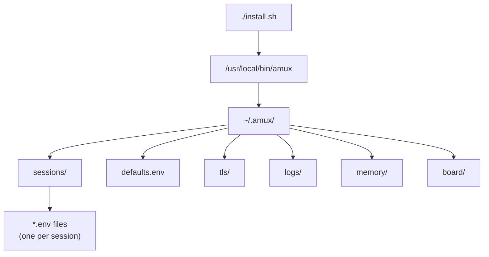
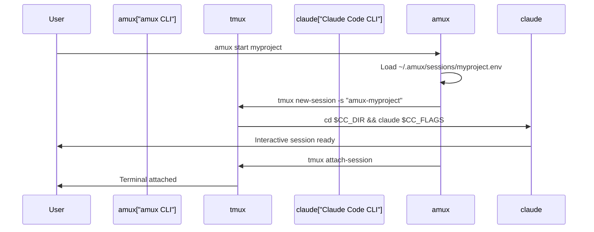
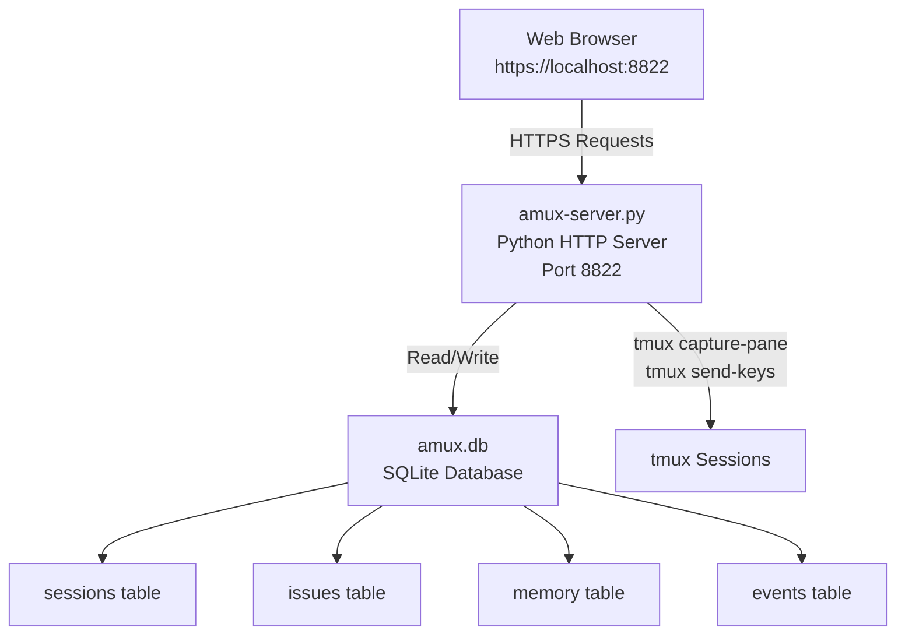
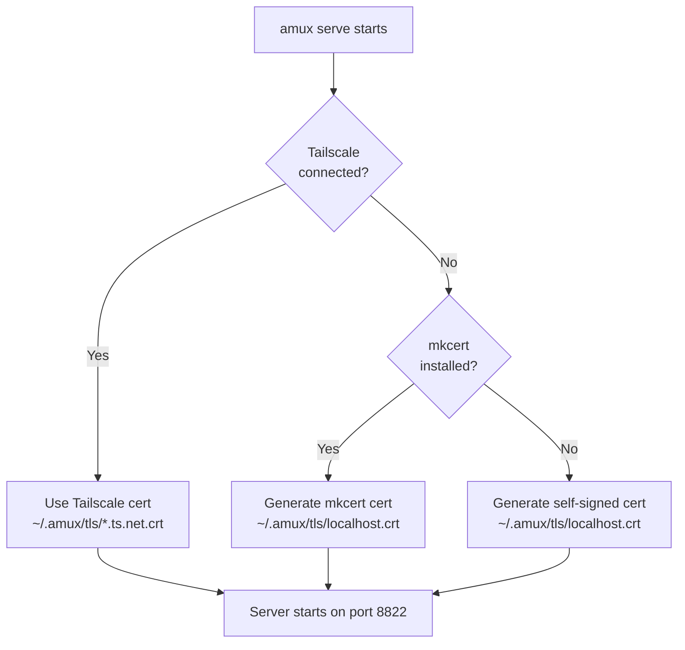
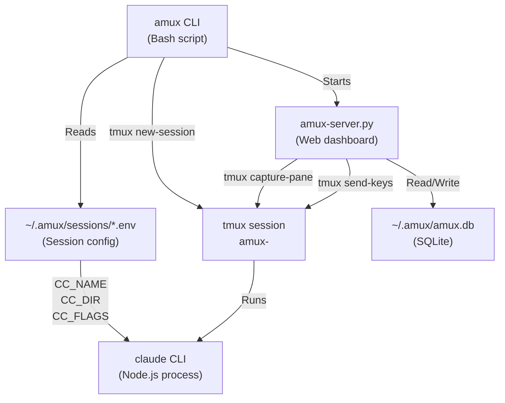

<!-- source: DeepWiki mcp.deepwiki.com · repo mixpeek/amux · page 1.1 Quick Start · fetched 2026-10-26 -->

# Quick Start

<details>
<summary>Relevant source files</summary>

The following files were used as context for generating this wiki page:

- [README.md](README.md)
- [amux](amux)
- [cloud/setup.sh](cloud/setup.sh)

</details>


This guide walks through installing amux and running your first Claude Code session. It covers installation, session registration, starting agents, and accessing the web dashboard. For detailed API usage, see [REST API Reference](#5). For cloud deployment, see [Cloud Deployment](#4).

---

## Prerequisites

amux requires:
- **tmux** — session multiplexer for managing Claude Code instances
- **python3** — runtime for the web dashboard server
- **Node.js 22+** — required by Claude Code CLI

Install on macOS:
```bash
brew install tmux python3 node
```

Install on Ubuntu/Debian:
```bash
apt-get install tmux python3 nodejs npm
```

**Sources:** [README.md:109-116](), [cloud/setup.sh:14-27]()

---

## Installation

### Install amux

```bash
git clone https://github.com/mixpeek/amux && cd amux
./install.sh
```

The install script:
1. Copies the `amux` CLI to `/usr/local/bin/amux`
2. Creates symlink `cc` → `amux` for legacy compatibility
3. Makes scripts executable

**Sources:** [README.md:109-116](), [amux:1-8]()

---

### Install Claude Code CLI

```bash
npm install -g @anthropic-ai/claude-code
```

Verify installation:
```bash
claude --version
```

**Sources:** [cloud/setup.sh:72-76]()

---

## Directory Structure

After installation, amux creates `~/.amux/`:

```
~/.amux/
├── sessions/           # Session configuration files (*.env)
├── defaults.env        # Global default flags
├── tls/               # Auto-generated HTTPS certificates
├── logs/              # Server logs
├── memory/            # Global memory shared across agents
├── board/             # SQLite board database
└── playwright-auth/   # Persistent browser auth profiles
```

**Directory Structure Initialization**



**Sources:** [amux:10-23](), [amux:42-45](), [cloud/setup.sh:56-61]()

---

## Register Your First Session

Create a session configuration:

```bash
amux register myproject --dir ~/Dev/myproject --yolo
```

### Common Flags

| Flag | Purpose |
|------|---------|
| `--dir <path>` | Working directory for Claude Code |
| `--yolo` | Skip permission checks (alias for `--dangerously-skip-permissions`) |
| `--model opus` | Use Claude Opus (default: Sonnet) |
| `--model haiku` | Use Claude Haiku |
| `--mcp-config <path>` | Custom MCP server configuration |

### What Gets Created

The `register` command creates `~/.amux/sessions/myproject.env`:

```bash
# amux session: myproject
# registered: 2024-01-15T10:30:00-08:00
CC_NAME="myproject"
CC_DIR="/Users/you/Dev/myproject"
CC_FLAGS="--dangerously-skip-permissions"
```

**Sources:** [amux:168-186](), [README.md:94-106]()

---

## Start a Session

```bash
amux start myproject
```

This command:
1. Loads session config from `~/.amux/sessions/myproject.env`
2. Creates tmux session named `amux-myproject`
3. Launches `claude` CLI with configured flags in the working directory
4. Attaches to the session

**Session Startup Flow**



**Sources:** [amux:188-234]()

---

## Detach and Reattach

### Detach Without Stopping

While attached to a session, press:
```
Ctrl-b d
```

This detaches from tmux but leaves Claude running in the background.

### Reattach Later

```bash
amux attach myproject
```

Or use fuzzy matching:
```bash
amux attach my    # Matches "myproject" if unambiguous
```

**Sources:** [amux:258-266]()

---

## View Output Without Attaching

```bash
amux peek myproject
```

Shows last 30 lines of output. Specify line count:

```bash
amux peek myproject 100
```

**Sources:** [amux:268-281]()

---

## Send Commands to Sessions

```bash
amux send myproject "implement user authentication"
```

Sends text + Enter to the session. Use `--keys` for raw key sequences:

```bash
amux send myproject --keys 'C-c'  # Send Ctrl-C
```

**Sources:** [amux:283-304]()

---

## Start the Web Dashboard

```bash
amux serve
```

Opens at `https://localhost:8822` (auto-generated TLS certificate).

**Web Dashboard Architecture**



The dashboard provides:
- **Session cards** with live status (working/idle/needs input)
- **Peek mode** to view terminal output in browser
- **Board view** with drag-and-drop Kanban
- **Token tracking** per session
- **File explorer** for workspace files

For detailed dashboard features, see [Web Dashboard](#6).

**Sources:** [amux:635-646](), [README.md:81-88]()

---

## HTTPS Certificate Setup

amux auto-generates TLS certificates in priority order:

1. **Tailscale** — if connected, uses Tailscale cert for `*.ts.net` domain
2. **mkcert** — if installed, generates locally-trusted cert
3. **Self-signed** — fallback, requires browser trust warning bypass

### Tailscale Setup (Recommended for Phone Access)

```bash
# Install Tailscale
curl -fsSL https://tailscale.com/install.sh | sh

# Connect to your network
tailscale up

# Get your Tailscale hostname
tailscale status
```

Then access dashboard at `https://your-machine.ts.net:8822` from any device on your Tailscale network.

**Certificate Priority Flow**



**Sources:** [README.md:118-120](), [cloud/setup.sh:64-70]()

---

## List Sessions

```bash
amux ls
```

Example output:
```
 1* myproject        ~/Dev/myproject YOLO sonnet
 2* api-server       ~/Dev/api       opus │ Waiting for input...
 3  frontend         ~/Dev/frontend  
```

Legend:
- `*` = running
- `YOLO` = `--dangerously-skip-permissions` enabled
- Model name displayed if non-default
- Last line of output shown if running

**Sources:** [amux:349-394]()

---

## Interactive Dashboard (CLI)

Run `amux` with no arguments for an interactive TUI:

```bash
amux
```

**Interactive Dashboard Commands:**

| Input | Action |
|-------|--------|
| `<number>` | Attach to session by number |
| `p<number>` | Peek session by number (e.g., `p1`) |
| `s<number> <text>` | Send text to session (e.g., `s1 fix bug`) |
| `ls` | Refresh session list |
| `q` | Quit |

**Sources:** [amux:396-456]()

---

## Stop a Session

```bash
amux stop myproject
```

Kills the tmux session. Session config remains in `~/.amux/sessions/`, so you can restart later.

**Sources:** [amux:306-319]()

---

## Remove a Session

```bash
amux rm myproject
```

Stops the session (if running) and deletes the config file.

**Sources:** [amux:321-332]()

---

## Common Workflows

### Single Session Development

```bash
# Register and start
amux register api --dir ~/Dev/api --model opus --yolo
amux start api

# Later: view output without attaching
amux peek api 50

# Send a command
amux send api "add error handling to login endpoint"

# Stop when done
amux stop api
```

### Multi-Agent Parallel Development

```bash
# Register multiple sessions
amux register backend --dir ~/Dev/api --yolo
amux register frontend --dir ~/Dev/web --yolo
amux register tests --dir ~/Dev/tests --yolo

# Start all
amux start backend
amux start frontend
amux start tests

# Monitor via web dashboard
amux serve
```

Open `https://localhost:8822` to view all sessions in real-time.

For agent orchestration patterns, see [Agent Orchestration Patterns](#12).

**Sources:** [README.md:9-14](), [README.md:169-180]()

---

## CLI to tmux to Claude Mapping

**Component Relationships**



**Sources:** [amux:1-752]()

---

## Next Steps

- **Configure integrations:** See [MCP Server Configuration](#8.1) for Google Docs, browser automation, and custom tools
- **Run multiple agents:** See [Running 10+ agents in parallel](https://amux.io/guides/running-10-plus-agents/)
- **Self-healing setup:** See [Self-Healing Watchdog](#2.4) for auto-recovery configuration
- **Cloud deployment:** See [Cloud Deployment](#4) for multi-tenant hosting
- **API automation:** See [REST API Reference](#5) for programmatic control

**Sources:** [README.md:200-213]()

---

