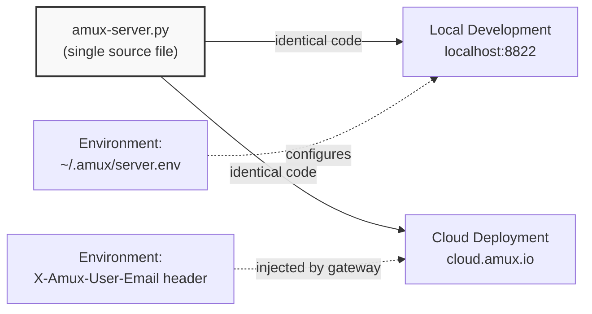
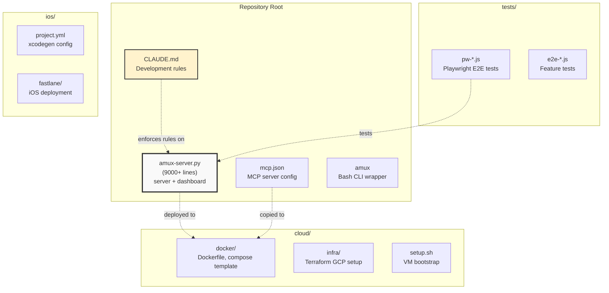
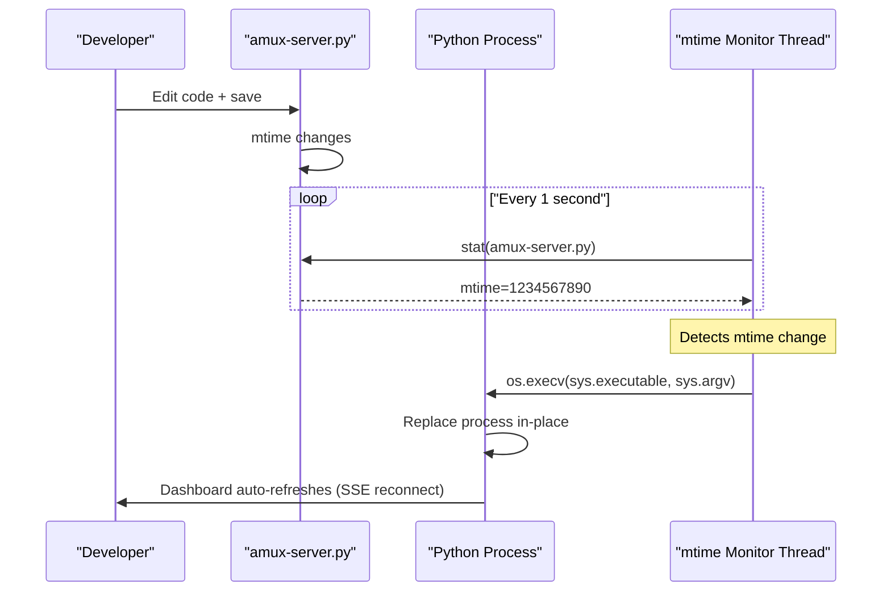
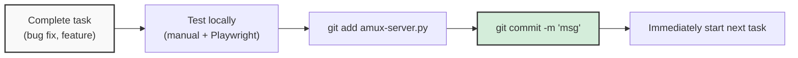
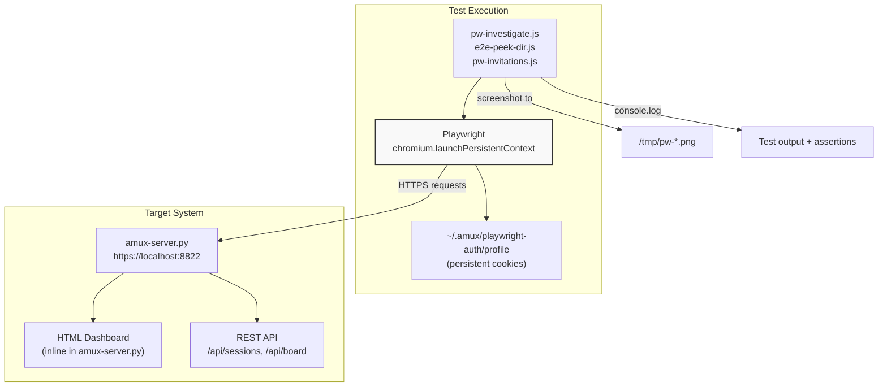
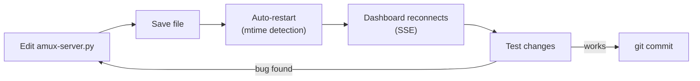
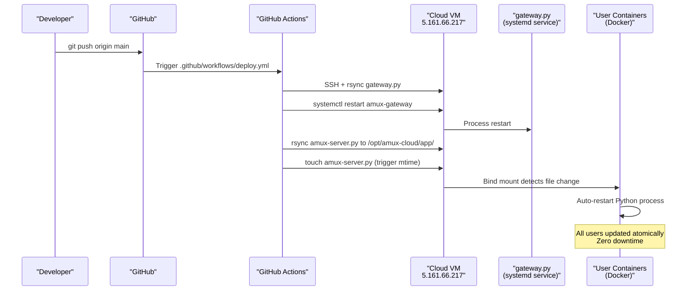
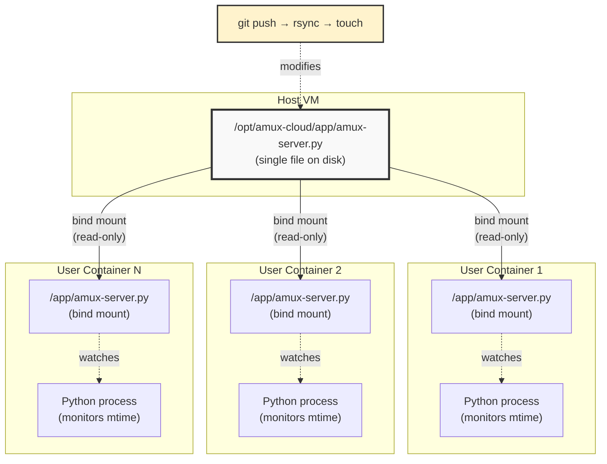

<!-- source: DeepWiki mcp.deepwiki.com · repo mixpeek/amux · page 10 Development · fetched 2026-10-26 -->

# Development

<details>
<summary>Relevant source files</summary>

The following files were used as context for generating this wiki page:

- [.gitignore](.gitignore)
- [CLAUDE.md](CLAUDE.md)
- [cloud/docker/Dockerfile](cloud/docker/Dockerfile)
- [cloud/docker/amux-server.py](cloud/docker/amux-server.py)
- [pw-investigate.js](pw-investigate.js)
- [pw-invitations-ui.js](pw-invitations-ui.js)
- [pw-invitations.js](pw-invitations.js)
- [pw-invite-final.js](pw-invite-final.js)
- [tests/e2e-peek-dir.js](tests/e2e-peek-dir.js)
- [tests/pw-investigate.js](tests/pw-investigate.js)
- [tests/pw-offline-debug.js](tests/pw-offline-debug.js)

</details>


This page provides a comprehensive guide for contributors developing and extending amux. It covers the core development philosophy, local development setup, testing practices, and deployment workflows.

**Related pages:** For specific development rules and constraints, see [Development Rules](#10.1). For testing infrastructure details, see [Testing](#10.2). For recording browser demos, see [Browser Recording](#10.3). For CI/CD pipelines, see [CI/CD Pipelines](#10.4).

---

## Overview

Amux follows a **single-codebase philosophy** where `amux-server.py` is identical across local and cloud deployments. This constraint ensures features work universally without platform-specific branches. Development focuses on iterative commits with immediate feedback through auto-restart mechanisms.

**Key characteristics:**
- Single Python file contains server + embedded dashboard
- Auto-restart on file modifications for instant testing
- Playwright-based E2E testing infrastructure
- Git-based deployment pipeline to cloud infrastructure

---

## Core Development Principles

### Single-Codebase Rule (Critical)

The most fundamental constraint in amux development:



**Forbidden patterns:**
- `if IS_CLOUD:` or `if os.environ.get('CLOUD')`
- Separate `amux-server-cloud.py` variants
- Build-time flags for deployment targets

**Allowed differentiation:**
- Headers injected by gateway (e.g., `X-Amux-User-Email`)
- Presence/absence of environment variables
- Configuration in `~/.amux/server.env`

Sources: [CLAUDE.md:24-30]()

---

## Development Environment Setup

### Prerequisites

```
python3 (3.11+)
tmux
git
node.js + npm (for Playwright tests)
```

### Local Installation

```bash
# Clone repository
git clone https://github.com/mixpeek/amux
cd amux

# Install Python dependencies (if any are added)
pip install requests

# Install Playwright for testing
npm install playwright

# Install Claude Code globally
npm install -g @anthropic-ai/claude-code
```

### Configuration Files

| File | Purpose | Example |
|------|---------|---------|
| `~/.amux/server.env` | Persistent server environment variables | `AMUX_S3_BUCKET=my-bucket` |
| `~/.amux/sessions/*.env` | Per-session configuration | `CC_DIR=/path/to/project` |
| `mcp.json` | MCP server integrations | Google Docs, Mixpeek API |
| `.gitignore` | Excluded from version control | Generated files, auth profiles |

Sources: [CLAUDE.md:32-44](), [.gitignore:1-17]()

---

## Code Structure



**Key files:**
- `amux-server.py` — The entire backend + frontend in one file
- `CLAUDE.md` — Development rules and conventions
- `mcp.json` — Centralized MCP server configuration
- `amux` — Bash CLI that wraps Python server calls
- `cloud/docker/docker-compose.template.yml` — Stamped out per user in cloud

**Generated files (excluded from git):**
- `cloud/docker/amux-server.py` — Copy created during cloud deploy
- `ios/AmuxApp.xcodeproj/` — Generated by xcodegen
- `~/.amux/playwright-auth/profile` — Browser session for tests

Sources: [CLAUDE.md:5-10](), [.gitignore:1-17]()

---

## Development Workflow

### Edit → Auto-Restart Cycle



The server monitors its own source file and restarts immediately on changes. No manual restart needed.

**How it works:**
1. Background thread checks `os.stat(amux-server.py).st_mtime` every second
2. On change, calls `os.execv()` to replace process image
3. All state (SQLite DBs, tmux sessions) persists across restart
4. Dashboard clients reconnect via SSE within ~2 seconds

Sources: [CLAUDE.md:14-15]()

### Syntax Validation

Always verify Python syntax after making edits:

```bash
python3 -c "import ast; ast.parse(open('amux-server.py').read())"
```

This catches syntax errors before the auto-restart cycle.

Sources: [CLAUDE.md:15]()

### Commit Workflow



**Rule: Commit after every completed task.** Do not batch multiple features into one commit.

**Example commit messages:**
- `Add auto-compact when context < 20%`
- `Fix YOLO auto-respond for approval prompts`
- `Board: atomic claim with SQLite CAS`

Sources: [CLAUDE.md:13]()

---

## Testing Infrastructure

### Playwright E2E Tests



**Test types:**

| Test File | Purpose | Key Actions |
|-----------|---------|-------------|
| `pw-investigate.js` | Debug UI state | Navigate tabs, capture screenshots, check computed styles |
| `tests/e2e-peek-dir.js` | Peek → Explore flow | Click directory path, verify overlay opens |
| `pw-invitations.js` | Invitation feature | Mock API responses, verify UI renders invitations |
| `tests/pw-offline-debug.js` | Offline mode | Go offline, test IndexedDB fallback |

**Running tests:**

```bash
# Single test
node pw-investigate.js

# Test suite in tests/
node tests/e2e-peek-dir.js

# View screenshots
open /tmp/pw-*.png
```

**Persistent context:** All tests use the same Chromium profile at `~/.amux/playwright-auth/profile`, preserving login state across runs.

Sources: [pw-investigate.js:1-16](), [tests/e2e-peek-dir.js:1-126](), [pw-invitations.js:1-293]()

### Test Anatomy

```javascript
const { chromium } = require('playwright');
const { homedir } = require('os');

(async () => {
  // Launch browser with persistent profile
  const ctx = await chromium.launchPersistentContext(
    `${homedir()}/.amux/playwright-auth/profile`,
    { headless: true, viewport: { width: 1440, height: 900 }, 
      ignoreHTTPSErrors: true }
  );
  
  const page = await ctx.newPage();
  await page.goto('https://localhost:8822', { waitUntil: 'domcontentloaded' });
  await page.waitForTimeout(2000);
  
  // Interact with UI
  await page.click('#tab-files');
  await page.waitForTimeout(1500);
  
  // Capture evidence
  await page.screenshot({ path: '/tmp/pw-files.png' });
  
  // Assert state
  const hasFiles = await page.evaluate(() => 
    document.querySelectorAll('.file-row').length > 0
  );
  console.log('Files loaded:', hasFiles);
  
  await ctx.close();
})();
```

**Key patterns:**
- `launchPersistentContext()` for cookie persistence
- `ignoreHTTPSErrors: true` for self-signed certs
- `page.evaluate()` for inspecting DOM state
- Screenshots to `/tmp/` for manual inspection

Sources: [pw-investigate.js:3-16](), [tests/e2e-peek-dir.js:8-14]()

### API Mocking

For testing UI that depends on external APIs:

```javascript
// Intercept and mock backend responses
await page.route('**/api/organizations/user-invitations*', async (route) => {
  await route.fulfill({
    status: 200,
    contentType: 'application/json',
    body: JSON.stringify({
      success: true,
      invitations: [{ organization_id: 'org_123', ... }]
    })
  });
});
```

This allows testing frontend behavior without running dependent services.

Sources: [pw-invitations.js:201-228]()

---

## Deploy Process

### Local Deploy (Development)



Changes are live within ~2 seconds. No manual restart needed.

---

### Cloud Deploy (Production)



**Deploy command (when user says "deploy"):**

```bash
git add amux-server.py
git commit -m "Your feature description"
git push origin main
```

GitHub Actions handles the rest automatically.

**Key mechanism:** All user containers bind-mount `/opt/amux-cloud/app/amux-server.py` read-only. Touching the file changes its mtime, triggering the auto-restart mechanism in every running container simultaneously.

Sources: [CLAUDE.md:19-23]()

### Hot Reload Architecture



This architecture enables zero-downtime updates: when the file's mtime changes, all containers restart independently without affecting each other.

Sources: [CLAUDE.md:24-31](), [cloud/docker/Dockerfile:11-13]()

---

## Development Tools

### CLI Investigation

The `amux` bash wrapper provides quick access to server functions:

```bash
# Register new session
./amux register my-session

# Start server
./amux serve

# Send message to session
./amux send my-session "your message here"

# Peek at session output
./amux peek my-session

# Attach to tmux session
./amux attach my-session
```

Sources: [CLAUDE.md:5-6]()

### Browser Recording Investigation

For debugging browser automation or recording demos:

```javascript
// tests/pw-investigate.js - inspect DOM state
const cursors = await page.evaluate(() => {
  const sel = ['body', '.card', '.tab-bar button'];
  return sel.map(s => {
    const el = document.querySelector(s);
    const computed = window.getComputedStyle(el).cursor;
    return { sel: s, cursor: computed };
  });
});
console.log('Cursor styles:', JSON.stringify(cursors, null, 2));
```

Useful for diagnosing CSS issues or verifying event handlers.

Sources: [tests/pw-investigate.js:16-90]()

### Server Log Inspection

```bash
# Server log location
tail -f ~/.amux/logs/server.log

# Session-specific logs
tail -f ~/.amux/logs/<session-name>.jsonl
```

The server log contains timestamped events with IP addresses, HTTP methods, and response codes. Session logs contain full Claude conversation history in JSONL format.

Sources: [cloud/docker/amux-server.py:72-89]()

---

## File Modification Rules

### What to Edit

**Always edit:**
- `amux-server.py` — All server and dashboard code

**Edit when adding integrations:**
- `mcp.json` — MCP server configurations

**Never edit (generated):**
- `cloud/docker/amux-server.py` — Copy created during deploy
- `ios/AmuxApp.xcodeproj/` — Generated by xcodegen

### .gitignore Exclusions

```
cloud/docker/amux-server.py       # Generated during deploy
ios/AmuxApp.xcodeproj/            # Generated by xcodegen
~/.amux/playwright-auth/          # Test browser profiles
scratch/                          # Temporary files
```

Sources: [.gitignore:8-12]()

---

## Environment Configuration

### Server Environment Variables

Stored in `~/.amux/server.env` and loaded at startup:

```bash
# S3 iCal sync for Google Calendar subscriptions
AMUX_S3_BUCKET=ethan-personal
AMUX_S3_KEY=amux/calendar.ics
AMUX_S3_REGION=us-east-2

# API keys for MCP servers (referenced in mcp.json via ${ENV_VAR})
ANTHROPIC_API_KEY=sk-ant-...
GDRIVE_CLIENT_ID=...
MIXPEEK_API_KEY=...
```

**Reloading config:**
```bash
# Edit ~/.amux/server.env
# Then trigger restart:
touch amux-server.py
```

Sources: [CLAUDE.md:32-44](), [cloud/docker/amux-server.py:36-43]()

### Docker Environment

For cloud deployments, environment variables are injected via docker-compose:

```yaml
environment:
  - ANTHROPIC_API_KEY=${ANTHROPIC_API_KEY}
  - CC_HOME=/data
  - AMUX_PORT=8822
```

Sources: [cloud/docker/Dockerfile:14-15]()

---

## Contribution Guidelines

### Before Starting Work

1. Review [CLAUDE.md]() for development rules
2. Ensure local environment runs: `./amux serve`
3. Verify tests pass: `node tests/e2e-*.js`

### During Development

1. **Edit only `amux-server.py`** (single-file rule)
2. **Test locally** — changes are live via auto-restart
3. **Verify syntax** — `python3 -c "import ast; ast.parse(open('amux-server.py').read())"`
4. **Write tests** — add Playwright tests for UI changes

### After Completing Feature

1. **Commit immediately** — `git commit -m "Concise description"`
2. **Don't batch commits** — one feature = one commit
3. **Push to deploy** — `git push origin main` triggers cloud update

### Testing Checklist

- [ ] Local server starts without errors
- [ ] Feature works in web dashboard
- [ ] Existing tests still pass
- [ ] New test added for new feature (if UI change)
- [ ] No syntax errors: `python3 -c "import ast; ast.parse(...)"`
- [ ] No forbidden patterns (no `if IS_CLOUD`)

Sources: [CLAUDE.md:12-23]()

---

## Common Development Patterns

### Adding a New API Endpoint

```python
# In amux-server.py, add to _route() method
if path == "/api/my-endpoint" and method == "POST":
    data = json.loads(self.rfile.read(length))
    result = {"status": "ok"}
    _send_json(self, result)
    return
```

### Adding Dashboard UI

HTML/CSS/JS is embedded in `amux-server.py` as a string literal. Search for `<!DOCTYPE html>` to find the dashboard code.

### Adding MCP Server Integration

```json
// In mcp.json
{
  "mcpServers": {
    "my-service": {
      "type": "url",
      "url": "https://api.example.com/mcp",
      "headers": {
        "Authorization": "Bearer ${MY_API_KEY}"
      }
    }
  }
}
```

Then add `MY_API_KEY=...` to `~/.amux/server.env`.

Sources: [CLAUDE.md:7-8]()

---

## Debugging Tips

### Check Auto-Restart Logs

```bash
# Server should log "Restarting due to file change..." when mtime changes
grep "Restarting" ~/.amux/logs/server.log
```

### Inspect SSE Events

```bash
# In browser console:
// SSE events arrive at EventSource('/api/sse')
// Check Network tab → EventStream for live updates
```

### Profile Browser Behavior

```javascript
// In tests/pw-investigate.js
const state = await page.evaluate(() => {
  return {
    activeTab: document.querySelector('.tab.active')?.id,
    sessionCount: document.querySelectorAll('.card').length,
    // ... any DOM state you need
  };
});
console.log('State:', state);
```

### Verify Docker Bind Mount

```bash
# On cloud VM:
docker exec amux-user-abc123 ls -la /app/amux-server.py

# Should show file from host with recent mtime
```

Sources: [tests/pw-investigate.js:1-90](), [cloud/docker/Dockerfile:11-12]()

---

## Related Documentation

- [Development Rules](#10.1) — Detailed constraints and conventions
- [Testing](#10.2) — Playwright test suite architecture
- [Browser Recording](#10.3) — Recording demos with visible cursor + captions
- [CI/CD Pipelines](#10.4) — GitHub Actions deployment workflows
- [REST API Reference](#5) — API endpoint documentation
- [Cloud Deployment](#4) — Infrastructure setup and Docker architecture

---

