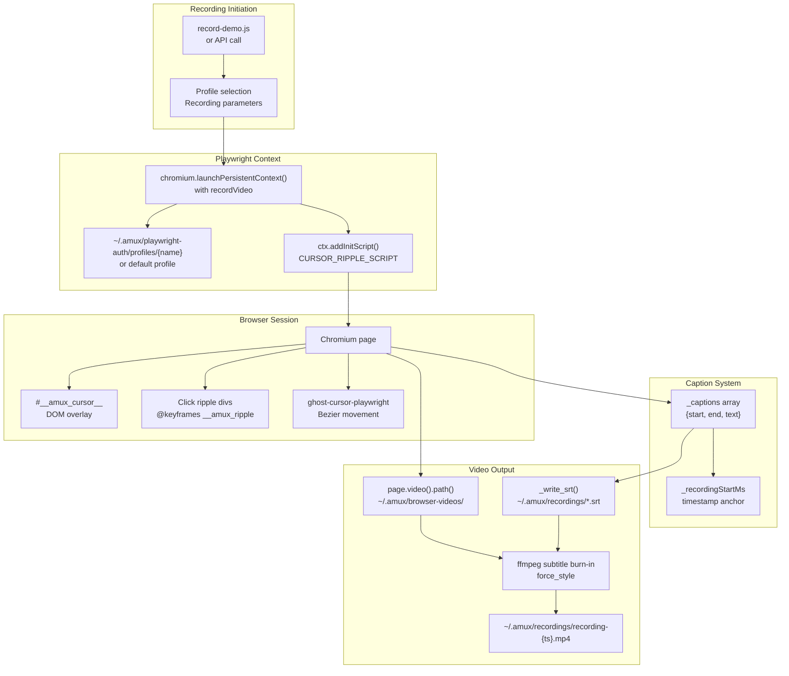
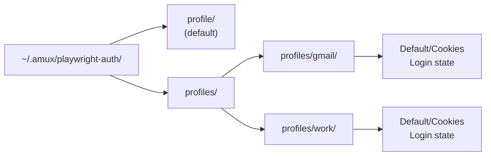
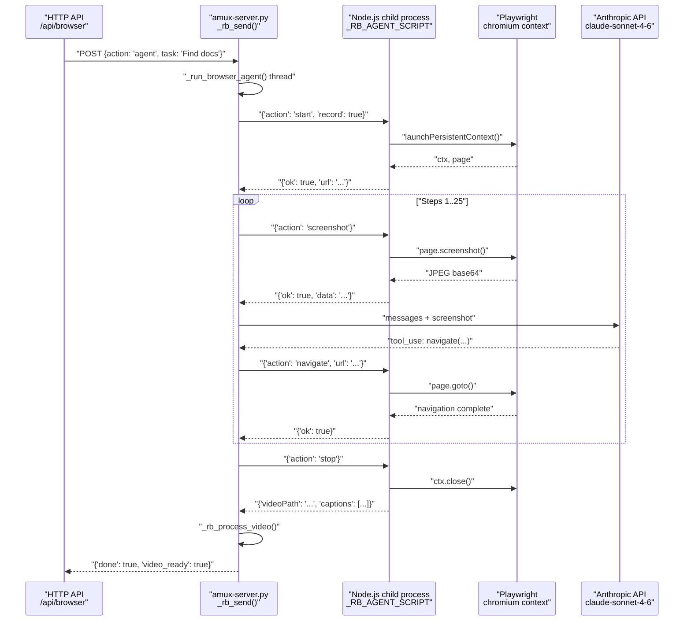

<!-- source: DeepWiki mcp.deepwiki.com · repo mixpeek/amux · page 10.3 Browser Recording · fetched 2026-10-26 -->

# Browser Recording

<details>
<summary>Relevant source files</summary>

The following files were used as context for generating this wiki page:

- [cloud/docker/Dockerfile](cloud/docker/Dockerfile)
- [cloud/docker/amux-server.py](cloud/docker/amux-server.py)
- [package.json](package.json)
- [pw-investigate.js](pw-investigate.js)
- [pw-invitations-ui.js](pw-invitations-ui.js)
- [pw-invitations.js](pw-invitations.js)
- [pw-invite-final.js](pw-invite-final.js)
- [tests/browser-comparison.js](tests/browser-comparison.js)
- [tests/e2e-peek-dir.js](tests/e2e-peek-dir.js)
- [tests/pw-investigate.js](tests/pw-investigate.js)
- [tests/pw-offline-debug.js](tests/pw-offline-debug.js)
- [tests/record-demo.js](tests/record-demo.js)

</details>


## Purpose and Scope

The browser recording system enables creation of demo videos with visible cursor indicators, click animations, and burned-in captions. It is built on Playwright's `recordVideo` API and includes custom DOM injection for visual feedback that appears in the recorded output. The system supports multiple authentication profiles for recording tasks across different logged-in sessions.

For information about using Playwright for UI testing (without recording), see [Testing](#10.2).

---

## System Architecture

The recording system operates in two modes:
1. **Standalone demo script** ([tests/record-demo.js:1-432]()) for manual multi-page recording workflows
2. **Remote browser agent** ([cloud/docker/amux-server.py:412-686]()) for Claude-driven browser automation with recording

Both modes share the same core components: cursor injection, caption tracking, and video post-processing.



**Sources:** [tests/record-demo.js:18-212](), [cloud/docker/amux-server.py:183-213]()

---

## Cursor and Visual Indicators

### DOM-Based Cursor Overlay

The cursor is implemented as a fixed-position `<div>` that tracks `mousemove` events. This approach ensures the cursor appears in Playwright's video recording output, unlike the system cursor which is not captured in headless mode.

The injection script creates two visual elements:

| Element | Purpose | Styling | Lifecycle |
|---------|---------|---------|-----------|
| `#__amux_cursor__` | Visible cursor position | 20px orange circle with border and shadow | Created on DOMContentLoaded, updated on mousemove |
| Ripple divs | Click feedback | 44px expanding orange circle with animation | Created on click, auto-removed after 750ms |

The cursor follows mouse position with a 60ms linear transition for smooth tracking:

```
el.style.left = e.clientX + 'px';
el.style.top  = e.clientY + 'px';
```

**Sources:** [tests/record-demo.js:64-133](), [cloud/docker/amux-server.py:433-480]()

### Click Ripple Animation

Click ripples use a CSS `@keyframes` animation that scales from 0.2 to 2.8 while fading opacity from 1 to 0 over 650ms:

```
@keyframes __amux_ripple {
  0%   { transform: translate(-50%,-50%) scale(0.2); opacity: 1 }
  100% { transform: translate(-50%,-50%) scale(2.8); opacity: 0 }
}
```

The ripple is centered at the click coordinates using `left` and `top` styles set to `e.clientX` and `e.clientY`.

**Sources:** [tests/record-demo.js:108-130](), [cloud/docker/amux-server.py:463-478]()

### Ghost Cursor Smooth Movement

For natural-looking cursor movement, the system uses `ghost-cursor-playwright` when available, which generates Bezier curve paths between points. If not installed, it falls back to linear interpolation over 18 steps at ~60fps:

```javascript
for (let i = 1; i <= steps; i++) {
  await page.mouse.move(
    cx + (x - cx) * (i / steps),
    cy + (y - cy) * (i / steps)
  );
  await page.waitForTimeout(16);
}
```

**Sources:** [tests/record-demo.js:136-181](), [cloud/docker/amux-server.py:483-504]()

---

## Caption System

### Timestamp Tracking

Captions are stored as an array of `{start, end, text}` objects with millisecond offsets from recording start. The system tracks `_recordingStartMs = Date.now()` when recording begins, then calculates caption timestamps relative to this anchor:

```javascript
function addCaption(text, durationMs = 3500) {
  const startMs = Date.now() - recordingStartMs;
  const endMs = startMs + durationMs;
  captions.push({ start: startMs, end: endMs, text });
}
```

This approach allows captions to be added at any point during recording without manual timestamp calculation.

**Sources:** [tests/record-demo.js:36-45](), [cloud/docker/amux-server.py:422-428]()

### SRT Generation

The caption array is converted to SRT format with the standard timecode syntax `HH:MM:SS,mmm`:

```javascript
function msToSrtTimecode(ms) {
  const totalSec = Math.floor(ms / 1000);
  const h = Math.floor(totalSec / 3600);
  const m = Math.floor((totalSec % 3600) / 60);
  const s = totalSec % 60;
  const mil = ms % 1000;
  return `${String(h).padStart(2,'0')}:${String(m).padStart(2,'0')}:${String(s).padStart(2,'0')},${String(mil).padStart(3,'0')}`;
}
```

Each caption block in the SRT file includes a sequence number, timecode range, and text:

```
1
00:00:02,500 --> 00:00:06,000
Opening the Playwright browser automation homepage

2
00:00:08,000 --> 00:00:11,500
Exploring Playwright's hero section and key benefits
```

**Sources:** [tests/record-demo.js:47-62](), [cloud/docker/amux-server.py:198-212]()

---

## Profile Management

### Profile Directory Structure

Profiles are stored in `~/.amux/playwright-auth/profiles/{name}/`, with the default profile at `~/.amux/playwright-auth/profile`. Each profile is a Chromium persistent context directory containing:

- Cookies (authentication state)
- Local storage
- IndexedDB databases
- Extensions and settings



**Profile Selection Logic:**

```javascript
const PROFILE_ARG = process.argv[2] || 'default';
const profilePath = PROFILE_ARG === 'default'
  ? DEFAULT_PROFILE
  : `${PROFILES_DIR}/${PROFILE_ARG.replace(/[^a-zA-Z0-9_-]/g, '')}`;
```

**Sources:** [tests/record-demo.js:24-33](), [cloud/docker/amux-server.py:521-539]()

### Profile State Detection

The system can detect whether a profile has saved authentication by checking for a populated `Cookies` file:

```python
def _profile_has_state(profile_path: Path) -> bool:
    cookies = profile_path / "Default" / "Cookies"
    return cookies.is_file() and cookies.stat().st_size > 4096
```

This is used by the remote browser agent to determine if a login step is required before executing a task.

**Sources:** [cloud/docker/amux-server.py:192-196]()

---

## Video Processing Pipeline

### Recording Configuration

Playwright's `recordVideo` option is configured with fixed dimensions and output directory:

```javascript
const ctx = await chromium.launchPersistentContext(profilePath, {
  headless: true,
  viewport: { width: 1280, height: 800 },
  ignoreHTTPSErrors: true,
  recordVideo: { 
    dir: VIDEOS_DIR,  // ~/.amux/browser-videos
    size: { width: 1280, height: 800 } 
  },
});
```

The video is finalized when the context closes:

```javascript
const vid = page.video();
await ctx.close();
const webmPath = await vid.path();
```

**Sources:** [tests/record-demo.js:194-206](), [cloud/docker/amux-server.py:542-552]()

### ffmpeg Subtitle Burn-in

The conversion pipeline processes WebM → MP4 with subtitle burn-in using `libass`. The subtitle filter includes extensive styling:

```
subtitles='{srt_path}':force_style='FontSize=24,PrimaryColour=&H00FFFFFF,OutlineColour=&H00000000,Outline=2,Shadow=1,Alignment=2,MarginV=40'
```

| Style Parameter | Value | Purpose |
|----------------|-------|---------|
| `FontSize` | 24 | Readable size at 1280×800 |
| `PrimaryColour` | &H00FFFFFF | White text |
| `OutlineColour` | &H00000000 | Black outline for contrast |
| `Outline` | 2 | 2px outline thickness |
| `Shadow` | 1 | Drop shadow depth |
| `Alignment` | 2 | Bottom-center alignment |
| `MarginV` | 40 | 40px margin from bottom |

The complete ffmpeg command:

```bash
ffmpeg -y -i input.webm \
  -vf "subtitles='path.srt':force_style='...'" \
  -c:v libx264 -crf 18 -preset fast \
  -pix_fmt yuv420p \
  -movflags +faststart \
  output.mp4
```

**Sources:** [tests/record-demo.js:369-387](), [cloud/docker/amux-server.py:214-247]()

### Fallback Without Subtitles

If subtitle burn-in fails (e.g., due to missing `libass`), the system falls back to converting without subtitles:

```bash
ffmpeg -y -i input.webm \
  -c:v libx264 -crf 18 -preset fast \
  -pix_fmt yuv420p \
  -movflags +faststart \
  output-nosubs.mp4
```

This ensures video output is always produced, even if caption rendering fails.

**Sources:** [tests/record-demo.js:397-411](), [cloud/docker/amux-server.py:246-258]()

---

## Remote Browser Agent

### Architecture Overview

The remote browser agent is a Node.js child process embedded in `amux-server.py` that accepts JSON commands via stdin and returns responses via stdout. It maintains a persistent Chromium context for browser automation tasks driven by Claude's tool-use API.



**Sources:** [cloud/docker/amux-server.py:286-411](), [cloud/docker/amux-server.py:412-686]()

### Agent Tool Set

The remote browser agent exposes 7 tools to Claude for browser automation:

| Tool | Input Schema | Purpose | Implementation |
|------|--------------|---------|----------------|
| `navigate` | `{url: string}` | Navigate to URL | `page.goto()` with 15s timeout |
| `click` | `{x: number, y: number}` | Click at pixel coordinates | `page.mouse.move()` + `page.mouse.click()` |
| `type` | `{text: string}` | Type text into focused element | `page.keyboard.type()` with 30ms delay |
| `key` | `{key: string}` | Press keyboard key | `page.keyboard.press()` (Enter, Tab, etc) |
| `scroll` | `{dy: number, x?: number, y?: number}` | Scroll page or element | `page.mouse.wheel()` at specified location |
| `wait` | `{ms: number}` | Pause for content loading | `time.sleep()` (max 5000ms) |
| `done` | `{summary: string}` | Complete task and stop | Breaks agent loop, returns video |

**Sources:** [cloud/docker/amux-server.py:301-316]()

### Caption Injection

During agent execution, captions are automatically added at each step with the action description:

```python
label = f"{name}({', '.join(f'{k}={repr(v)}' for k,v in inp.items())})"
_rb_agent_update(action=f"Step {step+1} — {label}")
```

The agent's caption system tracks these in the embedded Node.js script:

```javascript
function _addCaption(text, durationMs) {
  if (!_recordingStartMs) return;
  const startMs = Date.now() - _recordingStartMs;
  _captions.push({ start: startMs, end: startMs + (durationMs || 3500), text });
}
```

Captions are returned with the video path when the agent stops, then passed to `_rb_process_video()` for subtitle burn-in.

**Sources:** [cloud/docker/amux-server.py:363-365](), [cloud/docker/amux-server.py:422-428]()

### State Management

Agent state is tracked in `_rb_agent_state` and exposed via GET `/api/browser`:

```python
_rb_agent_state: dict = {
    "running": False,
    "task": "",
    "step": 0,
    "total_steps": 0,
    "action": "",
    "done": False,
    "error": None,
    "video_ready": False,
}
```

The state is updated atomically using `_rb_agent_update()` with a lock to prevent race conditions between the agent thread and HTTP request handlers.

**Sources:** [cloud/docker/amux-server.py:276-284]()

### Recording Metadata

Each recording gets a sidecar `.json` file with profile and task metadata:

```python
def _rb_write_recording_meta(mp4_path: str, profile: str | None, task: str | None) -> None:
    meta = {k: v for k, v in {"profile": profile or "default", "task": task}.items() if v}
    Path(mp4_path).with_suffix(".json").write_text(
        json.dumps(meta, ensure_ascii=False), encoding="utf-8"
    )
```

This enables filtering and organizing recordings by profile or task in the UI.

**Sources:** [cloud/docker/amux-server.py:264-274]()

---

## Usage Examples

### Standalone Demo Recording

```bash
# Record with default profile
node tests/record-demo.js

# Record with Gmail profile
node tests/record-demo.js gmail

# Output:
#   WebM:  ~/.amux/browser-videos/*.webm
#   SRT:   ~/.amux/recordings/demo-{timestamp}.srt
#   MP4:   ~/.amux/recordings/demo-{timestamp}.mp4
```

**Sources:** [tests/record-demo.js:13-16]()

### Remote Browser Agent via API

```bash
# Start agent with task
curl -X POST https://localhost:8822/api/browser \
  -H "Content-Type: application/json" \
  -d '{"action": "agent", "task": "Search for Playwright documentation", "max_steps": 15}'

# Check agent progress
curl https://localhost:8822/api/browser

# Download completed video
curl -O https://localhost:8822/api/browser/download
```

**Sources:** [cloud/docker/amux-server.py:286-411]()

### Adding Captions in Standalone Mode

```javascript
// In record-demo.js or custom script
addCaption('Logging into the application');
await page.goto('https://app.example.com/login');

addCaption('Entering credentials', 2000);  // 2s duration
await page.fill('#email', 'user@example.com');
await page.fill('#password', '********');

addCaption('Submitting login form');
await page.click('button[type="submit"]');
```

**Sources:** [tests/record-demo.js:228-240]()

---

## Output Directory Structure

```
~/.amux/
├── browser-videos/          # Raw WebM recordings (temporary)
│   └── *.webm
├── recordings/              # Final MP4 output + metadata
│   ├── demo-2024-01-15T10-30-00.mp4
│   ├── demo-2024-01-15T10-30-00.srt
│   ├── recording-1705315800.mp4
│   ├── recording-1705315800.json
│   └── recording-1705315800-nosubs.mp4
└── playwright-auth/
    ├── profile/             # Default profile
    │   └── Default/
    │       └── Cookies
    └── profiles/            # Named profiles
        ├── gmail/
        │   └── Default/
        │       └── Cookies
        └── work/
            └── Default/
                └── Cookies
```

**Sources:** [tests/record-demo.js:24-29](), [cloud/docker/amux-server.py:187-189]()

---

