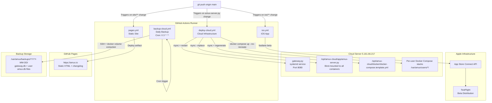
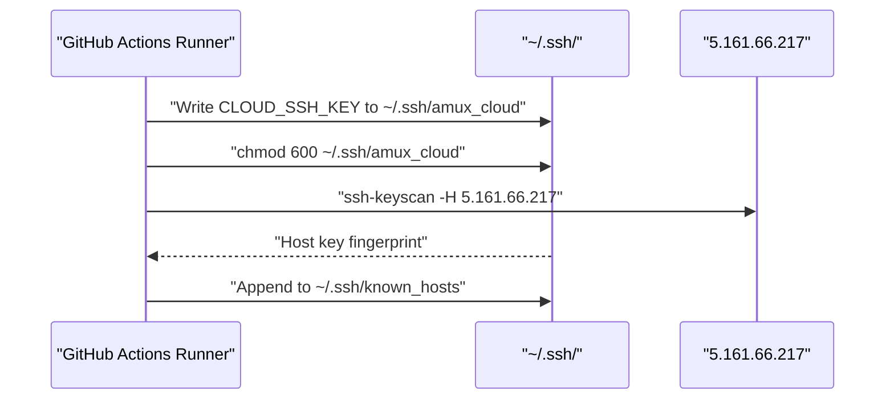
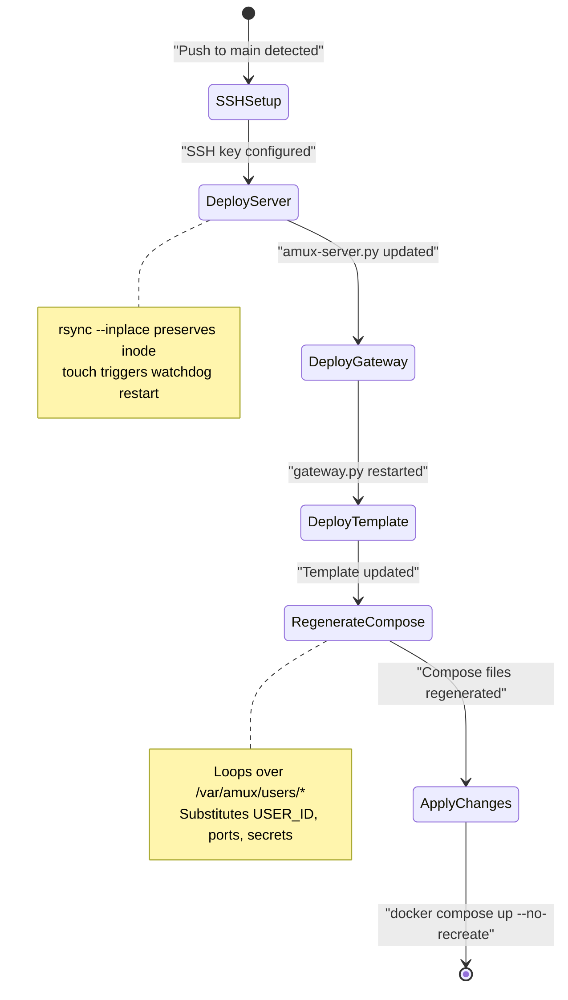
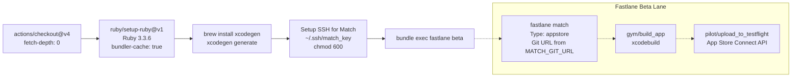
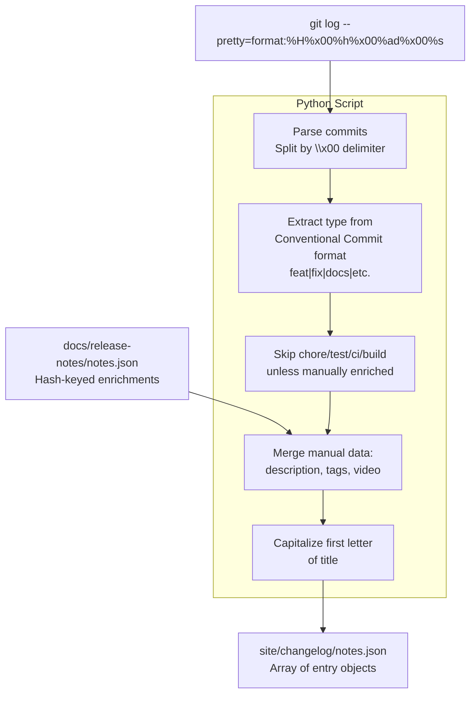
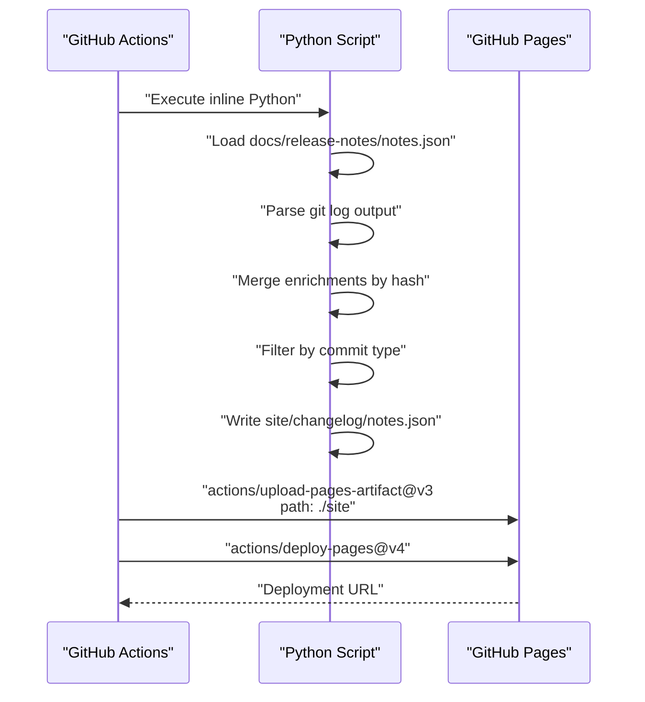
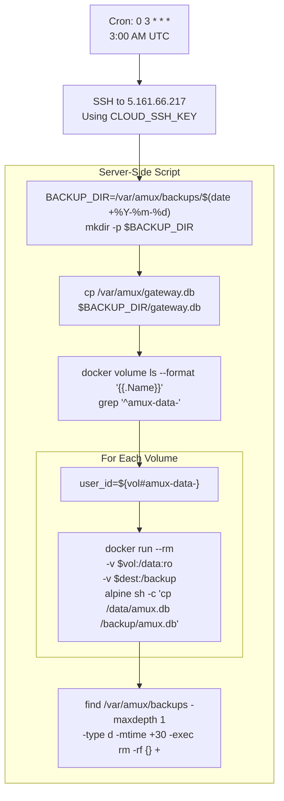
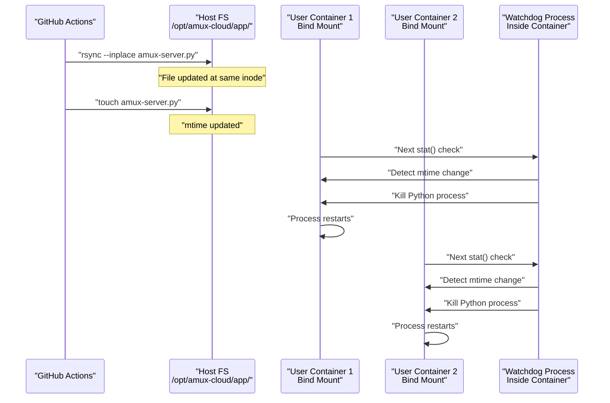

<!-- source: DeepWiki mcp.deepwiki.com · repo mixpeek/amux · page 10.4 CI/CD Pipelines · fetched 2026-10-26 -->

# CI/CD Pipelines

<details>
<summary>Relevant source files</summary>

The following files were used as context for generating this wiki page:

- [.github/workflows/backup-cloud.yml](.github/workflows/backup-cloud.yml)
- [.github/workflows/deploy-cloud.yml](.github/workflows/deploy-cloud.yml)
- [.github/workflows/ios.yml](.github/workflows/ios.yml)
- [.github/workflows/pages.yml](.github/workflows/pages.yml)
- [cloud/docker/docker-compose.template.yml](cloud/docker/docker-compose.template.yml)
- [ios/.ruby-version](ios/.ruby-version)
- [ios/Gemfile.lock](ios/Gemfile.lock)
- [ios/fastlane/Matchfile](ios/fastlane/Matchfile)
- [site/changelog/index.html](site/changelog/index.html)
- [site/changelog/notes.json](site/changelog/notes.json)
- [templates/README.md](templates/README.md)
- [templates/content-creator/CLAUDE.md](templates/content-creator/CLAUDE.md)
- [templates/content-creator/template.json](templates/content-creator/template.json)
- [templates/fitness-tracker/CLAUDE.md](templates/fitness-tracker/CLAUDE.md)

</details>


## Purpose and Scope

This document describes the automated deployment and backup pipelines for the amux system. It covers the four GitHub Actions workflows that handle continuous deployment to cloud infrastructure, iOS app distribution, static site publishing, and automated database backups. For information about the cloud infrastructure itself, see [Cloud Deployment](#4). For details about container orchestration, see [Container Lifecycle](#3.2).

---

## Pipeline Architecture Overview

The amux CI/CD system uses GitHub Actions to automate deployments across three targets and one backup workflow. All workflows are triggered on pushes to `main` and support manual dispatch.

### Workflow Topology



**Sources:** [.github/workflows/deploy-cloud.yml:1-69](), [.github/workflows/ios.yml:1-52](), [.github/workflows/pages.yml:1-111](), [.github/workflows/backup-cloud.yml:1-49]()

---

## Cloud Deployment Workflow

The `deploy-cloud.yml` workflow handles updates to the cloud infrastructure. It uses SSH and rsync to deploy changes to the live server at `5.161.66.217`.

### Trigger Conditions

```yaml
on:
  push:
    branches: [main]
    paths:
      - 'amux-server.py'
      - 'cloud/gateway/gateway.py'
      - 'cloud/docker/**'
  workflow_dispatch:
```

The workflow only runs when changes affect cloud infrastructure files, avoiding unnecessary deployments.

**Sources:** [.github/workflows/deploy-cloud.yml:3-10]()

### Deployment Steps

#### Step 1: SSH Setup



The workflow provisions SSH credentials from GitHub Secrets to authenticate with the cloud server. The key is written to `~/.ssh/amux_cloud` with restricted permissions.

**Sources:** [.github/workflows/deploy-cloud.yml:18-24]()

#### Step 2: Deploy amux-server.py (Zero-Downtime Update)

This is the most critical step. All user containers bind-mount the same `amux-server.py` file from `/opt/amux-cloud/app/amux-server.py`.

```bash
rsync --inplace -e "ssh -i ~/.ssh/amux_cloud" amux-server.py \
  root@5.161.66.217:/opt/amux-cloud/app/amux-server.py
```

The `--inplace` flag is critical—it overwrites the file at its existing inode rather than creating a new file and replacing it. This ensures that all Docker bind mounts continue to reference the updated file.

After the file is synced, the workflow triggers auto-restart by updating the file's mtime:

```bash
ssh -i ~/.ssh/amux_cloud root@5.161.66.217 \
  'touch /opt/amux-cloud/app/amux-server.py'
```

This causes the watchdog mechanism in each container to detect the change and restart the Python process.

**Sources:** [.github/workflows/deploy-cloud.yml:26-33]()

#### Step 3: Deploy gateway.py

```bash
rsync --inplace -e "ssh -i ~/.ssh/amux_cloud" cloud/gateway/gateway.py \
  root@5.161.66.217:/opt/amux-cloud/gateway/gateway.py

ssh -i ~/.ssh/amux_cloud root@5.161.66.217 \
  'systemctl restart amux-gateway'
```

The gateway is deployed with an immediate systemd service restart. Unlike user containers, the gateway has no state that needs to be preserved across restarts.

**Sources:** [.github/workflows/deploy-cloud.yml:35-40]()

#### Step 4: Deploy Docker Compose Template

```bash
rsync -e "ssh -i ~/.ssh/amux_cloud" cloud/docker/docker-compose.template.yml \
  root@5.161.66.217:/opt/amux-cloud/docker/docker-compose.template.yml
```

This updates the template used to generate per-user `docker-compose.yml` files.

**Sources:** [.github/workflows/deploy-cloud.yml:42-45]()

#### Step 5: Regenerate and Apply User Compose Files

This step regenerates each user's `docker-compose.yml` from the updated template, then applies changes without recreating containers:

```bash
source /etc/amux/gateway.env
R2_ENDPOINT="https://${CF_ACCOUNT_ID}.r2.cloudflarestorage.com"
TEMPLATE=/opt/amux-cloud/docker/docker-compose.template.yml

for user_dir in /var/amux/users/*/; do
  user_id=$(basename "$user_dir")
  compose_file="$user_dir/docker-compose.yml"
  port=$(grep -A1 "ports:" "$compose_file" | grep -oP "[0-9]{4,}(?=:8822)")
  
  sed "s/\${USER_ID}/${user_id}/g;
       s/\${USER_PORT}/${port}/g;
       s/\${CF_ACCOUNT_ID}/${CF_ACCOUNT_ID}/g;
       s|\${R2_ENDPOINT}|${R2_ENDPOINT}|g;
       s/\${R2_ACCESS_KEY}/${R2_ACCESS_KEY}/g;
       s/\${R2_SECRET_KEY}/${R2_SECRET_KEY}/g;
       s/\${ANTHROPIC_API_KEY}/${ANTHROPIC_API_KEY}/g" \
    "$TEMPLATE" > "$compose_file"
    
  cd "$user_dir" && docker compose up -d --no-recreate
done
```

The `--no-recreate` flag ensures that running containers are not stopped and restarted; only their configurations are updated. This is safe because the code update already happened via the bind mount.

**Sources:** [.github/workflows/deploy-cloud.yml:47-68]()

### Deployment Flow Diagram



**Sources:** [.github/workflows/deploy-cloud.yml:1-69]()

---

## iOS Deployment Workflow

The `ios.yml` workflow builds the iOS app and uploads it to TestFlight for beta testing. It uses fastlane and Match for code signing.

### Workflow Configuration

| Key | Value |
|-----|-------|
| Runner | `macos-latest` |
| Working Directory | `ios/` |
| Trigger Paths | `ios/**` |
| Ruby Version | `3.3.6` |

**Sources:** [.github/workflows/ios.yml:11-26](), [ios/.ruby-version:1]()

### Build Steps



**Sources:** [.github/workflows/ios.yml:17-51]()

### Code Signing with Match

The workflow uses fastlane Match to manage code signing certificates. Match stores certificates and provisioning profiles in a private Git repository specified by `MATCH_GIT_URL`.

SSH key setup for Match:

```bash
mkdir -p ~/.ssh
printf '%s\n' "$MATCH_SSH_KEY" > ~/.ssh/match_key
chmod 600 ~/.ssh/match_key
ssh-keyscan github.com >> ~/.ssh/known_hosts
git config --global core.sshCommand "ssh -i ~/.ssh/match_key"
```

Match configuration is defined in `ios/fastlane/Matchfile`:

```ruby
git_url ENV["MATCH_GIT_URL"] || "git@github.com:esteininger/amux-certs.git"
storage_mode "git"
type "appstore"
app_identifier "io.amux.app"
```

**Sources:** [.github/workflows/ios.yml:34-42](), [ios/fastlane/Matchfile:1-6]()

### Required Secrets

| Secret | Purpose |
|--------|---------|
| `MATCH_SSH_KEY` | SSH key for accessing the certificate Git repository |
| `MATCH_GIT_URL` | Git repository URL for certificates |
| `MATCH_PASSWORD` | Encryption password for certificates |
| `ASC_KEY_ID` | App Store Connect API key ID |
| `ASC_ISSUER_ID` | App Store Connect API issuer ID |
| `ASC_KEY_CONTENT` | App Store Connect API key content (base64) |

**Sources:** [.github/workflows/ios.yml:46-51]()

---

## Static Site Deployment Workflow

The `pages.yml` workflow generates the changelog from Git history and deploys the static site to GitHub Pages.

### Changelog Generation

The workflow generates `site/changelog/notes.json` by parsing Git commit history and merging it with manual enrichments from `docs/release-notes/notes.json`.

#### Changelog Generation Logic



The Python script embedded in the workflow:

- Parses commits with format `%H%x00%h%x00%ad%x00%s` (hash, short hash, date, subject)
- Extracts commit type using regex: `^(feat|fix|docs|...)(?:\([^)]+\))?!?:\s*`
- Skips low-signal types (`chore`, `test`, `ci`, etc.) unless the commit has manual enrichments
- Merges manual enrichments (tags, description, video) from `docs/release-notes/notes.json`
- Capitalizes the first letter of the title
- Outputs JSON array to `site/changelog/notes.json`

**Sources:** [.github/workflows/pages.yml:32-98]()

### Deployment Steps



**Sources:** [.github/workflows/pages.yml:100-110]()

### Example Changelog Entry

```json
{
  "hash": "2dc168121706eb9290b55f532803732f0a06aedf",
  "short": "2dc1681",
  "title": "Notes sidebar panel icons, offline save queuing, title sync",
  "date": "2026-03-04",
  "type": "feat",
  "tags": ["notes", "ui", "offline"],
  "description": "Replaced the text chevrons...",
  "video": "2dc1681.mp4"
}
```

**Sources:** [site/changelog/notes.json:2-11]()

---

## Backup Automation Workflow

The `backup-cloud.yml` workflow runs daily at 3:00 AM UTC to back up all user databases and the gateway database.

### Schedule Configuration

```yaml
on:
  schedule:
    - cron: '0 3 * * *'  # 3:00 AM UTC every day
  workflow_dispatch:
```

**Sources:** [.github/workflows/backup-cloud.yml:4-7]()

### Backup Procedure



The backup script uses a temporary Alpine container to read from each user's Docker volume. This is necessary because named volumes are not directly accessible from the host filesystem.

**Sources:** [.github/workflows/backup-cloud.yml:21-48]()

### Backup Structure

```
/var/amux/backups/
├── 2026-03-04/
│   ├── gateway.db
│   ├── user-abc123/
│   │   └── amux.db
│   ├── user-def456/
│   │   └── amux.db
│   └── user-xyz789/
│       └── amux.db
├── 2026-03-05/
│   └── ...
└── (backups older than 30 days are deleted)
```

**Sources:** [.github/workflows/backup-cloud.yml:25-47]()

---

## Zero-Downtime Deployment Mechanics

The core innovation in the amux deployment strategy is that all user containers share the same `amux-server.py` file via a read-only bind mount. This enables atomic updates across all users simultaneously.

### Bind Mount Configuration

Each user's Docker Compose file includes:

```yaml
volumes:
  - /opt/amux-cloud/app/amux-server.py:/app/amux-server.py:ro
```

All containers reference the same host file at `/opt/amux-cloud/app/amux-server.py`.

**Sources:** [cloud/docker/docker-compose.template.yml:12]()

### Update Sequence



**Why `--inplace` is critical:** Without `--inplace`, rsync creates a new file and then renames it, changing the inode. The Docker bind mount would still point to the old inode, leaving the old code running. With `--inplace`, the file content is updated at the existing inode, so all bind mounts immediately see the new code.

**Sources:** [.github/workflows/deploy-cloud.yml:28-33]()

---

## Secrets Management

All workflows use GitHub Secrets for sensitive credentials. Secrets are never committed to the repository.

### Required Secrets by Workflow

| Workflow | Secret Name | Purpose |
|----------|-------------|---------|
| `deploy-cloud.yml` | `CLOUD_SSH_KEY` | SSH private key for server access |
| `ios.yml` | `MATCH_SSH_KEY` | SSH key for certificate repository |
| `ios.yml` | `MATCH_GIT_URL` | Git URL for code signing certificates |
| `ios.yml` | `MATCH_PASSWORD` | Encryption password for certificates |
| `ios.yml` | `ASC_KEY_ID` | App Store Connect API key ID |
| `ios.yml` | `ASC_ISSUER_ID` | App Store Connect API issuer ID |
| `ios.yml` | `ASC_KEY_CONTENT` | App Store Connect API key content |
| `backup-cloud.yml` | `CLOUD_SSH_KEY` | SSH private key for server access |

Environment variables for cloud deployment (stored in `/etc/amux/gateway.env` on the server):

- `CF_ACCOUNT_ID` - Cloudflare account ID for R2
- `R2_ACCESS_KEY` - R2 access key
- `R2_SECRET_KEY` - R2 secret key
- `ANTHROPIC_API_KEY` - API key for Claude

**Sources:** [.github/workflows/deploy-cloud.yml:19-24](), [.github/workflows/ios.yml:46-51](), [.github/workflows/deploy-cloud.yml:50]()

---

## Workflow Execution Summary

| Workflow | Trigger | Frequency | Duration | Critical Path |
|----------|---------|-----------|----------|---------------|
| `deploy-cloud.yml` | Push to `main` (server files) | Per commit | ~2 min | SSH → rsync → regenerate compose |
| `ios.yml` | Push to `main` (`ios/**`) | Per commit | ~15 min | Match → Build → TestFlight upload |
| `pages.yml` | Push to `main` (`site/**`) | Per commit | ~1 min | Changelog gen → Pages deploy |
| `backup-cloud.yml` | Cron (3 AM UTC) | Daily | ~5 min | Extract volumes → Copy to backup dir |

**Sources:** [.github/workflows/deploy-cloud.yml:1-69](), [.github/workflows/ios.yml:1-52](), [.github/workflows/pages.yml:1-111](), [.github/workflows/backup-cloud.yml:1-49]()

---

