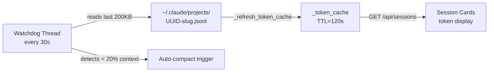
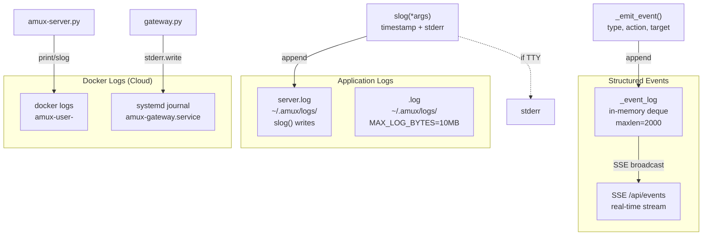
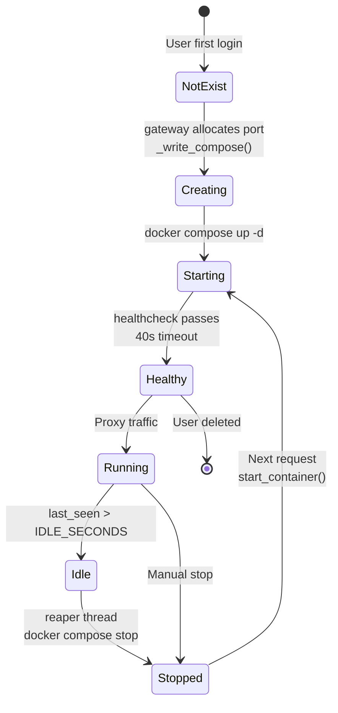
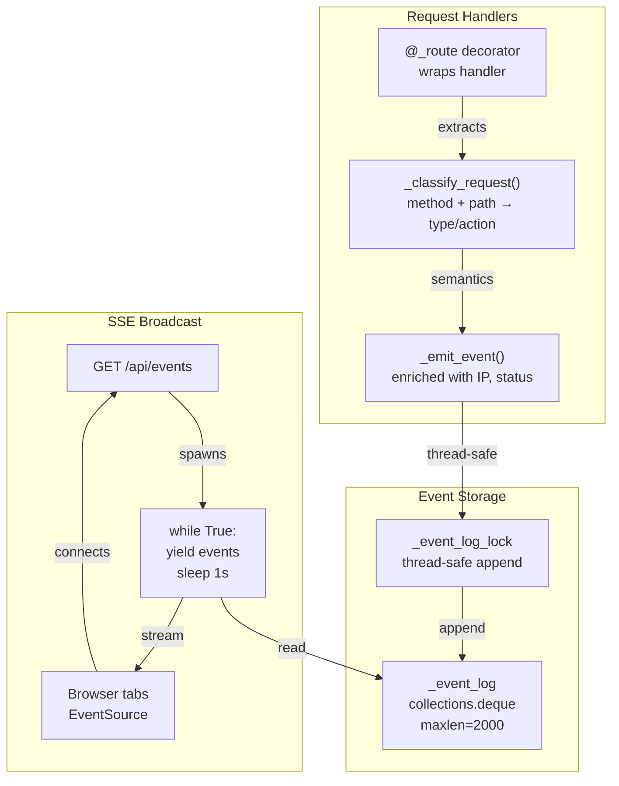
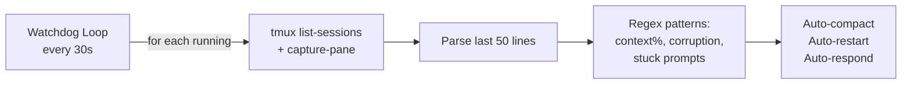
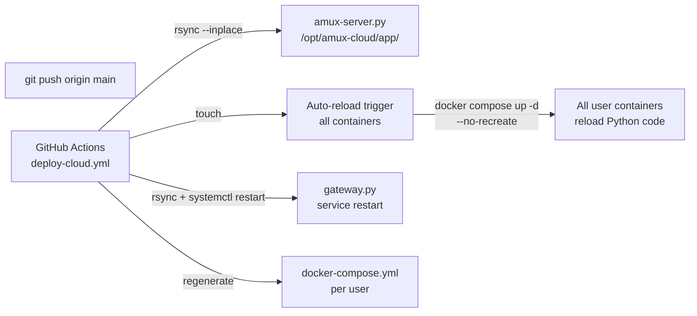

<!-- source: DeepWiki mcp.deepwiki.com · repo mixpeek/amux · page 11 Operations · fetched 2026-10-26 -->

# Operations

<details>
<summary>Relevant source files</summary>

The following files were used as context for generating this wiki page:

- [.github/workflows/backup-cloud.yml](.github/workflows/backup-cloud.yml)
- [.github/workflows/deploy-cloud.yml](.github/workflows/deploy-cloud.yml)
- [amux-server.py](amux-server.py)
- [cloud/docker/docker-compose.template.yml](cloud/docker/docker-compose.template.yml)
- [cloud/gateway/gateway.py](cloud/gateway/gateway.py)
- [templates/README.md](templates/README.md)
- [templates/content-creator/CLAUDE.md](templates/content-creator/CLAUDE.md)
- [templates/content-creator/template.json](templates/content-creator/template.json)
- [templates/fitness-tracker/CLAUDE.md](templates/fitness-tracker/CLAUDE.md)
- [test.mjs](test.mjs)

</details>


This document covers operational aspects of running amux in production, including health monitoring, resource management, log locations, container lifecycle, and event tracking. It focuses on day-to-day operational concerns for both local and cloud deployments.

For backup strategies and recovery procedures, see [Backup & Recovery](#11.2). For diagnosing and resolving issues, see [Troubleshooting](#11.3). For deployment automation and CI/CD pipelines, see [CI/CD Pipelines](#10.4).

---

## Deployment Modes

amux operates in two distinct modes, each with different operational characteristics:

| Aspect | Local OSS | Cloud (cloud.amux.io) |
|--------|-----------|------------------------|
| **Orchestration** | Manual (`./amux serve`) | Automated (gateway.py + systemd) |
| **Process Model** | Single Python process | Per-user Docker containers |
| **Health Checks** | None (rely on process exit) | Docker healthcheck + gateway polling |
| **Logs** | `~/.amux/logs/server.log` | Docker logs + per-container stderr |
| **Persistence** | Local filesystem | Named volumes + R2/S3 replication |
| **Resource Limits** | System-wide (shared) | Per-container (isolated) |
| **Idle Management** | None | Gateway reaper thread (1h timeout) |
| **Updates** | Manual (git pull + restart) | CI/CD (bind mount + auto-reload) |

**Sources:** [amux-server.py:1-96](), [cloud/gateway/gateway.py:1-50](), [cloud/docker/docker-compose.template.yml:1-71]()

---

## Health Monitoring Architecture

```mermaid
graph TB
    subgraph "Local Deployment"
        LocalProc["amux-server.py<br/>process"]
        LocalLog["~/.amux/logs/server.log"]
        LocalProc -->|slog() writes| LocalLog
    end
    
    subgraph "Cloud Gateway"
        Gateway["gateway.py<br/>Port 8080"]
        GatewayDB[("gateway.db<br/>last_seen timestamps")]
        HealthLoop["Health Check Loop<br/>every 60s"]
        IdleReaper["Idle Reaper Thread<br/>IDLE_SECONDS=3600"]
    end
    
    subgraph "User Container Stack"
        AmuxContainer["amux container<br/>healthcheck every 5s"]
        AmuxServer["amux-server.py<br/>Port 8822"]
        ContainerDB[("amux.db")]
        
        AmuxContainer -->|curl /api/sessions| AmuxServer
        AmuxServer -->|queries| ContainerDB
    end
    
    Gateway -->|proxy requests| AmuxContainer
    Gateway -->|update last_seen| GatewayDB
    HealthLoop -->|docker inspect| AmuxContainer
    IdleReaper -->|check last_seen<br/>docker compose stop| GatewayDB
    
    AmuxServer -->|event emission| SSEClients["SSE /api/events<br/>clients"]
    AmuxServer -->|_emit_event| EventRingBuffer["_event_log<br/>deque maxlen=2000"]
```

**Health Check Endpoints:**
- **Container Health:** `GET /api/sessions` (must return 200 within 3s)
- **Gateway Proxy:** Requests update `users.last_seen` timestamp
- **Idle Detection:** Last activity > `IDLE_SECONDS` triggers container stop

**Sources:** [cloud/docker/docker-compose.template.yml:22-27](), [cloud/gateway/gateway.py:376-393](), [cloud/gateway/gateway.py:419-437](), [amux-server.py:104-128]()

---

## Resource Tracking

### Token Monitoring

amux tracks Claude API token usage per session by parsing JSONL files from `~/.claude/projects/`:



**Token Cache Structure:**
```python
_token_cache = {
    "data": {"/path/to/project": total_tokens},
    "timestamps": {"/path/to/project": last_activity_unix},
    "time": cache_refresh_time
}
```

**Context Exhaustion Detection:**
- Watchdog reads `usage.input_tokens`, `usage.cache_read_input_tokens`, `usage.output_tokens`
- Calculates percentage: `(tokens_used / model_limit) * 100`
- Auto-compacts when < 20% remaining (configurable via `LOW_CONTEXT_THRESHOLD`)

**Sources:** [amux-server.py:786-887](), [amux-server.py:1445-1547]()

---

### Memory and Disk Usage

| Resource | Location | Typical Size | Cleanup Strategy |
|----------|----------|--------------|------------------|
| **Session Logs** | `~/.amux/logs/<session>.log` | 10 MB limit/session | Rotated on overflow |
| **Claude JSONL** | `~/.claude/projects/*.jsonl` | 50-500 KB/session | Deleted on session archive |
| **Board DB** | `~/.amux/amux.db` | < 1 MB | Soft deletes (tombstones) |
| **Uploads** | `~/.amux/uploads/` | User-controlled | Manual cleanup |
| **Browser Videos** | `~/.amux/recordings/` | 10-50 MB/recording | Manual cleanup |
| **Server Log** | `~/.amux/logs/server.log` | Unbounded | Manual rotation |

**Disk Usage Example (Cloud Container):**
```bash
# Typical amux-data-<user_id> volume breakdown:
~/.amux/amux.db           ~500 KB    # SQLite database
~/.amux/logs/             ~5 MB      # Session logs
~/.amux/uploads/          varies     # User uploads
~/.amux/sessions/         ~50 KB     # Session configs
~/.claude/projects/       ~10 MB     # Claude conversation history
```

**Sources:** [amux-server.py:49-78](), [amux-server.py:59]()

---

## Log Management

### Log Hierarchy



**Log Functions:**

| Function | Purpose | Format | Location |
|----------|---------|--------|----------|
| `slog()` | Timestamped server events | `YYYY-MM-DD HH:MM:SS <msg>` | server.log + stderr |
| `_emit_event()` | Structured semantic events | JSON dict | in-memory ring buffer |
| `_log_session_output()` | Per-session terminal capture | Raw text | `<session>.log` |

**Event Types:**
```python
# Semantic event classification from _classify_request()
("session", "started", session_name, session_name)
("session", "stopped", session_name, session_name)
("session", "message-sent", session_name, session_name)
("board", "created", issue_id, "")
("board", "claimed", issue_id, "")
("memory", "updated", target, session_name)
("http", "get", path, "")
```

**Sources:** [amux-server.py:78-95](), [amux-server.py:104-186](), [cloud/gateway/gateway.py:461-464]()

---

## Container Lifecycle (Cloud)

### State Machine



**Gateway Orchestration Functions:**

| Function | Trigger | Action |
|----------|---------|--------|
| `start_container()` | First request or wake | Restore R2 files → `docker compose up -d` → wait healthy |
| `stop_container()` | Idle timeout or manual | `docker compose stop` (preserves volumes) |
| `_restore_user_files()` | Every startup | `aws s3 sync` from R2 to named volume |
| `_reaper()` | Loop every 60s | Query `last_seen`, stop idle free-plan containers |

**Healthcheck Configuration:**
```yaml
healthcheck:
  test: ["CMD", "curl", "-f", "http://localhost:8822/api/sessions"]
  interval: 5s        # Check every 5 seconds
  timeout: 3s         # Fail if no response in 3s
  retries: 6          # Allow 6 failures before unhealthy
  start_period: 10s   # Grace period on startup
```

**Sources:** [cloud/gateway/gateway.py:233-276](), [cloud/gateway/gateway.py:376-393](), [cloud/docker/docker-compose.template.yml:22-27]()

---

## Event Streaming System

### Event Flow



**Event Structure:**
```python
{
    "ts": 1735689600.123,          # Unix timestamp (float)
    "type": "session",             # semantic category
    "action": "message-sent",      # what happened
    "target": "api-dev",           # affected resource
    "session": "api-dev",          # related session (if any)
    "detail": "",                  # human-readable context
    "status": 200,                 # HTTP status code
    "ip": "192.168.1.100"          # client IP (gateway adds)
}
```

**Event Types and Actions:**

| Type | Actions | Use Case |
|------|---------|----------|
| `session` | created, started, stopped, message-sent, archived | Session lifecycle tracking |
| `board` | created, claimed, updated, deleted, cleared | Task management activity |
| `memory` | updated | Context modifications |
| `file` | uploaded | File operations |
| `system` | pull | Repository updates |
| `http` | get, post, patch, delete | Fallback for uncategorized requests |

**Sources:** [amux-server.py:104-186](), [amux-server.py:2196-2225]()

---

## Performance Characteristics

### Request Latencies

| Endpoint | Typical Latency | Notes |
|----------|-----------------|-------|
| `GET /api/sessions` | 50-200 ms | Spawns subprocess per session for status check |
| `GET /api/board` | 5-20 ms | SQLite query, cached for 2s in SSE context |
| `POST /api/sessions/<name>/send` | 100-300 ms | `tmux send-keys` subprocess + JSONL append |
| `GET /api/sessions/<name>/peek` | 200-500 ms | `tmux capture-pane` + read last N lines |
| `GET /api/events` (SSE) | 1s intervals | Streaming, no timeout |

**Gateway Proxy Overhead:** +10-50 ms per request (HTTP round-trip to container)

**Sources:** [amux-server.py:1223-1320](), [amux-server.py:1681-1735]()

---

### Watchdog Thread Performance

The watchdog runs every 30 seconds and performs these operations per session:



**Watchdog Overhead:**
- ~100-200 ms per running session (subprocess spawn + capture)
- Typical deployment: 5-10 active sessions = 0.5-2s total per cycle
- Does not block request handling (runs in background thread)

**Sources:** [amux-server.py:1445-1547]()

---

## Operational Checklist

### Pre-Deployment

**Local OSS:**
- [ ] Python 3.11+ installed
- [ ] `tmux` available in PATH
- [ ] `~/.amux/` writable
- [ ] Port 8822 available (or set `AMUX_PORT`)
- [ ] `ANTHROPIC_API_KEY` in environment or `~/.amux/server.env`

**Cloud:**
- [ ] Gateway systemd service running: `systemctl status amux-gateway`
- [ ] Docker daemon running: `docker ps`
- [ ] Litestream credentials in `/etc/amux/gateway.env`
- [ ] R2 bucket accessible: `aws s3 ls s3://amux-cloud-users --endpoint-url <R2>`
- [ ] Clerk keys valid: `echo $CLERK_PUBLISHABLE_KEY`

**Sources:** [cloud/gateway/gateway.py:11-29](), [amux-server.py:36-48]()

---

### Daily Operations

**Monitor Container Health:**
```bash
# List all user containers and their status
docker ps -a --filter "name=amux-user-" --format "table {{.Names}}\t{{.Status}}\t{{.Ports}}"

# Check specific user's health
docker inspect -f '{{.State.Health.Status}}' amux-user-<id>

# View recent container logs
docker logs --tail 100 amux-user-<id>
```

**Check Gateway Activity:**
```bash
# Gateway service status
systemctl status amux-gateway

# Recent gateway logs (last 50 lines)
journalctl -u amux-gateway -n 50 --no-pager

# Active user connections (last_seen in last 5 min)
sqlite3 /var/amux/gateway.db "SELECT email, datetime(last_seen, 'unixepoch') FROM users WHERE last_seen > $(date +%s)-300"
```

**Monitor Resource Usage:**
```bash
# Disk usage by container
docker system df -v | grep amux-data

# Token usage from cache (requires amux API)
curl -k https://localhost:8822/api/sessions | jq '.[] | {name, tokens, context_pct}'

# Check for low-disk warnings
df -h /var/amux/users
```

**Sources:** [cloud/gateway/gateway.py:162-201](), [cloud/docker/docker-compose.template.yml:1-71]()

---

### CI/CD Integration

**Automated Deployment (GitHub Actions):**



**Deployment Commands:**
```bash
# Server code update (preserves bind mount inode)
rsync --inplace amux-server.py root@5.161.66.217:/opt/amux-cloud/app/
touch /opt/amux-cloud/app/amux-server.py  # Trigger auto-reload

# Gateway restart (zero-downtime via systemd)
systemctl restart amux-gateway

# Apply compose template changes
for dir in /var/amux/users/*/; do
    cd "$dir" && docker compose up -d --no-recreate
done
```

**Sources:** [.github/workflows/deploy-cloud.yml:1-69]()

---

### Backup Verification

**Daily Backup Job (3 AM UTC):**

```bash
# Check last backup timestamp
ls -lh /var/amux/backups/ | tail -5

# Verify backup contents
LATEST=$(ls -t /var/amux/backups/ | head -1)
ls -lh "/var/amux/backups/$LATEST/"

# Count backed-up user databases
find /var/amux/backups/$LATEST/ -name "amux.db" | wc -l
```

**Litestream Replication Check:**
```bash
# List replicated databases in R2
aws s3 ls s3://amux-cloud-users/users/ \
    --endpoint-url https://<account>.r2.cloudflarestorage.com \
    --recursive | grep "litestream/"

# Check replication lag (should be < 5 minutes)
docker exec amux-litestream-<user_id> litestream wal list /root/.amux/amux.db
```

**Sources:** [.github/workflows/backup-cloud.yml:1-49](), [cloud/docker/docker-compose.template.yml:29-43]()

---

## Service Dependencies

### Critical Services (Cloud)

| Service | Type | Failure Impact | Recovery |
|---------|------|----------------|----------|
| **amux-gateway** | systemd | No new sessions, existing proxied | `systemctl restart amux-gateway` |
| **Docker daemon** | systemd | All containers stop | `systemctl start docker` |
| **Litestream** | container | No DB replication, data loss risk | `docker compose up -d` in user dir |
| **Clerk API** | external | Auth fails, no new logins | Wait for Clerk recovery |
| **R2/S3** | external | Backup/restore fails, sessions work | Check Cloudflare status |
| **Anthropic API** | external | Claude requests fail in sessions | Users see API errors |

### Dependency Health Checks

**Gateway to User Container:**
```python
# Gateway health check (every 60s)
def container_healthy(user_id):
    r = subprocess.run(
        ["docker", "inspect", "-f", "{{.State.Health.Status}}", f"amux-user-{user_id}"],
        capture_output=True, text=True)
    return r.stdout.strip() == "healthy"
```

**User Container to amux-server:**
```yaml
# Docker healthcheck (every 5s)
test: ["CMD", "curl", "-f", "http://localhost:8822/api/sessions"]
```

**Sources:** [cloud/gateway/gateway.py:239-243](), [cloud/docker/docker-compose.template.yml:22-27]()

---

## Security Considerations

### Log Sanitization

**Sensitive Data in Logs:**
- API keys: Never logged by `slog()` or `_emit_event()`
- User emails: Logged in gateway for audit, redacted in public logs
- Session content: Terminal output stored in per-session logs (user-readable only)
- JWT tokens: Verification happens, token itself never logged

**Log Access Control:**
```bash
# Local: only user who runs amux-server.py
ls -la ~/.amux/logs/
# -rw-r--r-- server.log (world-readable)
# -rw-r--r-- <session>.log (world-readable)

# Cloud: only root can access container volumes
docker run --rm -v amux-data-<user_id>:/data alpine ls -la /data/logs/
# drwxr-xr-x logs/
```

**Sources:** [amux-server.py:81-95](), [cloud/gateway/gateway.py:406-408]()

---

## Alerting (Manual)

amux does not include built-in alerting. Operators should implement external monitoring:

**Recommended Alerts:**

| Metric | Threshold | Check Method |
|--------|-----------|--------------|
| Gateway down | Process not running | `systemctl is-active amux-gateway` |
| Container unhealthy | Health status != healthy | `docker inspect -f '{{.State.Health.Status}}'` |
| Disk usage | > 80% full | `df -h /var/amux/users` |
| Failed backups | No new backup in 2 days | `ls -t /var/amux/backups/ \| head -1` |
| High token usage | Context < 10% remaining | Parse `/api/sessions` JSON |

**Example: Cron-based disk alert**
```bash
#!/bin/bash
# /etc/cron.daily/amux-disk-check
USED=$(df /var/amux/users | tail -1 | awk '{print $5}' | sed 's/%//')
if [ "$USED" -gt 80 ]; then
    echo "amux disk usage: ${USED}%" | mail -s "ALERT: amux disk" ops@example.com
fi
```

**Sources:** None (recommended external tooling)

---

